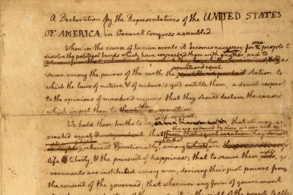

# A Brief History of the To-Do List and the Psychology of Its Success

## On reconciling the fussy with the fuzzy, or what Benjamin Franklin has to do with Drew Carey.

### By Maria Popova

“The list is the origin of culture,” Umberto Eco [famously proclaimed](https://www.brainpickings.org/2011/12/22/umberto-eco-on-lists/). ([Leonardo da Vinci](https://www.brainpickings.org/2012/02/08/da-vincis-ghost/#todolist), [John Lennon](https://www.brainpickings.org/2011/11/24/john-lennon-to-do-list/), and [Woody Guthrie](https://www.brainpickings.org/2011/12/27/woody-guthrie-1942-resolutions-list/) would have all agreed.) But the list, it turns out, might also be the origin of both our highest happiness and our dreariest dissatisfaction. So argue *New York Times* science writer **John Tierney** and psychologist **Roy F. Baumeister** in [***Willpower: Rediscovering the Greatest Human Strength***](https://www.amazon.com/dp/1594203075/ref=as_li_ss_til?tag=braipick-20&camp=0&creative=0&linkCode=as4&creativeASIN=1594203075&adid=1PQD66APK8D6WR3RJQDZ&). While the book is fascinating in general — an unconventional “self-help” tome that, much like Timothy Wilson’s [*Redirect*](https://www.brainpickings.org/2011/09/09/redirect-timothy-wilson/), grounds its insights and advice in thirty years of serious academic research into willfulness and self-control — its third chapter, titled “A Brief History of the To-Do List, From God to Drew Carey,” is particularly interesting. In it, Tierney and Baumeister dissect the sociocultural anatomy of our favorite organizational tool, from the storytellers who crafted the Bible and wrote the Genesis myth with its six-step world-creation plan, to Benjamin Franklin’s fastidious pursuit of virtue bound by goal-setting lists, to comedian Drew Carey’s quest for supreme personal productivity.

These anecdotes and pieces of cultural mythology are interwoven with ample psychology experiments from the past century and, ultimately, distilled into insight on how to make the to-list a tool of fulfillment rather than frustration.

One of Benjamin Franklin’s calendar-checklists of virtues, marking how he performed at his thirteen virtues: temperance, silence, order, resolution, frugality, industry, sincerity, justice, moderation, cleanliness, tranquility, chastity, and humility.

Franklin, for instance, demonstrated one of the greatest pitfalls of the to-do list: trying to do too much at once, letting different goals come into conflict with one another:

> Franklin tried a divide-and-conquer approach. He drew up a list of virtues and wrote a brief goal for each one, like this one for Order: ‘Let all your things have their places; let each part of your business have its time.’
>
> When, as a young journeyman printer, he tried to practice Order by drawing up a rigid daily work schedule, he kept getting interrupted by unexpected demands from his clients — and Industry required him to ignore the schedule and meet with them. If he practiced Frugality (‘Waste nothing’) by always mending his own clothes and preparing all his own meals, there’d be less time available for Industry at his job — or for side projects like flying a kite in a thunderstorm or editing the Declaration of Independence. If he promised to spend an evening with his friends but then fell behind his schedule for work, he’d have to make a choice that would violate his virtue of Resolution: ‘Perform without fail what you resolve.'”

The result of conflicting goals, the authors argue, is unhappiness instead of action. But deciding on the right goals can be a daunting task.

Tierney and Baumeister recount a revealing experiment: When a psychologist was invited to give a talk at the Pentagon on managing time and resources, he decided to warm up the elite group of generals with a short writing exercise. He asked them all to write a summary of their strategic approach limited to 25 words.

> The exercise stumped most of them. None of the distinguished men in uniform could come up with anything.
>
> The only general who managed a response was the lone woman in the room. She had already had a distinguished career, having worked her way up through the ranks and been wounded in combat in Iraq. Her summary of her approach was as follows: ‘First I make a list of priorities: one, two, three, and so on. Then I cross out everything from three down.'”

Unscrupulous, perhaps, but the authors argue this is a simple version of an important to-do list strategy for reconciling the long-term with the short-term, or “the fussy with the fuzzy.”

Comedian **Drew Carey** took a different approach to mastering his to-do list — he outsourced his strategy to productivity guru David Allen, author of the cultish, modern Bible [*Getting Things Done: The Art of Stress-Free Productivity*](https://www.amazon.com/dp/0142000280/ref=as_li_ss_til?tag=braipick-20&camp=0&creative=0&linkCode=as4&creativeASIN=0142000280&adid=1MJGDJ40XHPHG7P7JFEV&), who taught him how to adhere to specific next steps rather than abstract larger goals. The latter loom in the back of our mind like a nagging mother, never fully silenced until specific actionable steps are taken.

In fact, our brain appears to be wired to nag about unfinished to-do list items as uncompleted tasks and unmet goals continue to pop up into our minds. This is called the [Zeigarnik effect](http://www.psychwiki.com/wiki/Zeigarnik_Effect) and explains phenomena like earworms — when you hear only a portion of song, the song is likely to run through your mind at odd intervals as your brain struggles to finish it. Originally, the Zeigarnik effect was believed to be the brain’s way of ensuring goals are eventually accomplished, by prodding you into urgency until they are. But recent research has shed new light on the relationship between the conscious and the unconscious in our cognitive to-do lists.

> [It] turns out that the Zeigarnik effect is not, as was assumed for decades, a reminder that continues unabated until the task gets done. The persistence of distracting thoughts is not an indication that the unconscious is working to finish the task. Nor is it the unconscious nagging the conscious mind to finish the task right away. Instead, the unconscious is asking the conscious mind to *make a plan*. The unconscious mind apparently can’t do this on its own, so it nags the conscious mind to make a plan with specifics like time, place, and opportunity. Once the plan is formed, the unconscious can stop nagging the conscious mind with reminders.”

The moral, then? Unless you are [Woody Guthrie](https://www.brainpickings.org/2011/12/27/woody-guthrie-1942-resolutions-list/), keep your to-do list to a few very specific, actionable, non-conflicting items, then go fly your kite in peace.
