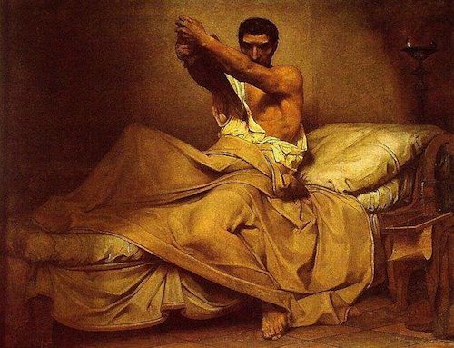

# Stoicism for Modern Stresses: 5 Lessons from Cato

[102 Comments](http://fourhourworkweek.com/2012/10/09/stoicism-for-modern-stresses-5-lessons-from-cato/#comments)

Written by Tim Ferriss
Topics: [Practical Philosophy](http://fourhourworkweek.com/category/practical-philosophy/)

The philosophical school of Stoicism is, I believe, the perfect operating system for thriving in high-stress environments. For entrepreneurs, it’s a godsend.

Both Seneca and Marcus Aurelius have been extensively written about elsewhere. But what of Cato, about whom Dante said, “And what earthly man was more worthy to signify God than Cato?”

One of my favorite anecdotes of Cato is from Plutarch. I quote it often (see “[Practical Pessimism](http://www.fourhourworkweek.com/blog/2009/06/10/the-practicality-of-pessimism-stoicism-as-a-productivity-system/)“):

> “Seeing the lightest and gayest purple was then most in fashion, he would always wear that which was the nearest black; and he would often go out of doors, after his morning meal, without either shoes or tunic; not that he sought vain-glory from such novelties, but he would accustom himself to be ashamed only of what deserves shame, and to despise all other sorts of disgrace.”

The following article was written by Rob Goodman and Jimmy Soni. At age 22, Rob Goodman became the speechwriter for Senator Chris Dodd, and then moved on to be the speechwriter for House Majority Leader Steny Hoyer. At age 26, Jimmy became the youngest-ever Managing Editor of the Huffington Post, reporting directly to Arianna Huffington to help oversee a global, 24/7 newsroom.

Both exemplify the power of Stoicism when applied to a world of modern noise.

Below are the five practical lessons they’ve distilled from Cato’s incredible career and legacy.

### Enter Rob and Jimmy

Julius Caesar wanted to end him. George Washington wanted to be him. And for two thousand years, he was a singular subject of plays, poetry, and paintings, with admirers as diverse as Benjamin Franklin, the poet Dante, and the Stoic emperor Marcus Aurelius.

Yet, for all that, you’ve probably never heard of him…

We’ve spent the last few years excavating the life, times, and legacy of [Marcus Porcius Cato the Younger](http://www.amazon.com/Romes-Last-Citizen-Legacy-Mortal/dp/0312681232), better known to the world simply as Cato. He was the senator who led the opposition to Julius Caesar in the last years of the Roman Republic, then killed himself rather than live under a dictator. He brought [Stoicism](http://www.fourhourworkweek.com/blog/2009/04/13/stoicism-101-a-practical-guide-for-entrepreneurs/) into the mainstream. The Founding Fathers resurrected him as a symbol of resistance to tyranny. George Washington even put on a play about him in the bitter winter at Valley Forge.

Why does he matter today? Because at a time of crisis and calamity in Rome, Cato’s mission was to live life on his own terms, even (and sometimes especially) when those terms put him at odds with everyone around him.

Cato reminds us that there’s a thin line between visionaries and fools–a lesson especially important to entrepreneurs, authors, creative-types, or really anyone doing work that goes against the grain.

He remains both a shining example and a cautionary tale. Here are five lessons he can teach us about reputation, authority, fear, discipline, and legacies:

**1) Master the power of gestures.**  
We talk about our times as the age of information overload, but public figures in all ages have had to compete to be heard. Ancient Rome was saturated with political talk: popular lawyers like Cicero consistently drew huge crowds, and the Roman people could regularly hear all-day parades of political speeches in the Forum. How could someone break through all that noise?

Cato understood that actions are far easier to “hear” than words. So he perfected a style of politics-by-gesture. He went barefoot. He wore his toga commando (then, as now, not the fashionable thing to do). He walked alone without the usual entourage of aides. He slept in the trenches with his troops rather than relax in a tent; he marched alongside them rather than ride a horse. He surrounded himself with philosophers, not political advisors. Just a second’s glance at him told an onlooker everything he needed to know about Cato. Those gestures, more than any vote cast or speech given, made his reputation.

*[TIM: Not unlike Gandhi’s [1930 Salt March](http://en.wikipedia.org/wiki/Salt_March).]*

Even his death at the end of Rome’s civil war was a statement against his enemies. One night, he retired to his room after dinner, and loudly called for a book—Plato’s dialogue Phaedo—*and his sword*. The Phaedo tells the story of the death of Socrates, a philosopher too principled to live, forced to drink poison by the political authorities. Cato wanted everyone to see the parallels. Then he gritted his teeth and disemboweled himself.

To this day, his gesture against tyranny speaks as loud as any book or speech on the subject.

**2) Don’t compromise—ever.**  
The Stoics taught Cato that there were no shades of gray. There was no more-or-less good, no more-or-less bad. Whether you were a foot underwater or a fathom, you were still drowning. All virtues were one and the same virtue, all vices the same vice.

It is the kind of austere scheme that seems unreasonable to live by and almost entirely impossible for the flux of war and politics. But Cato made it work. He refused political compromise in every form, to the point that bribe-takers turned his name into an aphorism: “What do you expect of us? We can’t all be Catos.”

He demanded the same of his friends, his family, and his soldiers. He was infuriating to his enemies, and he could seem crazy to his allies. And yes, sometimes he took his adherence to principle down absurd, blind alleys. But he also built an impossible, almost inhuman standard that brought him unshakable authority. By default, he became Rome’s arbiter of right and wrong. When Cato spoke, people sat up straighter. When he was carted off to jail by Julius Caesar, the entire Senate joined him in sympathy, forcing Caesar to let Cato go.

Many in Cato’s day spent their fortunes and slaughtered armies in pursuit of that kind of authority. But it can’t be bought or fought for—it’s the charisma of character. His countrymen couldn’t all be Catos, but they could join whichever uncompromising side of the argument Cato was on.

**3) Fear nothing.**  
On election day during a consequential race, Cato and his brother-in-law rose before dawn and set off for the polls. Both were on the record against the front-runners, men bearing grudges (and armies) against Cato.

They were ambushed. The torchbearer at the head of Cato’s party collapsed with a groan—stabbed to death. The light clattered to the pavement, and they were surrounded by shadows swinging swords. The assailants wounded each member of the party until all had fled but Cato and his brother-in-law. They held their ground, Cato gripping a wound that poured blood from his arm.

Their attackers were under orders to maim and frighten them, not to kill. The message sent, they fled through the streets. Cato and his brother-in-law were alone in the dark.

For Cato, the ambush was a reminder that if the front-runners were willing to perpetrate such crimes on the way to power, then one could only imagine what they would do once they arrived. It was all the more important that he stand in front of the Roman people, show off his wounds, and announce that he would stand for liberty as long as he had life in him. But his brother-in-law didn’t have the stomach for it. He apologized, left, and barricaded himself inside his home.

Cato, meanwhile, walked unguarded and alone to the polls.

Fear can only enter the mind with our consent, Cato had been taught. Choose not to be afraid, and fear simply vanishes. To the untrained observer, Cato’s physical courage was reckless. But in fact, it was among the most practiced aspects of Cato’s self-presentation. And it was this long meditation on the absurdity of fear—on its near-total insignificance but for our own belief in it—that enabled him to press forward where others gave in.

**4) Use pain as a teacher.**  
Cato’s early Stoic training was as hard and uncompromising as he hoped to become. He walked around Rome in unusual clothing with the goal of getting people to laugh at him. He learned to subsist on a poor man’s rations. He went barefoot and bareheaded in heat and rain. He learned how to endure sickness in perfect silence.

What was the point? Pain and difficulty could build endurance and self-control. Cato was drilling himself to become indifferent to all things outside the magic circle of the conscience. He could be ridiculed, starving, poor, cold, hot, sick—and none of it would matter. As the Stoic philosopher Epictetus taught: “Where is the good? In the will. Where is the evil? In the will.”

All of Cato’s practice paid off. [Seneca](http://www.fourhourworkweek.com/blog/2009/04/24/on-the-shortness-of-life-an-introduction-to-seneca/), the great imperial Stoic, relates a telling story. Visiting the public baths one day, Cato was shoved and struck. Once the fight was broken up, he simply refused to accept an apology from the offender: “I don’t even remember being hit.”

**5) Don’t expect to control your legacy.**  
No one in Rome was more skilled at building a public image than Cato. And yet, for all of his best efforts, at the moment he died he became the property of other people. Cato spent two decades as a politician. He has spent two millennia as a political object.

Would Cato have approved of being publicly humiliated by Caesar after his death, paraded through Rome’s forum on a billboard depicting his grisly suicide? Would Cato have approved of being cast as the star of an Italian opera, complete with a romantic subplot? Would Cato have approved of being turned by the Founding Fathers into a symbol of American democracy?

Who knows? Our guess is that Cato, irascible as he was, wouldn’t have liked any of it—because, at each step, Cato has been made to serve values and cultures almost totally alien to him, ones he never could have imagined. But that’s what you get when you’re dead—*if you’re lucky*. That’s what all of this vaunted “immortal fame” looks like.

Cato’s Stoicism told him that everything we value—our wealth, our health, our success, our reputations, essentially everything not between our two ears—is ultimately beyond our control. Even if you live such an exemplary life that people are writing books about you 2,000 years after you’re in the ground, you probably wouldn’t be happy about it, and in any case, you’d still be dead. Which proves better than anything what the Stoics taught: the only reward for virtue is virtue.

### Conclusion

Cato didn’t have Caesar’s military skill, or Cicero’s eloquence, or Pompey’s boyish good looks. But he had something even more formidable: a determination to hold himself, and those around him, to an insanely high standard. He asked to be measured by a standard higher than winning and losing in Roman politics, and that’s why he still matters long after ancient Rome went to ruins. We should remember Washington’s favorite line from the Cato play at Valley Forge:

“‘Tis not in mortals to *command* success; but we’ll do more…we’ll *deserve* it.”

Rob and Jimmy’s new book, [Rome’s Last Citizen: The Life and Legacy of Cato, Mortal Enemy of Caesar](http://www.amazon.com/gp/product/0312681232/ref=as_li_ss_tl?ie=UTF8&camp=1789&creative=390957&creativeASIN=0312681232&linkCode=as2&tag=offsitoftimfe-20), is effectively the first-ever modern biography of Cato. The writing is excellent, the stories unforgettable, and the lessons practical. IF you’ve enjoyed my [previous writing on Stoicism or Seneca](https://www.google.com/search?q=stoicism&sitesearch=fourhourworkweek.com), you will enjoy this book.

*Posted on: October 9, 2012.*

Watch [The Tim Ferriss Experiment](http://fourhourworkweek.com/tv/), the new #1-rated TV show with "the world's best human guinea pig" (Newsweek), Tim Ferriss. It's Mythbusters meets Jackass. Shot and edited by the Emmy-award winning team behind Anthony Bourdain's No Reservations and Parts Unknown. [Here's the trailer](http://fourhourworkweek.com/tv/).
