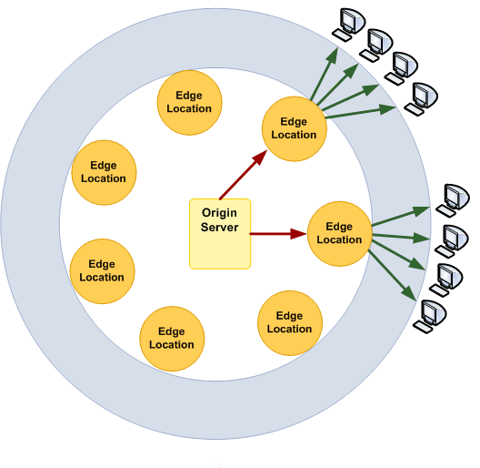
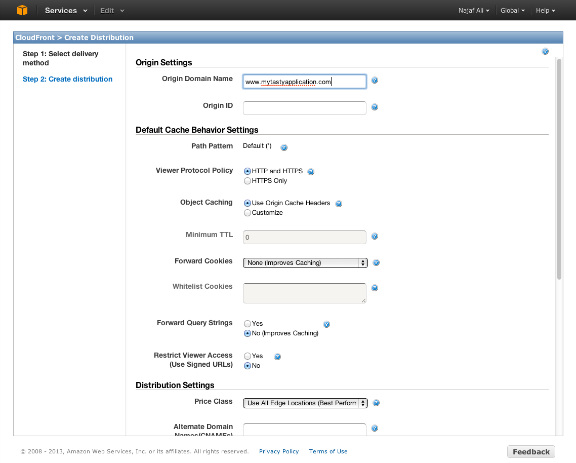

# How to speed up your Rails app with Cloudfront and the asset pipeline

A common trick I use with client work to speed up asset delivery is use
cloudfront as an asset host. I'm surprised this technique isn't in more
widespread use as it reliably makes for snappier user experiences,
especially users with a fresh cache.

This guide assumes you're using the Rails asset pipeline to package and serve
your assets. If you're not using the asset pipeline, whatever solution you use
to achieve the same result will need to fingerprint asset filenames with some
sort of unique identifier for it to work smoothly with Cloudfront or a CDN like
it.

## Don't use S3 to serve assets!

A common mistake I see in websites is serving static assets from S3.

S3 is a place for *storing* files, and I've only experienced bad download times
from it. Directly serving web traffic is not the use-case that S3 is designed
for so you shouldn't be surprised if you get less than optimal performance from
it.

## How Amazon Cloudfront works

Cloudfront is an offering from Amazon Web Services that allows you to serve
static assets like css, javascript and images from **edge cache locations**.

These are servers optimized for serving static files and are dotted around the
globe. Using DNS, any requests for a particular asset are routed to the edge
cache location closest to the user.



To work with Cloudfront you first need to set up a **distribution**. Each
distribution is assigned a domain that you can use to serve your static assets.

Typically, the domain name you get for a new Cloudfront distribution looks like the following:

```
http://randomjunk.cloudfront.net
```

Setting up a CNAME from `cdn.yourdomain.com` => `randomjunk.cloudfront.net` is
trivial, so you don't need to use the nasty domain that Cloudfront gives you for
your application.

Each distribution has to be configured with an **origin**. The origin is where
your distribution will forward requests to if it doesn't have a cached copy of
the file that was requested. After the first request for an asset, it's served
out of the edge cache.

It used to be that Cloudfront could only be configured to use S3 buckets as
origin servers but they've supported custom origins for a while. So if you
configure the origin server of your distribution to be:

```
http://www.myapplication.com
```

Then when you make the following request to a CF distribution:

```
http://randomjunk.cloudfront.net/a/great/big/static/asset.png
```

The first time it receives that request, the distribution will forward that
request to:

```
http://www.myapplication.com/a/great/big/static/asset.png
```

And cache whatever it finds there for future requests.

## Setting up a new distribution

Setting up a new distribution for your Rails app is as easy as logging into the
AWS management interface, clicking 'Cloudfront' and then 'Create distribution'.
You should be presented with a dialog that looks something like this:



The default settings should be fine for your application. If you want to set up
a custom domain for using the distribution (e.g. `cdn.yourapplication.com`) you
can enter it in the field labeled 'Alternate Domain Names' but you can always
add this later if you prefer.

Once you've clicked 'Create Distribution', the setup process will begin. This
takes in the region of five to ten minutes to complete. The AWS UI will give you
an indication of the distributions current status and tell you the domain name
assigned to the distribution.

Before moving on to the next stage, I'd recommend testing manually to see that
the distribution is working correctly. To do this, take the URL of one of your
assets and attempt to retrieve it using the distribution domain.

For example, if your Rails application is serving a css file at the following
URL:

```
http://my-rails-app.com/assets/application-99b3c0f37d3bfc5fb428f3312698aaa9.css
```

And you've configured the distribution to have the custom origin of
`my-rails-app.com`, then you should be able to get that file at the following
URL:

```
http://your-dist-url.cloudfront.net/assets/application-99b3c0f37d3bfc5fb428f3312698aaa9.css
```

If this doesn't work then either the distribution setup isn't quite finished or
you've fat-fingered the configuration. Make sure you can get access to your
assets before you setup your Rails application to work with Cloudfront.

## Making Cloudfront work with Rails

The Rails asset pipeline has the handy feature of compiling your assets and then
appending a hash of the contents to the filename. This means that if the
contents of the file change, then the filename changes too. This is perfect for
working with an edge cache like Cloudfront, as it never needs to expire objects.

You can make Rails serve static assets from your newly minted cloudfront
distribution by changing one line in `production.rb`. Specifically, set your
`asset_host` to the domain name of your new Cloudfront distribution:

```
# config/environments/production.rb
configaction_controllerasset_host 'your-dist-url.cloudfront.net'
```

This has the effect of making all the links you send use the configured asset
host instead of that of your own website. For example, where your main application
stylesheet may have been served like this in your HTML head:

```
<link href="/assets/application-99b3.css" rel="stylesheet">
```

The href will now have the configured asset host prepended:

```
<link href="http://your-dist-url.cloudfront.net/assets/application-99b3.css" rel="stylesheet">
```

As mentioned before, you can setup a CNAME record using DNS provider of choice
to use a nicer looking URL for your asset host. This blog for example uses
`cdn.happybearsoftware.com` which is just a CNAME for the Cloudfront
distribution URL.

## No syncing to S3 required

Since your Cloudfront distribution will only ask your application for a given
asset once, it's not worth syncing them to S3.

## No cache invalidations required either!

Remember that the asset pipeline fingerprints each asset with a hash of the
contents, so you don't need to worry about serving stale assets to your users.
When a new version of a file is referenced in your HTML, it will have a unique
hash of its contents as a part of the filename. Since it has a different
filename, Cloudfront recognizes your new version as a distinct resource.

## Sign up to the Happy Bear Software List

Find this article useful? For a regular dose of freshly squeezed technical content delivered straight to your inbox, **click on the big green button below to sign up to the Happy Bear Software mailing list**.

We'll only be in touch a few times per month and you can unsubscribe at any time.

[That sounds stupendous, sign me up!](https://www.getdrip.com/forms/2772775/submissions/new)
