# 10 Simple Habits That Make Afternoons as Productive as Mornings

IMAGE: Getty Images

Our society is collectively obsessed with morning routines.

What is just as important, but often neglected, is how we manage what happens in the middle of the day.

When we wake up, our minds are clear, our bodies are rested. [High willpower](http://bit.ly/1L99tyS) gives us the energy to take on the day.

The problem is that no matter how much energy we start with, [it can only sustain us for so long](http://snip.ly/7oq6). Without good midday habits, we fall prey to [distraction (hello Facebook!), impulsivity, irritability, and fatigue](http://snip.ly/o9uV). Or even worse, we crash and make bad decisions we regret. [According to renowned willpower researcher Roy Baumeister](http://snip.ly/r6Ys), "Most things go bad in the evening. Diets are broken at the evening snack, not at breakfast… Impulsive crimes are mostly committed after midnight."

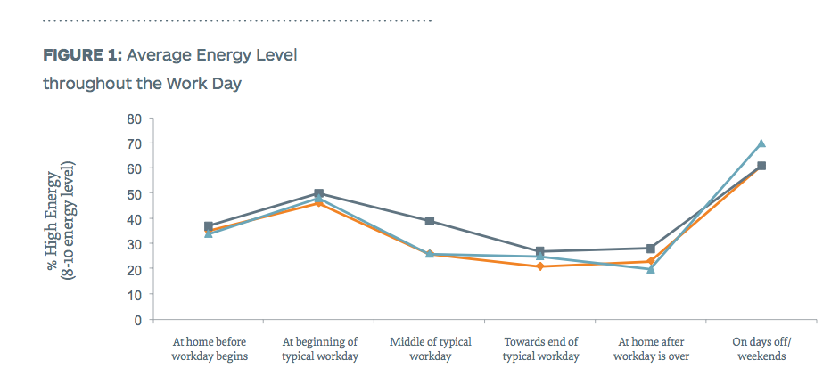

*Source:* [*The Power of an Energy Microburst*](http://snip.ly/NcPI) *by Janet Nikolovski, Ph.D. & Jack Groppel, Ph.D.*

To help you nail your afternoon routine, here is some practical and science-backed advice from successful entrepreneurs who have built multimillion-dollar companies.

———————

1. Move around and take a fidgeting break.

***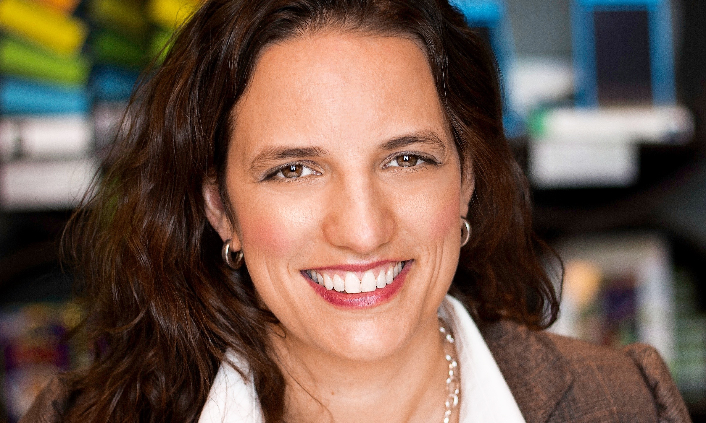***

*[Lindsay Gaskins](https://www.linkedin.com/pub/lindsay-gaskins/5/8a9/428), CEO of  [Marbles: The Brain Store](http://www.marblesthebrainstore.com/)*

When most people think about health and energy, they primarily focus on exercise. [While exercise is incredibly important](http://amzn.to/1MqL5Jd), our nonexercise activities (known as NEAT in the academic world) actually take up more time and burn more energy throughout the day.

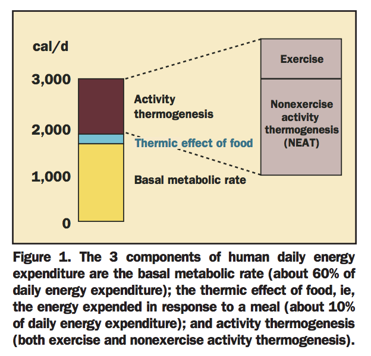

*Source:* [*The "NEAT Defect" in Human Obesity: The Role of Nonexercise Activity Thermogenesis*](http://snip.ly/kcsm) *by James A. Levine, MD, Ph.D.*

Changes to these NEAT activities are easier to make since they require less willpower; yet they are still incredibly impactful.

"We also found that when sitting for prolonged periods of time, any movement is good movement, and was also associated with better fitness," [says Dr. Jacquelyn Kulinski](http://snip.ly/XSSq), who has studied the [link between health and physical activity](http://snip.ly/LjWw). "So if you are stuck at your desk for a while, shift positions frequently, get up and stretch in the middle of a thought, pace while on a phone call, or even fidget."

[Lindsay Gaskins](https://www.linkedin.com/pub/lindsay-gaskins/5/8a9/428), CEO of [Marbles: The Brain Store](http://www.marblesthebrainstore.com/), is a big fan of fidgeting with a desk toy. She takes multiple fidget breaks every day to reduce stress and help her think more clearly.

"Anything I can press, bend, or manipulate makes my hands and brain happy," Gaskins says. She recommends desk toys like wooden puzzles, [Ball of Whacks](http://snip.ly/0Tq4), or [Flingons](http://www.marblesthebrainstore.com/flingons.htm) (a flingable, flexible magnetic fidget set).  
  
Katherine Isbister, research director of NYU’s Game Innovation Lab, [affirms the importance of desk toys in reducing stress](http://snip.ly/EZAQ). Isbister says that being able to squish something really hard, or knock it on the table “is a great way to overcome negative emotions such as stress or boredom." Isbister and her team are currently studying how workers use desktop toys to increase mental clarity.

2. Never eat alone.

**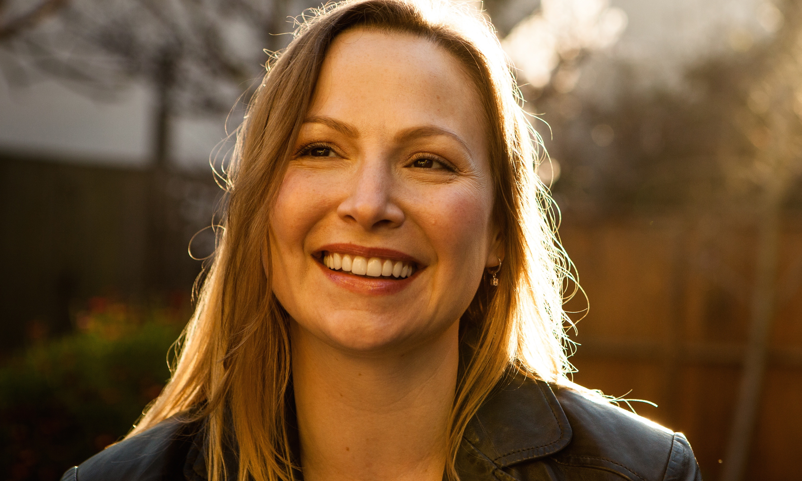**

[*Elizabeth Zaborowska*](https://twitter.com/lizzaborowska)*, founder and CEO of* *[Bhava Communications](http://www.bhavacom.com/)*

According to one research-backed book on the impact of face-to-face relationships, [*The Village Effect*](http://amzn.to/1z6vtB0), spending time directly with other people and having active social lives can increase [our likelihood of surviving cancer by 66 percent](http://snip.ly/KT5A). As noted in *The Village Effect,* and also discussed by National Geographic researcher Dan Buettner and his team, the right social circle is an essential part of why [centenarians live past 100 years old](http://snip.ly/FTwt).

[Elizabeth Zaborowska](https://twitter.com/lizzaborowska), founder and CEO of [Bhava Communications](http://www.bhavacom.com/) (revenue: $5 Million ), organizes an amazing 15-plus informal meals per week (750 meals per year) with her employees, clients, venture capitalists, industry colleagues, and more. She invites one or two people to join her for lunch and dinner, and occasionally sets up breakfasts and weekend brunches.

Having a meal together connects people in ways that simply working together can't. A meal creates an informal space where friendships can be formed, and sets the foundation for a deeper working relationship. [In one study](http://snip.ly/B3Td), employees at a tech company who rated other employees as being "especially good friends" had higher performance ratings from their bosses than those who had fewer numbers of such friendships.

Many well-known entrepreneurs use mealtime as one of the main ways they build relationships. During summers, Martha Stewart [regularly entertains guests for dinner](http://snip.ly/OWQZ) at her East Hampton estate. And Keith Ferrazzi proclaimed the power of meals, particularly dinner parties, in his bestselling book [*Never Eat Alone*](http://amzn.to/1N6n0Yd).  
  
"Today I can safely say my strongest links have been forged at the table," Ferrazzi says."The companionable effects of breaking bread -- not to mention drinking a few glasses of wine -- bring people together."

3. Set your timer for five minutes in order to break up that big, hard task you’ve been procrastinating on.

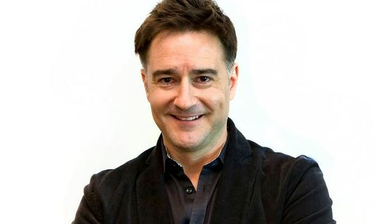

[*Brian Scudamore*](https://twitter.com/BrianScudamore)*, founder and CEO of* [*1-800-GOT-JUNK?*](http://www.1800gotjunk.com/?utm_source=inc&utm_medium=referral&utm_campaign=michaelsimmons)*,* [*You Move Me*](http://www.youmoveme.com/us?utm_source=inc&utm_medium=referral&utm_campaign=michaelsimmons)*, and [Wow 1 Day Painting](http://www.wow1day.com/?utm_source=inc&utm_medium=referral&utm_campaign=michaelsimmons)*

According to Stanford researcher BJ Fogg, the [best way to change your behavior](http://snip.ly/Ha8m) is to make the desired change easier. And the simplest way to make something easier is to reduce the amount of time it takes. For example, exercise is much less intimidating when you commit to it for one minute instead of one hour.

The same principle holds true in work. Whenever [Brian Scudamore](https://twitter.com/BrianScudamore), founder and CEO of [1-800-GOT-JUNK?](http://www.1800gotjunk.com/?utm_source=inc&utm_medium=referral&utm_campaign=michaelsimmons), [You Move Me](http://www.youmoveme.com/us?utm_source=inc&utm_medium=referral&utm_campaign=michaelsimmons), and [Wow 1 Day Painting](http://www.wow1day.com/?utm_source=inc&utm_medium=referral&utm_campaign=michaelsimmons), feels overwhelmed by a big goal or feels low energy, he sets his iPhone timer for five minutes and commits to focusing for that period of time on the task at hand. "What ends up happening is I build up momentum and want to keep going after the timer goes off," Scudamore says.

While setting big, hairy, audacious goals is really good for long-term thinking, it is paralyzing when you're at a low point in your day. Focusing on an easy, small step is powerful because it:

- Builds momentum and keeps you focused.
- Increases the odds that you'll take action.
- Cements your own identity as someone who gets stuff done.
- Gives you the feeling of progress, optimism, control, and gratitude.

For more information on how to set easy tasks, watch this [10-minute video](http://snip.ly/FqUX) by Fogg.

4. Take a "pocket vacation" in nature.

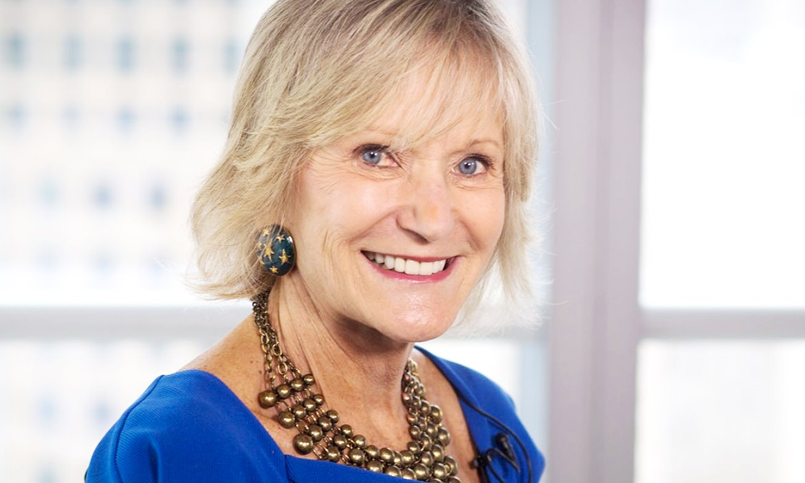

[*Kay Koplovitz*](https://twitter.com/kaykoplovitz)*, founder of* [*USA Network*](http://www.usanetwork.com/) *and [Syfy](http://www.syfy.com/)*

It turns out that exposure to all that's green and grows is good for your immune system. Not getting out in natural surroundings can lead to an increase of [allergies, asthma,](http://snip.ly/kTkW)and other illnesses. It even has a name; "[Nature Deficit Disorder](http://snip.ly/09gI)."

[Kay Koplovitz](https://twitter.com/kaykoplovitz), founder of [USA Network](http://www.usanetwork.com/) and [Syfy](http://www.syfy.com/) takes a daily walk in New York City's Central Park for 15 minutes, calling her routine her "[pocket vacation](http://snip.ly/Kz1L)." Research indicates that [a mere five minutes of walking in nature](http://snip.ly/vuyV) can produce an immense, immediate benefit of reducing stress, notably on our levels of cortisol, a stress hormone. An even more important effect is that nature [restores your ability to focus](http://snip.ly/mcDI) with a phenomenon called [Attention Restoration Theory](http://snip.ly/Nv4u).  
  
If you don't have time to take a quick walk, [spend 40 seconds looking through a window with greenery outside](http://snip.ly/lNt0). That short amount of time is enough to restore your attention span, leading to far fewer errors in your work.

5. Take micro naps like these iconic entrepreneurs, presidents, and artists.

[*Sevetri Wilson*](http://www.sevetriwilson.com/)*, CEO of [Solid Ground Innovations](http://sgicares.com/)*

Famous individuals throughout history have sworn by the power of naps; everyone from presidents (Ronald Reagan, John F. Kennedy, Lyndon B. Johnson, Bill Clinton) to artists (Salvador Dali, Leonardo Da Vinci) to entrepreneurs ([Thomas Edison](http://snip.ly/iLe4), John D. Rockefeller) have enjoyed midday naps. And it's no wonder why. According to one study, a [10 minute power nap](http://snip.ly/WmWE) can reduce fatigue and increase cognitive performance up to two hours. Salvador Dali had a particularly unique approach to naps he called "slumber with a key" that he felt increased his creativity. Essentially, he sat in a chair [with a key in his hand](http://snip.ly/qh2q). If he fell asleep, the key would drop and he’d immediately wake him up. This approach allow him to stay in a state of deep relaxation while also getting conscious access to his unconscious mind.

[Sevetri Wilson](https://twitter.com/sevetriwilson), CEO of [Solid Ground Innovations](http://sgicares.com/), has adopted a schedule where she works in the early morning hours, when other people are sleeping, and takes naps in the early evening, when other people are relaxing.

"This schedule allows me to get a lot more done without being distracted by text messages or TV and while remaining high-energy," Wilson says.  
  
Larger companies like [Google](http://bit.ly/1Mnfu9U) have started embracing the [the proven benefits of the power of nap](http://snip.ly/K8CY). For example, [Arianna Huffington](http://snip.ly/UsCl), founder of the Huffington Post, and [Brian Halligan](http://nyti.ms/1dmVMHI), CEO of publicly traded Hubspot, have each created employee nap rooms.

6. Play a musical instrument.

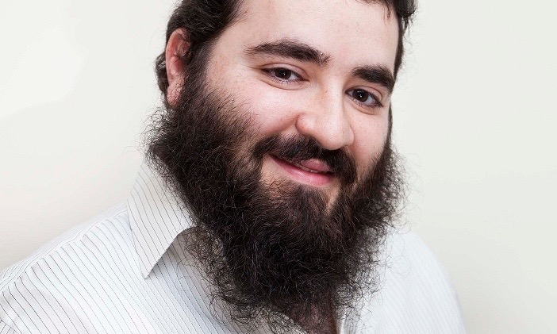

[*Joe Apfelbaum*](https://twitter.com/joeapfelbaum)*, CEO of* [*Ajax Union*](http://www.ajaxunion.com/)

[According to neuroscientist, Anita Collins](http://snip.ly/niSd), playing music is the cognitive equivalent of "a full-body workout," and it "engages practically every area of the brain at once."

More significant, music playing has been highlighted as a powerful long-term strategy to [improve brain plasticity](http://snip.ly/n5vE), as well as [overall brain functioning.](http://snip.ly/gBLa)

[Joe Apfelbaum](https://twitter.com/joeapfelbaum?lang=en), CEO of digital marketing agency, [Ajax Union](http://www.ajaxunion.com/), takes this research to heart, and he's baked it into the culture of his company. "For me to keep my high energy going throughout the day, I need to do things differently," Apfelbaum says. "When brainstorming I sometimes play guitar or other musical instruments that are in my office at all times."

Among the most famous of all amateur music players is [Albert Einstein, an avid and competent violinist](http://snip.ly/zgUB). Einstein often gushed about his love for his hobby, saying "I live my daydreams in music. I see my life in terms of music... I get the most joy in life out of music."  
  
Picking up a musical instrument is not as intimidating as it sounds: Josh Kaufman offers tips on his website for how he learned to play simple chord progressions [on a ukulele in less than 20 hours](http://bit.ly/1UG9H23).

7. Shower with your eyes closed.

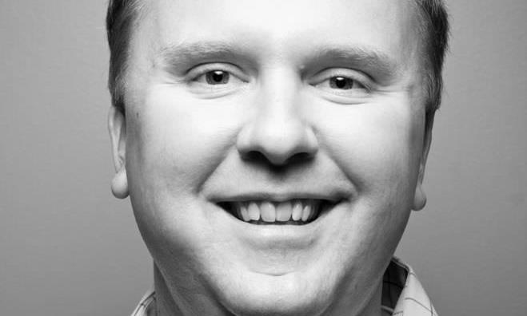

[*Jason Duff*](https://twitter.com/jasonduff)*, founder and CEO of* [*COMSTOR Outdoor*](http://www.comstoroutdoor.com/)

Artist Paul Gogan once declared, "I shut my eyes in order to see."

Recent research on how creative insights happen shows that he might have been on to something. In the book, [*Eureka Factor*](http://amzn.to/1HJELEL)*,* researcher John Kounios shares the importance of inner-directed attention:

"We found that just before viewing a problem that participants would eventually solve with insight, they disengaged from their surroundings and directed their attention inwardly on their own thoughts."

As soon as he gets back from work at the end of the day, [Jason Duff](https://twitter.com/jasonduff), founder and CEO of [COMSTOR Outdoor](http://www.comstoroutdoor.com/), takes his second shower of the day. It's 20 minutes long, and he closes his eyes and lets his mind wander.

Research shows that having your eyes closed [increases alpha waves](http://snip.ly/GZ7D), which is closely associated with relaxation and [helps new ideas go from your subconscious mind to your conscious mind](http://snip.ly/YxTB).  
  
If you want to add a second shower to your daily routine, but also want to conserve water, consider [purchasing a water-efficient showerhead](http://snip.ly/KVsx).

8. Create an easy list for the end of the day.

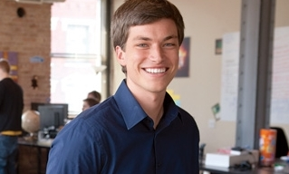

*[Emerson Spartz](https://twitter.com/EmersonSpartz), founder and CEO of* [*Spartz Inc.*](http://www.spartzinc.com/)

Many [articles](http://snip.ly/5XUo) and [books](http://amzn.to/1TxSzOE) have been written about the beginning of the workday. The predominant principle is to focus on hard, important tasks and decisions that will push your business forward.  
  
"If you save the same activities for the afternoon, you will likely procrastinate, be inefficient, and have lower quality," says [Emerson Spartz](http://www.emersonspartz.com/), founder and CEO of [Spartz Inc.](http://www.spartzinc.com/), a digital media company that owns a network of sites (like [Dose.com](http://www.dose.com/) and [OMG Facts](http://www.omgfacts.com/)) that collectively reach 45 million visitors per month. Instead, Spartz leaves mindless tasks and easy decisions (i.e., emails that need quick responses, social media, and simple tasks) for his final hours of work.

"I'll check email periodically throughout the day to respond to anything urgent," Spartz said. "But I reserve the last hour just for emailing, which is easier for my mind and more likely to distract me."

9. Exercise with a gym trainer or gym buddy.

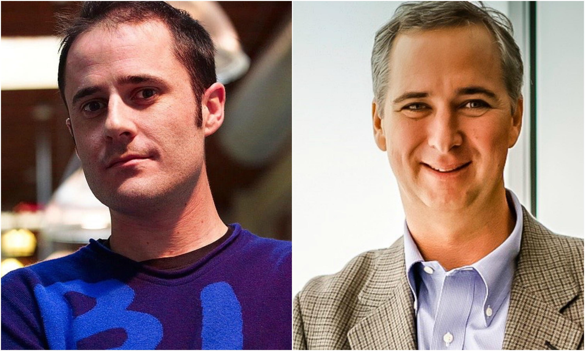

[*Cameron Herold*](http://www.cameronherold.com/)*, author of* *[Double Double](http://amzn.to/1WnnXyg)*, [*CEO coach*](http://www.cameronherold.com/)*, and globally renowned speaker*

Evan Williams, founder of Blogger, Twitter, and Medium, [works out in the middle of the day](http://snip.ly/R6VG), contradicting the typical advice to workout first thing in the morning:

"My focus is usually great first thing in the morning. So going to the gym first is a trade off of very productive time in the office. Instead, I've started going mid-morning or late afternoon (especially on days I work late). It feels weird (at first) to leave the office in the middle of the day, but total time spent is nearly the same, with higher energy and focus across the board."

[Cameron Herold](https://twitter.com/cameronherold), author of [*Double Double*](http://amzn.to/1WnnXyg) and a [CEO coach to high-growth businesses](http://www.cameronherold.com/), also exercises in the middle of the day. He uses a trainer to force himself to follow through.

"I need more help stopping work than I do getting it into it," Herold says. "If I can force myself to stop my day for a workout, I can sustain quality output much longer. Having a trainer forces me to show up."

A review of 29 [academic studies](http://snip.ly/FVUE) found that exercise dramatically increases attention, processing speed, and executive function:

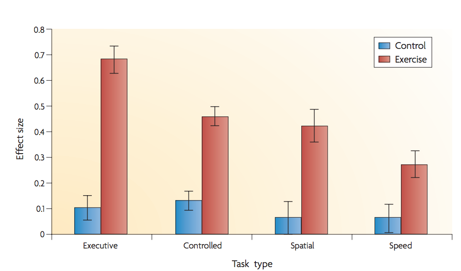

*Source:* *[Study: Be smart, exercise your heart: exercise effects on brain and cognition](http://snip.ly/1zvB)*

10. Save your easy meetings for the afternoon.

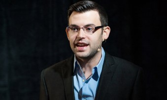

[*Benji Rabhan*](http://www.benjirabhan.com/)*, founder and CEO of* [*Apollo Scheduling*](http://apolloscheduling.com/)

Meetings have built-in accountability, and thus limited procrastination. That makes them perfect to hold your attention during the afternoon when your mind is more likely to wander.

[Benji Rabhan](http://www.benjirabhan.com/), founder & CEO of [Apollo Scheduling](http://apolloscheduling.com/), uses his [AppointmentCore](https://www.appointmentcore.com/) software to open his afternoons to meetings with clients, customers, and team members. Instead of using his precious morning time for meetings, he uses the late afternoon for simple meetings such as answering questions, status checks, or conveying information.

Rabhan still has big meetings that require difficult decisions in the morning, as several studies show that we make worse decisions throughout the day as a result of [decision fatigue](http://nyti.ms/1UGauQB).

Not convinced? Meeting in the afternoon has another benefit. [According to a study](http://snip.ly/FARk) of best times to schedule meetings, 3:00 p.m. has the highest acceptance rate!

*—*

*Special thanks to [Rachel Zohn](https://www.linkedin.com/pub/rachel-zohn/17/1ab/754)**,* [*Sheena Lindahl*](https://twitter.com/sheenalindahl) and [*Ian Chew*](http://ianchew.com/) *who volunteered their time to edit this article and do research.*

*Disclosure: Some of the contributors featured in this article are members of  [Seminal](http://www.beseminal.com/), a selective council that distills research-backed, actionable insights from world-class entrepreneurs and leaders.*

*—*

**Related Articles**
