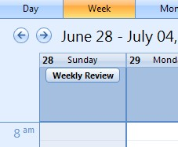

# Re-Establish the Weekly Review Habit

Reviewing where you are and where you're going is a critical but oft-overlooked part of personal development. Here's how to get in the habit of giving yourself a weekly review.

You may not have ever been an adherent of the Getting Things Done philosophy of time and task management, but at some point you've certainly sat down and reviewed what was going on in your life. Making lists and writing down tasks is a great habit, but it's equally important to make a routine of frequently reviewing your lists, tasks, and goals to reconnect with your work and purpose.

Productivity blog Stepcase Lifehack runs a series of refreshers on components of the Getting Things Done system. This week, the focus is on the weekly review and the importance of establishing a habit of reviewing:

> More than anything else, though, a weekly review is a point of connection between you and your work. We live in a go-go-go society where work – any work – is expected of each of us, all the time. Americans, especially, work harder than just about anyone – not necessarily more efficiently or on more important things, but longer hours and with fewer breaks. It's all too easy in all this rush of work for work's sake to lose track of why we're doing it and of what it has to do with us as people.

They point out, rather accurately, that it's easy to make lists and even do mini-reviews on any given day, but that larger reviews—the weekly, monthly, and yearly kind, involving more goals than tasks—are usually lost among all the little projects and fires we attend to. It's important to review your work to gain a sense of where you are, where you are going, and, more importantly, focusing on what the next tasks need to be to get to the place you want to be.

Not sure where to start with your own review? Check out our previous advice on [establishing a weekly review](http://lifehacker.com/software/getting-things-done/getting-into-the-weekly-review-habit-278118.php) and [the free refresher on weekly reviews](https://secure.davidco.com/store/catalog/Weekly-Review-p-16165.php) from David Allen. Are weekly reviews integral to your workflow? Never found the time for them? Sound off with your experiences in the comments below.

[GTD Refresh, Part 5: Building the Weekly Review Habit](http://www.lifehack.org/articles/productivity/gtd-refresh-part-5-building-the-weekly-review-habit.html) [Stepcase Lifehack]
