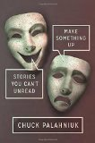
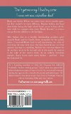

# Consider This: Coping

Let’s start with a secret about Suzy Vitello.

In her own mind, she’s really three people.  One person is Suzy who exists in the present moment.  Another is the Suzy who existed three days earlier.  The last person is the Suzy who will exist three days in the future.

In any immediate crisis, she can choose to be either the past or the future Suzy.  Three days earlier, the crisis didn’t exist.  Three days from now, the crisis will be lessened or resolved.  This gives her perspective and prevents her from reacting too brashly in the moment.  Stressful events come and go, but Suzy – she reminds herself – is eternal.  Being three people gives her stability.  Like a three-legged stool.  It’s a wonderful coping strategy.

She explained this concept of herself to me decades ago, in the early 1990’s in Tom Spanbauer’s writing workshop.  There, she also just so happened to be writing a novel about a young woman who was subject to schizophrenic episodes where two seemingly alter egos offered her advice.  Twenty years later, her novel is still forthcoming.

Suzy’s coping strategy has always stayed with me.  At this moment I’m at home, trapped by a snowstorm, miles from anyone.  I have enough wood to heat the house for two more days, and the prediction is for warmer weather by then.  Rather than fret about my solitary confinement – without even a dog – I imagine myself three days in either the past or the future.  Three days ago, I was eating lunch with an editor from Dark Horse Comics.  Three days from now I will be at UPS mailing 50 bloody severed (fake) hands to a bookstore in Seattle.

Suzy has given me something that a good book/story should always give to a reader:  A concept… a strategy… a way to cope.

It’s not difficult to imagine that Suzy’s concept led to me creating the Tyler Durden alter ego in *Fight Club*.  Beyond fractured personalities, let’s consider two other ways in which characters can react to the unbearable crisis of the moment.

Another friend of mine was trained as a smoke jumper, someone who could parachute into remote areas and fight wildfires.  The parachute training lasted six weeks, he explained, and during that entire time each student was required to carry one item:  A Hostess fruit pie.  Specifically, a cherry pie.  Cherry, the symbol of virginity.  It’s a fragile crust containing messy, goopy red innards.  Protected by only a thin paper wrapper.

Day and night, as the trainees study and practice, they know that they’ll be required to eat their particular pie at the graduation ceremony.  Even if it’s crushed and dirty, they’ll have to publicly choke it down.  If it’s missing, they’ll be humiliated or might even flunk.  So each person’s cherry pie becomes their precious baby.

The point of this tradition is that it displaces any fear the students might have about their own gloppy, red innards being spattered all over the ground.  Even as they’re leaping from airplanes, they’re most worried about their little pies.

Another friend tells a true story about being eight or nine years old.  She’d bought a coconut-scented candle as a gift for her mother, and she was walking home with it.  The shortest route was through a large, overgrown cemetery.  It was daytime, but the trees made the place a dark jungle.  People seldom went there.  Midway through, she saw a man standing among the headstones, watching her.  He called out for her to stop.  He said that he only wanted to talk.  She didn’t stop, and he fell into step behind her.  As she walked faster, he walked faster, still talking to her.  All she could think was:  He wants my candle.  He wants to hurt my candle.

Soon she was running, being chased through the tombstones by this stranger.  She cradled the candle and looked for a hole in the cemetery fence.  Just as she might’ve been caught, she slipped through and escaped.  She saved her candle.

Yet another friend tells a story about driving to a nursery to buy bedding plants for her garden.  On the way home, she’d set the boxes of fragile seedlings on her backseat.  Something happened, and her car veered off the highway.  It struck the guy wires which stabilized a power transmission tower and the front end of the car slid up the almost-vertical steel cable.  Stopped, finally, she found herself seated at the steering wheel, her car balanced on the cable, pointing almost straight up into the air.  Any movement might send the car crashing sideways or backward to the ground.  Still, her only fear was for the safety of the little seedlings still resting in the backseat.

In each real-life example – the cherry pie, the coconut candle, the seedlings – a person is faced with a danger so real and imminent that she or he must displace their fear onto the survival of something they perceive as more important and more vulnerable.  It’s human nature, and it makes for a wonderful detail in fiction.  A reader might not be sympathetic to a character in danger… but a character who’s in danger but is nevertheless trying to save a puppy or kitten or candle, that’s a character demonstrating lovable qualities.  We love things which love things.  That’s why, in the novel *Rant*, the girl is raped while trying to conceal the gold coin in her hand.  The terror is such that she convinces herself, until it’s too late, that her attacker only wants the coin.

It’s this same impulse – to displace peril onto things – that makes me love the part in Amy Hempel’s story "The Harvest" where the man is looking at the mangled woman, moments after the car accident, and he says about his own blood-stained clothes, “You’re going to be okay, but this sweater is ruined.”

True = Funny.  And Ugly True = Really Funny + Heartbreaking.

Another coping strategy that fascinates me is singing.  Yes, singing.  In the face of terror or sadness, we need something which will occupy our mind and displace our immediate emotion.

In the film *2001: A Space Odyssey* the computer’s death is the deepest moment of tragedy.  First, the computer, HAL, says that it’s scared.  But it begs to sing a song, the song which was the first thing it had been taught by its creator.  It sings, “Daisy Bell,” a simple, upbeat love song that clashes perfectly with the scene’s mood of death and nonexistence.  Such a song demonstrates both fear and barvery.  It’s heartbreaking.

Likewise, think of the final episode of the old *Mary Tyler Moore Show* from the 1970’s.  Yes, this is how old I am.  How could the writers dictate the last moments of a show that millions of people loved?  Again -- with people singing an absurd song.  The cast sings “It’s a Long Way to Tipperary” as they exit the set for the last time.

The arbitrary, absurd quality of the song chosen gives it even more authority to heighten the deep emotion and terror, or pathos, of the scene.

From my own experience, once a friend of mine was dying in the hospital and his oldest relative, a visiting aunt, insisted we, his friends, stand around his bed and sing.  He was comatose at the time, “actively dying.”  The song was the clincher.  We sang “Take Me Out to the Ball Game” because the aunt said it was his favorite song as a small child.  The group of his friends, we sang it softly and slowly, hundreds of times to comfort him.  The contrast between the glib, old-fashioned song and the grim context was emotionally devastating, and that’s why the scene stays fresh in my memory thirty years after the event.

Singing a silly song, or questing to rescue a worthless thing, both gestures demonstrate what bestselling thriller writer Chelsea Cain – in her brilliance – calls “self-comforting behavior.”  So often, when a story hits its emotional peak – terror or sadness too much to bear – consider depicting some form of self-comforting behavior.  Often this can be heightened by a breakdown in language, like a skip or stutter.

That’s why in the story "Romance" I have the narrator repeat the phrase “life goes around and life goes around and life goes around and life goes around and life goes around” before he states the emotional core of his perspective.  Perhaps it’s also why Bill Withers repeats “I know I know I know I know I know I know” before he states the inevitable truth (yes, you ought to leave the young thing alone).  Such a repetition creates tension by delaying the inevitable.  It makes the audience hungry to hear the next thing, and it depicts emotion so strong that the narrator seems unable to put that emotion into language.  Try it in a story.  It works wonderfully.

An example that demonstrates both the emotion of a moment and the breakdown of language is the final conflict scene in the film *Alien*.

What fascinates me most about that scene is how language devolves.  The final line “I got you, you son-of-a-bitch.” is premature, as the alien is still a threat.  From there, we proceed to singing “You are my Lucky Star,” and even that song – stylized, rote, primitive like a magic spell to ward off evil – even that devolves to the repetition of  “lucky, lucky, lucky, lucky” like a mantra.  The scene’s language has broken down from a sentence to a chorus to a single word.

The last “dialogue” is a scream.  Human language devolves completely to an animal sound.  Subsequent action completes the story.  Later, voiceover suggests a bridge into the future, “With any luck…” (Note: Again, the word luck) but the character is happily resolved and asleep.  The voiceover is delivered as a recorded entry in the ship’s log, a symbolic return to mechanical storytelling which bookends the words which appeared on the screen (“commercial towing vessel Nostromo”) in the film’s opening sequence.

Please also note that this return to formal language is a return to inaccuracy.  Ripley states that she’ll be rescued in a few weeks, but she’s not recovered for some 50+ years.

My takeaway is that spoken language is an inaccurate form of communication.  Singing is more accurate.  But a scream… a scream is the most honest and accurate form of expression.

Give me a punk song that devolves from clever lyrics to screaming, and I’m in hog heaven.  Among my favorites is Jim Carroll’s “People Who Died” which is, basically, a patter song, as witty as any Cole Porter standard, but with the word “Died!” screamed throughout.

Also, Monica Drake just sent me Margaret Atwood’s wonderful essay about happy endings which includes the line “John and Mary die.  John and Mary die.  John and Mary die.”

Yet another aside:  I once wrote a short story called “The Collector” about a man who murders people in hideous ways in order to record and copyright their screams.  Each scream he keeps in a huge digitized inventory and markets to people making horror movies.  Foley artists appreciate how the collector can distinguish the minute differences between a million screams.  He’s a true connoisseur of screams.  Instead of murder, he considers his vocation to be “harvesting screams.”  And the movie industry’s need for perfect sound effects makes the killer rich.

Is this an allegory about how the news media traffics in recorded misfortune and suffering?  You decide.  Look for "The Merchant" in 2015 as part of the story collection *Make Something Up*.

In closing, please look for Suzy Vitello’s new novel, *The Moment Before*, and come to hear Suzy, Chelsea and me present adult bedtime stories in Seattle on March 1st. ([tickets here](http://www.strangertickets.com/events/13475619/suzy-vitello-friends-adult-bedtime-stories)!)

For homework, identify narratives:  books, films, songs, in which language devolves to singing or the absurd repetition of a single word.

Identify moments when characters displace their own danger onto some inanimate object.

Identify self-comforting behaviors in narratives.  Think of Jane Fonda’s character in *Klute*, stoned, alone and singing some unlikely religious hymn (unlikely for her character, but suggesting her upbringing and childhood).  Think of Nick Carraway’s comforting flashback following the scene at Gatsby’s grave.

Above all, stay warm.    And thank you for reading my work.

---

**To Read More Exclusive Writing Essays  
by Chuck Palahniuk, [Join Our Writers Workshop](http://litreactor.com/workshop/preview?utm_source=instructor&utm_medium=share&utm_campaign=coping-essay)!**

### [Make Something Up: Stories You Can't Unread](http://www.amazon.com/Make-Something-Up-Stories-Unread/dp/0385538057%3FSubscriptionId%3DAKIAIUVGEUAHUWQA3RSA%26tag%3Dlitre-20%26linkCode%3Dxm2%26camp%3D2025%26creative%3D165953%26creativeASIN%3D0385538057)

**Author:** Chuck Palahniuk

**Price:** $18.36

**Publisher:** Doubleday (2015)

**Binding:** Hardcover, 336 pages

### [The Moment Before](http://www.amazon.com/The-Moment-Before-Suzy-Vitello/dp/1626811679%3FSubscriptionId%3DAKIAIUVGEUAHUWQA3RSA%26tag%3Dlitre-20%26linkCode%3Dxm2%26camp%3D2025%26creative%3D165953%26creativeASIN%3D1626811679)

**Author:** Suzy Vitello

**Price:** $12.19

**Publisher:** Diversion Books (2014)

**Binding:** Paperback, 216 pages
