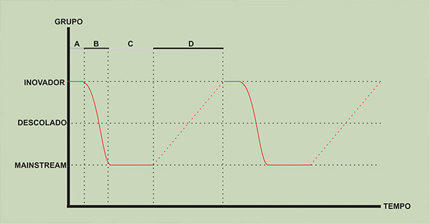
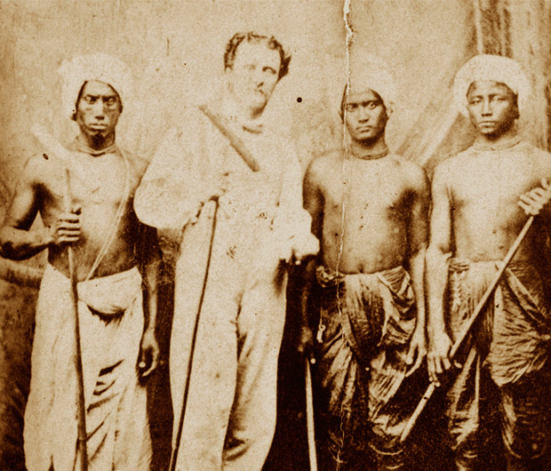
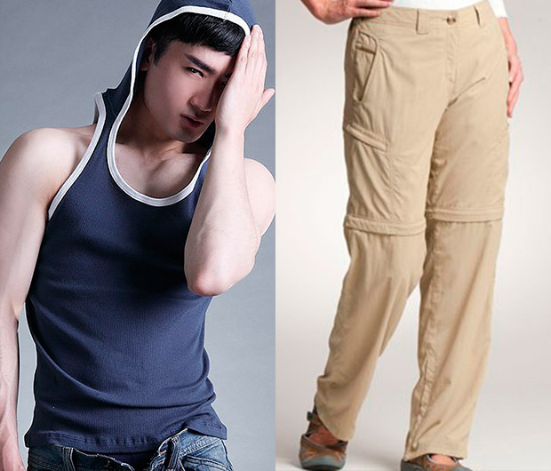

# Camisa Pólo: elegante ou coxinha?

Olá amigos,

Já se passaram quase 5 anos desde o último auge (comercialmente falando) da camisa pólo no Brasil. Se você parar pra pensar, lembrará. Balada era sinônimo de pólo, os mais hipsters (que naquela época ainda respondiam pela alcunha de indies, mesmo não sendo a mesma coisa) usavam pólos de tecido Piquet, lisas e normalmente escuras.

PUBLICIDADE

A galera mais *street* mandava bala com os listrados e o mainstream fazia um bem bolado de tudo, com uma leve predileção pro estilo rugby (listras grossas e números e brasões bordados).

Eis então que você se pergunta:

> Mas o que aconteceu que de repente a pólo virou uma peça de coxinha (careta, certinnha demais, filhinho da mamãe)?

Para responder a esta pergunta, é necessário entender como funciona uma parte da indústria do vestuário. Nesse caso, a tendência, que, por incrível que pareça, é normalmente o fenômeno mais orgânico deste segmento.

Explico. Utilizarei exemplos simplificados para que isso não se transforme em uma monografia:

Dividiremos as pessoas em 3 grupos:

1. **Inovadores:** não entenda como um elogio, mas somente como característica atribuída a pessoas que buscam e expõem coisas novas.

**2. Descolados:** são os famosos “formadores de opinião”. Eles não lançam as tendências, mas são os primeiros a filtrá-las e utilizam o que é mais “usável” entre as peças que vêem nos inovadores.

**3. Grande Público:** representa a maior parte das pessoas que, normalmente, não tem fácil acesso aos inovadores (pois se trata de um grupo pequeno). Portanto, eles recebem as informações vindas dos descolados e, mais uma vez, as peças são filtradas, agora pela massa.

**Este processo não tem nada de pejorativo para nenhum dos grupos**. Todos só visam eliminar o que não tem significado ou coerência em seu cotidiano.

É importante levarmos em conta que simbologias gráficas não existem quando isoladas de um contexto social e dependem de sua relação histórica com o indivíduo para fazerem sentido, portanto, é óbvio que, quanto mais distante for a origem do significado, menor será a identificação do usuário com a peça.

E é por este motivo que o descolado acha as peças do inovador mais normais do que o grande público acharia. Só isso.

***Obs:** esse texto não pretende definir quem são os Inovadores, Descolados e Grande Público. O exemplo foi dado apenas para auxiliar na compreensão de como funcionam as tendências na moda.*

Retomando, agora entendam porque se trata de um movimento natural. Usarei todo meu talento para desenhar este gráfico maneiro:

No gráfico, é possível entender como este tipo de sazonalidade é cíclica. Quando a pólo está no ponto A, ela chegou no auge do desejo para o inovador e no oposto do desejo do mainstream.  Já quando está em B, os descolados filtraram os elementos que mais gostavam da pólo e ajudam assim a fazer a transição para que a peça seja aceita pelo mainstream em C.

É interessante notar que a quantidade de pessoas em cada grupo tem relação direta com a permanência de duração da tendência, portanto, o desejo dos inovadores (A) sempre irá durar menos tempo que para os descolado (B). Já o mainstream será o que irá absorver a tendência por mais tempo ( C).

O Vácuo que se segue ( D), momento em que a peça é “mal vista” pelos 3 grupos. É, normalmente (mas não via de regra), a soma do tempo de B e C.

Outro fator interessante é notarmos como estas ondas são encurtadas ao longo do tempo. A grosso modo, podemos dizer que do século XV ao XVIII, categorizamos as tendências por século. No século XIX, elas foram divididas em 2 períodos de 50 anos.

No século XX, foram divididas em décadas.

Por fim, a partir do século 21, é possível analisar tendências que ocorrem de 5 em 5 anos (como é o caso das pólos). Porém, como estamos analisando um período histórico atual, é imprevisível (pelo menos sem estudos aprofundados) dizermos como isso se dará daqui para frente.

Apenas como palpite, arrisco dizer que o aceleramento das tendências nos levará a um novo estágio de neutralidade, eliminando as ondas cronológicas e dando espaço somente para ondas criativas, sinônimos de alguma inovação pontual tecnológica, gráfica ou ergonômica.

E agora você está se sentindo [tipo o Neo](http://www.imdb.com/character/ch0000741/), vendo [as letrinhas caírem](http://6269-9001.zippykid.netdna-cdn.com/wp-content/uploads/2013/09/Matrix-Live-Wallpaper.jpg), né?

Entender as coisas sempre nos aproximam delas. É por isso que você, leitor, que acompanha meus texto aqui no PdH, gosta um pouco mais de vestuário do que gostava antes.

Quando racionalizamos a moda, fica mais fácil prever seus movimentos, pois eles são sempre [diacrônicos](http://pt.wikipedia.org/wiki/Diacronia). O principal ponto é estar atento a leitura imagética/social das pessoas e de sua época. **É desta maneira que os grandes estilistas e as grandes marcas se destacam** ao anteverem qual é a peça, cor ou a modelagem será a "do momento". Quanto maior a sensibilidade e o contato humano, maior o acerto.

Voltemos a nossa querida pólo e a pergunta título do texto:

### Camisa Pólo: elegância ou coxinização?

Os tempos de degradação da peça (equivalentes ao “D” no gráfico) cronologicamente acabaram. Nos resta analisar o último fator para o sucesso de uma peça: a simbologia:

A origem da pólo é creditada erroneamente a [René Lacoste](http://pt.wikipedia.org/wiki/Ren%C3%A9_Lacoste) (o tenista que deu origem a marca do jacarezinho), porém, na verdade,  o que René fez foi aperfeiçoar esta peça para como a conhecemos hoje.

A camisa começou sua história durante os jogos de pólo, que são de origem asiática. Aliás, a palavra pólo é derivada de “pulu”, palavra tibetana que dá nome a uma espécie de bola de madeira que era utilizada nestes jogos.

A popularização no ocidente ocorreu durante o domínio britânico na Índia. Os soldados, principalmente em [Manipur](http://pt.wikipedia.org/wiki/Manipur), se afeiçoaram muito ao jogo, levando-o até a Inglaterra e, de lá, para todo o resto do mundo.

Na década de 20, nosso amigo Lacoste fez alterações significativas que seriam responsáveis por tornar a pólo, a peça que conhecemos hoje.

Até então, elas eram feitas de um algodão grosso e as de tênis costumavam ser com mangas compridas.

Lacoste então criou um modelo de mangas curtas, que facilitaram seus movimentos durante os jogos e também alterou a matéria prima, fazendo a peça com tecido Piquet, muito mais refrescante do que o algodão grosso usado até então.

Já conhecendo os dois fatores iniciais que fazem as pessoas gostarem ou não de uma peça de roupa. Chegamos, finalmente, a nossa resposta.

A camisa pólo clássica, hoje e durante alguns anos, nada terá de coxinha e será sim uma ótima pedida no vestuário, além de ser uma peça com coerência climática -- um dos principais fatores que levam a elegância.

Aqui, é possível encontrarmos um raro caso de peça híbrida que deu certo. Normalmente, esse tipo de peça não entrega direito nenhuma das propostas que pretende agregar, é o caso da calça com zíper que vira bermuda, do sapatênis ou da infame camiseta regata com gorro.

Já a pólo permite ao usuário brasileiro que fique mais alinhado simbologicamente do que estaria se estivesse de camiseta, devido a gola da pólo ser derivada da gola da camisa. Ao mesmo tempo, propicia uma sensação térmica adequada e confortável, como ocorreria se ele estivesse de camiseta.

Como disse anteriormente, **caso raríssimo de união de peças bem sucedidas** e evolução de vestuário masculino.

Para quem não sabe, uma última observação bastante pertinente, o xingamento número um do momento (pelo menos em São Paulo) -- coxinha -- simboliza o que durante muito tempo foi classificado como “mauricinho”, com a diferença que o mauricinho tinha menos teor social do que o “coxinha”, que também é símbolo dos bons costumes, conservadorismo e da gente certinha que segue a maioria.

Agora, ficar falando a toda hora que fulano e ciclano e o diabo são coxinhas não irá te "descoxinizar" em nada. Quer ser um cara bacana, descolado e não coxinha?

Cuida da sua vida e seja feliz.

Como sempre, espero que tenha sido útil ou, ao menos, divertido!

### Mecenas: [Dafiti](http://pdh.co/dafiti2)

Fomos convidados [pela Dafiti](http://pdh.co/dafiti2) para fazer uma curadoria de produtos, elegendo as peças mais bacanas que eles têm a disposição. O responsável foi nosso colunista de estilo, Bruno Passos, que julgou mais de 20 mil itens masculinos, foi uma tarefa um tanto longa e bem divertida.

*Aos que se interessaram pelas pólos, poderão fazer bom proveito dando uma passada no site da Dafiti.*

*Ou se quiser conhecer a curadoria inteira do PapodeHomem dos produtos, é só entrar [no link especial do PdH](http://pdh.co/dafiti2).*

---

*publicado em 05 de Novembro de 2013, 22:00*
