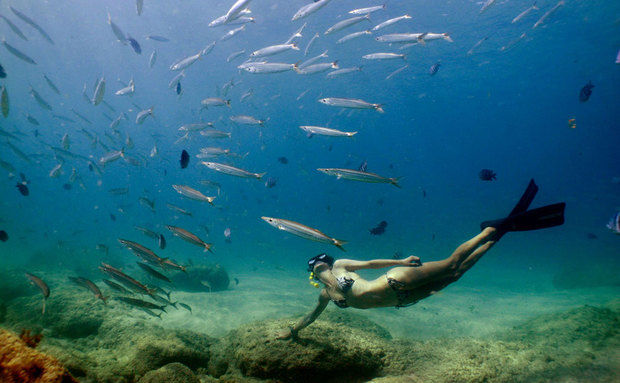
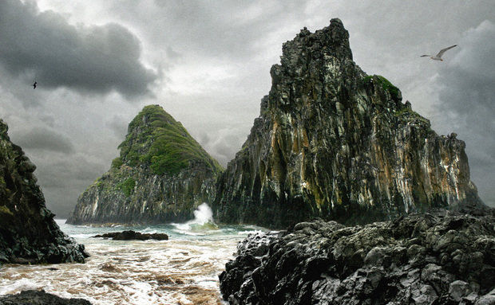

# Como viajar mais, passo-a-passo | Não destrua os lugares por onde passar

Turismo consciente é essencial para que os lugares que você conhecer continuem existindo

O céu brilhava e os Dois Irmãos, símbolos de Fernando de Noronha, formavam uma imagem única. Eu estava na ilha há menos de 24 horas, mas já tinha uma certeza: que viagem incrível. Muito cara, mas incrível.

Destino mais cobiçado do Brasil, Noronha conseguiu algo impressionante. Eu tinha expectativas altas. Gigantes. E mesmo assim voltei surpreendido. A primeira surpresa veio durante um passeio de barco. Enquanto o vento batia nos rostos e todos tentavam segurar seus queixos, uma garrafa pet voou para fora da embarcação. E causou um alvoroço: o barco parou, retornou e os tripulantes fizeram um esforço enorme para recuperar aquela garrafa.

A população de Noronha, embora pequena, sabe que é preciso conservar a ilha. Por todos os lados, placas lembram aos turistas que lixo não deve ser jogado no chão, que a vida animal não deve ser molestada, que há uma série de atitudes que são punidas com multas. E das grandes. Tipo o caso do grupo de turistas que foi multado em R$ 10 mil, por pessoa, [por invadir uma área de proteção ambiental e ignorar todos os avisos das autoridades](http://g1.globo.com/pernambuco/noticia/2012/11/turistas-estrangeiros-sao-detidos-por-crime-ambiental-em-noronha.html).

Não que Noronha seja o exemplo perfeito de turismo sustentável e que garante a proteção daquilo que, afinal de contas, é a razão para o turismo existir. Há falhas. Várias. Mas há muitos pontos que merecem elogios também  - e, quando o assunto é turismo, isso é raro.

### **Quando o turismo passa dos limites**

“Não alimente os jarawa”. Todo turista que chega nas Ilhas Andamão, controladas pela Índia, recebem esse aviso. O problema é que os jarawa são uma das maiores razões para que tantos viajantes desembarquem lá. Mesmo que seja ilegal, que eles vivam numa reserva onde a entrada não é permitida, os jarawa acabaram se transformando em atrações de um zoológico informal. Um zoológico humano.

Os jarawa  são parte de uma das tribos mais isoladas do planeta. Ou pelo menos deveria ser assim. Tour e passeios são organizados para a área de proteção, onde os jarawa dançam e cantam em troca de comida. [Há até um documentário sobre o assunto](http://www.vice.com/pt_br/the-vice-guide-to-travel/safari-humano).

*[Link Youtube](https://www.youtube.com/watch?v=WdgDqrPAZcE)*

Eu não estive nas Ilhas Andamão, mas infelizmente já estive num zoológico humano sem saber. Foi na Tailândia. Durante minha estadia em Chiang Mai, no norte do país, comprei um tour que envolveria as três principais atrações da cidade. A mais conhecida delas? Visitar a tribo das mulheres-girafa.

Elas são simpáticas e diferentes. Se você não pesquisar antes de ir, erro que eu cometi, vai ficar ansioso pela visita. O problema é que, como sempre ocorre em zoológicos humanos, muitas vezes a principal atração não gostaria de estar ali, entretendo turistas.

As mulheres-girafa da Tailândia se tornaram lucrativas para o governo e para os empresários do turismo. Por isso, elas não podem tirar as argolas do pescoço. Na realidade, até podem, mas sem as argolas elas perdem a ajuda de custo que recebem do governo. Já contamos sobre a [triste história das mulheres-girafa da Tailândia](http://www.360meridianos.com/2012/08/o-que-descobrimos-sobre-as-mulheres-girafa-da-tailandia.html) em outro texto.

Mas voltemos a falar do combo de passeios de Chiang Mai: outra grande atração da cidade, depois das mulheres-girafa, é o passeio de elefante, aquele que lota o mural do Facebook de todo mundo que passa pelo sudeste asiático. Aquele que apareceu no meu mural, em dezenas de fotos. É o tipo de passeio que você faz sem pensar. Você faz porque gosta de animais e quer ter mais contato com eles. Você faz porque parece inofensivo. Mas não é.

Eu só descobri isso quando voltei para casa. O problema é que os animais são torturados desde a infância para alimentar a prática. Que há um intenso tráfico de animais por conta da demanda turística. E que a prática é a principal causa para a queda da população de elefantes asiáticos no país - hoje o animal está em risco de extinção, [como é explicado nesse texto aqui](http://www.360meridianos.com/2014/05/verdade-sobre-os-passeios-de-elefante-na-tailandia.html).

Inofensivo? Não para o elefante.

Durante o período Romano, lutas com feras em arenas tipo o Coliseu foram responsáveis pelo desaparecimento de diversas espécies do norte da África. Tudo pelo entretenimento. Dois mil anos depois, parece que a situação não melhorou tanto assim.

Desde que comecei a viajar, fiz alguns passeios que, anos depois, descobri que traziam mais mal do que lucro para a comunidade local. O remorso bate, mas com ele vem o aprendizado: antes de qualquer viagem, é preciso uma coisa: informação. Muita.

E isso não é apenas para que tudo corra bem, para que o planejamento das suas férias funcione da melhor maneira possível. Isso é importante também para que você contribua com um turismo ético e sustentável. Um turismo que permita a evolução social e que garanta que a natureza, muitas vezes a razão para que você tenha ido até determinado local, não seja destruída pelo turista. Equilíbrio é a palavra de ordem. Sobre isso, fizemos até [um manisfesto no 360meridianos que aborda o assunto](http://www.360meridianos.com/2015/06/manifesto-queremos-refletir-sobre-o-turismo.html) e escrevemos um [texto sobre turismo sustentável](http://www.360meridianos.com/2014/09/turismo-sustentavel-um-guia-para-o-viajante-consciente.html) - fica o convite para que você leia e dê sua opinião.

### **Cuidado com o impacto que você causa**

Em Noronha, uma guia alertou aos viajantes: “não leve conchas da praia para a casa. Além de prejudicar o meio ambiente, isso dá multa”. Há países onde impera um verdadeiro mercado negro de itens históricos. Peças com séculos de existência e partes de ruínas milenares podem ser compradas e despachadas para casa por viajantes. Não faça isso.

Uma história rápida de minha infância: sou belo-horizontino. Isso significa que cresci a centenas de quilômetros do mar. E, dizem os sábios, com uma leve disposição de curar essa ausência num bar, mas isso é outra história.

Assim como muitos belo-horizontinos, passei as férias da minha infância em Guarapari, no Espírito Santo, um estado lindo e que merece um lugar destacado na mapa turístico brasileiro. Mas o turismo fez muito mal por lá, tanto por culpa do governo municipal como por culpa das ações de milhões de viajantes, gente que fica alguns dias na cidade, volta para casa e depois não se preocupa com qualquer problema que tenha causado.

Durante anos, a brincadeira favorita de centenas de crianças, na Praia das Castanheiras, em Guarapari, era “pescar” (com redinhas) filhotes de peixes que ficavam nas piscinas naturais formadas pelos corais da praia.

Não tenho nenhum dado e nunca vi um estudo sobre o impacto ambiental causado por essa prática por lá, mas sei que hoje, quando vou ao mesmo lugar, já não vejo a quantidade enorme de peixinhos coloridos que existia por ali quando eu era criança.

E, claro, todos os peixes que eu “pesquei” e levei para casa num balde morreram. Por sorte minha família me obrigou a parar com isso. A moral da história é simples e clichê: “tire fotos, deixe apenas suas pegadas, leve apenas lembranças”.

### **Deixe dinheiro na comunidade local**

O turismo é um importante motor econômico para o mundo. Representa 9,5% da economia mundial e emprega diretamente 266 milhões de pessoas. Mas há um problema, o *leakage effect*.

Para usar [a definição da Wikipédia](https://en.wikipedia.org/wiki/Leakage_effect), *leakage effect* é a forma como o lucro gerado pelo turismo vai parar nas economias de outros países. O efeito acontece principalmente em países em desenvolvimento, onde o dinheiro gerado pelo turismo pode até mesmo ser neutralizado.

No Caribe, cerca de 80% do dinheiro gasto com o turismo corre rapidamente para países ricos. Na Tailândia, esse percentual é de 70%. O efeito bastante diminui em países desenvolvidos.

É óbvio que não dá para evitar isso totalmente, afinal vivemos num mundo globalizado. Mas é possível ajudar mais as comunidades locais. Para isso, prefira ficar em hotéis, hostels e pousadas comandadas por habitantes do lugar que você visita, não numa rede internacional. Dê preferência para o pequeno restaurante local, não pela cadeia de *fast food*.

E, óbvio, vale o equilíbrio. Eu não evito completamente as redes internacionais ou as cadeias de *fast food* e sei que esses estabelecimentos também ajudam no desenvolvimento econômico da comunidade e geram empregos - o ponto não é tratar uma empresa estrangeira como vilã. Nem a comunidade local acharia isso. Mas, sempre que posso, prefiro deixar meu dinheiro mais perto da comunidade que visitei, da forma mais direta possível.

Depois de anos viajando com baixo orçamento, aprendi que é bom dar gorjeta, que é bom investir no artesanato local, que é preciso pagar por um serviço aquilo que ele merece, sem exagerar na barganha. E tento fazer isso sempre que possível. Em outro texto, há uma lista com [seis motivos para dar preferência para produtos e serviços locais durante suas viagens](http://www.360meridianos.com/2015/07/produtos-servicos-locais-viagens.html).

### **Tenha um pé atrás com atrações que envolvam animais**

A experiência me mostrou que muitas atrações envolvendo animais, até as mais simples, podem fazer um mal gigante para a natureza.

[Num artigo para a National Geographic (em inglês)](http://digitalnomad.nationalgeographic.com/2013/11/21/why-i-wont-go-shark-cage-diving/), o jornalista Andrew Evans explicou por que ele não iria mergulhar com tubarões, naquele esquema comum na África do Sul, em que o mergulhador é protegido por uma jaula e tubarões brancos são atraídos para perto dele, por meio de peixes mortos e sangue jogado na água.

Se você pensar que 250 mil pessoas fazem esse mergulho por ano apenas na África do Sul, vai entender o tamanho do impacto ambiental causado pelo sangue jogado na água - e como isso desequilibra o ecossistema.

Vi algo parecido em Maragogi, Alagoas. Sabe aquelas fotos em que uma pessoa aparece cercada por peixes? Parece que é natural e que os animais estavam ali, né? Mas não foi isso que eu presenciei. Depois de ver uma quantidade razoável de peixes com meu *snorkeling*, vi milhares deles cercando um casal, que era fotografado por um profissional. Um profissional que tinha uma porção de comida num dos bolsos, para atrair os peixes.

O Ibama sabe do impacto que isso causa e multa os envolvidos. Mas a prática continua. Em Noronha, por outro lado, eu mergulhei com peixes e tartarugas de todos os tipos - até tubarões. Mas não havia desequilíbrio ecológico na equação, ou pelo menos não vi, e eu fui orientado, diversas vezes, a não tocar, alimentar ou perseguir os animais. Eles estavam na deles e eu na minha.

Eu ainda poderia falar do caso de animais selvagens dopados, só para o turista tirar fotos de Facebook, de zoológicos que enchem suas jaulas com animais comprados no mercado negro ou de animais que são torturados durante o treinamento (ou colocados para “trabalhar” em horários ingratos e, óbvio, para além de sua natureza). Isso não torna todo zoológico um lugar ruim, toda atração envolvendo animal em algo desaconselhável. O tema é mais complexo do que parece. Se esse assunto te interessar, [leia esse texto aqui](http://www.360meridianos.com/2015/07/atracoes-com-animais-etico.html).

### **Prefira um turismo de experiências**

Não há nada de errado em fazer compras e eu passo longe de ser um franciscano ou condenar o consumismo - afinal, viajar é consumir. Mas eu também não quero ser um consumista enlouquecido. Por diversas questões, o brasileiro faz a relação de que viajar = comprar. E comprar bastante.

Não estou falando de comprar lembrancinhas ou coisas que serão úteis para você. Estou falando em voltar do exterior com malas sem fim e muita tralha na bagagem. E um monte de coisa que você nem precisa.

A não ser que dinheiro não seja limitado para você, é provável que compras em excesso encareçam sua viagem. E em tempos de loucura cambial, isso pode até inviabilizar suas férias. Não permita isso. [Experiências são sempre melhores do que produtos](http://www.papodehomem.com.br/a-ciencia-que-explica-porque-se-deve-gastar-o-dinheiro-em-experiencias-e-nao-em-coisas/). Eu prefiro investir meu dinheiro nelas.

Qual experiência? Isso depende de você. Pode ser uma aula de culinária local, um curso de idiomas, um mergulho (com respeito à natureza) ou qualquer coisa. O turismo tem o poder de transformar o mundo e a força de mudança dele está nas experiências.

Viajar é uma chance de sair da sua zona de conforto. E você sequer precisa ir muito longe de casa ou cruzar fronteiras para conseguir experiências assim.

### Percurso "Como viajar mais, passo-a-passo"

[Como viajar mais, passo-a-passo | Vencendo a burocracia](http://www.papodehomem.com.br/como-viajar-mais-passo-a-passo-or-vencendo-a-burocracia?track_slug=como-viajar-mais-passo-a-passo)

[Como viajar mais, passo-a-passo | Como organizar uma viagem responsa](http://www.papodehomem.com.br/como-viajar-mais-passo-a-passo-como-organizar-uma-viagem-responsa)

[Como viajar mais, passo-a-passo | É hora de falar de dinheiro](http://www.papodehomem.com.br/como-viajar-mais-passo-a-passo-or-e-hora-de-falar-de-dinheiro)

[Como viajar mais, passo-a-passo | Mala ou mochilão? Como escolher e organizar sua bagagem](http://www.papodehomem.com.br/como-viajar-mais-passo-a-passo-or-mala-ou-mochilao-como-escolher-e-organizar-sua-bagagem)

[Como viajar mais, passo-a-passo | Dicas pra quando você já estiver na estrada](http://www.papodehomem.com.br/como-viajar-mais-passo-a-passo-or-dicas-pra-quando-voce-ja-estiver-na-estrada)

---

*publicado em 01 de Outubro de 2015, 17:25*
