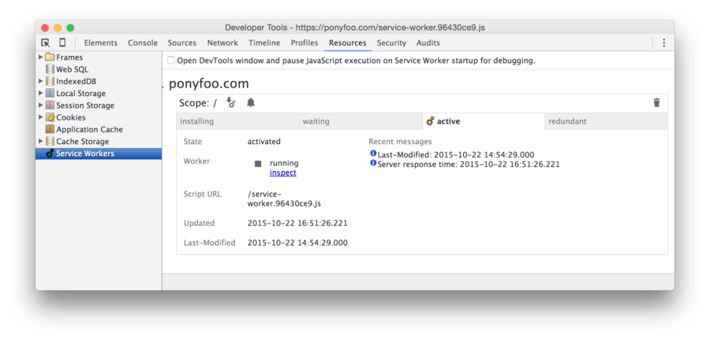
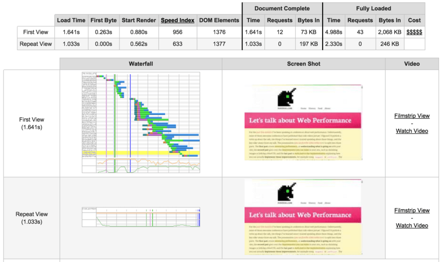

# ServiceWorker: Revolution of the Web Platform

While not the most amusingly named feature of the web platform, everything seems to point at ServiceWorker being the **most significant addition** to the web platform since the introduction of *AJAX* – over 10 years ago. Not to be confused with WebWorker *(used to offload intense compute operations onto another execution thread)*, ServiceWorker allows you to intercept *(and hijack)* network requests originating from your site before they’re even dispatched. This article explores how it works, what it means and what it enables, and how you can implement it by following a case study.

Sitting between humans and websites, ServiceWorker puts you in the driver’s seat. When a ServiceWorker is installed, you’ll be able to deliver responses to requests from the service worker *(which lies on the client-side)*, without necessarily hitting the network.

ServiceWorker is the evolution of the AppCache manifest. AppCache has been bashed for years because of several issues – that were [extensively documented](http://alistapart.com/article/application-cache-is-a-douchebag) – in a resonating *“AppCache sucks”* roar across the blogosphere. Most of the issues in AppCache revolved around it being a simple-looking declarative interface to offline behavior that, behind the curtains, had **a complicated ruleset that wasn’t simple nor intuitive.**

> The ApplicationCache spec is like an onion: it has many many layers, and as you peel through them you’ll be reduced to tears.  
> *– [Jake Archibald](https://twitter.com/jaffathecake)*

On the other hand, ServiceWorker offers a programmatic API that allows you to accomplish so much more than AppCache ever could. Instead of almost-too-magical rules around a simplistic declarative syntax, ServiceWorker relies on plain JavaScript code.

Even though it doesn’t have perfect [browser support today](https://jakearchibald.github.io/isserviceworkerready/), ServiceWorker is just the beginning. Once you implement ServiceWorker in your sites, you’ll be able to provide offline functionality for your pages. Yes, even when the human doesn’t have any network connectivity at all, **they’ll be able to access your site while offline**, provided that they’ve visited at least once before. And that’s *just the basic offering*. ServiceWorker also enables you to send **Push Notifications**, just like mobile apps do, and even when the website is running in the background; you also get to use **Background Sync**, allowing you to execute one-time or periodic updates of the content in your site while it’s backgrounded; and **Add to Home Screen**, which does exactly what it sounds like, making your website feel almost like a native app.


I’ve spent some time playing around with the ServiceWorker API and felt compelled to write about it. While brand new, this API is a web platform powerhouse that we must become acquainted with if we want to have a fighting chance when it comes to mobile devices. Furthermore, ServiceWorker is great for performance besides its offline capabilities, as it grants fine-grained control over caching. Remember those pesky *“this gravatar isn’t cached for that long”* messages on PageSpeed? You can use ServiceWorker as an intermediary cache that caches them for far longer!

If you have a personal website, blog, or small site you use to toy around with, I encourage you to make your way through this guide by trying to implement ServiceWorker on your own site. I did that with [`ponyfoo.com`](https://ponyfoo.com/) and besides being a great thought exercise it feels great to know that now we can access these articles while offline, too.

# Getting Started

Before getting started, we should go over a few notes on ServiceWorker.

- ServiceWorker doesn’t have DOM access – it’s a worker that runs outside of the scope of any one page
- ServiceWorker relies heavily on promises, you’ll have to feel comfortable with them [*(read the guide)*](https://ponyfoo.com/articles/es6-promises-in-depth)
- [`https` is required](http://www.html5rocks.com/en/tutorials/service-worker/introduction/#toc-before) for deployed sites to leverage ServiceWorker, although you can test on `http://localhost` just fine

ServiceWorker is a powerful addition to the web platform, having the ability to intercept all requests originating from a site – including those made against other origins *(e.g: `i.imgur.com`)*. For that reason, the `https` requirement is a given for security concerns.

The quintessential ServiceWorker installation example is in the code snippet below. This is what I’ve used in [`ponyfoo/ponyfoo`](https://github.com/ponyfoo/ponyfoo/blob/e5052ab1545d929f192f6fd7fdbf3e44e10c8eae/client/js/main.js#L40-L42) as well, and it shows how ServiceWorker is easily a progressive enhancement, as this is all the code in the main client-side codebase that references it. The feature test ensures we don’t break older browsers, and the rest of the ServiceWorker-enabled code will live in the `service-worker.js` script.

```
 ('serviceWorker'  navigator) {
  navigator.serviceWorker.register('/service-worker.js');
}
```

It should be noted that a ServiceWorker is scoped according to the endpoint we use to register the worker. If we just use `/service-worker.js` then the scope is the entire origin, but if you register a ServiceWorker with an endpoint like `/js/service-worker.js`, it’ll only be able to intercept requests on your origin scoped to `/js/`, such as `/js/all.js` – not at all useful.

Once a ServiceWorker is registered, it’ll be downloaded and executed. After that, the first step in its lifecycle will be to fire the `install` event. You can register event listeners that will fire at this time in your `service-worker.js` file.

The example below is a simplified version of how I install the ServiceWorker for Pony Foo. The `event.waitUntil` method takes a promise and then waits for it to be settled. If the promise fulfills, the ServiceWorker becomes installed, and otherwise the installation fails. ServiceWorker has access to the `caches` API that can be used as an intermediate cache that lives on the client-side.  
As you can observe in the code below, the `caches` API is heavily `Promise`-based as well. After opening the `v1::fundamentals` cache we use `cache.addAll` to store `GET` responses for each of the `offlineFundamentals` resources in said `cache`.

```
 offlineFundamentals = [
  ,
  '/offline',
  '/css/all.css',
  '/js/all.js'
];
self.addEventListener('install', function installer (event) {
  event.waitUntil(
    caches
      .open('v1::fundamentals')
      .then(function prefill (cache) {
        cache.addAll(offlineFundamentals);
      })
  );
});
```

Why am I caching those particular resources? Because visitors will be able to visit the home page of my site while offline. Additionally, the `/offline` resource can be used as a default offline response for `Content-Type: application/html` requests made against endpoints in my origin *(e.g: [`ponyfoo.com/articles/history`](https://ponyfoo.com/articles/history) while offline)*, as we’ll see later on.

> You can inspect the ServiceWorker lifecycle on DevTools. It’ll make your life much easier while debugging! Just go to the Resources tab and choose the last option in there – Service Workers. Available starting in Chrome 48 *(already in Chrome Canary)*.
>
> 

Once those resources are successfully cached, the ServiceWorker becomes `installed`.

# ServiceWorker Lifecycle

In addition to `installed` – and `installing` while waiting on the cache to be filled up – there’s also an activation step during which an older ServiceWorker becomes `redundant` while the newer one replaces it and becomes `activated` *(until then, the newer ServiceWorker is `activating`)*. There’s [five possible states](http://slightlyoff.github.io/ServiceWorker/spec/service_worker/#service-worker-state-enum) in the ServiceWorker lifecycle.

- `installing` while blocked on `event.waitUntil` promises during the `install` event
- `installed` while waiting to become active
- `activating` while blocked on `event.waitUntil` promises during the `activate` event
- `activated` when completely operational and able to intercept `fetch` requests
- `redundant` when being replaced by a newer ServiceWorker script version, or being discarded due to a failed `install`

After a ServiceWorker is `installed`, the `activate` event fires, and the exact same drill is followed. During the activation step, you could clear up room in the `caches`. Remember how I prefixed my cache as `v1::` earlier? If I updated the fundamental files in my cache I could just `.delete` the older cache and bump the version number, as seen below.

```
 version = 'v2::';

self.addEventListener('activate', function activator (event) {
  event.waitUntil(
    caches.keys().then(function (keys) {
      return Promise.all(keys
        .filter(function (key) {
          return key.indexOf(version) !== ;
        })
        .map(function (key) {
          return caches.delete(key);
        })
      );
    })
  );
});
```

Now that you have an `activated` ServiceWorker, you can begin intercepting requests.

# Intercepting Requests in ServiceWorker

Whenever a network request would be initiated and a ServiceWorker is activated, a `fetch` event is raised on that ServiceWorker instead. Event handlers for the `fetch` event are expected to produce a response for the request, and they may or may not access the network.

In its simplest form, your ServiceWorker could just act as a network passthrough. In this case, the application would seldom be any different than without a ServiceWorker. Note that, by default, `fetch` doesn’t include credentials such as cookies and fails to make requests to third parties that don’t support CORS.

```
self.addEventListener('fetch', function fetcher (event) {
  event.respondWith(fetch(event.request));
});
```

Typically, you don’t want to cache non-`GET` responses, so those should probably be filtered out. The code below will default to a networked response for every `POST`, `PUT`, `PATCH`, `HEAD`, or `OPTIONS` originating from the ServiceWorker’s scope.

```
self.addEventListener('fetch', function fetcher (event) {
   request = event.request;
   (request.method !== 'GET') {
    event.respondWith(fetch(request)); return;
  }
  // handle other requests
});
```

If you’re looking for recipes to handle requests, the [offline cookbook](https://jakearchibald.com/2014/offline-cookbook/) is a great place to look.

# Strategies

There are several different strategies you can apply to resolving requests in your ServiceWorker. Here are the ones I’ve found the most interesting.

# Network then Cached

> Fetch from the network first, and fall back to a cached response if `fetch` fails.

You don’t get to leverage the caching capabilities of ServiceWorker when you’re online with this strategy, because the network always comes first. For that reason, `fetch`-first also has the drawback that an intermittent, unreliable, or very slow network connection will never produce responses, even though it may have a perfectly usable cache going to waste.

- Always hit the network for non-`GET` requests
- Hit the network
  - If network request succeeds, use its `response` and store it in the cache
  - If network request fails, try `caches.match(request)`
    - If there’s a cache hit, use that as the `response`
    - If there’s no cache hit, attempt to fall back to `/offline`

This flow is better at producing fresh content *(as opposed to stale cached responses)* than others, but isn’t all that useful beyond entirely-offline *(as opposed to **effectively-offline** due to low connectivity)* improvements. Mobile devices won’t take full advantage of this strategy because their connectivity might be very low but not low enough for the device to turn `navigator.online` off, and so you end up in the same place as with no ServiceWorker.

## Cached then Network

> Look for a cached response first, but always fetch from the network regardless of cache state.

This flow is similar to the previous one, except you go to the cache first. Here responses may be immediate and you see performance improvements across visits to any content that was previously cached.

- Always hit the network for non-`GET` requests
- Check `caches.match(request)` to see if there’s a cache hit
- Hit the network, regardless of cache hits
  - If network request succeeds, cache its response
  - If network request fails, attempt to fall back to `/offline`
- Return `cached` response in case of cache hit, `fetch` response otherwise

Eventually, the cache becomes fresh again, because `fetch` is always used – regardless of cache hits.

The problem in that case is that the cache may be stale. Suppose you visit a page once. The worker uses `fetch` and then the response is cached. When you visit the page a second time, you get the cached response from the last time immediately, and then a `fetch` is executed that pulls the latest version into the cache. At that point you’ve already applied the previous version, which isn’t the latest content.

## Cached then Network and `postMessage`

The previous flow could serve stale content, but you could update the UI when the updated response comes in. I haven’t experimented with [`postMessage`](https://googlechrome.github.io/samples/service-worker/post-message/) at this point, so this is mostly a thought exercise. The `postMessage` interface can be used to transmit messages between the worker and the browser tabs under its control.

Using the same flow as described in [Cached then Network](https://ponyfoo.com/articles/serviceworker-revolution#cached-then-network), you could add messaging between the worker and the app so that when the cache is updated, any tabs that are on the same page as the updated cache endpoint get updated. Of course, the interaction should be carefully crafted. A combination of virtual DOM diffing and careful planning when dealing with cached resources other than HTML pages would go a long way towards making these updates seamless.

That being said, this approach is probably a bit too sophisticated for most applications. As usual, it all depends on your use case anyways.

# Implementation

On this blog I went for the [“Cached then Network”](https://ponyfoo.com/articles/serviceworker-revolution#cached-then-network) approach. This is the code we had so far. It helped us bail on non-`GET` requests.

```
self.addEventListener('fetch', function fetcher (event) {
   request = event.request;
   (request.method !== 'GET') {
    event.respondWith(fetch(request)); return;
  }
  // handle other requests
});
```

After that, We can look for cache hits with `caches.match(request)` and then respond with the result from a `queriedCache` callback.

```
event.respondWith(caches
  .match(request) 
  .then(queriedCache)
);
```

The `queriedCache` method receives the `cached` response, if any. It then makes a `fetch` request regardless of the cache getting a hit. We also try to fall back gracefully when either fetch or caching fail, with an `unableToResolve` callback. Lastly, we return the `cached` response and fall back to the `networked` promise if we miss the cache.

```
function queriedCache (cached) {
   networked = fetch(request)
    .then(fetchedFromNetwork, unableToResolve)
    .catch(unableToResolve);
  return cached || networked;
}
```

When `fetch` succeeds and `fetchedFromNetwork` is called, we store a copy of the response in the `cache` and then we return the `response` unchanged.

```
function fetchedFromNetwork (response) {
   clonedResponse = response.clone();
  caches.open(version + 'pages').then(function  (cache) {
    cache.put(request, clonedResponse);
  });
  return response;
}
```

When we’re unable to resolve `fetch` requests we have to return a fallback. By default, we can make that an opaque `offlineResponse`. As you can see, you can hardcode `Response` objects and use those to react to network requests.

```
function unableToResolve  {
  return offlineResponse();
}
function offlineResponse  {
  return new Response(, { status: , statusText: 'Service Unavailable' });
}
```

If we were dealing with an image, we could return some placeholder rainbows image instead – provided that `rainbows` is a URL string that was already cached during the ServiceWorker installation step.

```
function unableToResolve  {
   accepts = request.headers.get('Accept');
   (accepts.indexOf('image') !== -) {
    return caches.match(rainbows);
  }
  return offlineResponse();
}
```

Furthermore, if its a gravatar, we could use a tailored `mysteryMan` image for that, also cached during installation.

```
function unableToResolve  {
   url =  URL(request.url);
   accepts = request.headers.get('Accept');
   (accepts.indexOf('image') !== -) {
     (url.host === 'www.gravatar.com') {
      return caches.match(mysteryMan);
    }
    return caches.match(rainbows);
  }
  return offlineResponse();
}
```

Similarly, if it’s a request that accepts HTML, we could return the `/offline` view we had installed earlier.

```
function unableToResolve  {
   url =  URL(request.url);
   accepts = request.headers.get('Accept');
   (accepts.indexOf('image') !== -) {
     (url.host === 'www.gravatar.com') {
      return caches.match(mysteryMan);
    }
    return caches.match(rainbows);
  }
   (url.origin === location.origin) {
    return caches.match('/offline');
  }
  return offlineResponse();
}
```

Lastly, since Pony Foo is a single page application, the ServiceWorker also needs to understand how to render an offline view using JSON. In that case we’ll check that the `origin` matches mine and that the headers are expecting `application/json`. I can then construct a response that Taunus will interpret as the `/offline` view.

```
 (url.origin === location.origin && accepts.indexOf('application/json') !== -) {
  return offlineView();
}
function offlineView  {
   viewModel = {
    model: { action: 'error/offline' }
  };
   options = {
    status: ,
    headers:  Headers({ 'content-type': 'application/json' })
  };
  return  Response(.stringify(viewModel), options);
}
```

There’s plenty of other options. In content sites you could go as far as to autogenerate a ServiceWorker file that has all of the content inlined in it *(or maybe in a big payload that’s cached during installation)*. Or you could progressively crawl the site from the ServiceWorker using `requestIdleCallback`. Or you could just cache things that humans actually visited. Most of the time, that’s good enough.

As long as I’m able to visit content I’ve already seen, but offline, I’m glad to have implemented ServiceWorker. The screenshot below shows [WebPageTest.org](http://webpagetest.org/) results on repeat view where no requests are made whatsoever, shaving `~200ms` from start render time and around `~2.5s` from complete page load. Down **from 43 requests to zero**, and from `~2mb` in page weight to `~200kb`.



Definitely a worthwhile addition to any website.
