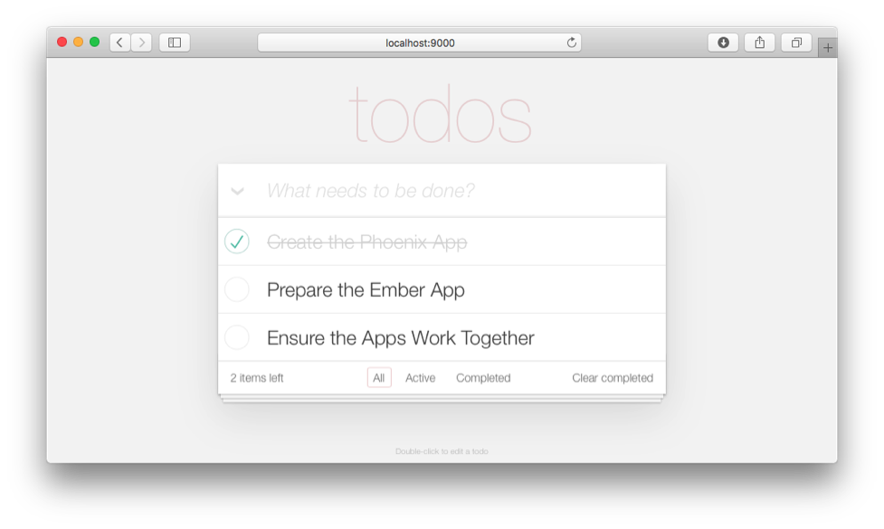

# Creating a Todo Application using the Phoenix Framework and Ember.js

We’re always on the lookout for relevant technologies for our clients. Today we’re going to look at a web application framework called [Phoenix](http://www.phoenixframework.org/ "http://www.phoenixframework.org"). Phoenix is built on Elixir, a blazing fast functional programming language that will feel familiar in some ways if you’ve been writing Ruby.

In this tutorial we’re going to create a simple client-server web application using Phoenix and Elixir on the server, with PostgreSQL as our store data. On the client side, the Ember Javascript framework will provide the user interface and communicate changes to the server. This combination of components is coming to be known as the [PEEP (Postgres, Elixir, Ember, Phoenix) stack](https://medium.com/@j_mcnally/the-peep-stack-b7ba5afdd055 "https://medium.com/@j_mcnally/the-peep-stack-b7ba5afdd055").

Here’s what the todo app we’ll be building looks like:



## Creating the Phoenix App

Before you get started, make sure you followed the [Phoenix Installation Guide](http://www.phoenixframework.org/docs/installation "http://www.phoenixframework.org/docs/installation") so you have all the necessary dependencies installed.

### 1) Create the skeleton application

First up, let’s run the following to create a new Phoenix app:

```
mix phoenix.new phoenix_todos_api --no-brunch
cd phoenix_todos_api
```

We are excluding [Brunch.io](http://brunch.io/ "http://brunch.io/") because our API-only app will not need asset management. When you are prompted to "Fetch and install dependencies?" answer `Y`.

### 2) Create the database

Next we’ll create the database. Make sure that the correct credentials for your PostgreSQL server are in both `config/dev.exs` and `config/test.exs`. The default credentials are:

```
username: "postgres",
password: "postgres",
```

Tip: if you have installed PostgreSQL using Homebrew you can just remove the username and password lines and it should just work.

With the correct credentials in place, run:

```
mix ecto.create
```

You might be prompted to install “rebar”, accept this to continue. After the app has finished compiling you will see:

```
 database  PhoenixTodosApi. has been created.
```

### 3) Boot the server

Next let’s start the Phoenix web server:

```
mix phoenix.server
```

The app should now be accessible at [http://localhost:4000](http://localhost:4000/) and will display Phoenix's default landing page.

Exit the server by hitting `Ctrl + C` twice.

### 4) Generate a Todo resource

The single resource in our API is the Todo item. Each Todo item stores a `title` string and an `is_completed` boolean. Phoenix provides a generator for creating all the files necessary for a JSON resource and we can invoke that using:

```
mix phoenix.gen.json  todos title:string is_completed:boolean
```

The output from the generator will list the files it's created:

```
* creating web/controllers/todo_controller.ex
* creating web/views/todo_view.ex
* creating test/controllers/todo_controller_test.exs
* creating web/views/changeset_view.ex
* creating priv/repo/migrations/20150929044516_create_todo.exs
* creating web/models/todo.ex
* creating test/models/todo_test.exs
```

As you can see, we have the controller, model and their corresponding test files created for us. We also get a migration to update the database, and finally we also have two views created: one `TodoView` for the new controller and another more generic `ChangesetView` that will be used by all JSON controllers to render any validation errors on our models.

### 5) Add the route

Next we need to setup a route to tell Phoenix how to connect incoming requests to the newly generated `TodoController.`

Open up `web/router.ex.` Add a new scope at the bottom:

```
defmodule PhoenixTodosApi.Router 
  
  scope , PhoenixTodosApi 
    pipe_through 
    resources "/todos", TodoController, except: [, :edit]
```

Note we're using the `api` pipeline. More on [Phoenix pipelines here](http://www.phoenixframework.org/docs/routing#section-pipelines).

### 6) Migrate the database

Next we need to migrate the database to create the table where `Todos` will be stored.

```
mix ecto.migrate
…
14.586 [info]  == Running PhoenixTodosApi..Migrations.CreateTodo.change/ forward
14.586 [info]  create table todos
14.617 [info]  == Migrated  .s
```

### 7) Seed the database

Start the server up again:

```
mix phoenix.server
```

Now we can visit <http://localhost:4000/todos> to access our todos but you’ll notice that we don’t have any yet.

Let’s fix this by seeding the database with some initial data. Add the following lines to `priv/repo/seeds.exs:`

```
alias PhoenixTodosApi.Repo
alias PhoenixTodosApi.Todo

Repo.insert!(%Todo{title: "Create the Phoenix App", is_completed: })
Repo.insert!(%Todo{title: "Prepare the Ember App", is_completed: false})
Repo.insert!(%Todo{title: "Ensure the Apps Work Together", is_completed: false})
```

To load in the seeds run:

```
mix run priv/repo/seeds.exs
```

Now when we visit <http://localhost:4000/todos> we see some todos!

```
{
  "": [{
    "title": "Create the Phoenix App",
    "is_completed": ,
    "": }, {
    "title": "Prepare the Ember App",
    "is_completed": false,
    "": }, {
    "title": "Ensure the Apps Work Together",
    "is_completed": false,
    "": }]
}
```

We now have a basic API up and running. It’s time to start working on the client side of the application.

## Preparing the Ember App

For the client side we’ll be using an [Ember CLI](http://www.ember-cli.com/ "http://www.ember-cli.com") implementation of [TodoMVC.com](http://todomvc.com/ "http://todomvc.com/").

Before completing the following steps, make sure you have followed the installation part of Ember CLI's [Getting Started](http://www.ember-cli.com/user-guide/#getting-started "http://www.ember-cli.com/user-guide/#getting-started").

### 1) Clone and install dependencies

Clone the repo for the Ember App and change into the project’s directory

```
git clone https://github.com/ember-cli/ember-cli-todos.git  
cd ember-cli-todos
```

Install the npm dependencies with:

```
npm install
```

And the bower dependencies with:

```
bower install
```

### 2) Start Ember’s server

To confirm that everything is installed as it should be, boot the app with:

```
ember server
```

Visit [http://localhost:4200](http://localhost:4200/) in your browser. At this point you can add todos, but it is only using in-memory storage and todos are not persisted when you refresh the page.

### Connecting Ember to Phoenix

So far we have a working server-side API app written with Phoenix, and a working client-side app written with Ember. But the two apps aren't talking to each other. Next we’ll look at connecting the two apps together and have our todos persisted.

### Changes to the Ember App

#### 1) Configuring Ember Data to use Phoenix

Instead of using in-memory storage, we need to configure [Ember Data](https://github.com/emberjs/data "https://github.com/emberjs/data") to use our Phoenix API as a backend instead. To do this, replace the contents of `app/adapters/application.js` with:

```
import config  '../config/environment';
import FixtureAdapter  'ember-data-fixture-adapter';
import DS  'ember-data';

 adapter;
 (config.environment === 'test') {
  adapter = FixtureAdapter.extend({});
}  {
  adapter = DS.RESTAdapter.extend({
    host: 'http://localhost:4000'
  });
}

export default adapter;
```

Note that if the app is booted under the test environment then we are going to continue to use the original `FixtureAdapter`, but for all other environments we are now using the `RESTAdapter` and instructing it to look for our Phoenix API at [http://localhost:4000](http://localhost:4000/).

**Tip:** The default adapter for Ember Data is actually the `JSONAPIAdapter` which expects an API that is modeled after the [JSON API Spec](http://jsonapi.org/ "http://jsonapi.org/"). If you are planning to build a serious API, it would be a good strategy to explore following this specification (perhaps by using the [ja\_serializer](https://github.com/AgilionApps/ja_serializer "https://github.com/AgilionApps/ja_serializer") or [jsonapi](https://github.com/jeregrine/jsonapi "https://github.com/jeregrine/jsonapi ") packages). However for the purposes for this tutorial we using the `RESTAdapter` in order to keep our example simple.

#### 2) Configuring the serializer

By default Ember Data expects our JSON to use camelCasing for key names, but our Phoenix API is using snake\_case. To work around this we must also customise the serializer that Ember uses.

First create a `serializers` directory:

```
mkdir -p app/serializers/
```

and then create a file at `app/serializers/application.js` and copy in this code:

```
import config  '../config/environment';
import DS  'ember-data';
import Ember  'ember';

 serializer;
 (config.environment === 'test') {
  serializer = DS.JSONSerializer.extend({});
}  {
  serializer = DS.RESTSerializer.extend({
    keyForAttribute(attr) {
      return Ember.String.decamelize(attr);
    }
  });
}

export default serializer;
```

Again we’re using a different serializer in the test environment, but otherwise we provide a custom `RESTSerializer` that uses Ember's builtin in `decamelize` adapter to translate all Ember Data model attributes into snake\_case. This is a fairly simplistic approach, but will work for the our purposes today.

#### 3) Setting up CORS

Because our client and server are going to be hosted from different ports we’ll need to put in place security policies that allow them to communicate. First we’ll update the [CSP headers](https://en.wikipedia.org/wiki/Content_Security_Policy "https://en.wikipedia.org/wiki/Content_Security_Policy") that the Ember server is providing. Modify the contents of `ENV.contentSecurityPolicy` for the development environment, inside of `config/environment.js:`

```
ENV.contentSecurityPolicy = {
  // ...
  'connect-src': "'self' http://localhost:*",
  // ...
}
```

The change we have made here is to append `http://localhost:*` to the `connect-src` rule, permitting connections to any port on localhost.

We will also need to add [CORS headers](https://en.wikipedia.org/wiki/Cross-origin_resource_sharing "https://en.wikipedia.org/wiki/Cross-origin_resource_sharing") to the Phoenix App, and to do so we need to know what port the Ember App will be running from. Let's set the port to 9000 inside of the project’s `.ember-cli` config file (found in the root directory of the Ember App):

```
{
  // ...
  "port": 
}
```

### Changes to the Phoenix App

We need to add [CORS headers](https://en.wikipedia.org/wiki/Cross-origin_resource_sharing "https://en.wikipedia.org/wiki/Cross-origin_resource_sharing") to the app so the browser will permit Ember to make requests to it.

#### 1) Setting up cors\_plug

We can do this by employing an open source [plug](http://www.phoenixframework.org/docs/understanding-plug "http://www.phoenixframework.org/docs/understanding-plug") called [cors\_plug](https://github.com/mschae/cors_plug "https://github.com/mschae/cors_plug"). To use it we need to add it to our dependencies in `mix.exs`:

```
  {:cors_plug, "~> 0.1.3"},
```

And then install it with:

```
mix deps.get
```

Once installed we can add it to the app’s endpoint, found in `lib/phoenix_todos_api/endpoint.ex`:

```
defmodule PhoenixTodosApi.Endpoint 
  
  plug CORSPlug, [origin: "http://localhost:9000"] # add this line
  plug PhoenixTodosApi.Router
```

We’ve placed it above `PhoenixTodosApi.Router` in the pipeline, and we are also passing it `http://localhost:9000` as the origin, which is using the port we configured the Ember App to run on.

#### 2) Configuring the JSON root keys

The `RESTAdapter` in Ember expects the root key of our JSON responses to map to the Ember Data model it should be deserialized into. For the Todo model this will mean `todos` for a collection of todos, and `todo` for a single todo. But when we ran `mix phoenix.gen.json Todo` it set up the TodoView to always respond with `data` as the root key.

Let's change the JSON output to use `todos` as the root key for a collection of todos, and `todo` as the root key for a single todo. First we will update the controller test to expect this change. Open up `test/controllers/todo_controller_test.exs` and replace all instances of `["data"]` with `["todo"]` (there should be 4 replacements). Then find the test for the `:index` action and change the expected root from `["todo"]` to `["todos"]`:

```
test "lists all entries on index", %{conn: conn} 
  conn = get conn, todo_path(conn, :index)
  assert json_response(conn, )["todos"] == []
```

Now run the controller test and you should see 4 failures:

```
mix test test/controllers/todo_controller_test.exs
...
Finished  . seconds (.s on load, .s on tests)
 tests,  failures
```

To get the tests passing we can modify the root key specified for the `index.json` and `show.json` views. We can find these in `web/views/todo_view.ex`:

```
 render("index.json", %{todos: todos}) 
  # '%{data:' replaced with '%{todos:':
  %{todos: render_many(todos, PhoenixTodosApi.TodoView, "todo.json")}

 render("show.json", %{todo: todo}) 
  # '%{data:' replaced with '%{todo:':
  %{todo: render_one(todo, PhoenixTodosApi.TodoView, "todo.json")}
```

Let’s run the tests again to ensure everything is now passing:

```
mix test test/controllers/todo_controller_test.exs
...
Finished  . seconds (.s on load, .s on tests)
 tests,  failures
```

Our Phoenix App is now ready to accept requests from the Ember App.

## Testing the Apps Together

We can verify that our apps work together by booting each one, starting with Phoenix:

```
mix phoenix.server
```

Followed by Ember:

```
ember server
```

And then visiting [http://localhost:9000](http://localhost:9000/) in our browser.

We should see the Ember App populated with the data we seeded into the Phoenix App previously. Any changes we make in the Ember App are persisted to the Phoenix App. You can watch the log output from `mix phoenix.server` to see this in action. If we refresh the page, your changes have been persisted.
