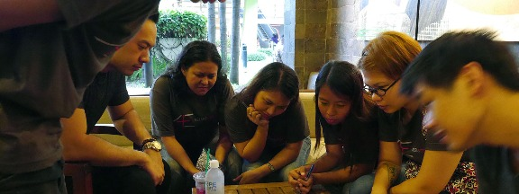
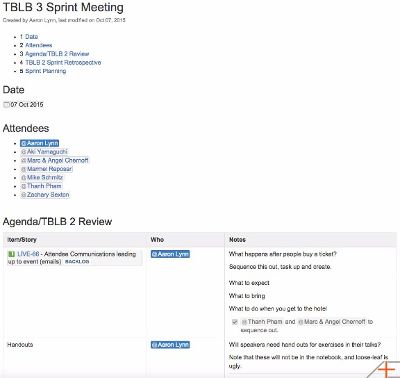
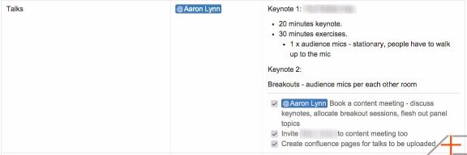

# How to Take Good Meeting Notes

By [Aaron Lynn](http://www.asianefficiency.com/author/aaron/ "Posts by Aaron Lynn")

Meetings.

Nobody particularly likes them, but they are absolutely essential to modern-day knowledge work.

At Asian Efficiency, we use meetings to problem-solve and to align different teams or team members on a particular objective. And one of the ways that we do this effectively is by taking good meeting notes.

You see, there’s no point to having a meeting if everyone just talks and discusses a lot and nothing is solved, implemented, or recorded.

So the question becomes: **How do I take good notes in meetings, or on calls, or at live conferences and seminars?**

How do I do this in such a way that I don’t get overwhelmed by the information, and what do I do with the notes afterwards?

I originally wrote this guide for our internal training use to help the rest of the AE team become more proficient note-takers. Hopefully, you will find it useful, too!

## Different Types of Note Taking

The first thing to realize is that there are two different types of note taking that you can do.

The first is [mind mapping](http://www.asianefficiency.com/mind-mapping/), which we will *not* focus on in this guide. Mind maps are really better-suited for big, free-flow creative sessions or piecing together lots of information at a conference or seminar. They’re also great for reading books and summarizing information. But they are not ideal for meetings and calls.

The second type of note taking is textual notes: the traditional headings, bullet points, and, well, just words in a list. This is what we’ll be focusing on here.

## The Note-Taking Process

Note taking is not a one-off process. You don’t simply show up to a meeting and start taking notes.

In fact, note taking is a multi-stage process, where you:

1. Prepare to Take Notes
2. Take Good Notes Live
3. Review and Tidy Notes
4. Implement Notes

Let’s look at each of these in detail.

## 1. Prepare to Take Notes

The first step to taking good notes is to prepare.

Every meeting should have a structured agenda set up beforehand.

We use a very simple meeting template at Asian Efficiency, and it includes:

- The date.
- List of attendees.
- Goals/Objectives of the meeting (if not obvious).
- Table of items, who, and notes.

It looks a bit like this:

Everything should be in place BEFORE the meeting starts, and during the meeting, the note taker will note down information and tasks in the Table.

Before the start of every meeting, one person attending the meeting should be assigned as the **Scribe—**the note taker. This can be highlighted on the agenda, or if not, the scribe can be selected at the start of the meeting.

This seems obvious, but almost everyone forgets to do this, and it results in a lot of meetings where we get to the end and ask, “Uh, did anyone take notes?”

Very clearly, at the beginning of the meeting, highlight who the scribe is going to be. The scribe can be assigned by the person running the meeting, or someone can volunteer to scribe.

Ideally, the scribe should not be someone who will talk a lot during the meeting. It’s hard to discuss and write at the same time, and the scribe really needs to concentrate on taking good notes.

It does help if the scribe is somewhat familiar with the subject area and problems being discussed, but it is not a deal-breaker.

So what exactly does a scribe do? They take notes!

It is the responsibility of the scribe to capture the core of what is being discussed in the meeting.

Now if we take the role of the scribe and combine it with the agenda we mentioned earlier, we can work out that the scribe should really read through the meeting agenda BEFORE the meeting, and seek to understand what is going to happen during the meeting. And if any items are unclear, they should be asking questions of different team members beforehand.

## 2. Take Good Notes Live

The secret to taking GREAT notes is to **LISTEN**.

Use the meeting agenda as a guide, listen to what is being discussed, and note down what is appropriate.

We like to take notes under a horizontal rule inside the actual agenda, like this:

In general, these should be textual notes, which include:

- Bullet points for general information.
- Checkboxes for action items, tagged with a name and a date if necessary.

When it comes to taking good notes live, there is no substitute for practice and experience, but there are things that can be done to cut down on the learning curve.

As a scribe, you generally want to let people talk and follow along.

You want to really listen and focus mainly on:

1. Decisions that are being made.
2. Things that need to be actioned.
3. Information that has to be retained or recorded.

You don’t need to write down everything—just the highlights.

You can also use whatever format you’re comfortable with. I personally prefer typing directly into the meeting notes (the [touch it once principle](http://www.asianefficiency.com/mindsets/touch-it-once-productivity-principle/)), but others prefer taking handwritten or shorthand notes and then typing them up later.

Taking notes is really a skill that gets better over time. It just takes lots and lots of practice. What you are doing is training your ability to take in auditory information, compress and summarize the ideas in your mind, and then record them right away as textual information.

***Tip:** If you want practice, volunteer to scribe/take notes—always!*

If during the process of taking notes you miss something, you can always interrupt the flow of the meeting as appropriate and ask the attendees to repeat the information or points. This may seem rude, but it is not. If you missed it (and you’ve been listening with intent), chances are other people missed it, too, and the reminder will help them retain that information better.

## 3. Review and Tidy Notes

Now that you’ve prepared and taken notes during the meeting, it’s time to make the magic happen.

Immediately after the meeting is over (or as soon as possible), you will want to go through the notes.

While everything is still fresh in your mind, you want to clarify, summarize, and tidy up whatever you need to.

Look for ideas that can be summarized in single points.

Look for action items that need to be converted from bullets into checkboxes.

Read over the notes as a coherent whole and see if anything doesn’t make sense or if there is anything missing.

As you gain more experience with note taking, you’ll find that there will be less tidying that needs to be done.

## 4. Implement Notes

The final step of the process of taking good notes is to implement them.

After all, there’s no point in taking notes if they never get actioned or utilized.

After tidying the notes, the scribe and the meeting owner (or product owner, or product manager) should sit down together and go through the notes and action items.

How you want to implement notes is really dependent on how your systems are set up.

On some teams, notes are simply saved as a Word document and emailed out to all attendees.

On some teams, action items are moved into a project management system like JIRA or Asana, while information is filed away in Confluence or a Google Doc.

**What you need to do really depends on your team setup**, but there absolutely must be some form of storing information and making sure that action items are actually actioned.

To emphasize: there will always be **information** and **action items**.

- **Action items** go into a task or project management system.
- **Information** goes into documents, wikis, or, if not permanent, can stay on the meeting agenda page.

If you do this implementation step and have functional task and information systems, you should almost never need to refer back to the meeting minutes/agenda as a checklist, unless it’s for reference or to jog someone’s memory of what was discussed during the meeting.

In fact, at Asian Efficiency, we actually check off action items from the meeting agenda during this implementation step, when we convert the items into JIRA tasks.

## Practice, Practice, Practice!

In a nutshell, that’s basically how you take good notes, live, during meetings.

It is a skill that really gets better with practice, and having a strong preparation and post-meeting review and implementation process makes the notes themselves much more useful and effective.
