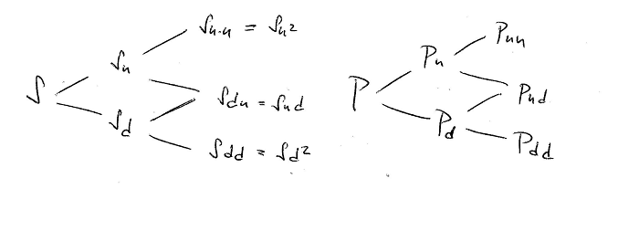
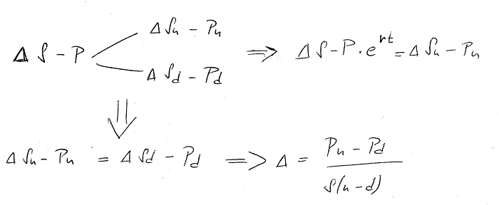
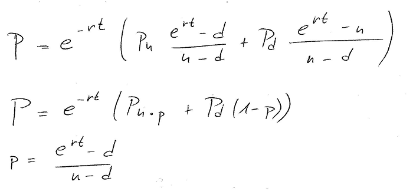
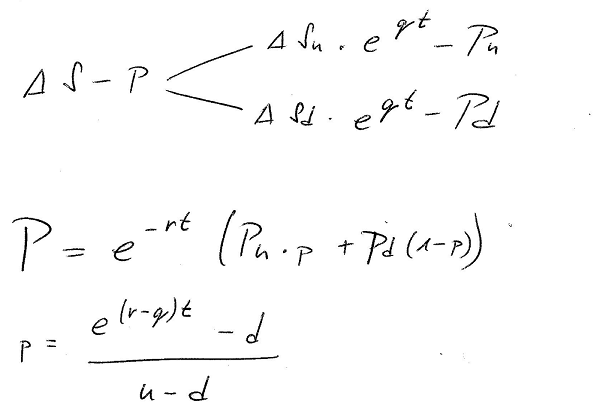
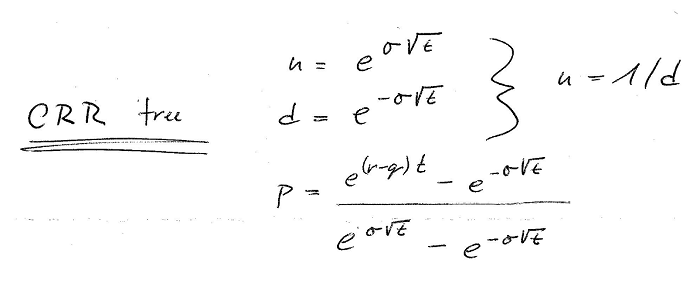
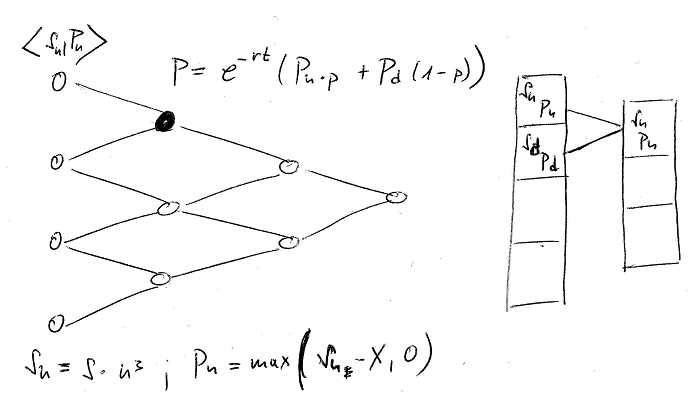

# Options pricing in F#

I have recently written a small option pricing library in F# called [Pricer](https://github.com/hoonzis/Pricer) (what an original name...). It contains a set of methods for derivatives pricing, generating payoff charts, estimating volatility. Payoff charts show you the profit of an option as a function of the share price change. One can create a payoff charts of any derivative. Multiple options traded in the same time form strategies which can be used to obtain different type of protection or leverage against the movements of the underlying stock - but that is not the subject of this post.

This post is about options pricing and the way it can be implemented in F#. There are generally two methods to price options:

- Black Scholes formula
- Binomial pricing

Black Scholes is closed-form mathematical formula for pricing European options (options that can be exercised only at the maturity). Binomial pricing is algorithmical method that can be applied to pricing of diverse financial products. Both of these methods place the same assumptions on underlying share and it's movements.

There are quite a lot of examples of the Black Scholes implementation around the web. Taking into account the fact that it is a mathematical formula, besides translating it into given programming language, there is not that much to talk about. So this blog post will be about Binomial Pricing. However, for both methods it is quite important to understand how the underlying stock movements are modelized.

## Share price and it's movements

In order to determine the price of the option, one has to guess how the shares will move in the future. That is not possible but we can assume two facts:

- the stock price follows a long term direction (in the long term it keeps climbing or it declines)
- the stock oscillates randomly in the short term

These two assumptions are contained in the following equation, which describes the stock movement as generalized [Wiener process](https://en.wikipedia.org/wiki/Wiener_process) (type of stochastic process).

```
dS = alpha*S*dt + sigma*S*dW
```

This equation describes the change in the share price (dS) in time (dt), as a function of the current share price (S), the drift (alpha), which is the long term direction of the stock, the volatility (sigma) and (dW) random value, which represents the random swing in the share price in the short time (dt). The volatility affects how big the random swings in the share price will be.

This by it self would not be enough to build any pricing model. A second assumption is based on the share price and it's daily returns. The daily returns of the stock which follows the generalized Wiener process have log-normal distribution. If we assume, that the daily returns are independent, than the logarithms of daily returns are normally distributed. It is important to keep this assumption in mind. Both methods (BS and Binomial pricing) are based on the fact, that the logs of daily returns are normally distributed and are indepent, which in the real time is not the case.

## Binomial pricing

The basic idea behind binomial pricing is the following. We assume that the share can move every day up or down, always in the same way. With this knowledge we will build a tree (binomial) which will contain all paths that the share price could undertake from now until certain time in the future (usually the maturity). In the same time, we can construct a second tree which will hold the prices of the derivative. The price of the option depends on the price of the underlying and thus any change in the price of the share will result also in change in the price of the option. Here are the trees:



We assume that there are constants **u** and **d** which symbolize the movements of the stock. The stock in the next time step will have value **S\*u** if it goes up or **S\*d** if it goes down.

Imagine that we could create a portfolio in which we would hold a certain number of shares (usually called delta) and short position in the derivative (selling the option in the same time) and that we would figure out the exact amount of shares (delta), which would make this portfolio immune to the share price. The portfolio would not loose nor win anything if the share price changes in any way. If we find out the exact number of shares needed to hedge the option, our portfolio should hold a stable value.

As it was said before the price of the option depends on the price of the share. If the price of the derivative changes the following day, because the stock moved, then the delta will change as well, we will have to buy different number of shares to "hedge" the option that we are selling. This is practice of continously adapting to the share and derivative price to keep neutral portfolio is called delta hedging.

Now back to delta, how can we figure out the exact amount of shares to hedge the option?

In a world where there is no arbitrage possible, nor taxes, this portfolio should earn you exactly the neutral interest rate - because it does not move. Taking these assumptions we will try to deduce the delta (the number of shares the we need to hold):



We have extracted two pieces of information from the binomial tree:
- the value of the portfolio should stay the same, which let's us solve for delta
- if the stock goes up, then the value of the portfolio should be equal to the portfolio monetized with neutral interest rate.
`(delta\*Su - Pu) = (S-P)\*exp(rt)`
We will use this knowledge later to determine the price of option P from the prices Pu and Pd in the next nodes.

We can use those last two equations and solve for **P** the price of the option.



We have defined a technical variable called **p** (small p) which is usually called technical probability just to simplify the equation, and we have the option price (**P**) as a function of **Pu** (the price of the option if the stock goes up) and **Pd** price of the option if the stock goes down. That means that if we would be able to find the prices of the derivative in the end nodes - at the maturity, we could walk the tree back all the way to the current node, to get the price of the derivative right now.

Now to make the things a bit more complicated, the stocks pay dividends and we have to take that into account. If the dividend yield is **q**, then the tree of our portfolio would be a bit different:



The dividend would raise the price of the stock up a bit in each step top **Su\*exp(qt)**, but everything else stays the same. The technical probability (**p**) now contains the dividend as well.

We have everything, but what we did not yet figured out are the values of **u** and **p** the multiplicators which make the stock go up or down.

This was determined by Cox, Ross, & Rubinstein in the [CRR binomial pricing model](https://en.wikipedia.org/wiki/Binomial_options_pricing_model), which tells us to use the volatility to obtain the values of **u** and **d**.



It is beyond the scope of this blog, to explain how this was determined, but note that this is only possible if the log returns of the underlying have normal distribution and if the returns of the stock are independent, (hence that introduction about share price modelization).

## Implementation

I will present here two implementations both in F#, the first one is more imperative in style, since it modifies two arrays which represent the actual layer of the binomial tree. The second implementation is purely functional code, however the ratio behind is the same and it is shown on the next images:



The algorithm has the following steps:

- Determine the prices of the stock and the derivative in the end nodes.
- Go backwards in the tree and compute the price of the derivative (P) as the function of **Pu** and **Pd** (derivative prices from the previous nodes)
- In the case of pricing American options, the option can be exercised any time (before maturity). If so, compare in each node the price of the stock to the price of the underlying share, and determine if pre-mature exercise is worth.

The price of the derivative in the end node is calculated with the **optionValue** function. For call option it would be *max(S-X,0)* for a put option *max(X-S,0)*, where *X* is the strike of the option. The following algorithm takes the number of steps in the tree as parameter and an option definition. Option has a property called **TimeToExpiry** which is the value between the purchase date of the option and the maturity in days. This time is then divided by the number of steps to obtain **deltaT** the time interval of a single step.

```
 deltaT  optionTimeToExpiryfloat steps
   stockVolatility deltaT
   
    stockdeltaT
   
 p_down    

 pricing  
    Periods  steps
      
      
      
    PDown  p_down
      
    Option  option
      stockCurrentPrice

 prices  ArrayzeroCreate pricingPeriods
 optionValue 
    match pricingOption 
              ->   ->   prices  pricingOptionStrike
              ->   ->   pricingOptionStrike  prices

prices <- pricingpricingfloat pricingPeriods
 oValues  ArrayzeroCreate pricingPeriods
oValues]<- optionValue 
    pricingPeriods 
    prices <- pricespricingpricing
    oValues]<- optionValue 

 counter  pricingPeriods
   counter downto  
          
        oValues <- pricingoValuespricingPDownoValuespricing
oValues
```

The technical probability (**p**) is determined as **p\_up**. We have also defined **p\_down** as *1-(p\_up)* just to simplify the computations.

Note that the implementation iterates and modifies 2 arrays: *oValues* which contains the prices of the derivate and *prices* which contains the prices of the stock in the current layer.

## Functional way

The previous implementation is cool but we iterate over the stock and option price arrays and constantly modify their's content, let's try to come up with an immutable way.

That can be surprisingly easy, let's define a function for single step backwards in the tree. This function would take a list of values, which are the values of the nodes in the current layer and produce another list which would contain the derivative prices in the next step. If we pass in a list with 4 items, we should get a list of 3 items, going down until we have only one item, which will be the derivative price.

This is achieved thanks to **Seq.pairwise** which iterates over all consecutive values in the array - in our case the first item will be *P\_up* and second *P\_down*.

```
  derPricefloat  pricingBinomialPricing 
    derPrice  |> pairwise
              |>   derPrice' )->
                 price  pricingpricingPDownpricing
                derPrice'  price'

  reducePrices derPricefloat  pricingBinomialPricing 
    match derPrice 
             single -> single
             prices -> reducePrices  prices pricing pricing
```

Rewriting all in functional way would resolve into something similar to the following snippet. I have changed the algorithm a bit to keep track of the share and the option price. Now the list of prices passed from one step to another contains a tuples of share price and option price.

```
 binomialPricingFunc pricingBinomialPricing 
     optionVal stock 
        match pricingOption 
                  ->   stock  pricingOptionStrike
                  ->   pricingOptionStrike  stock

     prices  generateEndNodePrices pricing pricing pricingPeriods optionVal

      pricesfloatfloat  
        prices
            |> pairwise
            |>   prices' sDowndDown ->
                 derValue  pricingpricingPDowndDownpricing
                 stockValue  pricing
                    pricingOptionStyle  American 
                                 prematureExValue  optionVal stockValue
                                 derValue prematureExValue
                             derValue
                prices'  stockValue

      reducePrices prices 
        match prices 
                 stock -> 
                  -> reducePrices  

    reducePrices prices
```

Now one last remark, I am using a method call **generateEndNodePrices** which gives me the list of the prices in the last nodes. Even this function can be written in nice functional way:

```
 generateEndNodePrices float float periods optionVal 
             
         lowestStock  float periods
         first  lowestStockoptionVal lowestStock
         values  unfold  stock)->
             stock  stock
               optionVal stock'
             stockstock'  first
        values |>  periods |> ofSeq
```

All it takes is to have the share price (*ref*) and the multiplicator to obtain it's price in the next step if the price goes up. We can then use **unfold** to get the price list.
