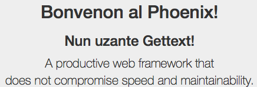
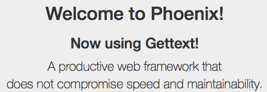

# Internationalization using Gettext in the Phoenix framework

Dec 20, 2015
|
Programming,
Elixir,
Phoenix

**Written using Phoenix 1.1**

## Internationalization - what is it?

*Internationalization* (henceforth called i18n, because programmers are lazy and hate typing long words) is the process of adapting a web application for use in different languages or cultures. Any application that allows you to change your language has implemented i18n. It’s a close sibling of *localization* (L10n) - the process of actually implementing a different language/culture in a web app. Once support for i18n has been included in an app, it can be localized. This may involve adding new text strings in a different language, or configuring different date formats.

For a concrete example, Facebook (at last count) supported **98** different languages - you can change your settings to use Facebook in such languages as Vietnamese, Italian, or Welsh; languages with entirely different character sets such as Russian, Hebrew or Arabic; or more esoteric choices such as Esperanto, Latin, Leet Speak, or English (Upside Down). (No, I’m not joking on those last two.) When you change your language, all the text that was in the previously-selected language (such as “Like”, “Search”, “Find Friends”, etc.) will all be in the newly-selected language.

## I18n with Linguist

In the early days of Phoenix, there was [Linguist](https://github.com/chrismccord/linguist), which was modeled on i18n support in Ruby on Rails. It required changing all of the text in your views to use its translation helpers - instead of writing something like:

```
Welcome  @user >!</
```

You might write the following:

```
>< @current_locale "homepage.welcome"  @user ></
```

And then you could define locale files with all of the different translations:

```
defmodule  
   Linguist.Vocabulary

  locale  
    homepage 
      welcome "Welcome, %{name}!"
    
  

  locale  
    homepage 
      welcome "Bonvenon, %{name}"
```

You could then set the `@current_locale` to whatever value you wanted (in my example, either `en` or `eo`), and text would automagically be translated when the page was rendered.

However, it was never really a fully-fleshed-out ready-for-production-use solution. It requires a lot of cognitive overhead, strict discipline to come up with a suitable translation key for each piece of text, and generally got very messy on large applications. (Ask any Rails developer.)

So in version 1.1, support for **Gettext** was added.

## An introduction to I18n with Gettext

[Gettext](https://en.wikipedia.org/wiki/Gettext) is an established standard for doing i18n and l10n in any kind of applications, not just web applications. So how does it work?

In your template files, you can now use the helper function `gettext` to mark where translated text should go. If you’ve generated a new Phoenix app using Phoenix 1.1, an example of this will already be done in `web/templates/page/index.html.eex` -

```
>< gettext "Welcome to %{name}"  "Phoenix!" ></
```

No more needing to come up with obscure translation keys - you simply write the text that you want to appear in your native language (in my case, English).

The beauty of this approach is that you can add `gettext` calls to your view before you ever start thinking about localizing your app - by default, `gettext` will just return the string passed in. So if you never need support for another language, it’s no big deal - the app works exactly the same whether you do or not.

To actually start localizing your app into another language, you’ll need to use a couple of provided Mix tasks - `gettext.extract` and `gettext.merge`.

## Working with `.pot` files

By default, Gettext stores all of its locale-related information in `priv/gettext`. If you have a look in there now, you’ll find an `errors.pot` and a folder for `en` translations - this contains an `LC_MESSAGES/errors.po` file.

The `.pot` files are the *template* files (yes, the `t` stands for `template`). These contain all of the translatable strings that Gettext has parsed from your app, and these files shouldn’t be modified manually. If you add new strings to our app that requires translation, you’ll need a way to get them into these `.pot` files - thats where the `gettext.extract` Mix task comes in.

If you run `mix gettext.extract`, it will create a new `.pot` file for the strings in your app:

```
mix gettext.extract
Generated test_gettext app
Extracted priv/gettext/default.pot
```

Inside this `priv/gettext/default.pot` file, you’ll see the template string from the auto-generated index template (header block omitted for brevity):

```
#: web/views/page_view.ex:2
msgid "Welcome to %{name}"
msgstr
```

To demonstrate how these files get updated when re-running the `gettext.extract` task, let’s add another string to translate. In `web/templates/pages/index.html.eex`, add a second call to `gettext` - I’ve used the following:

```
>< gettext "Welcome to %{name}"  "Phoenix!" ></
>< gettext "Now using Gettext!" ></
```

When you run `mix gettext.extract` again, the `default.pot` will be updated with the second translation (header block omitted for brevity):

```
#: web/views/page_view.ex:2
msgid "Welcome to %{name}"
msgstr 

#: web/views/page_view.ex:3
msgid "Now using Gettext!"
msgstr
```

The page itself still looks fine, even with the added heading. You now have a list of all the translatable strings in our application; now you can look at translating them into different languages.

## Working with `.po` files

Translations themselves go into `.po` files, scoped by the locale they are for. By default you have a `priv/gettext/en/LC_MESSAGES/errors.po`, which contains the default Ecto error strings in English (the `LC_MESSAGES` part is for Unix compatibility and can be ignored for now.) If you wanted to ‘translate’ the new string to English, run the following:

```
mix gettext.merge priv/gettext
```

**NOTE:** The two Mix tasks can be combined into one call: `mix gettext.extract --merge`

This will update any existing `.po` files, with any updates from `.pot` template files. This includes the creation of new `.po` files - because there’s now a `default.pot` file, it will generate a `default.po` for the English locale.

```
msgid 
msgstr 
Language: en\n"

#: web/views/page_view.ex:2
msgid "Welcome to %{name}"
msgstr 

#: web/views/page_view.ex:3
msgid "Now using Gettext!"
msgstr
```

It looks really similar to the `.pot` files, except for the “Language” specification at the top - this is by design. But that’s not really exciting. I18n is all about *different* languages, and I’m a student of Esperanto, so I’ll demonstrate how to translate our two sample strings into Esperanto.

To add a new language to your application, specify the `--locale` option when running `mix gettext.merge`. Esperanto’s language code is `eo`, so run that command:

```
mix gettext.merge priv/gettext --locale eo
Created directory priv/gettext/eo/LC_MESSAGES
Wrote priv/gettext/eo/LC_MESSAGES/default.po
Wrote priv/gettext/eo/LC_MESSAGES/errors.po
```

New `.po` files are generated, and these are the ones we can edit with the Esperanto translations of our text.

Update `priv/gettext/eo/LC_MESSAGES/default.po` with the following content (I don’t assume you know Esperanto!)

```
msgid 
msgstr 
Language: eo\n"

#: web/views/page_view.ex:2
msgid "Welcome to %{name}"
msgstr "Bonvenon al %{name}!"

#: web/views/page_view.ex:3
msgid "Now using Gettext!"
msgstr "Nun uzante Gettext!"
```

Now you just need to configure your app to use the Esperanto locale. If you wanted to allow users to select the language to browse your site in, you might add a `locale` attribute to your `User` schema, but that’s a bit outside the scope of this blog post - for now let’s just implement a custom plug that allows switching locales via a query string parameter.

## Switching and setting locales

Create a new file called `web/controllers/locale.ex` and put the following content in it:

```
defmodule MyApp.Locale 
  import Plug.Conn

     

    _opts 
     params"locale"  get_session :locale 
           -> 
      locale  ->
        Gettextput_localeMyApp.Gettext locale
         |> put_session:locale locale
```

Substituting your own application name for `MyApp`. This plug will inspect the `params` supplied in the connection, and if the `locale` parameter is not nil, will set the application locale to whatever is supplied. It’ll also set the locale in the session for future requests.

You can configure your application to use this plug for all requests by adding it to your browser pipeline in `web/router.ex`:

```
pipeline :browser 
  
   MyApp.Locale
```

Now you can change the locale in your application by setting a query string parameter: http://localhost:4000/?locale=eo gives you:



And changing the URL to http://localhost:4000/?locale=en gives you:



And just like that, we have our app configured for i18n, and localized for a new language!

## Maintaining an app using Gettext

This is just a toy example, but the methodology can be used for the entire lifetime of your app.

Every time you add some new text to a template, wrap it in a `gettext` call. Then, periodically, you can run `mix gettext.extract --merge` to update your `.pot` template files and `.po` translation files.

You can either work with the `.po` files yourself, or use one of the many existing tools available for working with them. Because Gettext is such a widely used standard, there many tools out there, such as [Poedit](https://poedit.net/).

This has only been a brief look into the new Gettext support in Phoenix 1.1, but hopefully it’s enough to show the potential and how easy it is to work with!
