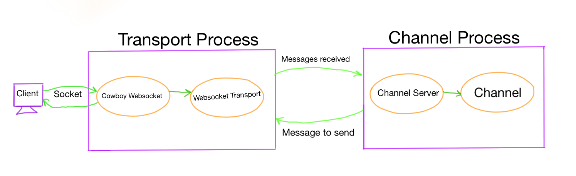
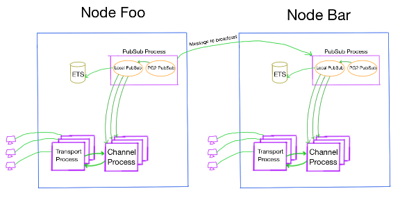

# Guts of Phoenix websocket channels

I knew that Phoenix framework could handle a lot of simultaneous websocket clients but the result that Chris posted just amazed me. This piqued my interest of how phoenix framework web socket layer actually works. I started looking over the code and I was amazed that how little code was there that accomplished a lot just because it used the right things.

In this post we are going to look at how the Phoenix channels are designed.

### Major components

Following are the major components that make up the whole of phoenix channels.

- **[Transport:](http://www.zohaib.me/guts-of-phoenix-channels/?utm_campaign=elixir_radar_28&utm_medium=email&utm_source=RD+Station#Transport)** This is the basic abstraction that sits in middle of the socket/communication layer and the channel.
- **[Channel:](http://www.zohaib.me/guts-of-phoenix-channels/?utm_campaign=elixir_radar_28&utm_medium=email&utm_source=RD+Station#Channel)** Includes the channel created by developer and the associated GenServer created by phoenix
- **[PubSub:](http://www.zohaib.me/guts-of-phoenix-channels/?utm_campaign=elixir_radar_28&utm_medium=email&utm_source=RD+Station#PubSub)** The PubSub (publisher subscriber) is responsible for broadcasting a message to all the sockets associated with a particular topic.

### Transport

Transport is the communication layer. It is responsible for receiving messages from client and passing it over to channel and receiving messages from channel to send it back to client.   
From `Phoenix.Socket.Transport` module doc the responsibilities of it are (verbatim)

- Implementing the transport behaviour
- Establishing the socket connection
- Handling of incoming messages
- Handling of outgoing messages
- Managing channels
- Providing secure defaults

In case of Phoenix it comes with two types of transports, one uses websocket and other long polling.

The transport allows to abstract away how upper layer i.e. channels receives or sends messages. Channels only need to call the right function of transport module and let it handle the raw work of communication.

For example if you don't want to use Phoenix framework for websites but with some other system in which you want to receive messages from database then you can create another transport that implements getting messages from the database and passing it onto channels. This allows you to have the same abstraction of channels at the top.

The design is extensible so that if a new protocol arrives in the future then the only change we have to make is to create a new transport and configure it in endpoint, rest remains the same.

#### How web sockets are handled

All the magic of actually maintaining the raw websocket connections is done by Cowboy.[Cowboy](https://github.com/ninenines/cowboy) is the HTTP server that is used by Phoenix. Along with serving regular HTTP requests cowboy also implements the websocket protocol.

To handle the websocket connection using Cowboy you have to implement the `cowboy_websocket_handler` behaviour which is as follows

```
# Is called when the websocket connection is initiated
defcallback init

# Is called to handle messages from the client
defcallback websocket_handle

# Is called to handle Erlang/Elixir messages
defcallback websocket_info

# Is called when the socket connection terminates
defcallback websocket_terminate
```

Phoenix implements this behavior in `Phoenix.Endpoint.CowboyWebSocket`. This module acts more like an intermediary between the cowboy and the transport implemented in `Phoenix.Transports.WebSocket`. The websocket transport uses the `Phoenix.Transports.WebSocketSerializer` as the serializer, which deserializes the Json to `Phoenix.Socket.Message` and serializes the reply from channel to Json and sends it off to the client.

---

### Channel

Channel has two components, one is the channel behavior implemented by the developer and the second is the channel GenServer that is spawned up by phoenix that consumes the developer written module.

It is responsible for

1. Communicating with the transport (receiving from & sending to transport)
2. Listening for requests to send a message that was broadcasted

On receiving the message from transport it calls the `handle_in` of the channel and if it returns `{:reply, payload, socket}` it sends a message to transport which relays it to the client.   
On receiving the request to send broadcasted message to client it calls the `handle_out` of the channel and if it returns `{:reply, payload, socket}` it sends the message to transport so it can do its job of sending to client.



---

### PubSub

How PubSub is designed was most interesting to me as the code involved is very less than I expected it to be.

PubSub is used for broadcasting messages to all the sockets associated to a topic. The channel GenServer subscribes to a topic with the PubSub and whenever someone publishes a broadcast message for that topic to the PubSub, it sends it over to all the subscribers (channel GenServer) which in turn send it over to the client using the transport. PubSub works across multiple nodes.

The PubSub leverages erlang[PG2 - Named Process Groups](http://erlang.org/doc/man/pg2.html) to create a named group of process. The process groups are maintained across nodes and all the distribution is handled by erlang.   
For example if you create a process group named `foobar` then we can get the list of all the process assigned to it from any node and send messages to them.

In phoenix there is a PG2 GenServer `Phoenix.PubSub.PG2Server` that is spawned up for each new topic; on a node. It is responsible for receiving messages from other nodes to broadcast to all the channel GenServer (that have subscribed to that topic) in local node .

Then there is local PubSub GenServer `Phoenix.PubSub.Local` which uses ETS to store the pids of the local channel GenServer that subscribe to that topic and when a broadcast request is sent to this local PubSub it retrieves all the local pids of that topic and sends the message to the channel GenServer.



Why have this local PubSub, why not just register all the channel GenServer to the PG2 group and let them handle the broadcast message directly. The reason I think is that it allows for less node to node message passing hence not throttling the network. So for each broadcast there can be up to N number of messages sent across nodes where N is the number of nodes in the cluster.

This is how the PubSub layer is created, it so simple even though it is distributed because it leverages the awesome capabilities and libraries already provided by erlang.

#### Changes made for reaching 2 Million Websockets

As I completed this post there was a great [blog post](https://github.com/phoenixframework/phoenix/compare/c114704...cm-local-pool) by Garry about the optimizations that were made in order to reach 2 million web socket connections. Among multiple optimizations the one relevant for this post is that instead of having one PubSub GenServer with its ETS table the team changed it to a pool of PubSub GenServer each with a different ETS table so the channels who subscribed with the PubSub were sharded among the pool based on PID, in this way the PubSub does not become the bottleneck. You can take a look at the [change list](https://github.com/phoenixframework/phoenix/compare/c114704...cm-local-pool) for more details.

---

Thanks to [Chris](https://twitter.com/chris_mccord) for taking a look at the post before I published it.

I hope this helps you in gaining more insight into workings of Phoenix. I suggest you to read the source code, its a delight :)

### Resources
