# Criando um chat bot com Hubot, Slack, Docker e Azure

Temos usado o [Slack](https://slack.com/) na Lambda3 já tem alguns meses. É uma ferramenta simples, que faz basicamente chat com diversos canais, mas que está ajudando muito na nossa comunicação. O Slack permite integração com diversos tipos de ferramentas, como o Visual Studio Team Services, Github, entre outros. E é totalmente gratuito, desde que você não se preocupe com permissões de usuários, histórico eterno de mensagens, ou não queira integrar com mais do que 10 aplicações. É suficiente para a maioria das empresas.

O Slack já vem com um chat bot chamado **Slackbot**. O Slackbot é capaz de fazer coisas básicas, como responder a mensagens simples. Por exemplo, você pode configurar para que, quando alguém disser num chat “bom dia”, que ele responda com “bom dia”. É um recurso divertido.

O Slackbot é um chat bot simples. Há chat bots mais poderosos. Um deles é o [Hubot](https://hubot.github.com/). O Hubot é feito pelo Github, e possui uma API de integração. Ele é escrito em CoffeeScript, roda sobre NodeJS, e é software livre. Ele se integra, através do que chama [adaptadores](https://hubot.github.com/docs/adapters/), com diversos tipos de aplicações de chat, como o Slack, mas também outros, como o HipChat, o Campfire e até o Skype.

O Hubot, sozinho, não faz nada. É através da sua API de integração que construimos scripts que respondem a comandos. Ele vem com uma série de scripts por padrão, que vem do pacote do npm [hubot-scripts](https://www.npmjs.com/package/hubot-scripts), que também é open source. [No github](https://github.com/github/hubot-scripts/tree/master/src/scripts) você pode ver os 461 scripts que já vêm com ele. De um tempo pra cá, esse repositório/pacote npm não recebe mais scripts novos, e todo novo script tem ido para a organização do github [“hubot-scripts”](https://github.com/hubot-scripts/), e cada script é um pacote npm independente.

## O que é possível fazer?

Aqui vocês vêem o hubot integrado ao slack do Code Cracker. Ele pode, integrado ao Github (clique nas imagens para ampliar – quase todas as imagens já estão do tamanho original):

- Mostrar um commit quando alguém posta um sha dele  
  [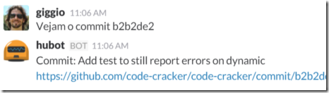](https://blog.lambda3.com.br/wp-content/uploads//2015/12/image2.png)
- Linkar para issues quando mencionado usando #  
  [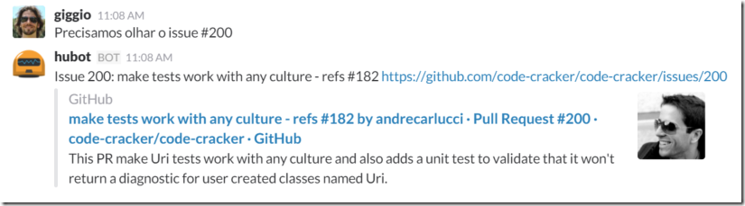](https://blog.lambda3.com.br/wp-content/uploads//2015/12/image18.png)
- Mostrar os Pull Requests de um projeto:  
  [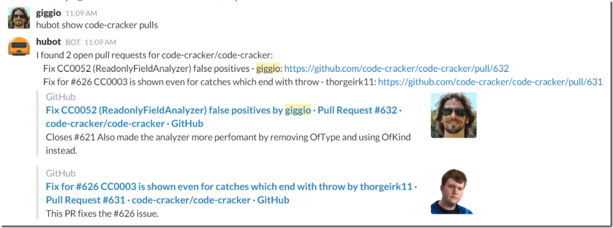](https://blog.lambda3.com.br/wp-content/uploads//2015/12/image19.png)
- Mostrar os issues, opcionalmente limitando o número que queremos ver, e a tag:  
  [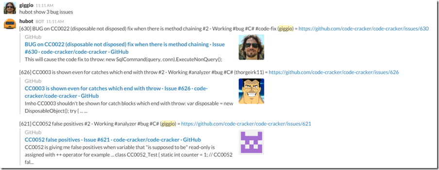](https://blog.lambda3.com.br/wp-content/uploads//2015/12/image20.png)

Ele também faz coisas de assunto geral, como:

- Pesquisar no youtube:  
  [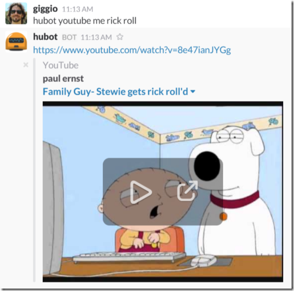](https://blog.lambda3.com.br/wp-content/uploads//2015/12/image21.png)
- Ver doges e pugs:  
  [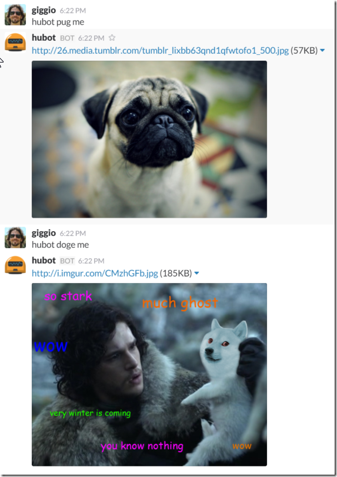](https://blog.lambda3.com.br/wp-content/uploads//2015/12/image22.png)
- Ver o clima:  
  [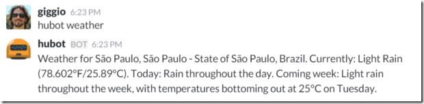](https://blog.lambda3.com.br/wp-content/uploads//2015/12/image23.png)
- Etc, etc…

E um highlight especial para a integração com o [Wolfram Alpha](http://www.wolframalpha.com/):

[](https://blog.lambda3.com.br/wp-content/uploads//2015/12/image24.png)

Deu pra entender, né? Com “hubot help” você mostra tudo que ele consegue fazer. O nosso consegue inciar pomodoros, nos lembrar de compromissos, marcar a reunião diária e por aí vai. Aqui o output do help atual:

```
#nnn - link to GitHub issue nnn for hubot_GITHUB_REPO project
            links to that commit in hubot_GITHUB_REPO
++
--
Business jargon - summons business cat
Listens for s with at least seven characters:
Unless the string 'commit/' shows up in the line, in which case it
hubot adapter - Reply with the adapter
hubot bottom 
hubot calculate  - Calculate the given math expression.
hubot command count - Tells how many commands hubot knows
hubot convert  in  - Convert expression to given units.
hubot create standup hh:mm - Creates a standup at hh:mm every weekday for this room
hubot create standup hh:mm UTC+2 - Creates a standup at hh:mm every weekday for this room (relative to UTC)
hubot delete all standups - Deletes all standups for this room.
hubot delete hh:mm standup - If you have a standup at hh:mm, deletes it
hubot delete reminder  - Delete reminder matching  (exact match required)
hubot doge bomb N - Many Doges. Such exploshun
hubot doge me - Wow. Such Doge
hubot echo  - Reply back with 
hubot erase  []
hubot flip - hubot flips a table
hubot global mute|unmute - (Un)mute hubot everywhere
hubot help - Displays all of the help commands that hubot knows about.
hubot help  - Displays all help commands that match .
hubot list standups - See all standups for this room
hubot list standups in every room - See all standups in every room
hubot map me  - Returns a map view of the area returned by `query`.
hubot mute list - Check which channels have been muted
hubot mute|unmute (channel name) - (un)mute a channel (if channel name omitted, mutes current channel)
hubot ping - Reply with pong
hubot pomodoro? - shows the details of the current pomodoro
hubot pug bomb N - get N pugs
hubot pug me - Receive a pug
hubot question  - Searches Wolfram Alpha for the answer to the question
hubot reload all scripts - Reloads scripts without restart. Loads new scripts too.
hubot remind me (on |in ) to  - Set a reminder in  to do an   is in the format 1 day, 2 hours, 5 minutes etc. Time segments are optional, as are commas
hubot repo commiters  - shows commiters of repository
hubot repo top-commiters  - shows top commiters of repository
hubot score  [for ]
hubot seen  - show when and where user was last seen
hubot seen in last 24h - list users seen in last 24 hours
hubot show  issues -- Lists all issues for chat user IFF hubot_GITHUB_USER_(.*) configured
hubot show [me]  pulls -- Show open pulls for hubot_GITHUB_USER/, if hubot_GITHUB_USER is configured
hubot show [me]  pulls [with ] -- Shows open pull requests for that project by filtering pull request's title.
hubot show [me] [ [of]] ['s|my] [] issues [for ] [about ] -- Shows open GitHub issues for repo.
hubot show [me] issues -- Lists all issues IFF hubot_GITHUB_REPO configured
hubot show [me] issues for  -- List all issues for given repo IFF hubot_GITHUB_USER configured
hubot show [me] issues for  -- List all issues for given repo
hubot show [me] org-pulls [for ] -- Show open pulls for all repositories of an organization, default is hubot_GITHUB_ORG
hubot show reminders
hubot standup help - See a help document explaining how to use.
hubot start pomodoro - start a new pomodoro
hubot start pomodoro  - start a new pomodoro with a duration of  minutes
hubot stop pomodoro - stop a pomodoro
hubot the rules - Make sure hubot still knows the rules.
hubot time - Reply with current time
hubot top 
hubot total pomodoros - shows the number of the total completed pomodoros
hubot translate me  - Searches for a translation for the  and then prints that bad boy out.
hubot translate me from  into   - Translates  from  into . Both  and  are optional
hubot unmute all - Unmute all individually muted channels
hubot weather - Get the weather for hubot_DARK_SKY_DEFAULT_LOCATION
hubot weather  - Get the weather for 
hubot youtube me  - Searches YouTube for the query and returns the video embed link.
is ignored.
repo#nnn - link to GitHub issue nnn for repo project
repo@       links to that commit in hubot_GITHUB_USER's repo
ship it - Display a motivation squirrel
user/repo#nnn - link to GitHub issue nnn for user/repo project
user/repo@  links to that commit in user/repo
```

## Como fazer um hubot

### Criando o hubot

É bem simples.

A criação de um hubot usa yeoman e é descrita logo no começo [dos docs](https://hubot.github.com/docs/). Basicamente você roda “yo hubot”, ele te faz várias perguntas, como o nome do seu bot, seu nome, qual adaptador usar, etc, e cria um hubot customizado. Olha só:

[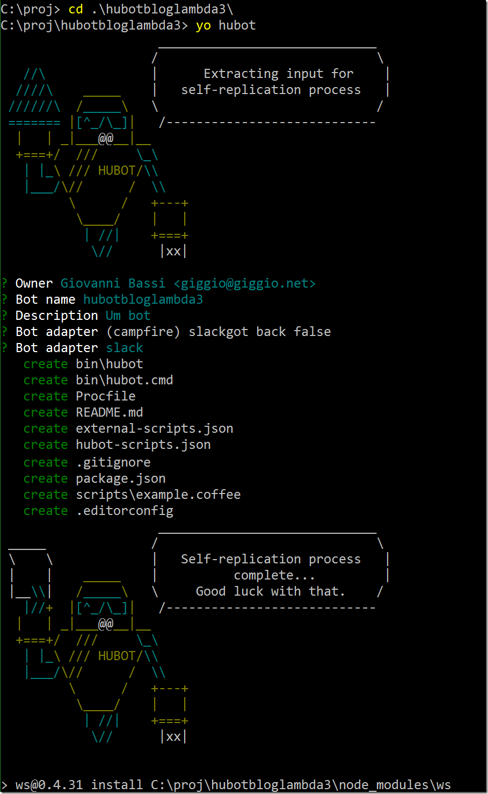](https://blog.lambda3.com.br/wp-content/uploads//2015/12/image25.png)

Durante o processo de criação ele já faz configura suas dependências e faz a instalação do npm, deixando o quase bot pronto pra rodar.

### Criando a integração do Hubot no Slack

Eu digo quase, porque você ainda tem que fazer uns passos manuais. O primeiro é ir até a [página do Slack que acrescenta o Hubot](https://slack.com/apps/A0F7XDU93-hubot). Lá você vai selecionar o Hubot e mandar criar:

[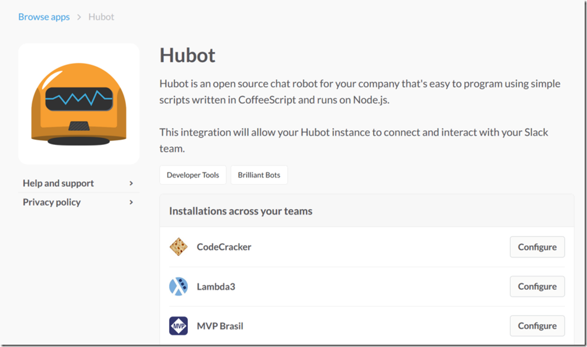](https://blog.lambda3.com.br/wp-content/uploads//2015/12/image26.png)

Você inicia dando um nome ao seu hubot:

[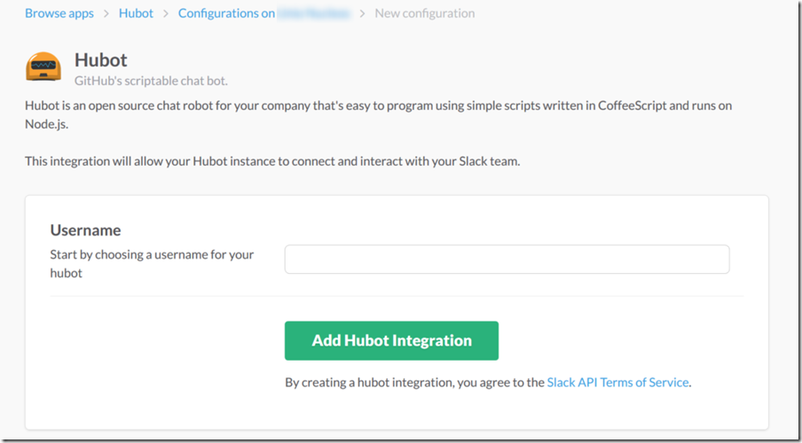](https://blog.lambda3.com.br/wp-content/uploads//2015/12/image27.png)

E então ele vai ter dar um chave de api, que você usuará no seu código. Na página do hubot do Slack criado ela já aparece, aqui deixei ela nublada, já que ela é privada pra cada serviço:

[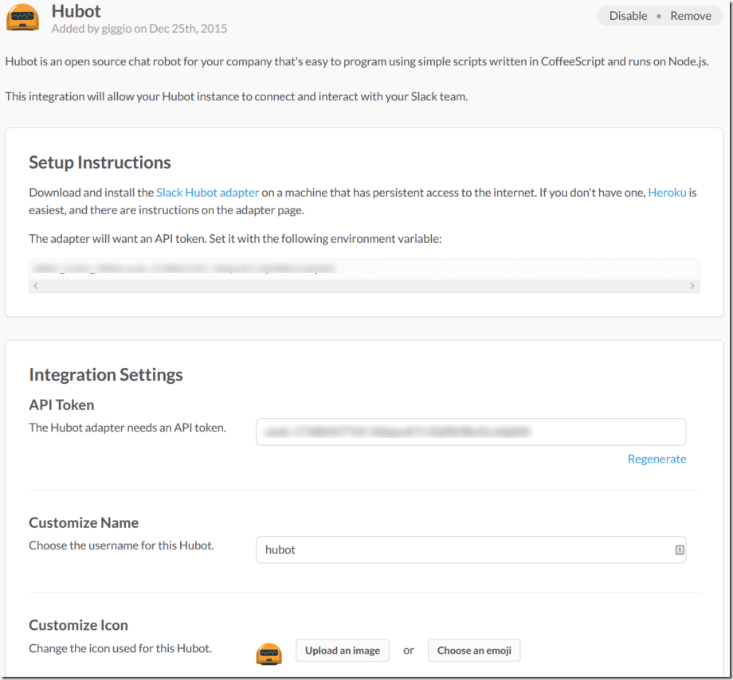](https://blog.lambda3.com.br/wp-content/uploads//2015/12/image28.png)

Nesse ponto a integração criada, só falta subir o serviço:

[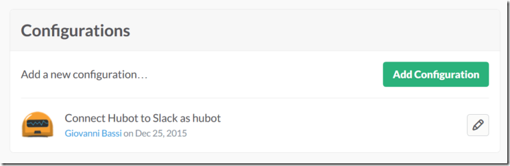](https://blog.lambda3.com.br/wp-content/uploads//2015/12/image29.png)

E você pode criar mais de um hubot, por exemplo, com nomes diferentes, e com habilidades diferentes, como podem ver na imagem anterior.

### Colocando o cérebro do Hubot no Azure

Eu queria rodar o Hubot no Azure. O Hubot precisa de um lugar pra guardar as informações dele. Ele chama esse lugar de cérebro, brain. Existe um pacote npm que oferece um brain usando Azure Storage, que custa 2.4 dólares por cada 100GB de armazenamento por mês, mais conhecido como quase de graça. Instalei o pacote, chamado hubot-azure-scripts. [Na página do pacote](https://www.npmjs.com/package/hubot-azure-scripts) você vê as configurações que precisa fazer, que basicamente, para produção, são o nome da storage account, e a API key dessa storage account. E dá pra definir o storage container e também dá pra testar localmente usando o development storage que vem com o sdk do Azure. Se tiver interesse, [veja como o adaptador é simples](https://github.com/bfcamara/hubot-azure-scripts/blob/master/brain/storage-blob-brain.coffee), menos de 100 linhas de código (yey CoffeeScript!).

(Se você quiser só ver o hubot rodando, dá pra executar ele com um brain usando o sistema de arquivos e a linha de comando para adaptador, o que facilita bastante.)

Para criar a storage account você precisa de uma conta no Azure. Crie uma, é muito simples, [e você ganha uns créditos grátis no primeiro mês](https://azure.microsoft.com/pt-br/pricing/free-trial/) (se você tem uma MSDN subscription [você tem créditos gratuitos](https://azure.microsoft.com/pt-br/pricing/member-offers/msdn-benefits/)). Depois vá ao portal, acessando [portal.azure.com](https://portal.azure.com/ "https://portal.azure.com/"). Então acesse New > Data + Storage > Storage Account. Escolha o modelo clássico, mesmo ele é suficiente, e o pricing tier, troque para o mais barato, que é o Standard-LRS. Você também pode escolher um resource group, e onde esse recurso vai ficar. Como os servidores do Slack devem ser nos EUA, mantive meu storage nos EUA, e também criei o server que hospedou o hubot nos EUA. Vejam como ficou:

[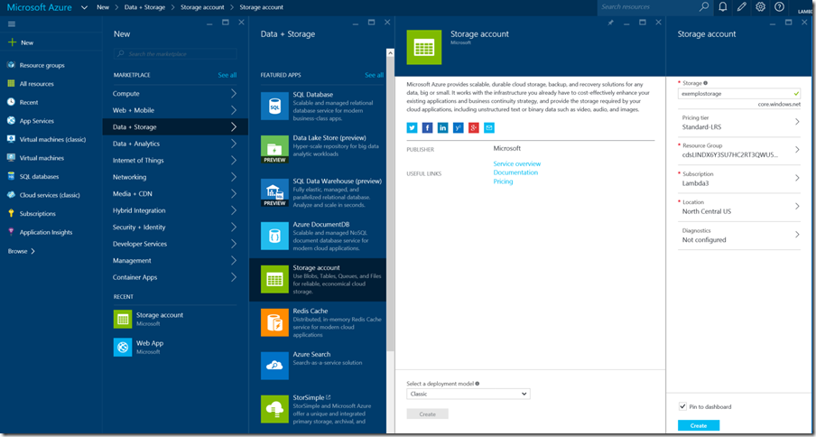](https://blog.lambda3.com.br/wp-content/uploads//2015/12/image30.png)

Depois da conta criada você precisa obter a chave. Você vai encontrar a storage account fixada na sua home page do portal, basta clicar nela. Se não estiver, vá em “All Resources” e ache ela lá. Então, na lâmina que abrir, clique em Settings e Access Keys, e copie a KEY1:

[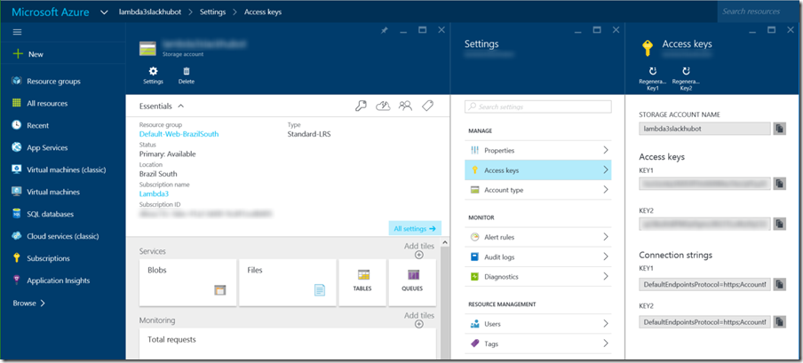](https://blog.lambda3.com.br/wp-content/uploads//2015/12/image31.png)

É ela que será usada na configuração HUBOT\_BRAIN\_AZURE\_STORAGE\_ACCESS\_KEY. E o nome da account será usado na configuração HUBOT\_BRAIN\_AZURE\_STORAGE\_ACCOUNT.

### Configurando os scripts

Para ativar o cérebro do azure, e qualquer outro script, você precisa alterar os arquivos de script do Hubot. Use o arquivo [hubot-scripts.json](https://github.com/code-cracker/codecrackerslackhubot/blob/master/hubot-scripts.json) para configurar arquivos que estão no próprio diretório de scripts ou no pacote hubot-scripts, e o arquivo [external-scripts.json](https://github.com/code-cracker/codecrackerslackhubot/blob/master/external-scripts.json) para os que vêm via outros pacotes. Note que o temos “hubot-azure-scripts/brain/storage-blob-brain” entre os scripts externos.

### Rodando o Hubot localmente

Com o npm instalado, criei um script que configura as variáveis de ambiente, tanto as públicas (como nome do hubot, adaptador, etc) quanto as seguras. Veja um exemplo desse script [no Github do Hubot do Code Cracker](https://github.com/code-cracker/codecrackerslackhubot/blob/master/bin/run.sh). Ele está sem as chaves, lógico, mas ele aponta quais faltam. Para rodar, basta copiar o arquivo, e preencher os valores.

Rodei, funcionou, consegui me conectar nele pelo Slack. Pra testar, mande uma DM para o Hubot escrevendo “help”, ele vai te dizer o que consegue fazer. Você também consegue ver ele online, indicando que ele está no ar.

### Rodando o Hubot no Azure

Inicialmente eu coloquei o Hubot pra rodar num Azure website. A boa notícia é que roda. A má notícia é que Windows ainda não é o melhor lugar pra rodar node no server. Tive problemas para restaurar os pacotes do npm durante o deploy do server, por exemplo, e o processo de deploy ficou super complicado. Alguns pacotes de extensões simplesmente não rodaram e tire que remover (o do Wolfram Alpha, por exemplo). Uma hora o Hubot saiu do ar e não voltou mais. Tive que repensar o processo. Pensei em colocar num Linux, mas configurar node, ambiente de build com Python, gcc, variáveis de ambiente, etc, ia dar muito trabalho, e se eu precisasse movimentar as coisas ia dar mais trabalho. Eu queria Platform as a Service, ou algo muito próximo disso. A saída era óbvia: contêineres com Docker.

Peguei meu Ubuntu, e criei um Dockerfile baseado em Node, configurei as variáveis e os passos de setup. Foi super simples. Testei, rodou. Vejam o [Dockerfile do Code Cracker](https://github.com/code-cracker/codecrackerslackhubot/blob/master/Dockerfile), como ficou simples:

```
FROM node:5
MAINTAINER Giovanni Bassi <no@MAILINATOR.COM>

RUN mkdir -p /usr/src/app
WORKDIR /usr/src/app

ENV HUBOT_ADAPTER=slack
ENV HUBOT_BRAIN_AZURE_STORAGE_ACCOUNT=codecrackerslackhubot
ENV HUBOT_DARK_SKY_DEFAULT_LOCATION="Sao Paulo"
ENV HUBOT_DARK_SKY_UNITS=si
ENV HUBOT_GITHUB_USER=code-cracker
ENV HUBOT_GITHUB_REPO=code-cracker

ADD . /usr/src/app
RUN [ "npm", "install" ]

ENTRYPOINT [ "./bin/hubot" ]
```

Ainda faltam outras variáveis de ambiente pra rodar, aí estão somente as que posso por no repositório de código. Eu poderia criar um script parecido ao anterior, mas ainda teria que me preocupar em montar a imagem do contêiner. Queria algo mais fácil, uma ferramenta que cuidasse de tudo pra mim.

Adicionei então o docker compose, para me ajudar a montar a imagem. O legal do docker compose é que ele já monta e configura a imagem, então não precisei me preocupar em montar imagem, subir pro docker hub, etc. Simplesmente subi o código pro Github, clonei no server, adicionei o script com as variáveis de ambiente, e tudo funcionou. O [docker-compose.yml do Code Cracker](https://github.com/code-cracker/codecrackerslackhubot/blob/master/docker-compose.yml) ficou extremamente simples:

```
bot:
  build: .
  restart: always

  environment:
    - HUBOT_SLACK_TOKEN
    - HUBOT_BRAIN_AZURE_STORAGE_ACCESS_KEY
    - HUBOT_YOUTUBE_API_KEY
    - HUBOT_WOLFRAM_APPID
    - HUBOT_DARK_SKY_API_KEY
    - HUBOT_GITHUB_TOKEN
```

Ele informa que vai repassar para a imagem as variáveis de ambiente seguras que encontrar no ambiente em que estiver rodando. O script de execuáção do docker compose é muito parecido com o script que roda o Hubot fora do Docker, mas mais simples, já que as variáveis que não precisam ser seguras já estão no Dockerfile. Você tem um exemplo dele no [runCompose.sh do Code Cracker](https://github.com/code-cracker/codecrackerslackhubot/blob/master/bin/runCompose.sh), mas sem os valores seguros, lógico.

```
#!/bin/bash

#provide these variables:
#export HUBOT_SLACK_TOKEN=
#export HUBOT_BRAIN_AZURE_STORAGE_ACCESS_KEY=
#export HUBOT_YOUTUBE_API_KEY=
#export HUBOT_WOLFRAM_APPID=
#export HUBOT_DARK_SKY_API_KEY=
#export HUBOT_GITHUB_TOKEN=

#daemonized
docker-compose up -d
```

No server os valores comentados estão informados, e basta rodar bin/runCompose.sh e o server roda como um serviço (ou daemon, note o “-d” como parâmetro para o docker-compose). Se o server reiniciar, o docker daemon é reiniciado, e o contêiner é reiniciado como serviço.

Para ver ele rodando, basta estar no diretório, e digitar “docker-compose ps”:

[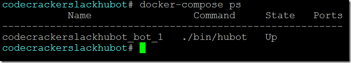](https://blog.lambda3.com.br/wp-content/uploads//2015/12/image32.png)

Em caso de atualizações, basta rodar um “git pull” no server para atualizar o diretório, e então “docker-compose build” para remontar a imagem, e rodar novamente o arquivo “bin/runCompose.sh”.

Se você achou a ideia legal, pode iniciar forkando o repositório do Hubot do Code Cracker, e alterando os arquivos que tem “codecracker” escrito (bin\hubot, bin\run.sh, Dockerfile, e package.json).

### Onde ficou o server?

O server é um Ubuntu rodando no Azure. É Infrastructure as a Service, mas o Docker torna o deploy ridiculamente simples. Eu poderia facilmente mover esse hubot para outro lugar, sem dor alguma. Pra criar um desses, basta ir no Azure e pedir para criar um server com Docker:

[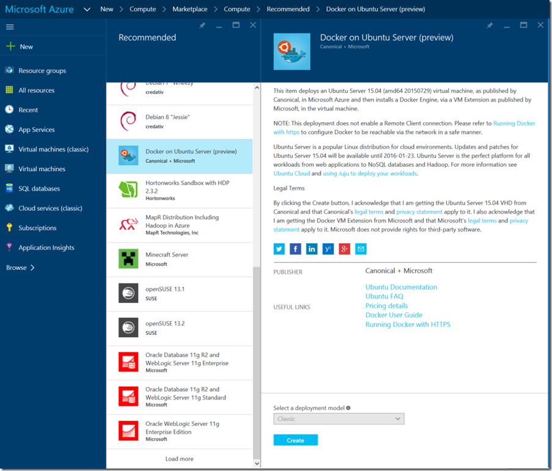](https://blog.lambda3.com.br/wp-content/uploads//2015/12/image33.png)

Se quiser algo mais PaaS mesmo, com Docker, você pode olhar o [Azure Container Service, que está em preview](https://azure.microsoft.com/en-us/blog/azure-container-service-preview/). Aí o negócio fica interessante, mesmo, já que eles te entregam o Docker como serviço!

### Concluindo

O legal é que dá pra experimentar tudo isso praticamente de graça. O Slack te dá 10 integrações de graça, e o Hubot é somente uma! O Azure te dá vários créditos, e se você tem uma MSDN Subscription, [já tem Azure de graça](https://azure.microsoft.com/pt-br/pricing/member-offers/msdn-benefits/).

Gostei da solução com Docker, e a grande surpresa foi docker-compose, ajudando brutalmente no deploy. A integração com Azure para o cérebro foi um higlight interessante também.

Pra começar, lembre que você pode forkar o [Hubot do Code Cracker](https://github.com/code-cracker/codecrackerslackhubot).

Curtiram? Já fizeram alguma coisa com Docker? Gostaram do Slack e do Hubot? Comentem aqui no blog!
