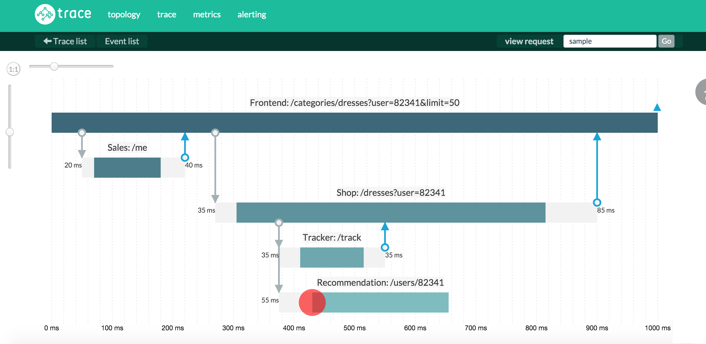

# How to Become a Better Node.js Developer in 2016

[nodejs](https://blog.risingstack.com/tag/nodejs-2/) · [best practices](https://blog.risingstack.com/tag/best-practices/)

These tips and best practices are not just for development - but how to operate Node.js infrastructures, how you should do your day-to-day development and other useful pieces of advice.

### Use ES2015

During the summer of 2015 the [final draft of ES2015](http://www.ecma-international.org/ecma-262/6.0/index.html) *(formerly ES6)* was published. With this a number of new language features were added to the JavaScript language, including:

- arrow functions,
- template strings,
- rest operator, argument spreading,
- generators,
- promises,
- maps, sets,
- symbols,

and a lot more. For a comprehensive list of new features check out [ES6 and Beyond](https://github.com/getify/You-Dont-Know-JS/tree/master/es6%20%26%20beyond) by [Kyle Simpson](https://twitter.com/getify). **Most of them are added to Node.js v4.**

On the client side, you can already use all of them with the help of [Babel](https://babeljs.io/), a JavaScript compiler. Still, **on the server side we prefer to use only the features that are added to the latest stable version**, without compiling the source to save us from all the potential headaches.

For more information on ES6 in Node.js, visit the official site: <https://nodejs.org/en/docs/es6/>.

### Callback convention - with Promise support

For the last years, we encouraged you to expose an error-first callback interface for your modules. With the **generators functions** already being available and with the upcoming **async functions** your modules *(the ones published to NPM)* should expose an **error-first callback interface with Promise support**.

*Why? To provide backward compatibility a callback interface has to be provided, and for future compatibility you will need the Promise support as well.*

For a demonstration of how to do it, take a look at the script below. In this example the `readPackage` function reads the `package.json` file and returns its' content by providing both a Promise and a callback interface.

|  |  |
| --- | --- |
|  | const require() |
|  | function readPackage (callback) { |
|  | //as of now we do not have default values in Node.js |
|  | callback callback function () {} |
|  | return Promise((resolve, reject) => { |
|  | .readFile(./package.json, (, ) => { |
|  | (err) { |
|  | reject(err) |
|  | return callback(err) |
|  | resolve(data) |
|  | return callback(, data) |
|  | module.exports.readPackage readPackage |

### Async patterns

For a long time in Node.js, you had two choices to manage asynchronous flows: callbacks and streams. For callbacks you could use libraries like [async](https://www.npmjs.com/package/async) and for streams [through](https://www.npmjs.com/package/through), [bl](https://www.npmjs.com/package/bl) or [highland](http://highlandjs.org/).

With the introduction of *Promises*, *generators* and the *async functions* it is changing.

> *For a more detailed history of asynchronous JavaScript check out [The Evolution of Asynchronous JavaScript](https://blog.risingstack.com/asynchronous-javascript/)*

### Error handling

Error handling is a crucial part of the application to get right: knowing when to crash, or simply just log the error and continue/retry can be hard.

To make it easier, we have to distinguish between **programmer errors** and **operational errors**.

Programmer errors are basically bugs so you should crash the process immediately as you won't know in what state your application is.

On the other hand, operational errors are problems with the system itself or a remote service, like request timeout or running out of memory. Based on the nature of the error you can try to solve with retrying, or if a file is missing you may have to create it first.

#### Error handling in callbacks

If an error occurs during an async operation, the error object will be passed as the first argument of the async function. **You always have to check it and handle it.**

The code snippet in the *Callback convention* section above contains an example.

#### Error handling in Promises

What's going to happen in the following snippet?

|  |  |
| --- | --- |
|  | Promise.resolve(() => ) |
|  | .(() => { |
|  | throw Error() |
|  | .catch(() => { |
|  | console.(ex) |
|  | .(() => { |
|  | throw Error() |
|  | console.() |

1. It will throw an exception in line 3
2. The catch will handle it, and print it out to the stdout: `[Error: ops]`
3. The execution continues and in line 9 a new error will be thrown
4. Nothing else

And really nothing else - the last error thrown will be a silent one. **Pay extra attention to always add a catch as the last member of the promise chain.** It will save you a lot of headaches. So it should look like this:

|  |  |
| --- | --- |
|  | Promise.resolve(() => ) |
|  | .(() => { |
|  | throw Error() |
|  | .catch(() => { |
|  | console.(ex) |
|  | .(() => { |
|  | throw Error() |
|  | console.() |
|  | .catch(() => { |
|  | console.(ex) |

And now the output will be:

```
[Error: ops]
[Error: ups]
```

### Use JavaScript Standard Style

In the past years, we had JSLint then JSHint, JSCS, ESLint - all excellent tools trying to automate as much code checking as possible.

Recently, when it comes to code style we use the [JavaScript Standard Style](https://github.com/feross/standard) by [feross](https://github.com/feross).

The reason is simple: no configuration needed, just drop it in the project. Some rules that are incorporated *(taken from the readme)*:

- **2 spaces** – for indentation
- **Single quotes for strings** – except to avoid escaping
- **No unused variables**
- **No semicolons**
- **Never start a line with `(` or `[`**
  - This is the **only** gotcha with omitting semicolons
- **Space after keywords** `if (condition) { ... }`
- **Space after function name** `function name (arg) { ... }`
- Always use `===` instead of `==` – but `obj == null` is allowed to check `null || undefined`.
- Always handle the node.js `err` function parameter
- Always prefix browser globals with `window` – except `document` and `navigator` are okay
  - Prevents accidental use of poorly-named browser globals like `open`, `length`,
    `event`, and `name`.

Also, if your editor of choice supports ESLint only, there is an ESLint ruleset as well for the Standard Style, the [eslint-plugin-standard](https://github.com/xjamundx/eslint-plugin-standard). With this plugin installed your `.eslintrc` will something like this:

```
  "plugins" 
    "standard"
```

### The Twelve-Factor Application

The Twelve-Factor application manifesto describes best practices on how web applications should be written.

### Starting new projects

Always start a new project with `npm init`. This will generate a basic `package.json` for your project.

If you want to skip the initial questions and go with the defaults, just run `npm init --yes`.

### Monitoring your applications

Getting notified as soon as something wrong happened or is going to happen in your system can save your business.

To monitor your applications, you can use open-source software as well as SaaS products.

For open-source, you can take a look at [Zabbix](http://www.zabbix.com/), [Collectd](https://collectd.org/), [ElasticSearch](https://www.elastic.co/products/elasticsearch) or [Logstash](https://www.elastic.co/products/logstash).

If you do not want to host them, you can try [Trace](http://trace.risingstack.com/?utm_source=how-to-become-a-better-node-js-developer-in-2016&utm_medium=rsblog&utm_campaign=tracebeta), our Node.js and microservice monitoring solution.

[](http://trace.risingstack.com/?utm_source=how-to-become-a-better-node-js-developer-in-2016&utm_medium=rsblog&utm_campaign=tracebeta)

### Use a build system

**Automate everything you can.** There is nothing more annoying and wasteful activity for a developer than to do grunt work.

Nowadays the tooling around JavaScript evolved a lot - Grunt, Gulp, and Webpack, just to name a few.

At RisingStack, most of the new projects use Webpack to aid in front-end development and gulp for other kinds of automated tasks. At first, Webpack can take more time to understand - for newcomers I highly recommend to check out the [Webpack Cookbooks](http://christianalfoni.github.io/react-webpack-cookbook/).

### Use the latest LTS Node.js version

To get both stability and new features we recommend to use the latest **LTS** *(long-term support)* version of Node.js - they are the ones with even release numbers. Of course, feel free to experiment with newer versions, called the **Stable** release line with the odd release numbers.

If you are working on different projects with different Node.js version requirements then start using the Node Version Manager - [nvm](https://github.com/creationix/nvm) today.

For more information on Node.js releases check out the official website: <https://nodejs.org/en/blog/community/node-v5/>.

### Update dependencies on a weekly basis

Make it a habit to update dependencies on a weekly basis. For this, you can use `npm outdated` or the [ncu](https://www.npmjs.com/package/npm-check-updates) package.

### Pick the right database

When talking about Node.js and databases the first technology that usually comes up is MongoDB. While there is nothing wrong with it, don't just jump into using it. Ask yourself and your team questions before doing so. To give some idea:

- Do you have structured data?
- Do you have to handle transactions?
- How long should you store the data?

You may only need Redis, or if you have structured data then you could go for PostgreSQL. If you start developing with SQL in Node.js, check out [knex](http://knexjs.org/).

### Use Semantic Versioning

> Semantic Versioning is a formal convention for specifying compatibility using a three-part version number: major version; minor version; and patch.

Major versions are bumped if an API change is not backward-compatible. Minor versions are bumped when new features are added, but the API change is backward compatible. Patch versions are bumped when only bug fixes happened.

Luckily, you can automate the release of your JavaScript modules with [semantic-release](https://github.com/semantic-release/semantic-release).

### Keep up

It can be challenging to keep up with the latest news and developments in the JavaScript and Node.js world. To make it easier make sure to subscribe to the following media:

### Learn more

> Want to learn more about how you could implement Node.js at your company? Drop us a message at [RisingStack.com](http://risingstack.com/)!
