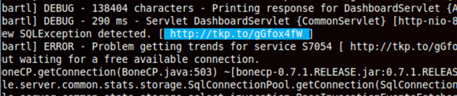
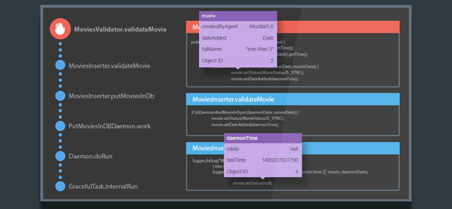

# If You've Written Java Code in 2015 – Here Are The Trends You Couldn't Have Missed

### A practical overview of the most interesting trends we had the chance to encounter over the last year.

Comment ()

[Tweet](https://dzone.com/articles/if-youve-written-java-code-in-2015-here-are-the-tr?utm_medium=feed&utm_source=feedpress.me&utm_campaign=Feed:%20dzone%2Fjava#)

The Java Zone is brought to you in partnership with [ZeroTurnaround](https://dzone.com/go?i=84821&u=http%3A%2F%2Fpages.zeroturnaround.com%2FRocket-Powered-White-Paper_Rocket-Powered-White-Paper.html%3Futm_source%3Ddzone%26utm_medium%3Dsponsored_link%26utm_campaign%3Drocketpowered). Check out this [8-step guide](https://dzone.com/go?i=84821&u=http%3A%2F%2Fpages.zeroturnaround.com%2FRocket-Powered-White-Paper_Rocket-Powered-White-Paper.html%3Futm_source%3Ddzone%26utm_medium%3Dsponsored_link%26utm_campaign%3Drocketpowered) to see how you can increase your productivity by skipping slow application redeploys and by implementing application profiling, as you code!

In this post, we’re looking back on 5 of the topics and new developments that shaped our conversations in 2015. Unlike many other end of year summaries that keep it on the high level, we’ll do a more practical down to earth walkthrough without resorting to [buzzwords](http://cdn.meme.am/instances/59639224.jpg). Well, not \*too many\* buzzwords. As always, a super important takeaway for us are your comments – We’d love to hear your opinions and learn about your highlights.

> New Post: If You've Written Java Code in 2015 – Here Are the Trends You Couldn't Have Missed <https://t.co/lszOJz5Pk2>[pic.twitter.com/NU9CY9PCrl](https://t.co/NU9CY9PCrl)
>
> — Takipi (@takipid) [December 30, 2015](https://twitter.com/takipid/status/682250206285553664)

## 1. Java Java Jing Jing Jing

This year has been all about 2 main themes in the Java space, Java 8 adoption and big strides in Java 9. On the Java 8 front, [DZone’s developer survey](https://dzone.com/guides/the-java-ecosystem-2015-edition) that included over 600 participants reported on 58% adoption of Java 8 for new projects with 20% in existing applications. Other surveys and the general sentiment we’re picking up is positive – so positive that when we published a less than ideal use case for lambdas and streams [it almost ended up with bomb threats](http://blog.takipi.com/benchmark-how-java-8-lambdas-and-streams-can-make-your-code-5-times-slower/).

The second area is Java 9. The JEPs targeting the next release have been [pretty much finalized](http://openjdk.java.net/projects/jdk9/) and there’s a good understanding of what’s in and what’s out. On JavaOne we’ve had a first taste of [how project Jigsaw would look like in practice](http://openjdk.java.net/projects/jigsaw/talks/), including demos and sample code explaining the new additions to the module system. Personally, apart from Project Jigsaw, we were also happy to see a Java REPL in the works and released [a short tutorial](http://blog.takipi.com/java-9-early-access-a-hands-on-session-with-jshell-the-java-repl/) after playing around with an early access version of Java 9.

We expected to see Java 9 released in 2016, but as it turns out we’ll have to wait for 2017 because of delays in project Jigsaw. Hopefully the new target date stays final. Until then you’re welcome to join the [Java 9 countdown](http://www.java9countdown.xyz/).

*\*\* If you’re wondering what Java Java Jing Jing Jing means, you need to [see this video](https://www.youtube.com/watch?v=TAX0gJt-aZg)*

## 2. Microservices Microservices Microservices

We can’t help but wonder, isn’t microservices just a new word for “separation of concerns”? Oh well. While you can argue that all the attention certain trends get is exaggerated, and they existed long before it became a “buzzword”, it actually makes sense as a sign of reaching certain maturity.

On the Java front, in ascending order, we’re seeing a rise in the popularity of [Java Micro Frameworks](http://blog.takipi.com/java-micro-frameworks-the-new-trend-you-cant-ignore/), like [Jodd](http://jodd.org/), [Spark](http://sparkjava.com/) (not Apache Spark) or [Ninja Framework](http://www.ninjaframework.org/). Even lighter than [Dropwizard or Spring Boot](http://blog.takipi.com/java-bootstrap-dropwizard-vs-spring-boot/) which also had a great year. This doesn’t mean that you can’t build microservices on [Play Framework](https://www.playframework.com/) or other full on frameworks, just that some applications can now be built on ridiculously small frameworks. Jodd weighs just under 1.5MB.

## 3. Docker Kubernetes Docker Docker Containers

What’s new with Docker? While not exclusive to 2015, it’s the year where it got most of the attention – [And many misconceptions have come out of that recent rise in popularity](http://blog.takipi.com/ignore-the-hype-5-docker-misconceptions-java-developers-should-consider/). All in all, containers have been quite messy and Docker helps deliver a better developer experience tied with powerful features.

As to JVMs on Docker, it remained kind of a pain just up until recently. Docker is all about minimalism, but when you’re adding Java on top, it adds up to over 800MB for a single container. Enter [Alpine Linux](http://www.alpinelinux.org/). A lightweight Linux distribution with [a base image of only 5MB](https://github.com/gliderlabs/docker-alpine). The recent rise in Alpine’s popularity comes from the Docker use case, and especially from the Java side of things. When using Alpine, [a Java 7 image is 123MB and a Java 8 image is 173MB](https://developer.atlassian.com/blog/2015/08/minimal-java-docker-containers/) – A huge x4.6-6.5 improvement.

## 4. Logs Logs Logs, Bills Bills Bills

More and more developer teams have started to feel the stress in managing never ending, ever growing log files that generate GBs of data every day. This year we’ve also seen the rise of [hosted ElasticSearch services](http://blog.takipi.com/hosted-elasticsearch-the-future-of-your-elk-stack/) that take away the overhead of running your own ELK stack. The combination of ElasticSearch, Logstash and Kibana is becoming one of the popular solution for making sense out of your logs.

While logs provide a lot of plain text data, and most tools work on aggregating and visualizing the data, sometimes getting to the root cause can be pretty exhausting (if you do have the data). At Takipi, [we’ve built a tool that lets you see the variable values](http://land.takipi.com/logs/) and exact state of every exception or log event, overlayed on the actual code that caused it. One of the features that we’ve added are log links. Turning a log event from plain text:

Into this:

## 5. This and That: Akka Streams, Apache Spark, Automation

A few more highlights that grabbed our attention in 2015 were in the Scala arena. We’ve [covered new tools](http://blog.takipi.com/async-goes-mainstream-7-reactive-programming-tools-you-must-know/) and [looked behind the scenes of building Akka and and Akka Streams](http://blog.takipi.com/the-bet-with-typesafe-that-got-me-into-building-akka/). It’s also becoming clear that Spark is the gradually replacing Hadoop for the use cases that require the fastest possible data crunching. We’ve examined [how Taboola handles 10B requests a day](http://blog.takipi.com/spark-monitoring-how-to-handle-10b-requests-a-day/), and what are the steps you need take when [migrating a new Spark architecture](http://blog.takipi.com/apache-spark-5-pitfalls-you-must-solve-before-changing-your-architecture/).

Another area that grabbed our attention this year was all-things-automation with [Chef, Puppet, Ansible and SaltStack](http://blog.takipi.com/deployment-management-tools-chef-vs-puppet-vs-ansible-vs-saltstack-vs-fabric/). Deployment and configurations management tools let us use recipes, playbooks, templates, or whatever terminology to simplify automation with a standard, consistent deployment. Speaking of automation, we’ve also [gone crazy for Slack](http://blog.takipi.com/hosted-elasticsearch-the-future-of-your-elk-stack/) this year, and it became an inseparable part of many of our workflows.

## Final Thoughts

It seems Developer Experience is becoming a higher priority and we can see how this affects the tools, practices and languages that we use. The software development industry progresses in a fast pace based on lessons learned from years of experience and we can’t wait to see what 2016 will hold.  
 …  
 Even though Star Wars 8 and Java 9 will only go live in 2017.

***Java / Scala developer? [Takipi](http://www.takipi.com/) replaces logging in production JVMs and lets you see the variable state that caused each log error and exception.***

The Java Zone is brought to you in partnership with [ZeroTurnaround](https://dzone.com/go?i=66621&u=http%3A%2F%2Fzeroturnaround.com%2Fsoftware%2Fjrebel%2F%3Futm_source%3Ddzone%26utm_medium%3Dbumper%26utm_campaign%3Djrebel). Discover how you can skip the build and redeploy process by using [JRebel by ZeroTurnaround](https://dzone.com/go?i=66621&u=http%3A%2F%2Fzeroturnaround.com%2Fsoftware%2Fjrebel%2F%3Futm_source%3Ddzone%26utm_medium%3Dbumper%26utm_campaign%3Djrebel).

Topics:

java,java 9,java 8,logging,akka,apache spark,microservices,docker

Published at DZone with permission of
Alex Zhitnitsky
, DZone MVB
.

Opinions expressed by DZone contributors are their own.
