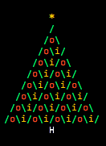

# Elixir Christmas Tree Puzzle

December 04, 2015

 [Tweet](https://twitter.com/intent/tweet?hashtags=&text=Elixir%20Christmas%20Tree%20Puzzle&url=/articles/elixir-christmas-tree-puzzle/&via=elixirgolf "Share on Twitter")

 [+1](https://plus.google.com/share?url=/articles/elixir-christmas-tree-puzzle/ "Share on Google Plus")

## Instructions

Use your **elixir** coding skills to create a Christmas tree.

Your code should create a **triangle** of `0` characters that is `9` rows high.
At the top of the tree should be a **star** `*` and at the bottom there should be
a **trunk** `H`. The star and trunk should be aligned, and the start should be
directly above the top of the tree. The start and trunk are addional rows,
therefore the entire tree is a total of `11` characters high.

Every row of the triangle should be properly indented, such that each row is
centred on the row above.
For example:

```
 enter   
        
        
       
      00000
     0000000
    000000000
   00000000000
  0000000000000
 000000000000000
00000000000000000
```

The solution that completes this puzzle with the shortest number of characters
wins. However if you want to get creative you will get an honourable mention.

### Submit your solution

Please submit your solution as a **comment on the Github issue** below, along
with your **Twitter handle** (we will use this to link back to you if your
solution is successful).

- <https://github.com/emson/elixirgolf/issues/3>

## Solutions

Generating a Christmas tree seemed to really resonate with the everyone, as we
had the most solutions submitted so far. We also had some really fun versions,
in particular @henrik and @stoftis for their “interpretations” of what a
Christmas tree should be like.

### Winner

Winner: [@ventsislaf](https://twitter.com/ventsislaf)

`char count 92`

```
 :stringcentre <- duplicate
```

#### Understanding

This solution from @ventsislaf builds a Christmas tree from three components,
the star, body and trunk. The clever bit is that he figured out a generic
function for building the components.

To understand what this generic anonymous function does, lets rewrite it:

```
 :stringcentre
#rewritten as
   :stringcentre
```

The Erlang function [`:string.centre/2`](http://www.erlang.org/doc/man/string.html#centre-2)
will create a string where the `String`
passed to it is centred by surrounding it with blank characters. The anonymous
function above takes one parameter, the `String` to centre, and outputs it
centred within `17` characters. The number of characters is dictated by the
shape of the Chrismas tree. 9 rows will make the total width `17` characters for
the bottom branches of the Christmas tree. This anonymous function is bound to
the variable `p` and can then be used throughout the algorithm to draw each
layer of the tree.

The first and last rows of the tree are created by a call to the anonymous
function `p.('*')` and `p.('H')` respectively. The body of the Christmas tree is
a bit more complex.

```
 <- duplicate
```

This **elixir** comprehension builds the triangular body of the Christmas tree.
If we rewrite it, it becomes clearer what is going on.

```
  <-   duplicate
```

The comprehension iterates over a range of interger values from `1..9` and
binds each integer to the variable `n`. This value is then used by the body of
the comprehension.  
First it calls the anonymous function defined previously and passes in a new
List. The List is constructed of a character List of `0s`, @ventsislaf uses the
shortcut `?0` to return the ASCII character `48` which maps to `0`. He then uses
the [`List.duplicate/2`](http://elixir-lang.org/docs/stable/elixir/List.html#duplicate/2)
function to create a new List. This function “Duplicates
the given `element` (`?0`, in our case), `n` number of times.

As can be seen from the formula @ventsislaf gradually increments the Character
List with `n * 2 - 1` until it reaches a maximum length of `17`. Each list is
then passed into the `:string.centre` function, and this gives us our triangular
shape.

A great solution, which highlights the power of tapping into Erlang functions
within **elixir**.

### Honourable mentions

Submitted by [fishcakez](https://github.com/fishcakez):

`char count 94`

```
format"~10s~s~n~10s~n" <- :io_libformat
```

This solution makes heavy use of the Erlang [`io.format/2`](http://www.erlang.org/doc/man/io.html#format-2)
function. fishcakez builds a List of data which he passes to the `io.format/2`
function. Understanding what this data looks like is key to understanding this
algorithm:

```
 <- :io_libformat
# rewritten for clarity
comprehension
```

So the **elixir** comprehension builds a list of data, which is inserted between
the `'*'` and the `'H'`. So the **elixir** comprehension builds a list of data,
which is inserted between the `'*'` and the `'H'`. Looking at this comprehension
in detail we see that it iterates over the rows from `1..9` and binds the value
to `n` like the winning example. He then uses the Erlang
[`io_lib.format/2`](http://www.erlang.org/doc/man/io_lib.html#format-2)
function to create a List of Lists describing a particular row. For instance
when `n = 1` the List output is:

```
:io_libformat
# gives a List of Lists we can print to the console
         
# this outputs to the console
```

Notice how the first character creates a newline, and then `9` spaces (ASCII
character `32`), preappended to a `0` (ASCII character `48`).

The first part of the algorithm prints `9` spaces and the content of the data.
For example:

```
 format"~10s~s~n~10s"
```

A sophisticated solution and very interesting use of `io.format` and
`io_lib.format`. Well done.

---

Submitted by [@henrik](https://twitter.com/henrik):

`char count 99`

```
duplicate 
 <-
```

This solution uses the newline after the `"*` to save an extra character instead
of using `\n`. @henrik uses a similar technique as the winning solution, in that
he creates an anonymous function and binds it to a variable:

```
duplicate
```

He can then use this function throughout his algorithm to output the various
layers of the Christmas tree. The tree is constructed from spaces and values
appended to those spaces. For example `s = d.(32, 8)` will create a list of `8`
space characters (ASCII `32`) and bind this List to the variable `s`. By using
an **elixir** List @henrik builds up all the Christmas tree components, which he
then outputs to the console with `IO.puts`.

So the List becomes a List of Lists. The first item being our variable bound to
a List of `8` spaces, then a binary String holding a `"*\n`. Although the newline
character `\n` is actually represented as one character as @henrik sneakily uses
an `iex` carriage return instead of the symbol.

```
  <-
```

The algorithm that generates the body of the tree works by building multiple
Lists of spaces and characters. A comprehension iterates over each row from
`0..8` and binds this value to `i`. The first item of the generated List
gradually decrements a List of spaces until an empty List is left. The second
item gradually increments a character list of ASCII represented zeros (`0` in
ASCII is `48` which is given by `?0` for readability). Finally the last
character in the List is the ASCII value `10` which is a newline character.

This is what the algorithm is doing for clarity.

```
   '000' 
  
   '00000000000000000'
```

Just remember that `IO.puts` on a List of Lists, including character data
(codepoints) will be output as a single binary String value.

Finally @henrik adds the Christmas tree trunk to the end of the master List `,s,?H]`.
Again he uses the List of `8` spaces to position the trunk which is the ASCII
character `72` represented by `?H`.

Excellent, there are some really interesting concepts and great use of Lists.

---

Submitted by [@vanstee](https://twitter.com/vanstee):

`char count 101`

```
duplicate  <-
```

@vanstee uses two anonymous functions in his algorithm.`d=&List.duplicate/2` and
`p=&IO.puts d.(32,9-&1)++&2`. The first function duplicates a List of items, `n`
number of times. Lets look at the second function in a bit more detail:

```
# rewritten as:
       
# when run will output
  '000'
```

This function creates a two character Lists and appends them together. The first
parameter `&1` is the size of the character List of space characters (ASCII `32`).
The second parameter `&2` is another character List of the “body” characters.

To create the star and trunk all @vanstee has to do is invoke his anonymous
function with the correct values: `p.(1,'*')` and `p.(1,'H')`

Finally he builds the body of the Christmas tree with a comprehension to iterate
over each row modifying his anonymous function parameters.

```
 <- 
# rewritten as:
  <-         
# which will output:
   <-         
        
       

00000000000000000
```

Well done @vanstee, who also influenced some of the other solutions.

---

Submitted by [@rubysolo](https://twitter.com/rubysolo):

`char count 103`

```
:stringcentre  <- duplicate
```

@rubysolo used the Erlang function `:string.centre/2` which he wrapped in an
anonymous function that takes a single binary String parameter. As the tree body
will only be `9` rows high we know that the width will be a maximum of `17`
characters.

The algorithm uses the `++` List append operator to append the star row, the
body rows and the trunk row.

```
 <- duplicate 
# rewritten as:
  <-   duplicate     
# which will output a List of Lists

  
  '       000       '
  
  '00000000000000000'
```

Good to see the use of Erlang in the solution. Well done.

---

Submitted by [@stoftis](https://twitter.com/stoftis):

`char count 117`

```
 <- Stringrjust  Stringrjust<><>
```

This solution makes heavy use of Strings. It uses a comprehension differently
from many of the other solutions. First it iterates over the full `11` rows i.e.
it includes both the star and trunk rows. The comprehension then uses two
filters to figure out what to pass to it’s body.

```
# this filter can be rewritten as:
```

This filter is passed the row value bound to `x` if it is `0` then the `*` is
returned if it is `10` then the `H` is returned else `0` is returned. All these
values are bound to the variable `y`.

```
 Stringrjust
# can be rewritten as:
           Stringrjust
```

This filter will bind the String of `0` values to the variable `z` if the
comprehension value of x is in the body range e.g. `1..9` otherwise it returns
an empty String. The String of `0` values will adjust according to what row the
comprehension is iterating over.

For each row we now have a String value for both `y` and `z`, and the body of
the comprehension will output these to the console:

```
 Stringrjust<><>
```

This `String.rjust/2` function appends both the values of `y` and `z` to it’s
result. By using `rjust` the resulting String is right justified and padded with
the default padding , which is whitespace.

Elixir String functions are poweful in their own right and we don’t always have
to revert down to using Erlang functions. Good thinking @stoftis

---

Submitted by [@notexactlyawe](https://twitter.com/notexactlyawe):

`char count 131`

```
import Stringduplicate  <-  duplicate duplicate
```

This algorithm is another all String solution which builds and outputs a String
for each row. First the `String` module is imported so that we can save
characters. Maybe we could wrap this `String.duplicate/2` function in an
anonymous function to save even more space.

@notexactlyawe then binds `8` blank characters to the `a` variable which acts as
padding for the star and trunk `a=duplicate " ",8`.

```
duplicate
```

The body then uses similar techniques we’ve seen before, by building a String of
spaces and concatenating it with the body String values, using interpolation
`"#{}"`.

```
 <-  duplicate duplicate
```

A nice use of Strings and String interpolation. Thank you.

---

## Bonus Credit

As a bit of fun we wanted to see what creative versions of the Christmas tree
the community could come up with. These solutions aren’t the smallest, but they
certainly show off other aspects of the **elixir** language.

Submitted by [@henrik](https://twitter.com/henrik):

```
import IO.ANSIresetblink_slowgreenyellowduplicateStreamcycle  <-
```

This solution was amazing and outputs a coloured Christmas tree with flashing
lights, as you can see below. (If you use iTerm2 you will need to turn on the
“blink” checkbox, to see it flash).



Really impressive thanks very much.

---

Submitted by [@stoftis](https://twitter.com/stoftis):

```
duplicate IO.ANSIyellow <>  <- randomIO.ANSIgreen IO.ANSI <> random~W(> = < ~ ~)
```

A great use of colour and just shows how easy it is to add fun flourshies in **elixir** code.

---

Submitted by [@emson](https://twitter.com/emson):

```
duplicate 
 <-  <-  random ~W(~ x o ~ ~)
```

```
     ~~~~~~
    ~~~~~~
```

The sigil [`~W(~ x o ~
~)`](http://elixir-lang.org/docs/stable/elixir/kernel.html#sigil_w/2) is a very clean way of creating simple Lists.
Thanks for this.

---

## Resources

[comments powered by Disqus](https://disqus.com/)
