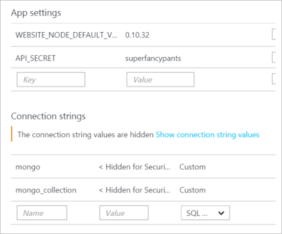

# Best practices for private config data and connection strings in configuration in ASP.NET and Azure

January 6, '16
[Comments [28]](http://www.hanselman.com/blog/CommentView.aspx?guid=6cbb04de-9804-48f1-bad8-62afc0aef3eb#commentstart)
Posted in [ASP.NET](http://www.hanselman.com/blog/CategoryView.aspx?category=ASP.NET)

Sponsored By

[](http://getcolorstock.com/)

A reader emailed asking how to avoid accidentally checking in passwords and other sensitive data into GitHub or source control in general. I think it's fair to say that we've all done this once or twice - it's a rite of passage for developers old and new.

The simplest way to avoid checking in passwords and/or connection strings into source control is to (no joke) **keep passwords and connection strings out of your source.**

Sounds condescending or funny, but it's not, it's true. You can't check in what doesn't exist on disk.

That said, sometimes you just need to mark a file as "ignored," meaning it's not under source control. For some systems that involves externalizing configuration values that may be in shared config files with a bunch of non-sensitive config data.

### ASP.NET 4.6 secrets and connection strings

Just to be clear, how "secret" something is is up to you. If it's truly cryptographically secret or something like a private key, you should be looking at [data protection systems or a Key Vault like Azure Key Vault](https://azure.microsoft.com/en-us/services/key-vault/). Here we are talking about medium business impact web apps with API keys for 3rd party web APIs and connection strings that can live in memory for short periods. Be smart.

ASP.NET 4.6 has web.config XML files like this with name/value pairs.

|  |
| --- |
| `<``appSettings``>`  `<``add` `key``=``"name"` `value``=``"someValue"` `/>`  `<``add` `key``=``"name"` `value``=``"someSECRETValue"` `/>`  `</``appSettings``>` |

We don't want secrets in there! Instead, move them out like this:

|  |
| --- |
| `<``appSettings` `file``=``"Web.SECRETS.config"``>`  `<``add` `key``=``"name"` `value``=``"someValue"` `/>`  `</``appSettings``>` |

Then you just put another appSettings section in that web.secrets.config file and it gets merged at runtime.

> NOTE: It's worth pointing out that the AppSettings technique also works for Console apps with an app.config.

Finally, be sure to add Web.secrets.config (or, even better, make it \*.secrets and use a unique extension to identify your sensitive config.

This externalizing of config also works with the <connectionStrings> section, except you use the configSource attribute like this:

|  |
| --- |
| `<``connectionStrings` `configSource``=``"secretConnectionStrings.config"``>`  `</``connectionStrings``>` |

### Connection Strings/App Secrets in Azure

When you're deploying a web app to Azure (as often these apps are deployed from source/GitHub, etc) you should NEVER put your connection strings or appSettings in web.config or hard code them.

Instead, always use the Application Settings configuration section of Web Apps in Azure.



These collection strings and name value pairs will automatically be made available *transparently* to your website so you don't need to change any ASP.NET code. Considered them to have more narrow scope than what's in web.config, and the system will merge the set automatically.

Additionally they are made available as Environment Variables, so you can Environment.GetEnvironmentVariable("APPSETTING\_yourkey") as well. This works in any web framework, not just ASP.NET, so in PHP you just getenv('APPSETTING\_yourkey") as you like.

The [full list](https://azure.microsoft.com/en-us/blog/windows-azure-web-sites-how-application-strings-and-connection-strings-work/) of database connection string types and the prepended string used for environment variables is below:

- If you select “Sql Databases”, the prepended string is “SQLAZURECONNSTR\_”
- If you select “SQL Server” the prepended string is “SQLCONNSTR\_”
- If you select “MySQL” the prepended string is “MYSQLCONNSTR\_”
- If you select “Custom” the prepended string is “CUSTOMCONNSTR\_”

### ASP.NET 5

ASP.NET 5 has the concept of User Secrets or User-Level Secrets where the key/value pair *does* exist in a file BUT that file isn't in your project folder, it's stored in your OS user profile folder. That way there's no chance it'll get checked into source control. There's a [secret manager](https://docs.asp.net/en/latest/security/app-secrets.html) (it's all beta so expect it to change) where you can set name/value pairs.

ASP.NET also has very flexible scoping rules in code. You can have an appSettings, then an environment-specific (dev, test, staging, prod) appSettings, then User Secrets, and *then* environment variables. All of this is [done via code configuration](https://docs.asp.net/en/latest/security/app-secrets.html#accessing-user-secrets-via-configuration) and is, as I mentioned, deeply flexible. If you don't like it, you can change it.

|  |
| --- |
| `var builder =` `new` `ConfigurationBuilder()`  `.AddJsonFile(``"appsettings.json"``)`  `.AddJsonFile($``"appsettings.{env.EnvironmentName}.json"``, optional:` `true``);`  `if` `(env.IsDevelopment())`  `{`  `// For more details on using the user secret store see http://go.microsoft.com/fwlink/?LinkID=532709`  `builder.AddUserSecrets();`  `}`  `builder.AddEnvironmentVariables();`  `Configuration = builder.Build();` |

So, in conclusion:

- Don't put private stuff in code.

- Seems obvious, [but](http://www.internetnews.com/blog/skerner/github-search-exposes-passwords.html)...

- Avoid putting private stuff in *common* config files
  - Externalize them AND ignore the externalized file so they don't get checked in
- Consider using Environment Variables or User-level config options.
  - Keep sensitive config out of your project folder at development time

I'm sure I missed something. What are YOUR tips, Dear Reader?

### Resources

- [Best practices for deploying passwords and other sensitive data to ASP.NET and Azure App Service](http://www.asp.net/identity/overview/features-api/best-practices-for-deploying-passwords-and-other-sensitive-data-to-aspnet-and-azure)

*Image Copyright Shea Parikh - used under license from* [*http://getcolorstock.com*](http://getcolorstock.com/)

---

**Sponsor:** Big thanks to Infragistics for sponsoring the blog this week! Responsive web design on any browser, any platform and any device with [Infragistics jQuery/HTML5 Controls](http://bit.ly/1JWnScH).  Get super-charged performance with the world’s fastest HTML5 Grid - [Download for free now](http://bit.ly/1JWnScH)!

#### About Scott

Scott Hanselman is a former professor, former Chief Architect in finance, now speaker, consultant, father, diabetic, and Microsoft employee. He is a failed stand-up comic, a cornrower, and a book author.

[About](http://hanselman.com/about)   [Newsletter](http://www.hanselman.com/newsletter)

You might also like

[Recommended by](http://www.hanselman.com/blog/#)

Wednesday, January 06, 2016 7:20:14 AM UTC

So your saying that storing a connection string on the server in web.config is bad?

Wednesday, January 06, 2016 8:51:20 AM UTC

Only if it contains sensitive information i would assume...

Thomas

Wednesday, January 06, 2016 8:54:09 AM UTC

In previous ASP.NET versions you also did not store the secret file in the project folder but somewhere outside like a user directory which never gets checked into source control. The configSource attribute can point to any location.  
  
@Mike: yes don't store your environment or secret data in web.config. This way you never have to transform your config when you promote your builds.

[Dustin Moris Gorski](http://dusted.codes/)

Wednesday, January 06, 2016 8:57:19 AM UTC

If you do add secrets into any web.config file (Even a web.secrets.config file as in the example Scott gave), don't forget to encrypt it. More info [here](https://msdn.microsoft.com/en-us/library/zhhddkxy.aspx).

[Muhammad Rehan Saeed](http://rehansaeed.com/)

Wednesday, January 06, 2016 9:13:35 AM UTC

He's saying that you should keep your secrets (user names, passwords, connection strings, etc.) hidden. Which means not checking it into source control (tfs, github, svn, etc.).  
  
Of course you will need them in test or prod and everything in between. But those secrets should live on the server, which is hopefully better secured than your source control. So you set them when you deploy to the server (only the first time, then just don't override the settings unless you really, really need to). That way, if you accidentally create a public instead of a private github repo, no bad guy can see those secrets.  
  
You'll need access during development, of course. But those configs should be passed around through a different way than storing them generally in your source control. Maybe even a different access code for each developer. That way you can monitor who does what.

KenBonny

Wednesday, January 06, 2016 9:52:09 AM UTC

I think you ought to mention that using "configSource" *doesn't* allow for merging of the values contained in both web.config and the external file.  
  
http://stackoverflow.com/questions/6940004/asp-net-web-config-configsource-vs-file-attributes

Pauli Østerø

Wednesday, January 06, 2016 10:00:25 AM UTC

One of things we have done in the past to avoid this issue is to have environment specific (eg. UAT, PROD) configuration files outside the source code in a separate repository (NOT in source control). No developer and only the IT guy has access to the repository.  
  
We then use combination of PowerShell and TeamCity tasks to replace the configuration file at the time of deploying a package. The team city had two builds: One to just build the solution, other to deploy it to specific environment.  
  
The advantage to this approach is that we always have one single build which propagates from SIT to UAT and PROD.

Ankit Vijay

Wednesday, January 06, 2016 10:01:26 AM UTC

This was actually a very annoying problem in our team and my [question](http://stackoverflow.com/questions/33079444/exclude-file-in-visual-studio-from-git-commit-by-default/34630066#34630066) on stackoverflow got no useful answer.  
Thanks to you, now we know how to avoid this problem.

Alireza

Wednesday, January 06, 2016 11:56:14 AM UTC

I find this useful to share connection strings and settings in projects as well. Link - not add - the files to other projects, and then you only need to make changes in one place. For non-web projects, I've learned you need to set the Copy to Output Directory to Copy always to ensure the files get copied to the bin folder on build. For web projects, I haven't figured out how to get IIS Express to find the config files unless they actually exist on disk. Symlinks can work but can be awkward. For me it's been easier and simpler to keep the config files in the web project, make sure they're ignored and then link to those files in the other projects that need them. As stated above, I've also found this can work better than web.config transforms. I have yet to find a setting in the web.config that needs to change between environments and that I can't externalize.


Wednesday, January 06, 2016 12:28:19 PM UTC

What's the recommended way to encrypt that data?

[Joe Hoppe](http://hoppe.apphb.com/)

Wednesday, January 06, 2016 1:46:23 PM UTC

For encrypting web.config, I use aspnet\_regiis. This probably isn't a solution for keeping passwords out of source control, but it is useful to prevent plain text passwords in deployed code. I use it often for vendor delivered applications.

```
# Encrypt the appSettings section of web.config  
& $env:WinDir\Microsoft.NET\Framework\v2.0.50727\aspnet_regiis -pef "appSettings" "C:\inetpub\wwwroot"  
  
# If later you need to decrypt that section, you can run  
& $env:WinDir\Microsoft.NET\Framework\v2.0.50727\aspnet_regiis -pdf "appSettings" "C:\inetpub\wwwroot"
```

  
  
[ASP.NET IIS Registration Tool (Aspnet\_regiis.exe)](https://msdn.microsoft.com/en-us/library/k6h9cz8h.aspx)

Elijah W. Gagne

Wednesday, January 06, 2016 1:51:47 PM UTC

Is something missing from the statement:  
  
"Finally, be sure to add Web.secrets.config (or, even better, make it \*.secrets and use a unique extension to identify your sensitive config."

Kerry Jenkins

Wednesday, January 06, 2016 2:04:55 PM UTC

Needful Information.  
Great discussion.

Mahtab Husain Abdi

Wednesday, January 06, 2016 2:55:47 PM UTC

The P&P for securely encrypting configuration has been the configProtectionProvider for a long time. This makes on-premises deployment to multiple servers much simpler through TFS builds.   
  
I was wondering is the support for configProtectionProvider being dropped entirely with the json file format?

Joseph

Wednesday, January 06, 2016 2:58:13 PM UTC

@Kerry Jenkins - if you do that make sure that your webserver doesn't serve those files directly: By leaving it with a .config extension IIS will refuse requests for it by default, and your teams editors will likely help with the file syntax.

[Ben Dugiud - Zhaph](http://doodle.uk/)

Wednesday, January 06, 2016 3:56:25 PM UTC

It's worth mentioning that if you're an Azure user the [Azure Key Vault](https://azure.microsoft.com/en-us/services/key-vault/) is another option for safely storing secrets outside your application.

[Travis Illig](http://www.paraesthesia.com/)

Wednesday, January 06, 2016 4:01:13 PM UTC

Someone is revisiting basics after long time. As always very informative.

Sumit

Wednesday, January 06, 2016 5:15:48 PM UTC

I'm wondering about the whole "secret in web.config" and encryption. First off, encryption in web.config was ugly every time I've looked at it because it's machine dependent on encryption and decryption and that was a problem with dev/test/prod environments (or maybe I'm doing it wrong). Putting the encryption thing aside the easier thing is to use Azure properties to set your values because that's safer than any other system. If IIS borks and exposes your raw web.config file (although I've never seen that happen) then it won't matter. It begs the question though and makes config transforms somewhat irrelevant. Currently I have dev/test/prod web.config transforms for connection strings, etc. but thinking it might be easier to ditch all those conversions and just simply use placeholder values and let Azure replace the values I need, safe behind my corporate Azure login. It's also a question of what are you protecting this against? If you use dummy values and replace them in Azure then even if the values get exposed you're only looking at stubs. The real protection is on your Azure account and if's the case, then you really only need to leverage that and encryption and extra config files are unnecessary. Okay, I think I've had way too much coffee this morning.

[Bil Simser](http://weblogs.asp.net/bsimser)

Wednesday, January 06, 2016 6:31:02 PM UTC

Be careful with .secrets. By default, it can be guessed and downloaded if it is available on the server.  
  
.config files are exempt from downloading.  
  
Good tips, though.

PRMan

Wednesday, January 06, 2016 7:38:39 PM UTC

Very nice. This will be very useful as I have seen folks (including yours truly) push Twitter API keys and other secrets into our open source repositories. This will allow adding a secrets config file to .gitignore, like you mentioned, and reduce the chance of doing this again.

[Joe Mayo](https://twitter.com/JoeMayo)

Wednesday, January 06, 2016 11:31:16 PM UTC

I'm not sure how it works with Azure, but for classic server deployment, there seems to be no good (i.e. secure, yet easy to manage) out-of-the-box strategy for sensitive data management. When assessing sensitive data protection techniques, it's not enough to just exclude sensitive settings from the source control. You also need to consider how they will be handled during deployment, what the vulnerabilities of the encryption (I assume nobody advocates storing sensitive data in plain text, right/) algorithms are (i.e. what it takes for a hacker to decrypt data once he gets access to a server), how easy it's to share them with other developers during the development phase, and so on.  
  
The most reasonable approach to me is base on the SOD (separation of duties) rules: sensitive settings in development environment are not protected beyond the infrastructure controls (access to source control system, intranet, etc), while sensitive settings in all other environments (QA, pre-prod, prod) are closely guarded by and known to a designated team (like systems engineers assigned to project). So, it's okay to have a connection string in plain text (or encrypted with a known secret) checked in as long as it points to the dev environment. This way it's easy for development team to share code and use common dev servers for dev testing and dev work. Once the code is out for deployment (in QA, pre-prod, prod), then all sensitive settings must be encrypted by a dedicated team members (specifically, non-developers) with the keys/passwords/certs that only they know (using aspnet\_regiis, ciphesafe, or whatever tool or technique is approved by the corporate InfoSec policies). This may not be a preferred method for all projects, but it seems to be working better than anything else I've seen in the enterprise environment.

[Alek Davis](http://alekdavis.blogspot.com/)

Wednesday, January 06, 2016 11:49:43 PM UTC

With ASP.NET 5, you can have a custom configuration provider to grab these settings only at runtime from some service. We use [this one](https://github.com/gusztavvargadr/aspnet-Configuration.Contrib) with [Octopus Deploy](https://octopus.com/) and plan to have similar ones for [Consul](https://consul.io/) and [Vault](https://vaultproject.io/) too. Now you need to secure only one secret, which you use to access that service :)

[Gusztav Varga](http://gusztavvargadr.github.io/)

Thursday, January 07, 2016 2:51:58 AM UTC

@Bil Simser, when you use web.config encryption, you can set the machineKey element in the config to get consistent encryption/decryption of the values. Just use a randomly generated key.  
  
http://www.allkeysgenerator.com/Random/ASP-Net-MachineKey-Generator.aspx

Matt S.

Thursday, January 07, 2016 3:43:12 AM UTC

Very useful post about security in ASP.NET application. Thanks.

[Arnab Roy Chowdhury](http://arnabroychowdhurypersonal.wordpress.com/)

Thursday, January 07, 2016 8:17:22 AM UTC

I believe that between [Azure KeyVault](https://cmatskas.com/azure-key-vault-the-new-security-service-from-microsoft/) and Azure configuration settings, developers have many options when it comes to securing their config settings and sensitive data. Your suggestions regarding different config sections and merging work really well in dev and other environments (qa, uat) too. In conclusion, if you have sensitive info checked in source control then you're doing it wrong.

[Christos Matskas](https://cmatskas/)

Thursday, January 07, 2016 1:08:50 PM UTC

Encrypting sensitive data (like in web.config) on a server to me "only" protects the data in case someone gets access to the file from the outside, for example, if IIS would deliver a .config file to a client due to a configuration error or bug.  
  
But it does not help anything in case the "outside person" got access to the server/OS or even against inside persons that should not but accidentally have access to the file because of, for example, insufficient ACLs - because in this case the person can easily decrypt it just like the application that uses this file can.  
  
I'm seeing this right, do I?

Bernhard

Thursday, January 07, 2016 2:43:13 PM UTC

@KerryJenkins I was going to point that out as well. I suspect Scott was going to use that paragraph to reiterate his tip about excluding that file from source control.

[anexo ausente][Jon Schneider](http://blog.jonschneider.com/)

Thursday, January 07, 2016 3:44:43 PM UTC

Cool article! I had this question once, and all I could find was to encrypt it, which I had no idea how to do, haha.


|  |  |
| --- | --- |
| E-mail | (will show your [gravatar](http://www.gravatar.com/) icon) |
| Home page |  |
| Remember Me | |
| Comment (Some html is allowed: `a@href@title, b, blockquote@cite, em, i, li, ol, pre, strike, strong, sub, super, u, ul`) where the @ means "attribute." For example, you can use <a href="" title=""> or <blockquote cite="Scott">. | |
| Live Comment Preview | |
