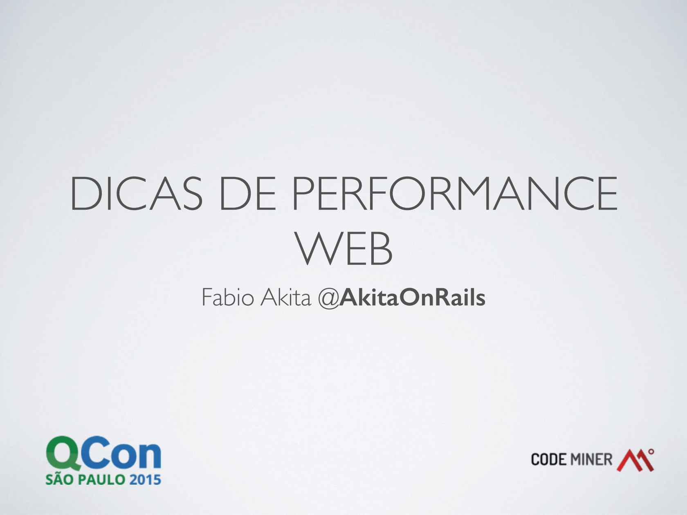

# Dicas de performance para aplicações Ruby on Rails Gravado em:

**Resumo**  
Nesta palestra serão apresentadas técnicas selecionadas que vão trazer o maior benefício pelo menor custo de desenvolvimento – para que sua aplicação não apresente gargalos óbvios. Serão exploradas desde técnicas simples como configurar filas para tarefas assíncronas, até otimizações para o lado HTTP como Memcache e ETags.

### Minibiografia

É cofundador da boutique de software Codeminer 42. Desde 2008 também é coorganizador da Rubyconf Brasil com a Locaweb. Ativista de Ruby on Rails desde 2006, publicou o primeiro livro do assunto. Já realizou quase 100 palestras pelo Brasil e pelo mundo. Trabalha como programador desde o começo dos anos 90 e passou por todas as principais tecnologias do mercado. Possui o blog akitaonrails.com.

O QCon enfatiza os tópicos de desenvolvimento mais importantes e inovadores do desenvolvimento de software, apresentados por engenheiros e empreendedores das grandes comunidades de desenvolvimento e arquitetura. Cada QCon é elaborado para oferecer um ambiente que promove aprendizado de alta qualidade e entrosamento entre os participantes.O QCon SP 2015 contou com 90 palestras e 12 tutoriais. Das 102 sessões mais de 30 foram internacionais. Com 15 tracks e 5 dias de duração, este foi o maior QCon brasileiro de todos os tempos e reuniu mais de 900 pessoas.
