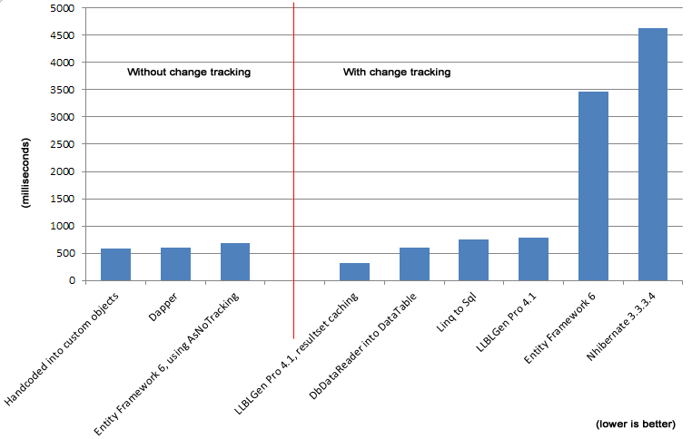

# Large Model Problems Continue to Plague Entity Framework, NHibernate

When using EDMX model to generate classes for Entity Framework, size matters. By default, the more entities you have in the model the slower operations are going to be. Here is a quote from the [bug report by David Obando](https://entityframework.codeplex.com/workitem/1829). The table mentioned is from the AdventureWorks sample database.

> If the EDMX only has one entity type (SalesOrderHeader) materialization takes 840 milliseconds (median value, 10 runs), but when the EDMX contains a richer model, for example one with 67 entity types and 92 associations, the same test takes 7246 milliseconds to complete (median value, 10 runs).

The performance issues was reported against EF 6, but can also be reproduced in EF 5.

According to a Reddit user by the handle NinetiesGuy, you can use the [AsNoTracking option](http://msdn.microsoft.com/en-us/library/gg679352(v=vs.103).aspx) to as a work around. But that can lead to other problems. Frans Bouma, a.k.a. responds, “AsNoTracking means the entity object doesn't do nor can be used for change tracking scenarios, so is effectively a readonly object.”

Frans Bouma, developer of the LLBL Gen Pro ORM, discusses this issue further in his article titled [Fetch performance of various .NET ORM / Data-access frameworks](http://weblogs.asp.net/fbouma/archive/2013/12/09/fetch-performance-of-various-net-orm-data-access-frameworks.aspx). In this article he demonstrates that with change tracking turned on, Entity Framework and NHibernate can take an order of magnitude longer to materialize entities than other ORMs or hand-coded objects.

For the test, “each operation consisted of fetching 31465 entities from the database with one query and materialize these in individual objects which were stored into a collection. The average times given are the averages of 10 operations per framework, where the slowest and fastest operation were ignored.”

In regards to the NHibernate results [he writes](http://www.reddit.com/r/dotnet/comments/1sgwjm/fetch_performance_of_various_net_orm_dataaccess/cdy02bw),

> I've included a screenshot of a profile I did on the NH code, to see why it was so slow. When I include 1 entity, no relationships, the NH code is hovering around 1500ms, EF around 1100ms. The slowness is coming from having more relationships in the model, but that's precisely the point: it's unnecessary to have that influence the fetch of a set of a single type: the other relationships are not at play, the ORM knows that.
>
> The slowness isn't coming from the size of the set, but of the size of the model: more relationships, slower fetches. What you refer to is having a dumb ORM store more and more entities in a set which gets slower and slower because it does a list.Contains(toAdd) before adding an entity to avoid duplicates (wild guess), which gets slower the more entities are stored. That's not the case here: the more relationships in the model, the slower they get. That is precisely why I picked this entity and this database: if an ORM has sloppy code so it can't deal with normal sized models, it will show.

### Tell us what you think

Email me replies to any of my messages in this thread
