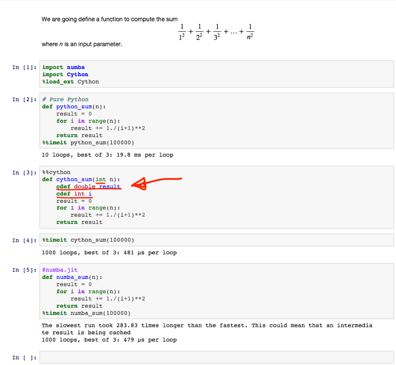

# 5 important Python Data Science advancements of 2015

#### Sometimes it can be hard to keep up with all the new stuff happening in the Python data science community. And who has the time to watch the videos from the PyData and the SciPy conferences? Well, since I did just that, I might as well also give you a short summary of the most awesome stuff.

### Numba

#### — Just-In-Time compiling

Coding in Python just became a lot more awesome… and a whole lot faster as well. Previously, gaining a significant speed-up came with the cost of having to rewrite your code as well as having to break it into compilable pieces. Now you don’t have rewrite the entire code, nor to pre-compile it! All you need is a decorator.

I will let [the code](http://github.com/elgehelge/elgehelge.github.io/blob/master/notebooks/Cython%20vs%20Numba.ipynb) speak for itself:




It even warns you about stuff that can be done smarter. If you wanna know a little more, check out this talk from Scipy 2015:

### Conda

#### — replacing *pip* and virtualenv

Conda is the future. Why? Because it is better than *pip* for managing packages, better than *virtualenv* for managing environments. And then it is platform independent!

I recommend [this blog post](http://stiglerdiet.com/blog/2015/Nov/24/my-python-environment-workflow-with-conda/) by [Tim Hopper](http://twitter.com/tdhopper) about his reasons for using Conda.

### **The Jupyter notebook**

#### — with *GitHub...* and Binder... and Pinapple… and tmpnb.org!

I didn’t realize this until my iPython notebook suddenly had a new logo. The notebook project has grown big and spread into other languages and has now been separated from iPython notebook kernel. This means that any language can be implemented to work with the new [*Jupyter Notebook*](http://jupyter.org/). This separation has spawned an entire ecosystem around the Jupyter Notebook.

Here is a few of my favorites.

#### [**GitHub rendering**](https://github.com/blog/1995-github-jupyter-notebooks-3)

Files of the type .ipynb are now rendered directly inside GitHub. [BuzzFeed News is already open sourcing their data analysis](http://github.com/BuzzFeedNews/everything#data-and-analyses) this way!


#### [Binder](http://mybinder.org/)

Lets you instantly turn a GitHub repo into a collection of interactive notebooks running in the cloud and being interfaced by your browser. This is going to completely revolutionize science and push data journalism to the next level — making it easy to share results, and as easy to reproduce them.

#### [tmpnb.org](http://tmpnb.org/)

Lets you spin up temporary notebook instantly. Go [try it out](http://tmpnb.org/)!

#### [**Pineapple**](http://nwhitehead.github.io/pineapple/)

A Desktop app for Mac. It still needs a little work, but I already love it!

And the Jupyter team keeps going. Soon the Jupyter notebook will get support for real-time collaboration!

### Matplotlib 2.0

#### — it’s kind of pretty now

Can you believe it? Matplotlib plots now looks kind of pretty. While the old default *matplotlib* was making you cry every time you needed to plot something, you can now use a handful of different predefined well-known styles like *ggplot*, *Bayesian Methods for Hackers*, or *FiveThirtyEight*, by simply typing for instance:

```
plt.style.use(‘ggplot’)
```

Here is what some of the styles look like:


The default


‘ggplot’


‘bmh’ (as in Bayesian Methods for Hackers)


‘fivethirtyeight’

matplotlib 2.0 is going to break backward compatibility which is hopefully going to make it easier to use. However, I would still recommend interfacing with matplotlib through [*Seaborn*](http://stanford.edu/~mwaskom/software/seaborn/).

**Edit:** The styles shown above are not new. What’s new is that *matplotlib 2.0* will have a pretty default style. It has not yet been decided which one, but the old *matplotlib 1.x* style can be brought back using:

```
plt.style.use(‘classic’)
```

### TensorFlow

#### — A second generation deep learning library from Google

Chances are you did not miss this. If so, you should [check it out](http://www.tensorflow.org/). The project still have a few childhood diseases, but it quickly got more followers than any other open source deep learning library on GitHub. Primarily because of the insane amount of hype, but let’s see.
