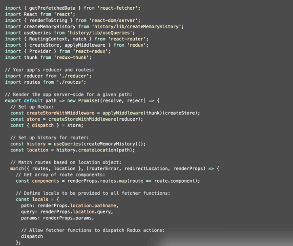

# Javascript Fatigue

A few days ago, I met up with a friend & peer over coffee.

> Saul: “How’s it going?”Me: “Fatigued.”Saul: “Family?”Me: “No, Javascript.”

More accurately, I meant *React* and the Javascript ecosystem that comes with it.

For starters, consider that [Pete Hunt](https://medium.com/u/3b799f227b58) asked why React is overwhelming for beginners:

If you use React, you probably share the same experiences with [Vjeux](https://medium.com/u/46fa99d9bca4):

> There is a major problem in the React community that cripples beginners and hinders experts alike.

#### Too Many Tools.

At work this past quarter, we **painstakingly** started three new projects at work. I say “painstakingly” because *every* project required decisions to be made around tooling depending on the scope & needs.

Ultimately, the problem is that **by choosing React (and inherently JSX), you’ve unwittingly opted into a confusing nest of build tools, boilerplate, linters, & time-sinks to deal with before you ever get to *create* anything.**

#### Boilerplates & Generators Are Not The Answer.

[Yeoman](http://yeoman.io/) & [Plop](https://github.com/amwmedia/plop) can alleviate the amount of copy & pasting you do between projects.

However, generated is *never* a one-to-one match, nor can it be.

At scale with enough projects, it is exceedingly difficult to back-port features & improvements from one application to the rest, since **the common code is not abstracted into an independently updatable dependency.**

> When a generator is good solution for repetitious code, a better solution is to abstract it into a simpler API.

Otherwise, the generator becomes a confusing, logic-riddled application itself due to permutations of possible use-cases, forever in a race to stay relevant with the applications it created.

I’ve experienced this first-hand with several generators, including my own [evolution/wordpress](https://github.com/evolution/wordpress).

#### Too Many APIs. Too Much Configuration.

An example of this can be seen in [Mark Dalgleish](https://medium.com/u/d7225e72eea)’s excellent [react-fetcher](https://github.com/markdalgleish/react-fetcher#example-usage-with-react-router-and-redux), libraries such as [Redux](https://github.com/rackt/redux), [React Router](https://github.com/rackt/react-router), [Webpack](http://webpack.github.io/), and the React ecosystem have, largely, opted for discrete modularization at the cost of terse APIs by **offloading their architectural underpinnings to the user and, as a result, worsen the developer experience in aggregate.**

Alone, the APIs are small, but even less than a handful yield a nearly incomprehensible mess of code to each new set of eyes.

Even if contained in a “boilerplate” project, scaffolded by a generator, or tucked away in a *finalCreateStorev3SeriousThisTime.js* file, we’ve created a rat’s nest of wiring that would make WordPress plugins blush.

#### More Abstractions. Less Code.

Of course, these APIs are a requirement for having smaller, decoupled, testable, and therefore, *high-quality* libraries.

However, we **need an abstract middle-ground between wiring dependencies and generating boilerplates*.***

> Abstractions are necessary to reduce the cognitive load of how things work so you can focus on creating.

#### Fight Against Lines of Code.

Any significantly-scoped project will already have a substantial amount of code behind it.

> Application developers should not have to become experts in the underpinnings of the library just to use it.

Therefore, instrumenting tooling should aim to be *as minimal as possible*.

Consider this **hastily-compiled list of alternatives**:

- Provide an opinionated, *author-endorsed* wrapper API or library for the theoretical 90% of use-cases.  
  *(Cutting the boilerplate for React + Router + Redux alone would be a* ***huge*** *improvement for many.)*
- Publish use-case *presets* akin to Babel’s (e.g. [*es2015*](https://www.npmjs.com/package/babel-preset-es2015),[*react*](https://www.npmjs.com/package/babel-preset-react), etc.) presets.
- Leverage folder & file-naming conventions for automatically discovering application-specific routes, actions, tests, and more.  
  *(This is already common-place for testing (e.g.* [*Mocha*](http://mochajs.org/)*) & serving public assets, but somehow every project magically requires a unicorn-configuration.)*
- Community-driven Rapid Application Development (RAD) tooling to significantly delay the need for explicit configuration until scope is solidified.

Until a large part of the ecosystem adopts terse APIs, conventions, and strives for significantly reducing implementation details for end-users, abstract tooling may be our only outlet.

#### RAD Tooling

Following the Twitter threads above, many rightfully concede that there is no one-size-fits-all solution.

> However, if we start with the intent to just build a prototype, the underlying abstractions don’t matter.

Related, [Vjeux](https://medium.com/u/46fa99d9bca4) [challenged the community to devise tooling for quick prototyping](http://blog.vjeux.com/2015/javascript/challenge-best-javascript-setup-for-quick-prototyping.html), even at the cost of customization.

In the meantime, I’m aware of a few options you can use **today** to jumpstart your next project:
