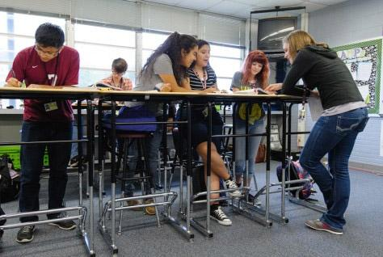

# Standing desks may boost students’ cognitive function as well as health

## Pilot study on high school freshman finds 7-14% better scores after one school year.

[Texas A&M University](http://www.eurekalert.org/multimedia/pub/106788.php)

Standing desks—most often installed in efforts to improve physical activity and health—may help [get your noggin in shape](http://www.mdpi.com/1660-4601/13/1/59), too, according to a pilot study published in the *International Journal of Environmental Research and Public Health*.

Following 27 high school freshman over one school year, researchers found that using a standing desk generally improved the kids’ neurocognitive test scores by seven to 14 percent. The tests, given both at the beginning and end of the school year, evaluated cognitive processes such as reasoning and working memory.

“These findings provide the first preliminary evidence on the neurocognitive benefits of standing desks, which to date have focused largely on energy expenditure,” the authors conclude. If the results are backed up in further studies, it could mean that a simple furniture swap to standing desks could lead to a rise in outstanding students.

ADVERTISING

The researchers, led by Ranjana Mehta of the Texas A&M School of Public Health, got the idea for the study after seeing observational data that hinted at improved attention and focus of kids using standing desks in schools. Some schools are starting to use [the trendy tables](http://arstechnica.com/science/2015/10/standing-desks-are-no-replacement-for-a-workout/) to allow students to move and ignite calorie burning during class—which could ultimately help combat the nationwide obesity epidemic.

But with the known [cognitive benefits of exercise](http://arstechnica.com/science/2015/12/tv-binging-exercise-skipping-linked-to-poor-cognitive-function/), the researchers hypothesized that standing desks could also help give the kids’ brains a jog.

To test the idea, Mehta and colleagues recruited freshman at a Texas high school that had undergone a transition to “standing-biased” classrooms, which offered tall desks at which kids could stand, sit on a stool, or shift between the positions during class time. The 27 students had not been exposed to standing desks in schools before the study.

In both the fall and spring semesters, researchers gave the kids five neurocognitive tests that evaluated quick decision-making, reasoning abilities, working memory, their ability to modify cognitive strategies, and cognitive flexibility. The researchers also used a portable brain-imaging device, called a functional near infrared spectroscopy, to assess the activity of 14 of the students' noodles during the testing.

Comparing the students’ test results from the beginning with those at end, the researchers found general improvement in cognitive functions. The imaging also showed increased activity in students’ left prefrontal cortex, which is generally involved in working memory and executive functioning.

Because the study was a pilot, it lacked a sitting control group for comparing cognitive performance. The authors recommend that researchers conduct bigger studies with such proper controls in the future. However, the authors argue that the improved cognitive scores seen in the standing students are unlikely to be due to a year's worth of aging or schooling. Such test scores are usually fixed around age 12, and education in such a short time period are unlikely to significantly influence the scores, the authors argue.

The authors also recommend that future studies look at students’ grades and standardized test scores to see if improved cognitive function translates to real-world success.

Ultimately, the authors conclude, this study could kick off others that prove that standing desk use in kids can "drive their cognitive development and impact educational outcomes."

*International Journal of Environmental Research and Public Health*, 2015. DOI: [10.3390/ijerph13010059](http://www.mdpi.com/1660-4601/13/1/59)   ([About DOIs](http://arstechnica.com/science/news/2010/03/dois-and-their-discontents-1.ars)).
