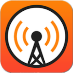
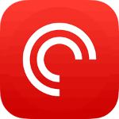

# TPS76: 8 Best Practices for Email

By [Asian Efficiency Team](http://www.asianefficiency.com/author/aeteam/ "Posts by Asian Efficiency Team") [1 comment](http://www.asianefficiency.com/podcast/076-email/#comments "Read Comments")

Mike, Thanh, and Zack discuss how to tame the email monster, one of the topics that we at Asian Efficiency get the most questions about. In the episode, we dive into some of our favorite tips for controlling your email instead of letting it control you, strategies getting to inbox zero, and show you how to use technology to systematize your email management.

#### The Productivity Show The Productivity Show

### TPS76: 8 Best Practices for Email TPS76: 8 Best Practices for Email

## **Cheat Sheet**

- How to maintain inbox zero
- Why you should process your emails regularly
- Why Thanh is currently checking his email only once a week
- How to process your individual emails when you receive them, and decide what to do with those emails
- Why the number of unread emails you have in your inbox isn’t that important
- How to use pull notifications instead of push, so that you don’t get distracted
- The “touch it once” concept
- How to use email technology and software to your advantage
- How to sort your email and read from the oldest received email
- How to put boundaries in place to stop “email creep”

## **Links**

If you enjoyed this episode, **subscribe to the podcast on iTunes, Sticher, Overcast, PocketCast** or your favorite podcast player.It’s easy, you’ll get new episodes automatically, and it also helps the show gain exposure. You can also leave a review! [Here’s how](https://www.youtube.com/watch?v=7rrwvGAYKeM).  
 

Posted in  *[Podcasts](http://www.asianefficiency.com/podcast)*  [February 1, 2016](http://www.asianefficiency.com/2016/02/ "Posts from February, 2016") [Print this](http://www.asianefficiency.com/podcast/076-email/http%3A%2F%2Fwww.asianefficiency.com%2Fpodcast%2F076-email%2F) [Add a Comment](http://www.asianefficiency.com/podcast/076-email/#respond)

### 1 Comment

[anexo ausente]

Posted by [Linda Maye Adams](http://www.linda-adams.com/)   [February 3, 2016 at 8:02PM](http://www.asianefficiency.com/podcast/076-email/#comment-60068) [Reply](http://www.asianefficiency.com/podcast/076-email/?replytocom=60068#respond)

Most of the email I receive requires some kind of action from me. So I ended up doing three things.

The first is identifying what constitutes an emergency, or at least something that needs to be responded to right away. I did a list for my backup for when I went on leave, and it turned out be useful for me. I work in a culture of fire fighting. People wait until the last minute, scream, “It’s an emergency!” and expect me to drop everything to help them. If it’s not on that list, it’s not an emergency.

The second thing is that I touch the emails twice. The first time is to see if they are an emergency that I need to take care of right away. If not, then I move it into an email folder with other like items and answer them all at once.

The third is that I use a lot of different signature blocks. I often have to give out instructions, most of which I give out over and over. So I built different signature blocks with those instructions. If someone asks about something, I select the appropriate signature block, then add whatever comments above and “See the instructions below.”

### Leave a Reply

Name (required) Mail (will not be published) (required) Website
