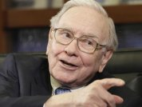

# How to spot bad business books

[Flickr/Morgan](https://www.flickr.com/photos/meddygarnet/4454466145/)

### See Also

#### [25 books that every entrepreneur should read](http://www.businessinsider.com/best-books-for-entrepreneurs-to-read-2016-1/)

#### [18 books billionaire Warren Buffett thinks everyone should read](http://www.businessinsider.com/warren-buffett-favorite-books-2015-10)

#### [The 20 best business books of 2015](http://www.businessinsider.com/the-best-business-books-of-2015-2015-12)

We all like to be inspired.

That’s a universal truth, we all like to hear, see and engage in things that allow us to experience a paradigm shift or encourage a change in our thinking. It gives us a certain degree of motivation, and it can mean the difference between giving up on what we want to do and persevering.

But there’s an industry of inspiration. An industry that thrives on badly written and often vapid truisms that just aren’t useful. An industry of books.

There are some great books on business out there. And the good ones are easy to recognize. They’re well written, well thought out and highly practical.

If you’ve ever read "The Lean Startup" by Eric Ries, you’ll know that’s the benchmark. Same goes for "The Hard Thing About Hard Things," by Ben Horowitz. When you read books like that, there’s enough hard learning and clear, actionable techniques to guide any dedicated business through validation and product development.

The bad ones are a whole other breed. Spend a good 10 minutes browsing the business or management sections of any larger book store and you’ll uncover tomes of knowledge that are priced around $50 and will never help you grow a business.

They’re full of crap. They’re overblown, over-hyped, and full of useless anecdotes that have very little to do with real advice and actionable lessons. They’re the literature equivalent of cheap stock photos full of old dudes in suits.

I categorize most of these books as Cheese Relocation Management Spell Books. They use all kinds of analogies that are intended to make executives spend a bucket-load of money on consultants and seminars. And they have about as much hard data and insight as a fictional wizard’s spell books.

When you read them, you find old school corporate "synergy" speak dressed up in innovation’s clothing. Give up on them, and give up on them early. Here’s how to spot them:

## **Analogies and metaphors instead of case studies and data**

Great books will cover, in detail, the real-life business cases that the author’s management, economic, or start-up theories are based on.

The bad books will try and use imaginative and wise-sounding stories or analogies to laboriously illustrate their points. It’s complicated, vague, and sounds incredibly wise whilst not giving any direction worth a dime.

## **Name-dropping instead of citing results or research**

If every management consultant who’s ever written a book was truly contracted by Microsoft, we’d have to wonder if Redmond has stopped hiring people internally. Look, I’m not calling anyone out here, but it shouldn’t matter in the first place.

If an author wants to convince me of his or her credentials, he or she is going to have to do more than show me a resume. The author needs to either demonstrate that he or she is an expert in the field or show me the results of his or her work.

Carly Fiorina, I’m looking at you  —  being CEO of HP counts for nada when the results of your work are publicly available. If you ever write a book, don’t expect me to read it.

## **Management-speak instead of plain language**

Synergy is not a thing, people. It’s just not. It means nothing and it says nothing. Unfortunately, it’s just one of a hundred words or phrases that sound *super business-y* but don’t really express a point or help to explain important concepts.

When the business book you’re reading relies on these words either for filler or because the writer doesn’t know how to express him- or herself without spouting crap, you’re wasting your time.

## **Fool-proof formulas or "silver bullets" instead of real lessons**

There’s no shortcut in life or business. There’s no easy path to success, and if a book is trying to sell you one, or is trying to teach you the formula to Google’s rise, you’d have a more productive afternoon tearing it up than reading it.

*[Jon Westenberg](http://www.jonwestenberg.com/) is a start-up inspired entrepreneur, comedian, writer, critic.*

Read the [original article](https://medium.com/life-learning/how-to-spot-bullshit-business-books-6e6d8d434d82#.798g213x8) on [Medium](https://medium.com/). Copyright 2016. Follow Medium on [Twitter](http://twitter.com/Medium).

### SEE ALSO: [Imitating the habits of successful people is ultimately pointless](http://www.businessinsider.com/why-copying-the-habits-of-high-achievers-wont-make-you-more-successful-2016-1)

### NOW WATCH: [Bill Nye has a great response to Trump's outrageous statements about climate change](http://www.businessinsider.com/bill-nye-great-response-donald-trump-statements-climate-change-2016-1)
