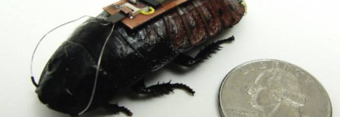

# Você pode criar sua barata-ciborgue com apenas US$ 30

Por
Redação
| em
04.02.2016 às 08h10

[Share](#)

A próxima vez que você chegar em casa, pode ser que a barata da vizinha esteja na sua cama controlada à distância por controle remoto. Parece uma imagem absurda vindo de algum filme ruim de ficção-científica que mistura *MIB* com *Exterminador do Futuro*, mas é a mais pura e nojenta realidade. Afinal, alguém teve a brilhante ideia de equipar um desses asquerosos insetos com componentes eletrônicos que permitem o controle à distância. Isso mesmo, estamos falando de um mundo em que já existem baratas-ciborgues soltas por aí e você não tem ideia do que pode fazer para se defender.

A estranha experiência foi comandada pelo usuário bravoechonovember1 no fórum Instructables. E ele fez exatamente o que você está pensando: capturou uma barata em sua casa, instalou uma série de circuitos e conseguiu fazer com que ela seguisse suas ordens. O mais impressionante é que toda essa operação não custou mais do que US$ 30. Isso significa que com pouco mais de R$ 120 você pode ter sua própria barata-robô para invadir a casa dos outros ou apenas dar aquele susto nas suas amigas.

Como o próprio autor da façanha, todo o processo de criação do inseto-ciborgue é bem simples e consiste apenas em criar uma espécie de “mochila robótica” para o animal feita com uma estrutura de alumínio, conectores e alguns fios aplicados em uma Arduino. A partir dessa pequena geringonça, ele anestesiou uma barata ao mergulhá-la em água gelada e deu início a todo o processo cirúrgico para criar sua obra-prima. O segredo está em conectar a mochila ao tórax do animal e tirar suas antenas para colocar os fios de seu sistema no lugar. Feito isso, basta fazer um furo no exoesqueleto para inserir outro cabo e pronto.

É claro que para que a barata-ciborgue responda aos seus comandos é preciso programar a Arduino de modo que os comandos façam algum sentido. O lado bom é que esse processo é bem simples e, de acordo com o responsável por essa bizarrice, bastam apenas seis linhas de códigos para que a mágica aconteça. Assim, o controle remoto consegue estimular o inseto pelo que deveriam ser suas antenas e, a partir de diversas frequências, fazer com que a barata acredite estar diante de paredes. É nessa tentativa de desviar de um objeto inexistente que está o segredo. Contudo, os efeitos são temporários e a criatura para de responder a esses estímulos aos poucos.

Ainda assim, esse é um feito e tanto. Por mais bizarro e nojento que seja pensar que alguém está criando baratas comandadas por controle remoto, é no mínimo curioso ver como podemos controlar a natureza a partir de algumas tecnologias bem simples e baratas — com o perdão do trocadilho. E, mais importante que tudo isso, perceber que a ciência por trás de *Homem-Formiga* não é tão absurda assim. Só é uma pena que o Vingador que a gente mereça seja um animal tão asqueroso.

*Via: [Instructables](http://www.instructables.com/id/Control-a-Cockroach-With-Arduino-for-Under-30/), [Ars Technica](http://arstechnica.com/science/2016/02/make-your-own-cyborg-cockroach-for-under-30/)*

[Seja o primeiro a comentar!](http://canaltech.com.br/noticia/robo/voce-pode-criar-sua-barata-ciborgue-com-apenas-us-30-57277/#comentarios)
