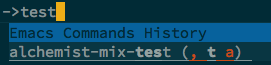
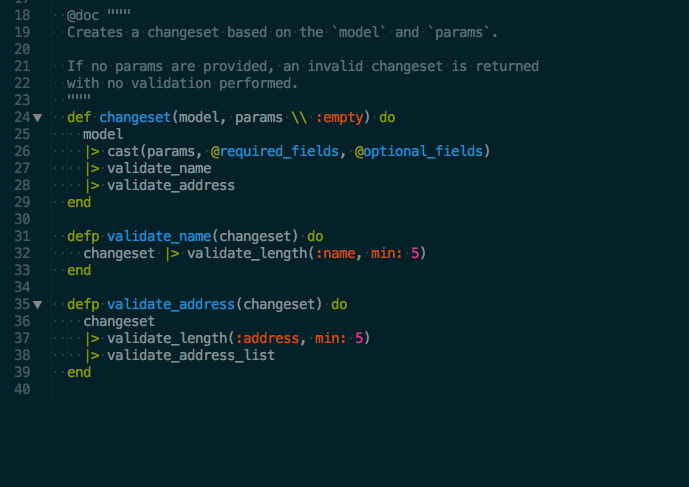
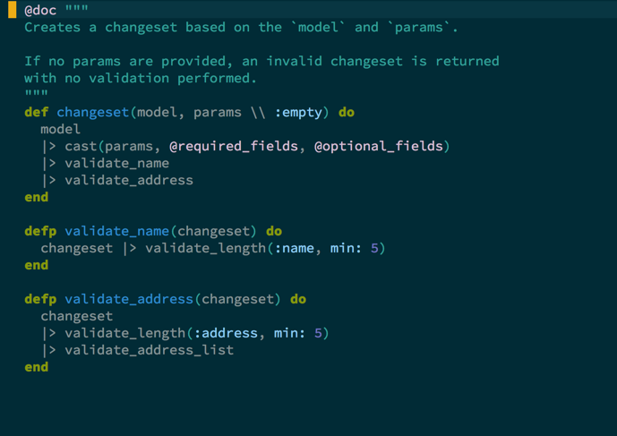
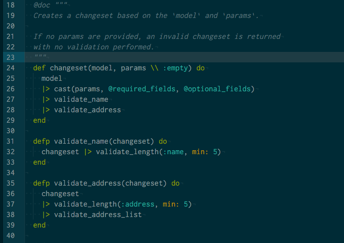

# Phoenix, to the basics and beyond.

## Introduction

Phoenix is the exciting new kid on the block in the vast world of web frameworks.  
Its roots are in Rails, with the bonus of the performances of a compiled language.  
This isn’t exactly a getting started guide, but a (albeit short) list of things you’ll have to know very soon in the process of writing a Phoenix application, that are just a bit beyond the "writing a blog engine in 15 minutes by using only the default generators".  
I assume previous knowledge of the Elixir language, the Phoenix framework and the command line tools

```
mix ecto.create         # Create the storage for the repo
mix ecto.drop           # Drop the storage for the repo
mix ecto.gen.migration  # Generate a new migration for the repo
mix ecto.gen.repo       # Generate a new repository
mix ecto.migrate        # Run migrations up on a repo
mix ecto.rollback       # Rollback migrations from a repo
mix phoenix.digest      # Digests and compress static files
mix phoenix.gen.channel # Generates a Phoenix channel
mix phoenix.gen.html    # Generates controller, model and views for an HTML based resource
mix phoenix.gen.json    # Generates a controller and model for a JSON based resource
mix phoenix.gen.model   # Generates an Ecto model
mix phoenix.gen.secret  # Generates a secret
mix phoenix.new         # Create a new Phoenix v1.1.2 application
mix phoenix.routes      # Prints all routes
mix phoenix.server      # Starts applications and their servers
mix test                # Runs a project's tests
iex -S mix              # Starts IEx and run the default task
```

> command line tools cheat sheet

## First, a digression: development environments

If you want to skip this section, [go directly where the action is](http://dev.mikamai.com/post/138675652509/phoenix-to-the-basics-and-beyond#models)

### Emacs

Emacs and [Alchemist](http://t.umblr.com/redirect?z=http%3A%2F%2Fwww.alchemist-elixir.org%2F&t=NTkwMDhlNDI0MjVkYWRjYWY0YWI0OWEyM2VlNTUxZDBhZmI4MmUzYixrVUZ3MGNweA%3D%3D) are the most advanced programming environment for Elixir and Phoenix development.  
The features range from the simple syntax highlighting, to autocomplete, mix and iex integration, testing, compiling, running and evaluating code on the fly, everything you would expect from a modern IDE.  
Unfortunately (for me) I can’t really Emacs, the fact that my favourite Emacs
distribution is [Spacemacs](http://t.umblr.com/redirect?z=http%3A%2F%2Fspacemacs.org%2F&t=OTI1OWQ3ZmZlOTY2NTA1MzFkNGQ2NGI4MGYzODQ4N2U0NjkxYzI2ZSxrVUZ3MGNweA%3D%3D) says a lot about which one of
the two kind of people I am.  
Just for reference, if you are like me, `SPC m t a` launch `mix test` in a new buffer and rerun it every time you save a file.  
As simple as it might look, Alchemist is the only environment that offers this feature out of the box (everytime in Spacemacs you see `, somekey someotherkey`, that comma is translated to `m` in Spacemacs bindings).



> , somekey someotherkey

**TL;DR**: for hardcore Emacs users [Alchemist](http://t.umblr.com/redirect?z=http%3A%2F%2Fwww.alchemist-elixir.org%2F&t=NTkwMDhlNDI0MjVkYWRjYWY0YWI0OWEyM2VlNTUxZDBhZmI4MmUzYixrVUZ3MGNweA%3D%3D) is a must have.

### Sublime/Textmate

Sublime is my editor of choice on OS X and is the one I use to write Elixir too.  
There is a single bundle to be installed, it’s called Elixir and it’s the same for Sublime and Textmate.  
It provides syntax highlighting, autocomplete, snippets and a couple of commands (`Build with: elixir-mix-test` and `Build with: elixir`) to run tests and projects directly from the editor.  
I’ve also installed [SublimeREPL](http://t.umblr.com/redirect?z=https%3A%2F%2Fsublimerepl.readthedocs.org%2Fen%2Flatest%2F&t=NjEyMGFiNjBjYWY3ZjFmN2QxODJhY2M5MmJjMmZkMWU1ZDc4NTY1NCxrVUZ3MGNweA%3D%3D) which currently supports Elixir and iex, so you can split the screen between and iex shell and a code editor pane.

**TL;DR**: All the usual goodies of Sublime applies.

Atom is great, but actually is not.  
This sentiment strucks me everytime I use it, something is awesome, something else is awful, there is no middle ground when it come to the Github editor.  
For example I find unacceptable that in 2016 an editor cannot soft wrap on column 78 by default and I’ve found no package that does it.  
Coming from node, Atom inherits its problems, specifically the need to install many small packages to just get what you need.  
This time I installed `language elixir`, `autocomplete-elixir`, `elixir-cmd` (I’m not very convinced it is useful at all) and `iex`. The last one is the best of them all, it is actually pretty great honestly, letting you run an iex console and tests inside it (by pressing `ALT+CMD+a`).

**TL;DR**: Sorry Atom, I’ve tried, but you did not convince me.

### Beauty contest

I use Solarized Dark theme everywhere, from my editor, to the shell, I even used the Solarized palette in my personal website.  
I will share my opinions on the different syntax highlighting engines.

IMHO the winner is SublimeText (and Textmate, the bundle is the same).  
The different elements are clearly highlighted and less prominent ones (like comments) are low contrast, you can almost "not see them" after a little bit of training.



> SublimeText 3

Emacs comes second, we have a clear distinction here too, but the different colours are too soft/pastel and comments look too bright.



> Emacs

Atom is the loser here.  
I like a lot the polished interface and the look of the theme (the best of the lot), but the syntax highlighting is actually pretty cheap.



## Models

Phoenix models are a very thin layer around [`Ecto models`](http://t.umblr.com/redirect?z=https%3A%2F%2Fhexdocs.pm%2Fecto%2FEcto.Model.html&t=MjA0ZTQ2ZDBkZTVkMDA5YjE1NDEzNTZlZjllNjVmNmQ4ZTI2NWVjOSxrVUZ3MGNweA%3D%3D).  
The [schema dsl](http://t.umblr.com/redirect?z=https%3A%2F%2Fhexdocs.pm%2Fecto%2FEcto.Schema.html&t=YjViNWE5NTRhZDI0MzBlYjdiYjNmM2JmY2MzODI4NTJjZmZhNzgzNSxrVUZ3MGNweA%3D%3D) is very lightweight making it super easy to model the data layer.

> What a minimal model looks like

```
defmodule .Email 
   App.Web, :model

  schema "emails" 
    field :address, :string
    timestamps # the ususal timestamps: created_at, updated_at
```

With `use App.Web, :model` you just import some packages defined in `web/web.ex` that you can customize.  
Specifically, by default Phoenix `use`s `Ecto.model` and `import`s from `Ecto.Changeset` and `Ecto.Query`.  
The difference between `use` and `import` is that `use` calls the `__using__` macro and inject code in the module that uses it, while `import` make functions in the imported module available to the caller and let you chose to import everything or just some of them.

### Custom primary keys

The first “beyond the basics” we can do is to personalize the primary key of our model.  
By default they are autogenerated, autoincrementing `integers` and are called `id`.

Suppose we want to use a [GUID](http://t.umblr.com/redirect?z=https%3A%2F%2Fen.wikipedia.org%2Fwiki%2FGlobally_unique_identifier&t=ODE0YWFiNWI4NGI1Yjg2MWE0NjY5YjMxODM5NTAyMzc4ZmYzZTJiNCxrVUZ3MGNweA%3D%3D), how can we do that?

It’s pretty simple: first of all we have to tell the model that we don’t want Phoenix to autogenerate the primary key.  
We do that at the `migration` level, where we also tell Phoenix to generate a field of type `:uuid`, [it’s a predefined type that maps to `Ecto.UUID`](http://t.umblr.com/redirect?z=https%3A%2F%2Fgithub.com%2Fphoenixframework%2Fphoenix%2Fblob%2F5f230cf52a5f601e4a1cd35dbb6a2d8ba8082728%2Flib%2Fmix%2Ftasks%2Fphoenix.gen.model.ex%23L209&t=NTYyM2I4ZmM2MDQyZmQzNDYyNzRkOWQyYThiYmI5MTlhODQ1NmU3NyxrVUZ3MGNweA%3D%3D)

```
defmodule .Repo.Migrations.CreateEmail 
   Ecto.Migration

   change 
    create table(:emails, primary_key: false) 
      add , :uuid, primary_key: 

      # ... rest of the table definition
```

Then we instruct the model to use our new primary key

```
defmodule .Email 
   App.Web, :model

  # autogenerate GUIDs through the included GUID generator
  # the type is binary_id
  # by passing --binary-id to 'mix phoenix.new' 
  # binary_id is assumed as the default format for ids
  @primary_key {, :binary_id, autogenerate: }

  # instruct Phoenix on how to extract the primary key for this model
  @derive {Phoenix.Param,  }
```

That’s all: we can now safely browse urls like `http://localhost/emails/1b72fe0b-5977-48bd-a19c-38140d1d1fed`.

### Custom validators

Validators in Phoenix are just functions that accept a changeset and optionally other parameters and return the same changeset or a new one filled with errors.  
[Changeset](http://t.umblr.com/redirect?z=https%3A%2F%2Fhexdocs.pm%2Fecto%2FEcto.Changeset.html&t=MTA5M2JlMmI3M2Q0MTY3OGM2MTk1NjkxNjg2ZGU5ZDk5NTE4MjYxNSxrVUZ3MGNweA%3D%3D) are the data structure Phoenix uses to keep track of the changes in the model and provide constraints and validations facilities.

Changesets provide the following default validators

```
validate_change(changeset, field, validator)
##Validates the given field change
validate_confirmation(changeset, field, opts \\ [])
##Validates that the given field matches the confirmation parameter of that field
validate_exclusion(changeset, field, data, opts \\ [])
##Validates a change is not included in the given enumerable
validate_format(changeset, field, format, opts \\ [])
##Validates a change has the given format
validate_inclusion(changeset, field, data, opts \\ [])
##Validates a change is included in the given enumerable
validate_length(changeset, field, opts)
##Validates a change is a string or list of the given length
validate_number(changeset, field, opts)
##Validates the properties of a number
validate_subset(changeset, field, data, opts \\ [])
##Validates a change, of type enum, is a subset of the given enumerable. 
##Like validate_inclusion/4 for lists
```

> default validators

On a first look, it seems like Ecto developers have been lazy and provided only a handful of validators.  
In reality it’s incredibly easy to build custom validators, thank to the `|>` operator we actually build validation pipelines.

Foe example this code validates an Email model by ensuring the presence of the fields name and address and enforcing the format for the address field.

```
defmodule Wejustsend.Email 
  # all the usual imports and schema omitted  
  
   "
  Creates a changeset based on the `model` and `params`.

  If no params are provided, an invalid changeset is returned
  with no validation performed.
  "
   changeset(model, params \\ :empty) 
    model
    # build a changeset from params
    # cast enforce the type of the fields and the presence of the required 
    |> cast(params, @required_fields, @optional_fields) 
    |> validate_name
    |> validate_address
  
  
   validate_name(changeset) 
    # name cannot be shorter than 4 characters
    changeset |> validate_length(:name,  )
  
  
   validate_address(changeset) 
    changeset
    |> validate_length(:address,  ) # a@a.a is 5 characters long
    |> validate_address_list
  

   validate_address_list(changeset) 
    # validate a list of one or more email addresses separated by ','
    # an email address is considered valid if it matches the regex
    # ^\S+@\S+\.\S+$
    changeset |> to_address_list |> Enum.reduce(changeset, (address, acc) ->
      if address =~ address_format 
        # if matches we return the changeset as it is
        acc
      else
        # if it doesn't, we add the error to the changeset and return the new invalid changeset
        add_error(acc, :address, "#{address} is not a valid email address")
      
    )
  

   to_address_list(changeset) 
    # if get_change returns the default value, it means that the change is empty
    # and we return the empty list
    # otherwise we split the string on ',' and strip the spaces around them
     get_change(changeset, :address, []) 
      []      -> []
      address -> address |> String.split() |> Enum.map(&String.strip/)
    
  

   address_format 
    ~r/^\S+@\S+\.\S+
```

> validations for an Email model

It is a little verbose, honestly, but it is also very clear and required a basic knowledge of the framework to build it.  
Of course validation code, being just pure functions, can be generalized and moved somewhere else (a different Module for example) to be used in different models or in different applications.

## The Repository Pattern and the macros

Phoenix does not supply any ORM or ORM like library for accesing data, instead it relies on the Repository Pattern (and the awesome [`Ecto.Query`](http://t.umblr.com/redirect?z=http%3A%2F%2Fhexdocs.pm%2Fecto%2FEcto.Query.html&t=Y2NjMTY1MDU1OGJjYTFhZWFkN2M1ZWJlNGU5Mzg2NDU3ZjM2MTZiZSxrVUZ3MGNweA%3D%3D)), which, IMHO, is superior to Active Record any day of the week.  
Phoenix implemented it in a very generic way, using the facilities provided by `Ecto`:

```
defmodule .Repo 
   Ecto.Repo, otp_app: , adapter: Sqlite.Ecto # default adapter is PostgreSQL

##then you can query the repository

Repo.all(Email)                                    # -> all emails
Repo.all(User)                                     # -> all users
Repo.get(User, )                                  # -> user with id 2
Repo.get_by(User, {name: 'Rambo')                  # -> first user whose name is Rambo
Repo.insert(%Email{address: 'marsrover@nasa.gov'}) # -> insert a new email
```

However, Active Record is a very well established and recognized pattern in web applications, it is perfectly possible that its absence could let some developer down.  
Let’s add something that resembles it to our models:

```
defmodule .Email 
  # all the usual imports and schema omitted

  alias App.Repo

  # returns all Emails
  (opts \\ []) 
    Repo.all(Email, opts)
  

  # find Emails by filtering out all emails not respecting clauses  
  # for example: {domain: 'email.com'}
  (clauses, opts \\ []) 
    Enum.filter all(opts),  map ->
      Enum.all?(clauses,  {key, val} -> Map.get(map, key) == val )
    
  

  # get the Email with id equal to id
  (id, opts \\ []) 
    Repo.get(Email, id, opts)
  

  # more functions
  # I suppose you get the pattern…

##now you can do this
Email.all
Email.find({domain: 'email.com'})
Email.get()
##etc. etc.
```

Elixir has a powerful mechanism to write generic code, [macros](http://t.umblr.com/redirect?z=http%3A%2F%2Felixir-lang.org%2Fgetting-started%2Fmeta%2Fmacros.html&t=OTFkYzQ0NTc0YjBkMGVmOWExYjNhOWU3Yjg4MGQ0MmNjMDNiZDFmZSxrVUZ3MGNweA%3D%3D).  
Phoenix is an Elixir app after all, so we can use macros to write a generic `ActiveRecord` like wrapper for the `Repo` and inject it into the `Model` code at compile time (yes, at compile time, it will be like we actually wrote that code with no loss of performance whatsoever).

```
defmodule .Activerecord 
  # when we "use" a Module, Elixir calls the relative __using__ macro inside it  
  defmacro __using__() 
    quote 
      alias App.Repo

      # __MODULE__ is resolved at compile time with the name
      # of the caller, inside "quote do" we are in the caller context
      (opts \\ []) 
        Repo.all __MODULE_, opts
      

      (clauses, opts \\ []) 
        Enum.filter all(opts),  map ->
          Enum.all?(clauses,  {key, val} -> Map.get(map, key) == val )
        
      

      (id, opts \\ []) 
        Repo.get __MODULE_, id, opts
      

       get_by(clauses, opts \\ []) 
        Repo.get_by __MODULE_, clauses, opts
      

    

  

##and then do

defmodule .Email 
  # all the usual imports and schema omitted
   App.Activerecord # <- this inject the code into the Email module

##now you can do this
Email.all
Email.find({domain: 'email.com'})
Email.get()

##but also this, if you use the ActiveRecord module in the User model
User.all
User.find({role: 'admin'})
User.get()
```

I don’t know if this is a good idea, but it is very easy to implement and the mechanism is so powerful that opens up the way for writing well organized and understandable code.

Next time we’ll talk about the assets pipeline and long running processes.
