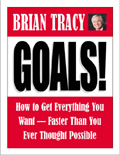
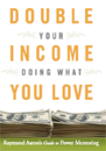

# 22 Strength & Courage Quotes To Build You Up

Posted by [admin](http://www.goalsontrack.com/blog/author/admin/ "Posts by admin") on Tuesday, March 5, 2013 · [3 Comments](http://www.goalsontrack.com/blog/2013/03/05/22-strength-courage-quotes-to-build-you-up/#comments)

*By [Addicted2Success.com](http://addicted2success.com/)*

“Sometimes you don’t realize your own strength until you come face to face with your greatest weakness.” – ***Susan Gale***

“Beliefs have the power to create and the power to destroy. Human beings have the awesome ability to take any experience of their lives and create a meaning that disempowers them or one that can literally save their lives.” - ***Tony Robbins***

“Man can live about forty days without food, about three days without water, about eight minutes without air, but only for one second without hope” - ***Hal Lindsey***

“Most of the important things in the world have been accomplished by people who have kept on trying when there seemed to be no hope at all.” – ***Dale Carnegie***

“Courage doesn’t always roar. Sometimes courage is the quiet voice at the end of the day saying, “I will try again tomorrow.” - ***Mary Anne Radmacher***

“The brave may not live forever, but the cautious dont live at all.” – ***Ashley L***

Anyone can give up, it’s the easiest thing in the world to do. But to hold it together when everyone else would understand if you fell apart, that’s true strength. - ***Unknown***

“Never say never, because limits, like fears, are often just an illusion.” – ***Michael Jordan***

“Dream as if you’ll live forever, live as if you’ll die today.” – ***James Dean***

“True strength is keeping everything together when everyone expects you to fall apart.” - ***Unknown***

“Fall seven times, stand up eight.” – ***Chinese Proverb***

“You were given this life, because you are strong enough to live it.” – ***Robin Sharma***

“Strength does not come from winning. Your struggles develop your strengths. When you go through hardships and decide not to surrender, that is strength.” - ***Arnold Schwarzenegger***

“In the depth of winter, I finally learned that within me there lay an invincible summer.” - ***Albert Camus***

“Anyone can hide. Facing up to things, working through them, that’s what makes you strong.” - ***Sarah Dessen***

“Courage is looking fear right in the eye and saying, “Get the hell out of my way, I’ve got things to do.” – ***Unknown***

“Change does not roll in on the wheels of inevitability, but comes through continuous struggle. And so we must straighten our backs and work for our freedom. A man can’t ride you unless your back is bent.” - ***Martin Luther King, Jr.***

“Nobody can hurt me without my permission.” - ***Mahatma Gandhi***

“Life will break you. Nobody can protect you from that, and living alone won’t either, for solitude will also break you with its yearning. You have to love. You have to feel. It is the reason you are here on earth. You are here to risk your heart. You are here to be swallowed up. And when it happens that you are broken, or betrayed, or left, or hurt, or death brushes near, let yourself sit by an apple tree and listen to the apples falling all around you in heaps, wasting their sweetness. Tell yourself you tasted as many as you could.” - ***Louise Erdrich, The Painted Drum LP***

“If you always put limit on everything you do, physical or anything else. It will spread into your work and into your life. There are no limits. There are only plateaus, and you must not stay there, you must go beyond them.” - ***Bruce Lee***

“In the end, some of your greatest pains become your greatest strengths.” ― ***Drew Barrymore***

“Anyone can give up, it’s the easiest thing to do. But to hold yourself together when everyone would expect you to fall apart; that is true strength.” – ***Unknown***

Filed under [personal development](http://www.goalsontrack.com/blog/category/personal-development/ "View all posts in personal development") · Tagged with

## [Goal Setting Software to Help You Achieve Goals by Doing Less!](http://www.goalsontrack.com/home/why)

### Like this article? Grab these great e-books for free!

Plus, you'll have **free access** to all our member resources. Subscribe below to get your free access code in the confirmation email.

[We respect your email privacy](http://www.aweber.com/permission.htm)

### Comments

**3 Responses to “22 Strength & Courage Quotes To Build You Up”**

1. [anexo ausente] [Joel](http://addicted2success.com/) says:

   [January 12, 2015 at 9:38 pm](http://www.goalsontrack.com/blog/2013/03/05/22-strength-courage-quotes-to-build-you-up/comment-page-1/#comment-7175)

   This article is originally from my site Addicted2Success.com.

   Please credit back with a link to the article.

   Thank you!

### Speak Your Mind

**Tell us what you're thinking...   
and oh, if you want a pic to show with your comment, go get a [gravatar](http://en.gravatar.com/)!**

[Click here to cancel reply.](http://www.goalsontrack.com/blog/2013/03/05/22-strength-courage-quotes-to-build-you-up/#respond)

Name (required)

Mail (will not be published) (required)

Website
