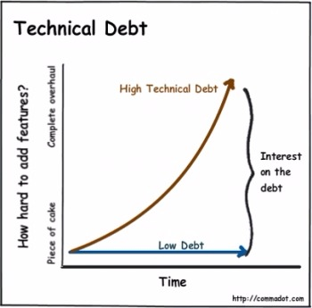

# Modernising legacy code with SOA and Agile

Have you gone into a project where the team says the only possible solution is to start over?

In my activities as a consulting CIO I come across interesting problems and challenges. While I always strive for results and excellence, every now and then something happens which truly transforms the culture at a business. I love these occasions, and they fuel me and drive me.

The problems I encounter are not going to be unusual in themselves, and are, I am certain, being echoed in companies and teams around the world.

One such problem is dealing with a legacy codebase, in the face of mounting business objectives and competing management priorities. In one such situation I walked into, the team had a codebase that consisted of an internal CRM app written in Delphi and maintained over 10 years. There was also a C# application that produced the final deliverable to customers, and which replaced an earlier version in Microsoft Word and Excel four years ago.

The team knew it had learned more things about software development over the years. For one thing, it was enjoying the opportunities web services provided in its C# code, thus making a raft of utilities available as smartphone apps while providing the same functionality on its public web site, with all the logic embedded within a reusable web service. Yet, the Delphi codebase was monolithic through no fault of anyone, with all parties having quite rightly made the best technology decisions at the time with the available knowledge and skills and foresight at hand.

Yet, the Delphi code was proving more troublesome to maintain. Features were taking longer to add, bugs were taking more time to fix, and as staff turnover occurred finding new people who knew - or were even willing - to engage in the once mighty Borland Delphi (now owned by Embarcadero) were dropping off.

Ironically, I've long had an affection for Delphi and Pascal, and I would point out to people that C# is in a way the spiritual successor to Delphi, with the architect of both being the same man, Anders Hejlsberg, formerly of Borland and now of Microsoft.

Of course, I'm an old(er) man now, and modern Computer Science graduates who were still in primary school when I left University have had no exposure to the language, either educationally or commercially.

The Delphi codebase was thus difficult to leverage, difficult to maintain, and contained no unit tests and sparse documentation. Its design did not lend itself to extensibility. The team were divided into the Delphi developers and the C# developers - with the Delphi developers secretly wishing they were working on the C# code.

The development team put to me if they could only start work on a brand new all-in-one application in C# they could attain the tremendous goals of a common code base, full team ownership, easier access to skilled hires, improved alignment with business processes and an improved architecture all around.

What they really wanted me to put to management was to freeze development and maintenance on the CRM, then essentially fire up Visual Studio and click File/New Project. Or, as some might suggest, they wanted to nuke the Delphi codebase from orbit.

Of course, management had a different perspective. It had some hundred or so features and bug fixes and issues that it wanted incorporated. The business was growing, it was expanding, and it was wanting to just do more good stuff.

I had my work cut out.

### FREE NETWORKING SERVICES CASE STUDY

**As one of the world’s largest social networking services, Facebook handles a lot of user information, and requires input from an astounding range of stakeholders 24 hours a day, 7 days a week — from both inside and outside the business.  
  
Discover how Facebook was helped to connect remote employees, vendors, consultants, and partners to applications and web services quickly and reliably - without risking sensitive data.  
**[GET CASE STUDY!](http://www.f5grid.com/citrix-vdi/f5australia/validation.html)****

******### GET THE IT BUDGET YOU WANT

**Explore your Network Treasure Trove to get the IT Budget you want  
  
With Australian businesses projected to spend over $78.7 Billion why does it feel like you can never get the budget you need?.  
  
In most cases your budget will get approved because the proposals are not only technically correct, but also provide good, credible evidence on how the spend aligns with key business objectives.  
  
Did you know that your Network Monitoring tool can help you build a comprehensive business case without an MBA?  
  
HERE ARE 8 TIPS TO GET THE IT BUDGET YOU WANT.

[CLICK HERE!](http://www.paessler.com/support/resources/tip-sheet-it-budget?utm_source=itwireau&utm_medium=banner&utm_campaign=itwire_eofs&utm_content=tip-sheet-budget)********

******

### [David M Williams](http://www.itwire.com/opinion-and-analysis/the-wired-cio/itemlist/user/2537-davidmwilliams)

David has been computing since 1984 where he instantly gravitated to the family Commodore 64. He completed a Bachelor of Computer Science degree from 1990 to 1992, commencing full-time employment as a systems analyst at the end of that year. Within two years, he returned to his alma mater, the University of Newcastle, as a UNIX systems manager. This was a crucial time for UNIX at the University with the advent of the World-Wide-Web and the decline of VMS. David moved on to a brief stint in consulting, before returning to the University as IT Manager in 1998. In 2001, he joined an international software company as Asia-Pacific troubleshooter, specialising in AIX, HP/UX, Solaris and database systems. Settling down in Newcastle, David then found niche roles delivering hard-core tech to the recruitment industry and presently is the Chief Information Officer for a national resources company where he particularly specialises in mergers and acquisitions and enterprise applications.

More in this category:
[« Back up your life with personal cloud storage](http://www.itwire.com/opinion-and-analysis/the-wired-cio/71267-back-up-your-life-with-personal-cloud-storage)

[back to top](http://www.itwire.com/opinion-and-analysis/the-wired-cio/71320-modernising-legacy-code-with-soa-and-agile#startOfPageId71320)******

*Página 2*

I started with an education campaign. I had to teach the developers about risk. Make no mistake, the very suggestion of stopping programming, and performing a complete rewrite, is an immense risk. What if it is not completed? What if feature parity is not achieved? What if architectural decisions are made that then, in a further ten years, turn out to be regretful? Would all historical data be completely available?

Indeed, it would have been a brave person who would seriously propose to the Managing Director that development should stop, and instead investment poured into rewriting the same app so that in a couple of years time (maybe) the MD would have exactly what he has now - just it is written in a different language. This wasn't a discussion I was going to have whatsoever!

It wasn't one-sided. I needed to also explain to management the concepts of opportunity cost, of velocity, and of technical debt. These are the problems we face when code is rushed, when we work on old and undocumented code, when we don't have automated testing in place. An application accrues technical debt when code is rushed through without proper testing or documentation, and this debt impedes velocity - the rate at which developers can implement new code and features and fixes. As debt increases, velocity diminishes.

The idea of rewriting the app from scratch just was not going to fly. I could not propose it as a viable option. History supports me with the experience of the Mozilla development team. In 1998 this team decided to scrap the whole code base of the then-popular Netscape web browser and rewrite it from the ground up.

The project fell far behind its original projected deadlines. Skepticism grew about Mozilla as a browser and as a brand. Some doubted a finished Mozilla browser would ever see the light of day.

In an unusual exception to the story, Mozilla survived the purchase of Netscape by AOL and the crash of the dot-com boom. By June 2002 - four years later - Mozilla produced version 1.0 of their new browser.

Ok, in this case, they did make a finished project. However, four years was greater than the appetite management at this company had to just sit on a static CRM. That's four years for a small but growing business of making no further development in its core platform, stagnating the business growth. It would never have been viable. While Mozilla were fortunate in the end, their project demonstrated it went off the rails and it took longer and cost more than was ever expected.

I came across a fascinating article by John Brant, Don Roberts, Bill Plendl and Jeff Prince, the combined work of RefactoryWorkers.com and ProfitStars. This paper was entitled, "Extreme Maintenance: Transforming Delphi into C#" which described a similar situation. Here, the goal was to convert a 1.5 million line-of-code Delphi app to C# for much the same drivers as experienced in the situation I was in.

Yet, they did not rewrite. Instead they translated. They invested their time in building a rules engine to translate Delphi code, forms, reports and add-ons to C# code. This meant the existing product could even continue to be worked on, because each run of the translator would just bring in all the new code. It proved successful over 18 months.

I spoke with John Brant of RefactoryWorkers who provided me an estimated time and cost if such an endeavour were to happen in this business. It didn't solve all my goals - for instance, it didn't provide a new extensible, modular codebase, but it did solve the issue of needing Delphi programmers. Nevertheless, it was a solution of sorts, even if it was going to produce a weird-looking code base.

Armed with confidence I had a fall-back plan I then pitched to the developers a modular approach using a service-oriented architecture (SOA) for all new development work. Instead of continuing to write Delphi code, in the monolithic style, implement new functionality in a tiered data, logic, presentation set of layers and progressively refactor the existing code to use these new services.

Refactoring sounds like work but it actually works. It also provides immediate improvements and happy developers. It allows code quality to improve over time. It provided a way to migrate functionality to C# services. Importantly, the application kept running!

Yet, this wasn't the end of the story. We had developers working on the code, but I still had to manage the managers.

*Página 3*

How do you manage the managers?

While well-intentioned, and while enthusiastic about the opportunities technology afforded the business to grow, there was a pattern of wildly-changing priorities, of no clear expected result, of unordered task lists, imprecise specifications and even limited memory of what an item in the massive task list actually meant when it came time to question or clarify it later.

To this end, I introduced the business to the agile scrum process. While scrum may not be for everyone, it was perfect for this company. It meant business value was prioritised. It meant user stories were clearly articulated with well-defined acceptance criteria. It meant there was a clear and agreed "definition of done" - namely, what the deliverable would look like. Importantly, the business received a new build every fortnight, and at the same time, the management team agree to not changing priorities within these two week sprints.

The largest difficulty was pinning down a person who could serve as the product owner, who would then manage stakeholders, rather than all and sundry presenting their wish list to the programmers, all at equal priority. Yet, management was onboard, and was supportive, and we put scrum into motion.

Entertainingly, while discussing the scrum retrospective meeting that occurs at the end of a sprint, I said to one manager, "You know, this means you have to come up with a good point each fortnight" to which he replied, "I guess we all need to adapt to new ways of working."

Our results were focused developers, enhanced business confidence in the programmers to actually deliver and a transparent process and to-do list.

Through SOA and scrum we attained what was previously unattainable. We had a continuous pattern of development with new features - delivering actual agreed business value - being released every fortnight. Management had insight into what the team was doing. Both the developers and management alike were seeing results and a greater harmony and cohesion.

As our burndown chart showed work remaining decrease for the period, so too the business confidence level increased.

It was a terrific result. This isn't to say SOA is for every business, nor is scrum as a project management framework for every business, but in our situation I can confirm it absolutely turned around a dismal situation, making the development team and its applications a real strength of the business.

### FREE NETWORKING SERVICES CASE STUDY

**As one of the world’s largest social networking services, Facebook handles a lot of user information, and requires input from an astounding range of stakeholders 24 hours a day, 7 days a week — from both inside and outside the business.  
  
Discover how Facebook was helped to connect remote employees, vendors, consultants, and partners to applications and web services quickly and reliably - without risking sensitive data.  
**[GET CASE STUDY!](http://www.f5grid.com/citrix-vdi/f5australia/validation.html)****

******### GET THE IT BUDGET YOU WANT

**Explore your Network Treasure Trove to get the IT Budget you want  
  
With Australian businesses projected to spend over $78.7 Billion why does it feel like you can never get the budget you need?.  
  
In most cases your budget will get approved because the proposals are not only technically correct, but also provide good, credible evidence on how the spend aligns with key business objectives.  
  
Did you know that your Network Monitoring tool can help you build a comprehensive business case without an MBA?  
  
HERE ARE 8 TIPS TO GET THE IT BUDGET YOU WANT.

[CLICK HERE!](http://www.paessler.com/support/resources/tip-sheet-it-budget?utm_source=itwireau&utm_medium=banner&utm_campaign=itwire_eofs&utm_content=tip-sheet-budget)********
