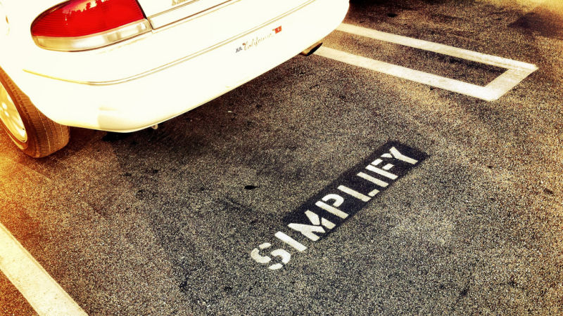

# Focus On Simplifying Your Budget More Than Optimizing It

You could spend hours every day optimizing your budget choices to make sure you’re not wasting a penny. However, the time isn’t always worth the effort. Instead, focus on simplifying your budget.

As personal finance site Afford Anything explains, making better choices and making the *optimal* choice are not always the same thing. Spending ten minutes to distinguish between a bad deal and a good one is time well spent. Spending ten hours to distinguish between a great deal and a marginally greater deal is wasted effort. Rather than obsessing over the optimal choice in every situation, simplify your budget so you have more time to focus on the decisions that matter:

> If you paid a monthly bill for your mental energy, you wouldn’t squander this bandwidth on time-wasters and minutia. You’d focus your energy only on the few things that matter most. You’d be deliberate about how you spend that bandwidth. But here’s the thing: Your brain’s bandwidth DOES cost money. It’s one of the most expensive assets you hold.

Once you start to focus on simplifying, you can see where your decisions matter and where they don’t. Spending several hours analyzing a home loan is going to be worthwhile. Spending that same time finding coupons to get fifty cents off laundry detergent is a waste. By keeping the basics simple, you can save that mental energy for where you need it most.

[Feeling Overwhelmed? Here’s Why Simplifying is the Smarter Choice (and How to Do It)](http://affordanything.com/2016/01/26/feeling-overwhelmed-heres-why-simplifying-is-the-smarter-choice/) | Afford Anything via [Rockstar Finance](http://rockstarfinance.com/)

*Photo by [David Poe](https://www.flickr.com/photos/mockstar/5898331833/).*
