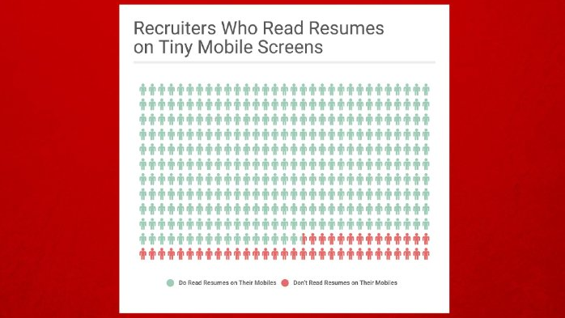

# Format Your Resume for a Mobile Screen

It probably wouldn’t surprise you to hear many recruiters review resumes on their phones. That’s a problem for you if your resume is formatted more for print than for the screen.

Executive resume writer Donna Svei offers do’s and don’ts for making your resume look good on a tiny phone. Her helpful advice includes:

> 1. Strive for two or three-line blocks of text. Never go over four.
> 2. Use six points of space (Format/Paragraph/Line Spacing/Exactly/6 pt) between bullet points and a full space between resume sections and jobs.
> 3. Avoid tiny font. It’s impossible to read on a phone. Go with at least 11-point Calibri.

Take inspiration from web page’s [flat design](https://en.wikipedia.org/wiki/Flat_design) and review your resume on your phone before sending it out.

Check out the post below for more guidelines.

[Why Your Fancy Resume is Totally 2015](https://www.linkedin.com/pulse/why-your-fancy-resume-totally-2015-svei-executive-resume-writer) | LinkedIn
