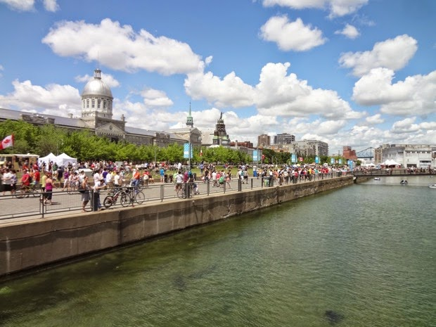
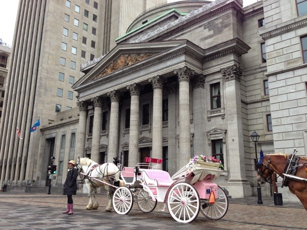
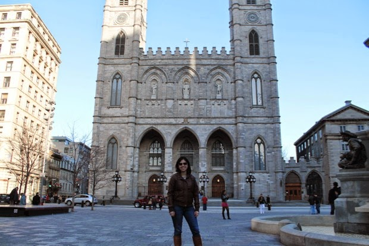
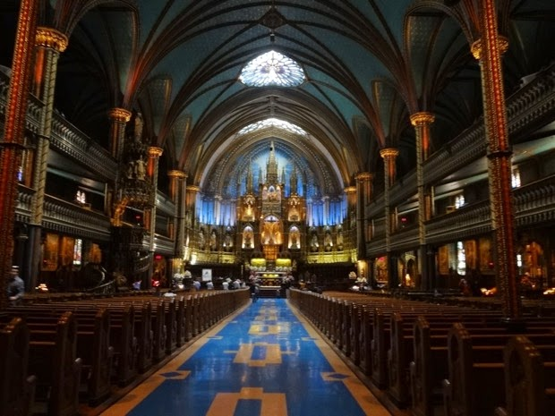
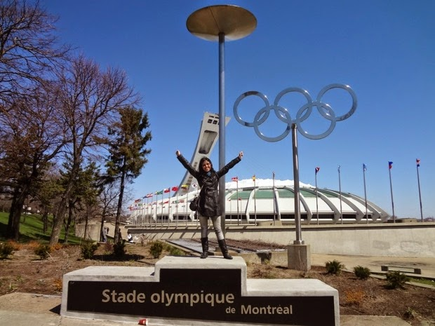
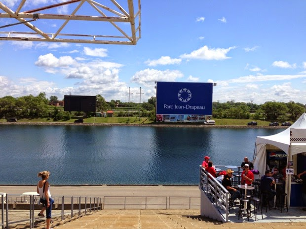

# Roteiro de 3 dias em Montreal

Montreal é uma cidade maravilhosa e super divertida. É a primeira cidade que penso toda vez que quero viajar dentro do Canadá por ter uma vibe diferente, além de ser uma cidade super bonita e com várias coisas pra fazer.  
  
Eu prefiro visitar a cidade na primavera ou verão, porque aí dá pra andar bastante sem sentir frio, e eu acho que 3 dias é o suficiente pra aproveitar bastante a cidade. Todas as vezes que visitei Montreal fiquei perto da estação de metrô Sherbrook, e de lá era super fácil usar o transporte público pra ir pra qualquer lugar. Uma dica é ter o google maps no celular, pois ele te dá os caminhos usando o transporte público e ainda te fala qual o horário do próximo ônibus.  
  
Veja o roteiro:

Dia 1:

Old Port (Vieux-Port de Montréal)

O porto antigo de Montreal sempre tem festivais no verão e é bem legal pra passear pelos mais de 2Km de extensão. O visual é super bonito e é um lugar tranquilo. Lá perto tem vários restaurantes e por isso acho que é o passeio ideal pra parte da manhã, e quando a fome bater, os restaurantes já estão ali do lado.

Old Montreal (Vieux-Montréal)

Depois do almoço, pra fazer a digestão, a dica é passear pela Old Montreal, ou cidade antiga, pra ver a arquitetura francesa da cidade nos prédios históricos como o da prefeitura, e de várias igrejas.

Basílica de Notre-Dame

A basílica de Notre-Dame é uma que vale a pena entrar. Com arquitetura gótica, a basílica também um orgão gigante. A entrada custa $5 e vale a pena ver dentro, tudo é bem lindo e super rico.

Depois de tanta andança, é só comer alguma coisa e partir pra descansar até a noite.

A dica pra noite é ir pra Rue Peel com Rue Saint-Catherine, lá tem vários bares, pubs, restaurantes e baladas.

Dia 2:

Montreal Botanical Gardens

Passear pelo jardim botânico é super relaxante. Lá tem um jardim japonês, além do Biodome, planetário e insetário. É um prato cheio para os amantes de botânica.

Dica: no comecinho da primavera o jardim ainda está bem feio, nem vale muito a pena visitar.

Estádio Olímpico  
Bem do ladinho do jardim botânico tem o tão famoso estádio de Montreal, ele foi construído para as olimpíadas de 1976 e foram gastos $770 milhões no projeto. Depois de 30 anos, e uma dívida de 1.4 bilhões em reformas e projetos, o elefante branco finalmente foi pago e hoje em dia abriga os jogos de futebol americano e baseball em Montreal e também cedia eventos como shows.

Mont Royal

Indo pro outro lado da cidade tem o Mont Royal, um parque no alto do morro com uma vista fantástica da cidade. É o maior parque da cidade.

Oratório Saint-Joseph du Mont Royal

Descendo do Mont Royal, tem o gigantesco Oratório de Montreal. Com mais de 100 anos, o oratório católico tem uma vista linda da cidade e uma história bem interessante.

Dia 3:

Parque Jean Drapeau

Na ilha do Rio Saint-Laurence tem este outro parque bem grande, que é cede da formula 1 todo ano no circuito Gilles Villeneuve. Além do circuito, o parque tem a Biosphere (aquela bola grande iluminada) que é o museu do meio ambiente, um cassino e praia.

Centro comercial

Como todo turista, tem que passar pela área comercial da cidade e fazer umas comprinhas, nem que seja um chaveirinho. A Rue Saint-Catherine tem várias lojas famosas e é super movimentada. Além disso, se ainda sobrar um tempinho, visite a cidade subterrânea que nada mais é do que mais lojas!

Dica: Pra quem mora em Toronto, vale mais a pena fazer compras por aqui mesmo, já que as taxas de Quebec são 14% e de Toronto 13%, mas claro, se você encontrar algo único em Montreal, não deixe de comprar!  
  
Separe uma noite ou duas pra visitar os melhores restaurantes do Canadá que ficam em Montreal. Eu fui no [Au Pied de Cochon](http://aupieddecochon.ca/) e simplesmente AMEI, vale super a pena. Pra ver a lista completa dos 100 melhores restaurantes do Canadá, clique [aqui](http://www.canadas100best.com/category/canadas-100-best-restaurants-2015/):

1. Toqué!  
10. Joe Beef  
11. Maison Publique  
13. Park  
15. Hôtel Herman

21. Cabane a Sucre  
23. Bouillon Bilk  
24. Le Club Chasse et Pêche

27. Maison Boulud

28. Milos

34. Au Pied de Cochon

35. Le Filet

41. Le Serpent

51. Le Bremner

61. Lawrence

62. Less 400 Coups

64. Le Vin Paillon

71. L'Express

74. Kazu

95. Nora Gray

Postado por Mariana Cimini em www.vireicanadense.com em 31/08/2015. - <http://www.vireicanadense.com/2015/08/roteiro-de-3-dias-em-montreal.html>.

Tags: dicas, diversao, variedades

[Voltar](#)
