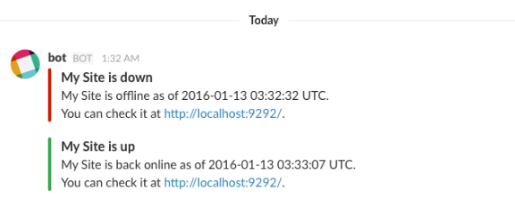
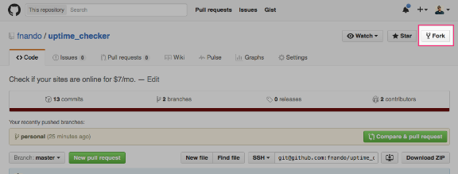

# Replacing Pingdom with Ruby and Heroku

January 29, 2016

Read in 3 minutes

Pingdom recently increased the price of the starting plan from $10 to $14. Since they didn’t keep the price for older customers, I decided to create something to replace it, because the new pricing is just too much for my personal sites.

This article shows how you can set up your own uptime checker and run it on Heroku for $7/month.

## About uptime\_checker

I created [uptime\_checker](https://github.com/fnando/uptime_checker), which has less than 500 lines. The main features are:

- Several notification mechanisms (Telegram, Twitter’s Direct Message, E-mail, Slack, Hipchat, and more)
- Easy to set up on Heroku
- Easy to define the sites that will be monitored

The idea is pretty simple: hit the urls you define every 30s (configurable) and see if the site returns the expected status code. You can also check if the response contains a string. If the status/body is not what you expected, it notifies you.



Running uptime\_check on Heroku is really easy and you won’t need more than a few minutes, so let’s do it.

## Setting up uptime\_checker

First, you have to fork the repository, since you have to create your own branch with a configuration file. Go to [Github](https://github.com/fnando/uptime_checker) and hit the “Fork” button.



Now, clone the repository and create a new branch: I’ll call it `personal` in this article.

```
$ git clone git@github.com:<your username>/uptime_checker.yml
$ cd uptime_checker
$ git checkout -B personal
```

Copy the sample configuration file.

```
$ cp checkers.yml.sample checkers.yml
```

Open the `checkers.yml` file. This file is where you define all the sites that must be monitored. It supports ERB, so you can render dynamic variables. Here’s is my own configuration file.

```
notify ¬ify
   twitter fnando
   email fnando.vieira@gmail.com
   stdout 
   telegram -97517324
    <%= ENV["NOTI_FNANDO"] %>

checkers
    Codeplane
     https://codeplane.com/
    notify *notify
    status 

    Codeplane
     https://codeplane.com.br/
    notify *notify
    status 

    Hellobits
     http://hellobits.com/
    notify *notify
    status 

    HOWTO
     http://howtocode.com.br/
    notify *notify
    status 

    Nando Vieira
     http://nandovieira.com/
    notify *notify
    status 

    Nando Vieira
     https://nandovieira.com.br/
    notify *notify
    status 

    Presentta
     https://presentta.com.br/
    notify *notify
    status
```

To avoid repeating the notifiers, I’m using the shared block trick. You can have different notifications for each site you’re monitoring if you need.

Notice that I’m expecting those sites to respond with a 200 status code, but you can also check if the response has some given text.

```
checkers
    Example
     http://example.com
    notify *notify
    status 
     Some string
```

After you’re done, commit your changes.

```
$ git add .
$ git commit -m "Add checkers."
$ git push origin personal
```

## Deploying to Heroku

Deploying uptime\_checker to [Heroku](https://heroku.com/) is the easiest way you can have this running. Assuming you already Heroku configured, create a new application.

```
$ heroku create
```

Redis is required, so we need to add the add-on.

```
$ heroku addons:create heroku-redis
```

To receive e-mail notifications, you’ll also need Sendgrid.

```
heroku addons:create sendgrid:starter
```

I use [Noti](http://notiapp.com/). If you check the checkers example above, you’ll see that I’m using a `NOTI_FNANDO` environment variable. Let’s set that on Heroku:

```
$ heroku config:set NOTI_FNANDO=fc17d63d-5d3e-4532-98ed-b8047f0d5bc9
```

Now it’s time to deploy! Since we’ll deploy the `personal` branch, you have to use the following command:

```
$ git push heroku personal:master
```

This means that the `personal` branch will be pushed as Heroku’s `master`.

To run this 24/7 ($7/mo), we have to scale up our worker.

```
$ heroku ps:scale worker=1
$ heroku dyno:type worker=hobby
```

And we’re done! You can check the logs with `heroku logs --tail`.

```
app[worker.1]: enabled_notifiers="email, noti, stdout, telegram, twitter" time="2016-01-29T12:40:28Z"
app[worker.1]: message="starting check" url="https://presentta.com.br/" time="2016-01-29T12:40:28Z"
app[worker.1]: message="starting check" url="https://nandovieira.com.br/" time="2016-01-29T12:40:28Z"
app[worker.1]: message="starting check" url="http://nandovieira.com/" time="2016-01-29T12:40:28Z"
app[worker.1]: message="starting check" url="http://howtocode.com.br/" time="2016-01-29T12:40:28Z"
app[worker.1]: message="starting check" url="http://hellobits.com/" time="2016-01-29T12:40:28Z"
app[worker.1]: url="https://codeplane.com/" message="check finished" status="no changes" time="2016-01-29T12:40:28Z"
app[worker.1]: url="https://codeplane.com.br/" message="check finished" status="no changes" time="2016-01-29T12:40:28Z"
app[worker.1]: url="http://howtocode.com.br/" message="check finished" status="no changes" time="2016-01-29T12:40:28Z"
app[worker.1]: url="https://nandovieira.com.br/" message="check finished" status="no changes" time="2016-01-29T12:40:28Z"
app[worker.1]: url="https://presentta.com.br/" message="check finished" status="no changes" time="2016-01-29T12:40:28Z"
```

If you’re not into Heroku, you can also deploy it to a VPS. If you already know how to deploy a Rails application, you won’t have any problem. Since this involves too much things, I leave this as an exercise to the reader.

### Keeping up with master

You may want to keep up with `master`, getting all the fixes and new features (if any). The workflow for updating your branch is pretty simple.

First, switch off to `master` and pull all the changes.

```
$ git checkout master
$ git pull
```

Then switch back to `personal` and apply `master`’s onto it.

```
$ git checkout personal
$ git rebase master
```

Now, deploy the repository.

```
$ git push heroku personal:master -f
```

## Wrapping up

That’s it! If you have any suggestions or need help, just [open an issue](https://github.com/fnando/uptime_checker/issues/new).
