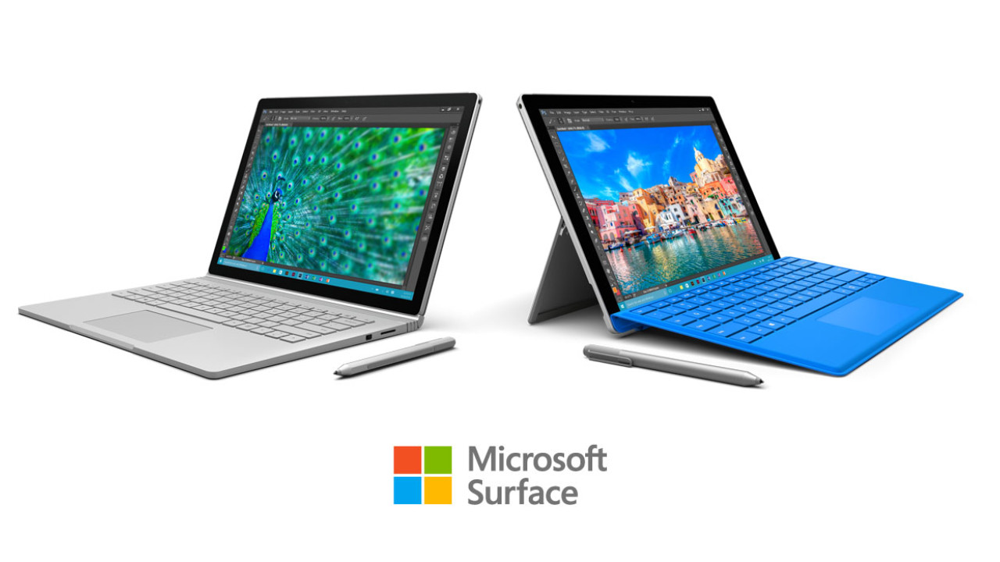
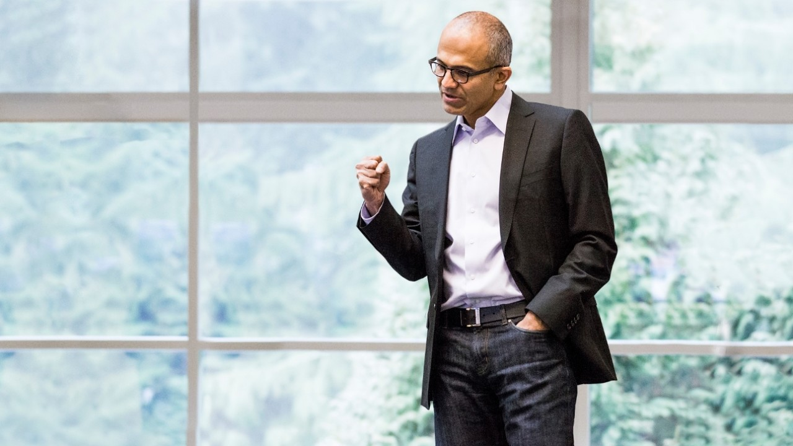

# Satya Nadella hits 2 years, but is Steve Ballmer the unsung hero of Microsoft's resurgence?

When Steve Ballmer [resigned from Microsoft 2 years ago](http://www.neowin.net/news/here-is-steve-ballmers-last-email-to-employees), the press slammed the door pretty hard behind him. Undeterred and looking forward, however, the passionate executive quickly opened another door, starting his [next career as NBA team owner](http://www.neowin.net/news/steve-ballmer-reportedly-signs-contract-to-buy-nbas-la-clippers-for-2-billion). But he still cares deeply about the company he left behind; as the largest individual shareholder with 4% of the stock, [Ballmer has been vocally critical](http://www.neowin.net/news/ballmer-calls-microsofts-cloud-numbers-bulls----wants-android-apps-on-windows-10-mobile) about some of Microsoft’s recent choices [but bullish on what's next for Windows 10](http://www.neowin.net/news/steve-ballmer-delivers-his-verdict-on-microsofts-windows-10-announcements).

And to better understand that future, it’s important to appreciate how Microsoft got to where it is today. With the benefit of hindsight, the former CEO’s 14-year tenure is worth a second look to better assess his contributions to the “new” Microsoft.

"If Nadella engineered the great comeback, then Ballmer must have screwed it up beforehand, right? But it's never that simple."

It’s easy to get stuck in the false binary: if Nadella engineered the great comeback, then Ballmer must have screwed it up beforehand, right? But it’s never that simple. [Steve Ballmer](http://www.neowin.net/news/tags/steve_ballmer) has claimed that it’s [“not important” if he gets credit](http://www.neowin.net/news/steve-ballmer-its-not-important-if-i-get-credit-for-microsofts-success) for the company’s success. But in light of Microsoft’s recently improved outlook and its attribution to Satya Nadella, two years down the road is a good time to analyze the genesis of it all.

### The Mistakes

First, it's important to set the stage. Indeed, Ballmer made his share of mistakes, including the colossal blunder of reacting too slowly to the iPhone when it was [unveiled in January 2007](http://www.neowin.net/news/apple-announces-iphone), ultimately ceding the next massive computing platform: mobile. It took nearly four, painfully slow years for Microsoft to [deliver Windows Phone 7](http://www.neowin.net/news/microsoft-shows-off-10-new-windows-phone-7-devices), a delay resulting from [equal parts arrogance](http://www.neowin.net/news/google-android-just-a-press-release-says-ballmer) and a [lack of urgency and vision](http://arstechnica.com/information-technology/2007/04/ballmer-says-iphone-has-no-chance-to-gain-significant-market-share/).

"After the iPhone was unveiled, it took nearly four, painfully slow years for Microsoft to deliver Windows Phone 7, a delay resulting from equal parts arrogance and a lack of urgency and vision."

By comparison, Google had already acquired Android in 2005. And when Google saw the original iPhone, the Android team turned on a dime, releasing a stuttering, poorly-designed operating system well ahead of a superior but late Windows Phone. Google aggressively licensed a good-enough Android for free, turning it into the widely-distributed, more refined [juggernaut it is today](http://www.neowin.net/news/android-sales-pick-up-in-the-us-while-apple-still-going-strong-in-europe).

Moreover, Ballmer [allowed an internal environment](http://www.businessinsider.com/this-org-chart-explains-why-microsofts-ceo-in-waiting-is-suddenly-out-2012-11) in which the Windows and Office groups suffocated projects that threatened either. Innovation was stifled as talent became discouraged; [J Allard departed](http://www.neowin.net/forum/topic/903368-where-in-the-world-is-j-allard/) as promising projects like the [Courier tablet](http://www.neowin.net/news/new-microsoft-courier-pictures-and-video-leak) were killed, while Skype missed the messaging app explosion by not noticing it was in prime position to dominate.

And let’s not forget Windows 8, a design effort that was ill-conceived for its target devices and audiences, and Windows Vista which consumed resources for too many years. The $6.2 billion [aQuantive acquisition and write-down was a big fail](http://www.neowin.net/news/microsoft-to-take-62-billion-write-off-on-aquantive-buyout) as well, though it’s debatable whether the Nokia acquisition wasn’t necessary to tide over the mobile strategy despite the [massive $7.6 billion write off](http://www.neowin.net/news/microsoft-to-cut-7800-jobs-in-phone-division-76bn-write-down-changes-to-product-range).

But this is where most people stop their analysis and draw their conclusions. So let’s not stop.

### The Business

First, the rarely considered: the actual business performance that enables investment in the future. Under Ballmer’s stewardship, revenue grew from $25 billion in 2001 to $87 billion in 2014, more than tripling the business in 13 years. And the company increased annual operating profit from $11.7 billion to $27.7 billion. [In the final fiscal year of Ballmer’s tenure, that’s a net profit margin of 32%.](https://www.microsoft.com/Investor/EarningsAndFinancials/Financials/fy14/q4/IncomeStatements.aspx)

That level of net margin, growth and sales volume is extremely rare in any industry. Apple exceeds that today, while Google is in the same league. But no other large organizations achieve those kinds of metrics.

### The Long View

Microsoft was, and still is, one of the best managed companies in the world. One reason is that they continually invest and take the long view. Bill Gates did this, and Steve Ballmer continued it by maintaining an unshakable belief in large strategic bets. Other CEOs might have cut and run on the big stuff, but Ballmer rarely did.

"Microsoft’s current resurgence is largely the result of tactical long-term bets by Steve Ballmer..."

The bottom line is that Microsoft’s current resurgence is largely the result of tactical long-term bets by Steve Ballmer, who approved or nurtured—and, just as importantly, chose not to kill—all of the following: Surface, Xbox, Cortana, Bing, Band, Office 365 and the build-out of Microsoft retail stores. Not to mention the quick pivot to a new direction with Windows 10 and Continuum, with the [firing Steven Sinofsky](http://www.neowin.net/news/steven-sinofsky-leaves-microsoft-effective-immediately) to acknowledge [the failure of Windows 8 and his management style](http://www.neowin.net/news/report-bill-gates-agreed-sinofsky-should-leave-microsoft) as a much-needed step. And perhaps most important, the early wager on the Azure cloud business, a team Nadella led for years and deserves co-credit for.

For the skeptical, let’s be clear: big technology ventures require lots of planning, money, perseverance and patience. Nearly all of this stuff was approved for development before the new CEO took the helm, though HoloLens is an exception that Nadella accelerated.

An oft-cited example of Nadella's savvy is touch-first Office for iPad and iPhone. But this project was initiated by the Office group years ago, an example of patient incubation. Ballmer could have killed the project in light of the company’s Windows-only bent. But he let it live, knowing that he might be forced to release it someday, [a decision he actually made himself](http://www.neowin.net/news/microsoft-office-for-ipad-was-a-ballmer-decision).

Was the software’s launch shortly after Ballmer left—and development for the Android version—fast-tracked by Nadella? [Probably](http://www.neowin.net/news/microsoft-office-for-ipad-was-a-ballmer-decision). But it already existed in such high quality form in the first place, ready to pull the trigger.

### Devices and Services… still

Which brings us to the hardware that shows off the new software. Microsoft’s relatively recent pivot from a software company that made some keyboards and mice, to a company that earns billions in Surface revenue each year is remarkable. We’re all accustomed to this shift because [it occurred years ago](http://www.neowin.net/news/microsoft-surface-tablet-on-video-complete-with-dubstep). But it was shocking and risky at the time, and still kind of is, as evidenced by [the surprise unveiling of Surface Book last year](http://www.neowin.net/news/microsoft-unveils-the-surface-book).

Today, Satya Nadella is the new face of Microsoft, and he’s basking in Redmond’s newfound leadership status. He’s been successful at rebranding Microsoft as a kinder, gentler innovator and partner—no small feat. However, it was Ballmer who laid the groundwork for nearly everything we've seen from Microsoft over the past two years, harkening back to a time when he envisioned a “devices and services” company to take on Apple.

Interestingly, despite Nadella's eschewing of that mantra and [repositioning the company as “mobile first, cloud first,”](http://www.neowin.net/news/nadella-looks-to-distance-himself-from-ballmer-does-away-with-device-and-services-model) Microsoft still looks a lot like the company Steve Ballmer left behind: bursting with hardware inspiration that’s leading a [once reluctant](http://www.neowin.net/news/microsoft-surface-tablet-on-video-complete-with-dubstep), usually monolithic and boring OEM contingent into a new era. Just look at the improved hybrid hardware from Dell, HP, Lenovo and even Asus. Moreover, Dell and HP have agreed do the unthinkable: [resell and support Microsoft Surface in the enterprise](http://www.neowin.net/news/dell-hp-and-others-to-sell-and-support-microsofts-surface-pro-tablets). And Apple made the iPad Pro, a conspicuous Surface follower.

### Nadella has taken the baton and been excellent

Satya Nadella deserves a lot of credit for [recalibrating Microsoft internally](http://www.neowin.net/news/satya-nadella-defines-the-new-microsoft-in-email-to-employees) and externally. He has quickened the progress of existing assets like Office for iOS and Android, which have vastly increased Microsoft’s mobile reach along with the acquisition of popular cross-platform apps like [Acompli](http://www.neowin.net/news/microsoft-buys-acompli-a-mobile-email-startup-for-over-200-million) (now Outlook), [Wunderlist](http://www.neowin.net/news/microsoft-confirms-its-acquisition-of-wunderlist), [Sunrise calendar](http://www.neowin.net/news/it039s-official-microsoft-has-acquired-sunrise) and [Echo Notification](http://www.neowin.net/news/microsoft-acquires-android-app-echo-notification-lockscreen). His bets on the future are promising as well, with HoloLens as perhaps the best known, but also [AI](http://www.neowin.net/news/tags/artificial_intelligence) moves like buying [SwiftKey](http://www.neowin.net/news/it039s-official-microsoft-acquires-swiftkey), learning from [Xiaoice](http://www.neowin.net/news/microsofts-cortana-has-a-little-sister-name-xiaoice) (“Little Bing”) used by 40 million in China, and [open-sourcing some of its machine-learning efforts](http://www.infoworld.com/article/3004800/application-development/microsoft-rolls-out-open-source-toolkit-for-machine-learning.html)."Nadella has projected much-needed openness and humility, and set a compelling example against the insularity that has historically plagued Microsoft."

The current CEO has also opened up important partnership opportunities, instead of setting up Redmond for confrontation by predictably prioritizing Windows and Office exclusively at nearly every turn. Nadella has [partnered with Dropbox](http://www.neowin.net/news/microsoft-teams-up-with-dropbox-for-office-integration), [Box](http://www.neowin.net/news/microsoft-adds-dropbox-and-box-integration-on-outlookcom-new-office-cloud-partners-on-ios), [Salesforce](http://www.neowin.net/news/microsoft-expands-offices-footprint-with-help-from-box-salesforce-and-others) and [Apple](http://www.neowin.net/news/microsoft-makes-surprise-appearance-at-apple-event-to-talk-up-productivity-on-ipad-pro), to name a few.

However, Nadella has made mistakes, still uncorrected, which continue to accelerate the decline of Windows Mobile and Phone. For instance, for no clear reason he continues to allow teams to abandon timely app development for both Windows mobile platforms, even as the company aggressively adds to its app libraries for iOS and Android.

For example, absent from Windows Mobile are Office Delve ([despite being his "favorite app"](http://www.businessinsider.com/satya-nadellas-favorite-new-microsoft-app-is-delve-2014-12)), Sunrise Calendar and Office Sway to name a prominent few. This erodes credibility among developers in its sales pitch for Universal Windows Apps; why would a developer make a UWA if Microsoft, a company of vast resources, shows little commitment to Windows when creating their own cutting edge mobile apps?

But as Microsoft’s new leader, Nadella has projected much-needed openness and humility, set a compelling example against the insularity that has historically plagued Microsoft, and convinced the world that Microsoft is doing a great job empowering users on whichever platforms they use.

This is perhaps the most important shift Nadella is responsible for: the new Microsoft is committed to the cloud and cross-platform mobility with its pervasive services, while repositioning Office and Azure as indispensable platforms above the OS device level.

It’s fair to say that the transition between two very different CEOs has worked well. It's been an effective and complementary hand-off. Nadella has leveraged the best of Microsoft’s bets under Ballmer, spreading them far and wide, while projecting a friendlier Microsoft that has succeeded in making the press and public more accepting of the brand. It’s a formula that has created an intriguing future for the company, and few people would count out Microsoft at this point, something many did just a couple of years ago.

*[Steve Ballmer image](http://www.shutterstock.com/pic-1715434/stock-photo-ballmer.html?src=DgYzwGLs7nzTPwYuGp1f5w-1-0) via Shutterstock*
