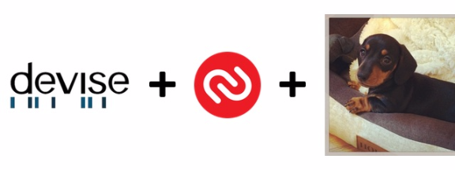
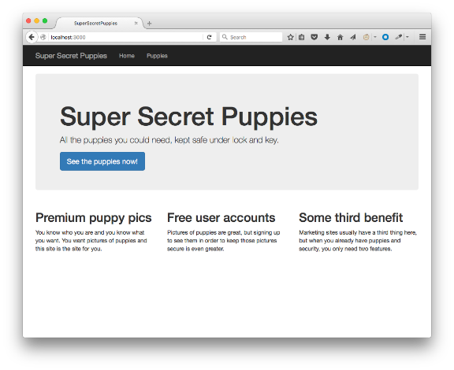
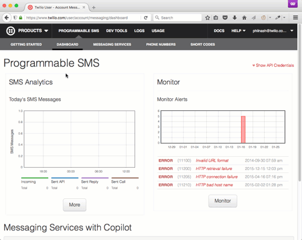
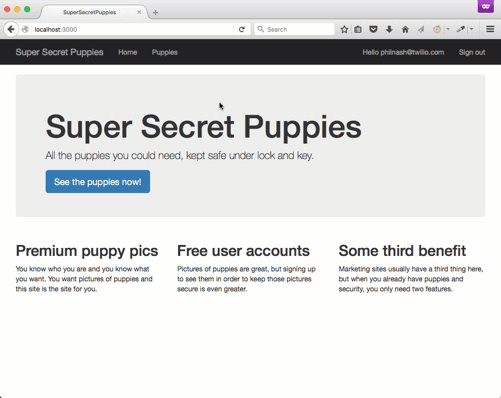

# Two Factor Authentication in Rails 4 with Devise, Authy and Puppies

Passwords aren’t enough any more. Keeping user data safe is hard enough without users themselves choosing [the worst passwords in the world](https://www.teamsid.com/worst-passwords-2015/). Yes, “123456” has topped the list of most commonly used password of the year again.

Two factor authentication keeps your users’ accounts secure by requiring a second factor of authentication, something a user has (their phone) as well as something they know (their password). Two factor authentication can be hard to implement and even harder to secure properly. [Authy](https://www.twilio.com/authy) is a Twilio service that provides two factor authentication as an API, making it easy to secure our users’ accounts.

In this post I want to show you how to implement two factor authentication using Authy in your Rails 4 apps using [Devise](https://github.com/plataformatec/devise). We already have a tutorial that walks you through [adding two factor authentication to a Rails application](https://www.twilio.com/docs/tutorials/walkthrough/two-factor-authentication/ruby/rails), but as Devise is the [most popular authentication framework for Rails](https://www.ruby-toolbox.com/categories/rails_authentication) I thought it would be unwise to leave it out. In this post we’ll take a basic Rails application, add user accounts with Devise and make them extra secure by enabling two factor authentication.

### The tools

To put this application together we’re going to need a couple of things:

- a Twilio account ([sign up for free here](https://www.twilio.com/try-twilio))
- [Ruby](http://ruby-lang.org/) installed (I’m using the current latest, 2.3.0, but any version that runs [Rails](https://rubygems.org/gems/rails) will work)
- [Bundler](http://bundler.io/), so we can install our dependencies.

And that’s it. Let’s get going.

### Something to protect

So that we don’t have to build a whole Rails application up from scratch I have created a starter application for us. It’s called Super Secret Puppies and is a simple app that allows users to log in and look at pictures of puppies. All we need to do is build that login functionality.

Let’s get the app up and running. You can clone the repository, install the dependencies and start the app with the following commands:

Shell

|  |  |
| --- | --- |
|  | clonehttpsgithubphilnashsupersecretpuppies  supersecretpuppies  bundle install  bundle rails server |

Navigate to [http://localhost:3000](http://localhost:3000/) and you’ll see the home page.

You’ll find you can click on the call to action to see the puppies and you’ll be directed to a page of puppy pictures. I’ll give you a minute while you enjoy that.

Ok it’s just one puppy, my one, but she’s called Ruby so I’m pretty happy that this is on topic for today.

For the rest of this post we’re going to implement user accounts with two factor authentication to restrict access to this page to our registered users.

### Implementing user accounts with Devise

We’ll start by adding Devise to our Gemfile. Add the following line after all the regular gems (that is, not inside any of the groups).

|  |  |
| --- | --- |
|  | # Gemfile  'devise' |

Bundle the new gem into the project.

Shell

|  |  |
| --- | --- |
|  | bundle install |

Run the Devise generators and migrate the database.

Shell

|  |  |
| --- | --- |
|  | bundle railsdeviseinstall  bundle railsdevise  bundle migrate |

This installs Devise and then creates a User model that we will use to sign up to our application with.

Let’s protect our puppies controller from non-logged in users. Open up
controllerspuppies\_controller and add the following
before\_action at the top of the file:

|  |  |
| --- | --- |
|  | # app/controllers/puppies\_controller.rb  classPuppiesControllerApplicationController  before\_actionauthenticate\_user  index |

This is a Devise helper that ensures there is a logged in user in the session. If there is no logged in user then the response will be a redirect to the login page.

I like to make one other change to the default Devise setup. That is to allow logging out by GET request. Open up
configinitializersdevise and change the line

|  |  |
| --- | --- |
|  | # config/initializers/devise.rb  configsign\_out\_viadelete |

|  |  |
| --- | --- |
|  | # config/initializers/devise.rb  configsign\_out\_via |

Restart the application and load up the home page again. You’ll find links to sign up and log in at the top right (I snuck those into the base app to save us writing HTML). Try navigating to the page of puppies. You’re now redirected to the login page. Hit the link to sign up, enter your email and a password, submit the form and you’re signed up and looking at a page of puppy pictures. Lovely, but we can make it more secure. Let’s get Authy involved and add two factor authentication to this experience.

### Adding two factor authentication to Devise with Authy

First thing we need to do is install the devise-authy gem that will handle most of the integration. Add another line to your Gemfile, below the Devise gem we added earlier.

|  |  |
| --- | --- |
|  | # Gemfile  'devise'  'devise-authy' |

Bundle the new dependency.

Shell

|  |  |
| --- | --- |
|  | bundle install |

Create an initialiser for Authy in
configinitializers.

Shell

|  |  |
| --- | --- |
|  | touchconfiginitializersauthy |

Add the following code to the initialiser.

|  |  |
| --- | --- |
|  | # config/initializers/authy.rb  Authyapi\_key"AUTHY\_API\_KEY"  Authyapi\_uri"https://api.authy.com/" |

You’ll notice we need an API key for Authy. You can get this from your [Twilio account portal](https://www.twilio.com/user/account/authy/getting-started). Click the link to access the Authy dashboard.

If you don’t already have an Authy account, this will set one up for you. You will need to verify your email address and set up two factor authentication. Then you can create an application with Authy and this will give you your API key.

If you already have an Authy account, click “New application” at the bottom of your dashboard menu and you will go through the same process.

Now you have your API key, copy
configexample to
config and fill in the key.

|  |  |
| --- | --- |
|  | # config/env.yml  development  AUTHY\_API\_KEY: 'YOUR\_AUTHY\_API\_KEY\_HERE' |

We’re using a gem called [envyable](https://rubygems.org/gems/envyable) to set the API key in your application’s environment. It’s all set up for you, but if you’re interested in this setup more, I wrote about [environments and envyable](https://www.twilio.com/blog/2015/02/managing-development-environment-variables-across-multiple-ruby-applications.html) last year.

Now we’re ready to run our Devise Authy install script. On the command line enter:

Shell

|  |  |
| --- | --- |
|  | railsdevise\_authyinstall  railsdevise\_authy  migrate |

This installs the Devise Authy plugin and updates the User model to use two factor authentication if it is enabled for the account. Let’s enable this for our user that we created earlier now.

Restart your server and visit this page: <http://localhost:3000/users/enable_authy>. Fill in your country and your mobile phone number and you will get an SMS with a 7 digit token. Or, if you are already a user of the [Authy app](https://www.authy.com/app/), you will receive a push notification adding the Super Secret Puppies app to your account and showing you the token (though you can force the token to arrive by SMS if you need). Submit the token to the form in the puppies app and two factor authentication will be enabled on your account.

You can test this by logging out with the link in the top right of the page and then logging in again. You will be asked once more for a token which you should receive by SMS or application and once you enter the token you will be logged in.

### Two Factor Authentication in just a few lines of code

Since we were using Devise, adding two factor authentication using Authy was pretty straightforward. All we had to do was add an initializer for Authy, enter our API key, run an install command and migrate the database.

If you didn’t follow along with the code, but you want to see the finished application, you can check out the complete branch in the [GitHub repository](https://github.com/philnash/super-secret-puppies/tree/complete).

If you want to customise your application a bit more there are a few options. You can [edit the views](https://github.com/authy/authy-devise#custom-views), set up [custom redirects](https://github.com/authy/authy-devise#custom-redirect-paths-eg-using-modules) and add [internationalised messages](https://github.com/authy/authy-devise#i18n) throughout the flow. If you’re not using Devise, or are interested in how it works, check out the tutorial on [securing your user accounts using just Authy and Rails](https://www.twilio.com/docs/tutorials/walkthrough/two-factor-authentication/ruby/rails).

If you’ve got any questions about two factor authentication or using Authy, then do leave a comment below, [@philnash](https://twitter.com/philnash).

*\*\*Okay, okay, no-one needs to keep pictures of puppies safe. Everyone wants to show off pictures of puppies, why else do you think I’d use them as an example in a blog post? Hope you enjoyed them!*
