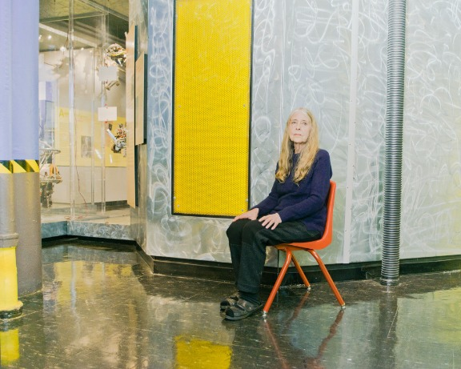
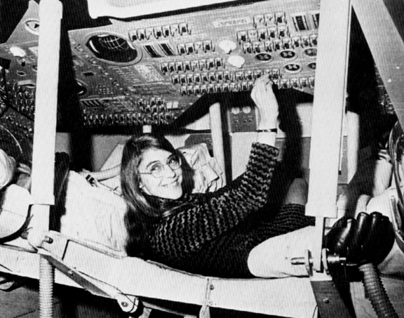
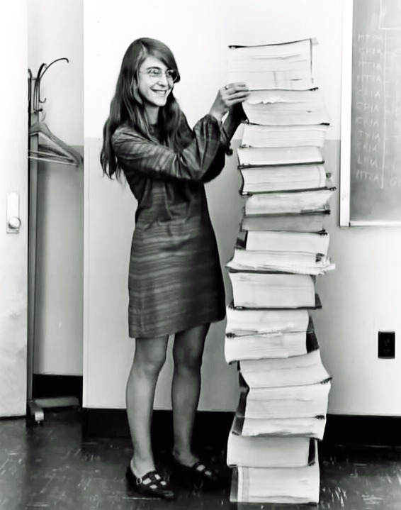
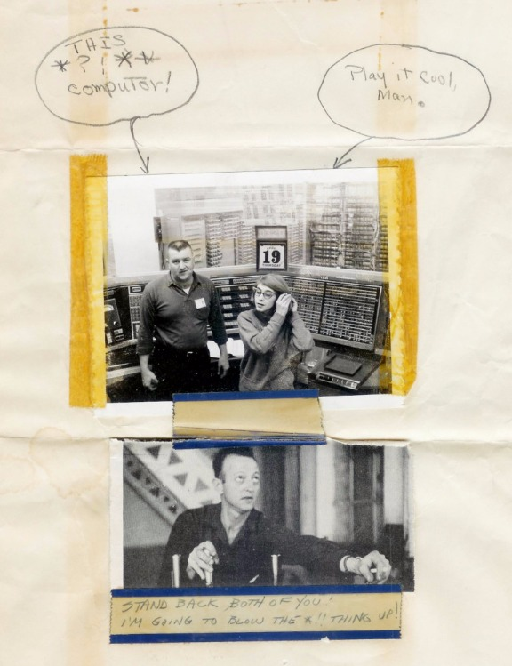
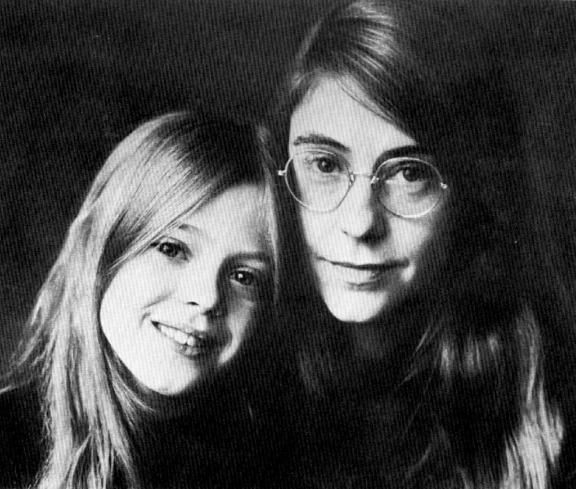
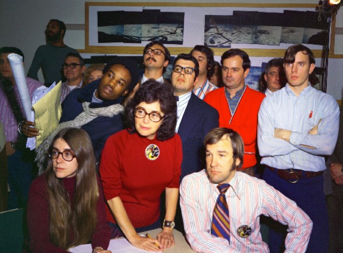
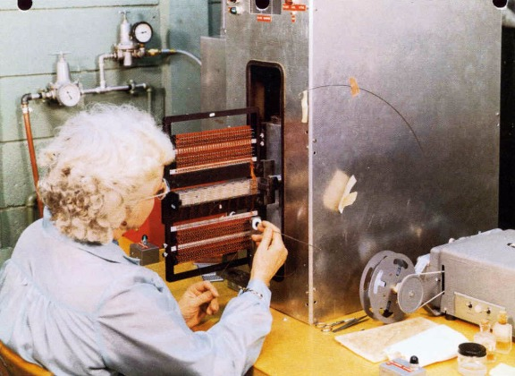
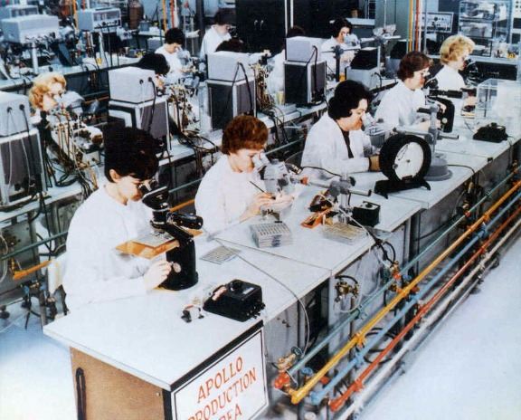
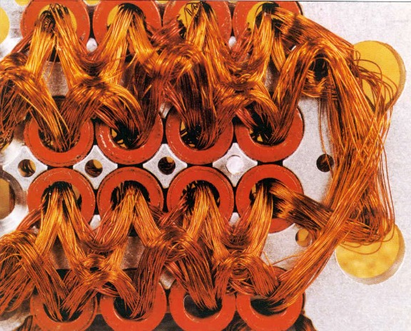

# Her Code Got Humans on the Moon—And Invented Software Itself

Margaret Hamilton at the MIT Museum in Cambridge, MA.  Harry Gould Harvey IV for WIRED

Margaret Hamilton wasn’t supposed to invent the modern concept of software and land men on the moon. It was 1960, not a time when women were encouraged to seek out high-powered technical work. Hamilton, a 24-year-old with an undergrad degree in mathematics, had gotten a job as a programmer at MIT, and the plan was for her to support her husband through his three-year stint at Harvard Law. After that, it would be her turn—she wanted a graduate degree in math.

But the Apollo space program came along. And Hamilton stayed in the lab to lead an epic feat of engineering that would help change the future of what was humanly—and digitally—possible.

As a working mother in the 1960s, Hamilton was unusual; but as a spaceship programmer, Hamilton was positively radical. Hamilton would bring her daughter Lauren by the lab on weekends and evenings. While 4-year-old Lauren slept on the floor of the office overlooking the Charles River, her mother programmed away, creating routines that would ultimately be added to the Apollo’s command module computer.

“People used to say to me, ‘How can you leave your daughter? How can you do this?’” Hamilton remembers. But she loved the arcane novelty of her job. She liked the camaraderie—the after-work drinks at the MIT faculty club; the geek jokes, like saying she was “going to [branch left minus](http://en.wikipedia.org/wiki/Branch_%28computer_science%29)” around the hallway. Outsiders didn’t have a clue. But at the lab, she says, “I was one of the guys.”

Then, as now, “the guys” dominated tech and engineering. Like female coders in today’s diversity-challenged tech industry, Hamilton was an outlier. It might surprise today’s software makers that one of the founding fathers of their boys’ club was, in fact, a mother—and that should give them pause as they consider why the gender inequality of the *Mad Men* era persists to this day.

‘When I first got into it, nobody knew what it was that we were doing. It was like the Wild West.’ — Margaret Hamilton

As Hamilton’s career got under way, the software world was on the verge of a giant leap, thanks to the Apollo program launched by John F. Kennedy in 1961. At the MIT Instrumentation Lab where Hamilton worked, she and her colleagues were inventing core ideas in computer programming as they wrote the code for the world’s first portable computer. She became an expert in systems programming and won important technical arguments. “When I first got into it, nobody knew what it was that we were doing. It was like the Wild West. There was no course in it. They didn’t teach it,” Hamilton says.

This was a decade before Microsoft and nearly 50 years before Marc Andreessen would observe that software is, in fact, [“eating the world.”](http://www.wsj.com/articles/SB10001424053111903480904576512250915629460) The world didn’t think much at all about software back in the early Apollo days. The original document laying out the engineering requirements of the Apollo mission didn’t even mention the word *software*, MIT aeronautics professor David Mindell writes in his book *Digital Apollo*. “Software was not included in the schedule, and it was not included in the budget.” Not at first, anyhow.

## Related Galleries

Slide: 1 8

Caption:
Margaret Hamilton inside a mock-up of the Apollo command module.

Slide: 2 8

Caption:
Hamilton stands next to listings of the Apollo Guidance Computer (AGC) source code.

Slide: 3 8

Caption:
Hamilton with one of her former colleagues on April 19, 1962. Hamilton was developing software on the first AN/FSQ-7 computer at Lincoln Labs. Hamilton’s software program was a radar registration surveillance program used for detecting potential enemy planes. Courtesy Margaret Hamilton

Slide: 4 8

Caption:
Hamilton and her daughter Lauren. Courtesy Margaret Hamilton

Slide: 5 8

Caption:
Hamilton, far left, sits with some of her staff in the Scama room at MIT, while supporting the Apollo 8 mission. Courtesy Margaret Hamilton

Slide: 6 8

Caption:
A Raytheon worker weaving copper wires through magnetic rings. Jack Poundstone/Raytheon

Advertisement

Slide: 7 8

Caption:
“Little Old Ladies” of Raytheon. Jack Poundstone/Raytheon

Slide: 8 8

Caption:
Close-up view of Raytheon copper wires. Jack Poundstone/Raytheon

## Related Galleries

Slide: 1 8

Caption:
Margaret Hamilton inside a mock-up of the Apollo command module.

## Related Galleries

Slide: 1 8

Caption:
Margaret Hamilton inside a mock-up of the Apollo command module.

Slide: 2 8

Caption:
Hamilton stands next to listings of the Apollo Guidance Computer (AGC) source code.

Slide: 3 8

Caption:
Hamilton with one of her former colleagues on April 19, 1962. Hamilton was developing software on the first AN/FSQ-7 computer at Lincoln Labs. Hamilton’s software program was a radar registration surveillance program used for detecting potential enemy planes. Courtesy Margaret Hamilton

Slide: 4 8

Caption:
Hamilton and her daughter Lauren. Courtesy Margaret Hamilton

Slide: 5 8

Caption:
Hamilton, far left, sits with some of her staff in the Scama room at MIT, while supporting the Apollo 8 mission. Courtesy Margaret Hamilton

Slide: 6 8

Caption:
A Raytheon worker weaving copper wires through magnetic rings. Jack Poundstone/Raytheon

Slide: 7 8

Caption:
“Little Old Ladies” of Raytheon. Jack Poundstone/Raytheon

Slide: 8 8

Caption:
Close-up view of Raytheon copper wires. Jack Poundstone/Raytheon

## Related Galleries

Slide: 1 8

Caption:
Margaret Hamilton inside a mock-up of the Apollo command module.

But as the Apollo project unfolded, the centrality of software in accomplishing the mission started to become clear. In 1965, Hamilton became responsible for the onboard flight software on the Apollo computers. It was an exciting time, and the US was depending on the work that she was doing. But sometimes the pressure kept Hamilton up at night. Once, after a late-night party, she rushed back to the computer lab to correct a piece of code she’d suddenly realized was flawed. “I was always imagining headlines in the newspapers, and they would point back to how it happened, and it would point back to me.”

By mid-1968, more than 400 people were working on Apollo’s software, because software was how the US was going to win the race to the moon. As it turned out, of course, software was going to help the world do so much more. As Hamilton and her colleagues were programming the Apollo spacecraft, they were also hatching what would become a $400 billion industry.

For Hamilton, programming meant punching holes in stacks of punch cards, which would be processed overnight in batches on a giant Honeywell mainframe computer that simulated the Apollo lander’s work. “We had to simulate everything before it flew,” Hamilton remembers. Once the code was solid, it would be shipped off to a nearby Raytheon facility where a group of women, expert seamstresses known to the Apollo program as the “Little Old Ladies,” threaded copper wires through magnetic rings (a wire going through a core was a 1; a wire going around the core was a 0). Forget about RAM or disk drives; on Apollo, memory was literally hardwired and very nearly indestructible.

Apollo flights carried two near-identical machines: one used in the lunar module—the *Eagle* that landed on the moon—and the other for the command module that carried the astronauts to and from Earth. These 70-pound Apollo computers were portable computers unlike any other. Conceived by MIT engineers such as Hal Laning and Hamilton’s boss, Dick Batton, it was one of the first important computers to use integrated circuits rather than transistors. As Mindell tells the story, it was the first computerized onboard navigation system designed to be operated by humans but with “fly-by-wire” autopilot technology—a precursor to the computerized navigation systems that are now standard on jetliners.

The system stored more than 12,000 [“words”](https://en.wikipedia.org/wiki/Word_(computer_architecture)) in its permanent memory—the copper “ropes” threaded by the Raytheon workers—and had 1,024 words in its temporary, erasable memory. “It was the first time that an important computer had been in a spacecraft and given a lot of responsibility for the mission,” says Don Eyles, who worked on the lunar module code while at MIT’s IL. “We showed that that could be done. We did it in what today seems an incredibly small amount of memory and very slow computation speed.” Without it, Neil Armstrong wouldn’t have made it to the moon. And without the software written by Hamilton, Eyles, and the team of MIT engineers, the computer would have been a dud.

This became clear on July 20, 1969, just minutes before Apollo 11 touched down on the Sea of Tranquility. Because of what Apollo software engineer Don Eyles has termed a [“documentation error,”](http://www.doneyles.com/LM/Tales.html) the Apollo computer started spitting out worrying error messages during this critical phase of the mission. But here’s where the technical arguments won by Hamilton and others saved the day. The error messages were popping up because the computer was being overwhelmed, tasked with doing a series of unnecessary calculations when, in fact, it was most needed to land the module on the surface of the moon. Back in Houston, engineers knew that because of Apollo’s unique asynchronous processing, the computer would focus on the task at hand—landing the *Eagle* on the Sea of Tranquility. When the software realized it didn’t have enough room to do all the functions it was supposed to be doing, it went through its error detection process and focused on the highest priority job, Hamilton says.

### ‘That would never happen’

One day, Lauren was playing with the MIT command module simulator’s display-and-keyboard unit, nicknamed the DSKY (dis-key). As she toyed with the keyboard, an error message popped up. Lauren had crashed the simulator by somehow launching a prelaunch program called P01 while the simulator was in midflight. There was no reason an astronaut would ever do this, but nonetheless, Hamilton wanted to add code to prevent the crash. That idea was overruled by NASA. “We had been told many times that astronauts would not make any mistakes,” she says. “They were trained to be perfect.” So instead, Hamilton created a program note—an add-on to the program’s documentation that would be available to NASA engineers and the astronauts: “Do not select P01 during flight,” it said. Hamilton wanted to add error-checking code to the Apollo system that would prevent this from messing up the systems. But that seemed excessive to her higher-ups. “Everyone said, ‘That would never happen,’” Hamilton remembers.

But it did. Right around Christmas 1968—five days into the historic Apollo 8 flight, which brought astronauts to the moon for the first-ever manned orbit—the astronaut Jim Lovell inadvertently selected P01 during flight. Hamilton was in the second-floor conference room at the Instrumentation Laboratory when the call came in from Houston. Launching the P01 program had wiped out all the navigation data Lovell had been collecting. That was a problem. Without that data, the Apollo computer wouldn’t be able to figure out how to get the astronauts home. Hamilton and the MIT coders needed to come up with a fix; and it needed to be perfect. After spending nine hours poring through the 8-inch-thick program listing on the table in front of them, they had a plan. Houston would upload new navigational data. Everything was going to be OK. Thanks to Hamilton—and Lauren—the Apollo astronauts came home.

Also thanks to Hamilton and the work she led, notions of what humanity could do, and be, changed not just beyond the stratosphere but also here on the ground. Software engineering, a concept Hamilton pioneered, has found its way from the moon landing to nearly every human endeavor. By the 1970s, Hamilton had moved on from NASA and the Apollo program. She went on to found and lead multiple software companies. Today her company, Hamilton Technologies, is just a few blocks away from MIT, where her career began—a hub of the code revolution that’s still looking toward the stars.

You may also like:

[Go Back to Top. Skip To: Start of Article.](http://www.wired.com/2015/10/margaret-hamilton-nasa-apollo#start-of-content)
