# Build A Weather by Text Service With Twilio

Bots are rising and today we’ll build a service that sends weather forecasts of any city by SMS. **Twilio** provides a set of messaging, voice, video and authentication API’s. We are going to use their [Programmable SMS](https://www.twilio.com/sms) API to build a weather by text service.

If you’re in the US you can test our demo now by sending an SMS to this Twilio number **+1 628 600 1473**, with the name of a city (e.g. “New York”). You can also get a full week forecast by typing “forecast” after the name of the city (e.g. “New York forecast”).

Our service will work in the following steps :

1. A user sends an SMS to a number provided by Twilio that will pass a city name into our Stamplay backend.
2. A Stamplay Task will catch the SMS using the Twilio integration and pass it to a custom Code Block.
3. Our custom Code Block will fetch weather data for a city, then assemble a response message from the data, and output the message.
4. Another Stamplay Task will execute once the Code Block execution is complete, and using the output to respond to the intial SMS number with the weather data for that day.

###### You Will Need

- Twilio Account
- Stamplay Account

##### Get Started

After you have a Twilio account, navigate to your Account Settings to get your API credentials, your `AccountSID` and `AuthToken`. You can find them [here](https://www.twilio.com/user/account/settings).

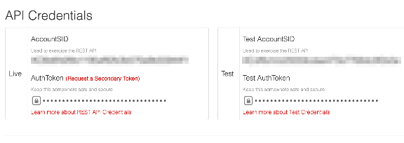

Inside Stamplay, on the left hand side select `Tasks` then components.

Choose the Twilio component within the list.

Next inside the Twilio component configuration, add the Twilio credentials to their corresponding fields.

Now we are ready to start using Twilio within our Stamplay app.

First we need to intialize a Code Block within Stamplay. Code Blocks are custom RESTful endpoints within our Stamplay application.

Create a new one by selecting Code Blocks on the left hand side and entering a name for our Code Block. Let’s call it `weather`.

Our new Code Block should look like the picture below.

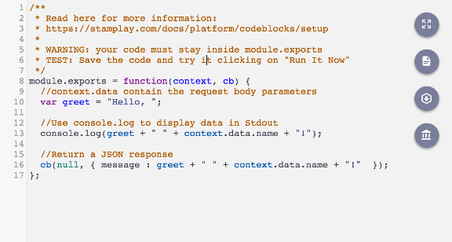

For now we will leave it as is and edit it later.

Head over to the Stamplay Tasks section and create a new Task.

Configure the new task to trigger to: when a new SMS from Twilio is received, run a code block.

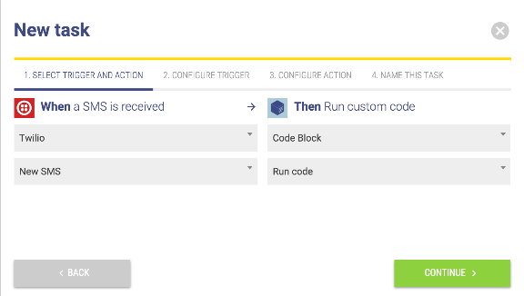

In Step 2, select a number from the dropdown you wish to trigger this Task when the number selected receieves and SMS.

When you created a Twilio account, a Twilio number should have been created for you. You can see your numbers [here](https://www.twilio.com/user/account/messaging/phone-numbers), if you do not have one then add one.

Below the dropdown where we selected the Twilio number, copy the input field containing the callback url, and head over to your Twilio [phone numbers](https://www.twilio.com/user/account/messaging/phone-numbers) page.

Select the number you used to trigger the Task in Stamplay.

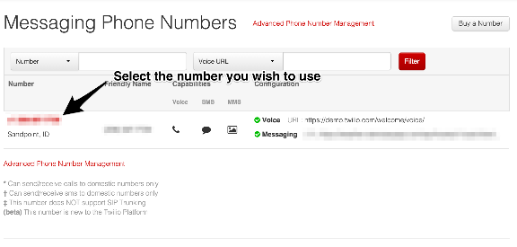

Then in the prompt add the callback url into the `Request URL` input:

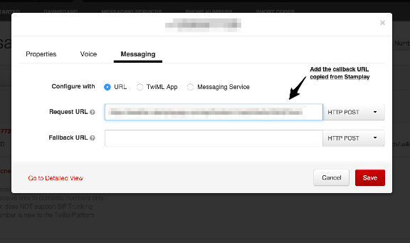

Now back in Stamplay, we need to finish our Task setup. Proceed to Step 3.

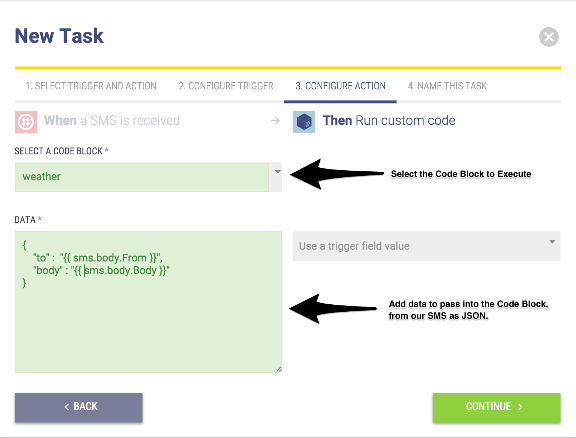

We will pass in the phone number that sent the original text as the `to` property on the JSON object as we will use this number after the Code Block executes to send a message back. The `body` property is the `city name` and if present the `forecast` option which we will explain later once we get to our Code Block.

After Step 3, name your Task and head over to the Code Block to start editing.

|  |  |
| --- | --- |
|  | module.exports function(context, ) { |
|  | // request - fetch data from openweather API |
|  | request require(request); |
|  | // moment - easily transform timestamps into formatted dates |
|  | moment require(moment); |
|  | // http://home.openweathermap.org |
|  | APPID \_\_YOUR\_OPENWEATHER\_API\_KEY\_\_; |
|  | // type is used to find if the user wants the current weather or upcoming forecast. |
|  | type context...split(); |
|  | // the forecast option will be the last argument |
|  | // if not present will return only current weather for city |
|  | type type[.length ] forecast weather forecast; |
|  | // check http://openweathermap.org/api for all available options |
|  | uri http://api.openweathermap.org/data/2.5/ type; |
|  | uri context..; |
|  | uri &APPID= APPID; |
|  | uri &units=imperial; // or metric |
|  | (type weather){ |
|  | // send request to open weather |
|  | request(uri, function(, , ){ |
|  | // parse response body |
|  | data .parse(body); |
|  | // assemble readable message for current weather to send to user |
|  | weather . .weather[].description ; |
|  | weather Temp: .floor(..) degrees(F); |
|  | weather Humidity: ..humidity ; |
|  | weather Wind: .floor(..speed) ; |
|  | weather Cloud Cover : .clouds. ; |
|  | // pass in the current weather as the body property, and the number to send to as the to prop |
|  | (err, { body weather, to context.. }); |
|  | // if forecast is the type, make the request for the 5 day forcast |
|  | request(uri, function(, , ){ |
|  | // parse the incoming body |
|  | data .parse(body); |
|  | // Assemble an entry for each of the 5 day forcast |
|  | week ; |
|  | ( i ; i ..length; i ) { |
|  | week 5 day forecast: ; |
|  | week moment.(.[i].).format(dddd, MM-DD-YY); |
|  | week Type: .[i].weather[].; |
|  | week Description: .[i].weather[].description; |
|  | week Temp: .floor(.[i]..) degrees(F); |
|  | week Humidity: .[i]..humidity ; |
|  | week Wind: .floor(.[i]..speed) ; |
|  | week Cloud Cover: .[i].clouds. ; |
|  | // output the week forecast as the body property, and the intial number as the to prop |
|  | (err, { body week, to context.. }); |

Inside our Code Block we first `require` any npm packages we are going to use.  
Next we need to add our API key from <http://openweathermap.org/>, where we will be pulling our data from.

The `type` variable inside our Code Block is used to check whether the `forecast` option has been passed in. What this means is that apart from a city name if our user passed in `forecast` at the end, we will send them a 5 day forecast instead of just the current weather for the city.

When we assemble our query string for our API request, we will pass in the city name as the `q` param, our API Key as the `APPID` parameter, and the unit type we want our information displayed; I have chosen `imperial`, but `metric` is available as well.

The `if` block determines which request to run. Inside the intial `if`, if the `type` equals weather we will fetch data for the current weather in a city.

To see all available data on the JSON response for our current weather data request, you can see all the options [here](http://openweathermap.org/current).

Otherwise, if the `type` is `forecast` we run the `else` block. Our request retrieves a 5 day forecast which we will loop through and concatenate a readable message to send back to our user. You’ll notice we are iterating by 8. This is because within the forecast, they will return forecasts for every 3 hours of a day giving us 8 blocks in a day. To be concise, we’ve elected to only send the first 3 block of each day.

Once we’ve formuatled our response, we output the weekly data as the `body` property, and `to` property.

These two properties, whichever block is run will be used in the next Task triggered by the completion of this Code Block.

Create a New Task.

Step One: When a Code Block finishes executing trigger an SMS message with Twilio.

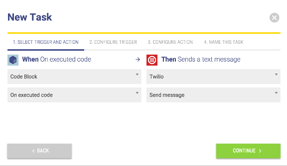

Step Two: Only trigger this Code Block when the `weather` Code Block executes.

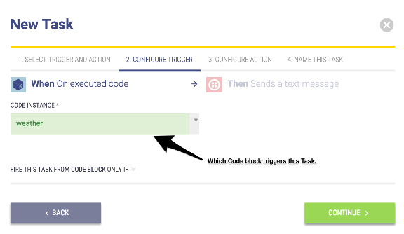

Step Three: Set the **Message** to send as the `body` property from our Code Block output, and the **To** field as the `to` property from our Code Block output.

Select the Twilio number that you want to send the message with.

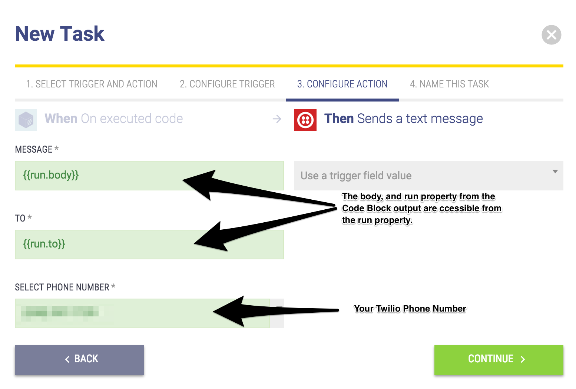

Step Four: Name the Task and save.

And now we can test our service.

###### Testing Our Weather By Text Service

To test our service, we simply need to text our Twilio number from a verified number in Twilio.

To verify a number visit, <https://www.twilio.com/user/account/phone-numbers/verified> to add one. Once verified send a city name to your number and you should recieve a response text within several seconds.

**Current Weather**

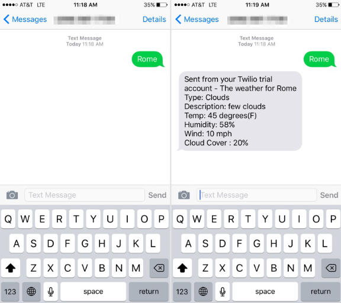

**5 Day Forecast**

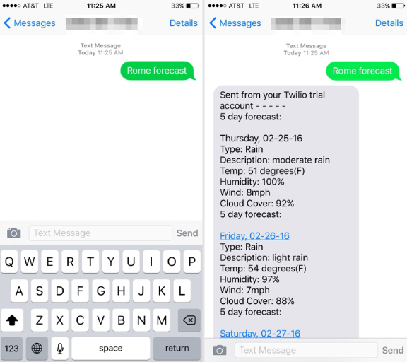

There we have it, we now can get the current weather, and forecast via text!

With Twilio we were able to very quickly, and easily integrate SMS capabilities and hook into our Stamplay Task system to provide value to our users.

Among other APIs Twilio provides, you can use Stamplay and Twilio together to create robust dynamic application quickly!

Try another [Twilio](https://twilio.com/) API, build another app with Stamplay and Twilio!

---

***Haven't signed up to Stamplay yet?***

[START NOW](https://editor.stamplay.com/auth/google/connect)

*Join the thousands of other Stamplayers who are building products faster while writing less code.*

---
