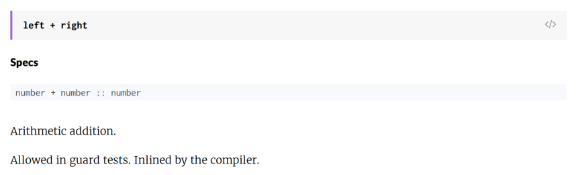

# Custom Infix Functions in Elixir

*Published February 14, 2016 by [Rodney Folz](https://twitter.com/rodneyfolz)*

(…sort of)

I’m writing a [Math module/shim](https://hex.pm/packages/math) for Elixir, which means I need to write tests that deal with floats. In particular, I need to know when two floats are *really, really close* to being equal, even though they might not be 100% equivalent.

My tests look like this:

|  |  |
| --- | --- |
| ``` 1 2 3 4 5 6 7 8 ``` | ```   assert        asin"    assert      assert ``` |

and they pass!

|  |  |
| --- | --- |
| ``` 1 2 3 4 5 ``` | ``` ➜  mix  ........  Finished 0.1 seconds 0.1s on load, 0.00s on tests 8 tests, 0 failures ``` |

This might look like magic, especially if you’ve tried and failed to write custom infix functions in the past (like I have). Here’s how I implemented my nearly-equal test:

|  |  |
| --- | --- |
| ``` 1 2 3 4 5 6 7 8 9 10 11 ``` | ```  """ Equality-ish test for floats that are nearly equal. """ @spec number  number  boolean        nearly_equal?      nearly_equal? ``` |

That’s right: it’s just a regular function definition!

This isn’t the only infix operator you can use. Here’s all the infix operators you can define in this way (as of Elixir 1.2.0):

`\\`, `<-`, `|`, `~>>`, `<<~`, `~>`, `<~`, `<~>`, `<|>`, `<<<`, `>>>`, `|||`, `&&&`, and `^^^`.

Sadly, you can’t use any other custom symbols or names as infix. But hopefully those fourteen infix operators will be enough to satisfy :-)

---

Now for the deep dive into why this is the case.

Let’s look at the source code for another infix operator like the built-in `+` addition operator. First we need to find where `+` is defined – the [Getting Started guide](http://elixir-lang.org/getting-started/case-cond-and-if.html#if-and-unless) gives us a hint:

> The [`Kernel`](http://elixir-lang.org/docs/stable/elixir/Kernel.html) module is also where operators like `+/2` and functions like `is_function/2` are defined, all automatically imported and available in your code by default.

Ok, that’s promising. Let’s check out the [Kernel module docs for `+/2`](http://elixir-lang.org/docs/stable/elixir/Kernel.html#+/2).



Hmm, not really helpful for us. However, there’s a link to [the source code for `+/2`](https://github.com/elixir-lang/elixir/blob/v1.2/lib/elixir/lib/kernel.ex#L822). Maybe that will be what we’re looking for?

|  |  |
| --- | --- |
| ``` 1 2 3 4 ``` | ``` @spec number  number  number    right    :erlang right ``` |

This isn’t the answer, but it’s a start. Notice that when the `Kernel` module implements `+/2`, it’s already using the left-op-right form. So does this mean we can just define our own infix functions like the ones in `Kernel` are defined?

|  |  |
| --- | --- |
| ``` 1 2 3 4 ``` | ``` @spec number  number  String    right      INFIX right ``` |

No, we can’t:

|  |  |
| --- | --- |
| ``` 1 2 3 ``` | ``` == Compilation error on file lib/ops.ex == ** (SyntaxError) lib/ops.ex:34: syntax error before: ')'     (elixir) lib/kernel/parallel_compiler.ex:100: anonymous fn/4 in Kernel.ParallelCompiler.spawn_compilers/8 ``` |

Darn, it would have been nice if custom infix functions Just Worked.

But what about trying it the other way? Can we define an infix-by-default operator as a prefix function?

|  |  |
| --- | --- |
| ``` 1 2 3 ``` | ```   right     right ``` |

This doesn’t work. In fact, it’s a compile error to try to define `<~>` in the regular way.

|  |  |
| --- | --- |
| ``` 1 2 3 4 ``` | ``` ➜  iex -S mix == Compilation error on file lib/ops.ex == ** (SyntaxError) lib/ops.ex:30: syntax error before: ')'     (elixir) lib/kernel/parallel_compiler.ex:100: anonymous fn/4 in Kernel.ParallelCompiler.spawn_compilers/8 ``` |

From this, we can guess that the Elixir parser does not generally support infix notation, but instead has the infix operators in `Kernel` special-cased. Let’s validate our hunch by finding how Elixir is parsed.

This information, however, is not to be found in the Getting Started Guide. Instead, a brief Google search for “elixir parser” led me to this very interesting [article on parsing source code with Elixir](http://andrealeopardi.com/posts/tokenizing-and-parsing-in-elixir-using-leex-and-yecc/). Near the end of article, the author mentions that Elixir itself is parsed using the same methods discussed in the article:

> Want another real-world™ example? Wait, I think I have one: ever heard of the Elixir programming language? It’s a nice language built atop the Erlang virtual matching, focused on concurrency, fault to… Well, it’s [parsed by yecc](https://github.com/elixir-lang/elixir/blob/master/lib/elixir/src/elixir_parser.yrl) :).

Jackpot! Let’s check the source for [elixir\_parser.yrl](https://github.com/elixir-lang/elixir/blob/master/lib/elixir/src/elixir_parser.yrl#L51-L75), the file linked in that quote, and see what we get.

|  |  |
| --- | --- |
| ``` 1 2 3 4 5 6 7 8 9 10 11 12 13 14 15 16 17 18 19 20 21 22 23 24 25 ``` | ``` Right      stab_op_eol     %% ->         Nonassoc   capture_op_eol         in_match_op_eol %% <-, \\ (allowed in matches along =) Right      when_op_eol     %% when Right      type_op_eol     Right      pipe_op_eol     Right      assoc_op_eol    %% => Right      match_op_eol          or_op_eol       %% ||, |||, or       and_op_eol      %% &&, &&&, and       comp_op_eol     %% ==, !=, =~, ===, !==       rel_op_eol      %% <, >, <=, >=       arrow_op_eol    %% |>, <<<, >>>, ~>>, <<~, ~>, <~, <~>, <|>       in_op_eol             three_op_eol    %% ^^^ Right     two_op_eol      %% ++, --, .., <>       add_op_eol      %% +, -       mult_op_eol     %% *, / Nonassoc  unary_op_eol    %% +, -, !, ^, not, ~~~       dot_call_op       dot_op          Nonassoc  at_op_eol       Nonassoc  dot_identifier ``` |

There we have it. In Elixir, operators are predefined in the parser. Since the parse step happens before Elixir is bootstrapped, there’s no way for us to define our own operators in our code. We would either have to modify the Elixir parser directly (and recompile Elixir) or just be satisfied with one of the fourteen unused operators:

`\\`, `<-`, `|`, `~>>`, `<<~`, `~>`, `<~`, `<~>`, `<|>`, `<<<`, `>>>`, `|||`, `&&&`, and `^^^`.

After I posted an excited tweet about my “discovery”, [José Valim](https://twitter.com/josevalim) reached out to me and confirmed that the unused operators were deliberately included for exactly this use case.

In summary:

- Elixir’s infix operators are special-cased in the parser.
- The Kernel module just implements them, but doesn’t do anything special, syntax-wise, itself.
- You can implement behavior for unused operators that the parser knows about.
- You can’t create new infix operators without recompiling Elixir from source.

---

But wait, there’s more!

While I was searching around for how infix operators worked, I came across [this #elixir-lang-talk thread](https://groups.google.com/forum/#!topic/elixir-lang-talk/pTde-7d52QY) which discussed overriding the built-in `Kernel` module’s operators.

> One special thing about Kernel is that it defines the original implementations for each operator. You can redefine any of the operators if you first unimport it inside your module.

Once you have a new implementation for an operator (say, in module called MyOp), you can call it as a function

|  |  |
| --- | --- |
| ``` 1 ``` | ``` MyOp.>(a, b) ``` |

or you can import it and use it as an operator

|  |  |
| --- | --- |
| ``` 1 2 3 4 ``` | ``` import Kernel, except: [>: 2] import MyOp  a > b ``` |

This trick is used by the [pipespect](https://github.com/alco/pipespect/blob/master/lib/pipespect.ex#L9-L10) library to automatically `IO.inspect` every stage in a `|>` pipe

|  |  |
| --- | --- |
| ``` 1 2 3 4 ``` | ``` import Kernel except:   defmacro first |>     # code and edge cases to wrap the pipeline in IO.inspect ``` |

Since this is monkey-patching the language, redefining Kernel’s built-in operators may break expectations from other Elixir code and should be used with care, if it’s used at all. But it’s a fascinating example of how predictable and regular Elixir can be.

---

Thanks for reading! If you liked this, enter your email address and I'll let you know when I write something new:

You can also find me [@rodneyfolz on Twitter](https://twitter.com/rodneyfolz).
