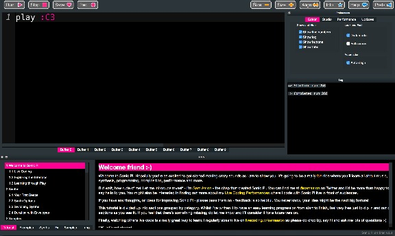

# Preparations

22 Jan 2016

*This article is part of the [Aerodynamic](https://aimxhaisse.com/aerodynamic-en.html)* guide.

We are going to spend most of our time in
[Sonic Pi](http://sonic-pi.net/), which will be our best companion
during this journey. It is a free (both as in beer and as in freedom)
environment to make sound from text, initially made to introduce kids
to coding, but it also works with elders, don't be intimidated!

Once you have downloaded and started *Sonic Pi*, let's see if it works
properly by entering the following text in the main area:

This line is an instruction which asks *Sonic Pi* to play the note
`:C3` (the 3rd `C` on a piano). It doesn't do anything for the moment
because we haven't asked *Sonic Pi* to play. To do so, click on the
button `Run` on the top left corner, if you hear something, then
everything is fine and we can continue!

If this is the first time you write code, congratulations!

We'll often have to click on this `Run` button, it's a bit fastidious
and it is easier to use the shortcut, which you can know by
highlighting with your cursor the button. Also, if like me, bright
colors attack your retina, by going into the preferences (the `Prefs`
button on the top right corner), and by ticking `Dark Mode`, your
world will be illuminated.

*Welcome to the Matrix Neo.*

A last note about *Sonic Pi* which will be useful, we can start to
record what we play via the `Rec` button, when you press it a second
time, a window appears to ask you where to save your work.

In addition to *Sonic Pi*, we are going to use the following softwares
(also free as in beer and as in freedom) which may help to analyze
sound:

We aren't going to spend a lot of time detailing their usage in these
pages, I'll directly provide screenshots containing meaningful
information.

[Next...](https://aimxhaisse.com/aerodynamic-structure-en.html)

---

*This article is part of the [Aerodynamic](https://aimxhaisse.com/aerodynamic-en.html)* guide.
