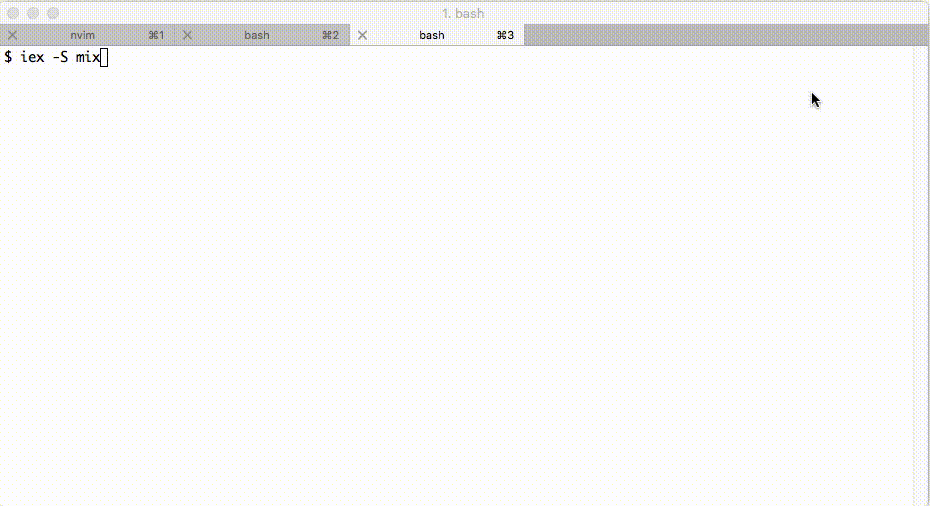
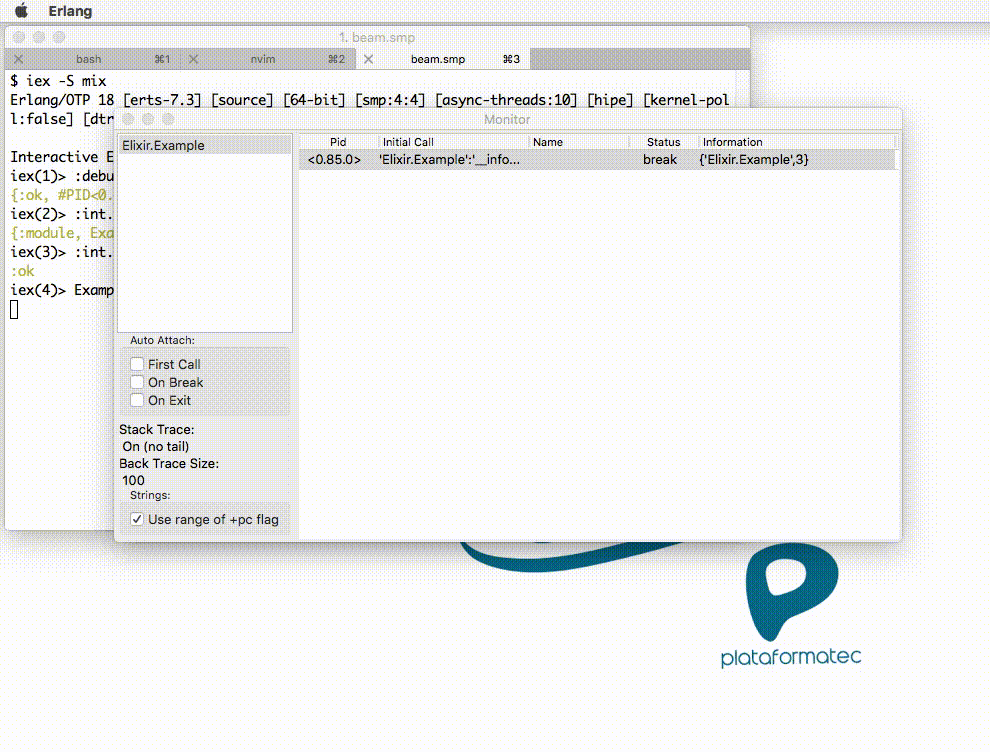

# Debugging techniques in Elixir

It’s common that our first experience with debugging in a new language is by printing values to the terminal. Elixir isn’t different: we can use `IO.puts/2` and `IO.inspect/2`. However, Elixir also provides other approaches to debugging.

In this blog post, we’ll show you other 2 options: `IEx.pry/0` and `:debugger`.

## IEx.pry

The name “pry” is an old friend in the Ruby ecosystem but it has a different behavior in Elixir. Let’s create a new project with `mix` to try it out:

```
mix new example
cd example
```

Now let’s write some sample code in `lib/example.ex`:

```
require IEx;

defmodule Example 
   double_sum(x, y) 
    IEx.pry
    hard_work(x, y)
  

   hard_work(x, y) 
     * (x + y)
```

Now start a new IEx session and invoke our new function:

```
$ iex -S mix
Interactive Elixir (1.2.4) - press Ctrl+C to  ( h() ENTER  )
iex(1)> Example.double_sum(1, 2)
```

`IEx.pry/0` is built on top of IEx. Although it isn’t a traditional debugger since you can’t step, add breakpoints and so forth, it’s a good tool for non-production debugging. It runs in the caller process, blocking the caller and allowing us to access its binding (variables), verify its lexical information and access the process information. You can finish your “pry” session by calling `respawn`, which starts a new IEx shell.



You can find more information at [IEx.pry doc](http://elixir-lang.org/docs/stable/iex/IEx.html#pry/1).

## Debugger

If you need a breakpoint feature, we can use the `:debugger` module that ships with Erlang. Let’s make a change in our example to be more didactic:

```
defmodule Example 
   double_sum(x, y) 
    hard_work(x, y)
  

   hard_work(x, y) 
    x =  * x
    y =  * y

    x + y
```

Now we can start our debugger:

```
iex -S mix
Erlang/OTP  [erts-] [source] [-bit] [] [async-threads:] [hipe] [kernel-poll:false] [dtrace]

Compiled lib/example.ex
Interactive Elixir (.) - press Ctrl+C to exit (type h() ENTER  help)
iex()> :debugger.start()
{, #PID<0.87.0>}
iex()> .ni(Example)
{:module, Example}
iex()> .break(Example, )

iex()> Example.double_sum(,)
```

When you started the debugger, a Graphical User Interface must have opened in your machine. We called `:int.ni(Example)` to prepare our module for debugging and then added a breakpoint to line 3 with `:int.break(Example, 3)`. After we call our function, we can see our process with break status in the debugger:



The process is blocked as in `IEx.pry/0`. We can add a new breakpoint in the monitor window, inspect the code, see the variables and navigate it in steps.

Debugger has more options and command instructions that you can use. Take a look at [Debbuger doc](http://erlang.org/doc/apps/debugger/debugger_chapter.html) for more information.

### Troubleshooting

You may have some problems when executing `:int.ni(Example)` in the example above:

```
iex()> .ni(Example)
** Invalid beam file  no abstract code: 'Elixir.Example'
```

Before the upcoming Erlang 19 version, the debugger did not have the [heuristic that traverses the module source attribute](https://github.com/erlang/otp/pull/977) applied. If you are not on the latest Erlang version, you can update the debugger manually with the following steps:

1. Download the file `int.erl` from the PR.
2. Compile it with `erlc -o . int.erl`.
3. Overwrite `lib/debugger/ebin/int.beam` in your Erlang installation with the new compiled file.

In the next post, we will see a tracing technique that doesn’t block the caller process.

What about you? What are the tools that you are using to debug your Elixir applications?

[](http://plataformatec.com.br/elixir-radar?utm_source=our-blog&utm_medium=referral&utm_campaign=elixir-radar&utm_content=elixir-radar-cta-blog-post-bottom)
