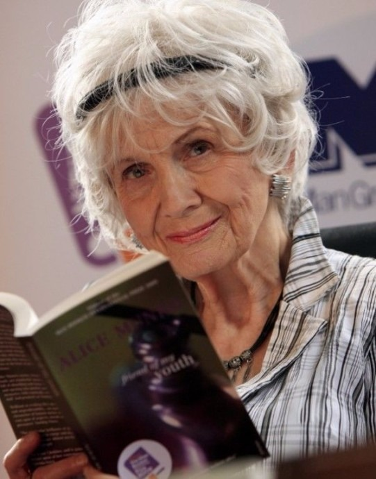

# 15 coisas que você precisa saber sobre Alice Munro

## **Nobel de literatura em 2013, Alice Munro surpreendeu o cenário literário, por ter em suas narrativas breves o maior trunfo para receber o prêmio. Veja 15 coisas que você precisa saber sobre a escritora!**

1. Seu nome de nascimento é Alice Laidlaw;

2. Ela nasceu em 10 de julho de 1931, nos arredores de Wingham, Ontário, cenário que fez aparições frequentes em suas histórias (como os renomeados contos *Jubilee*, ou *Hanratty*);

3. Seu pai, Robert Laidlaw, era um descendente direto de James Hogg, autor de *The Private Memoirs* e *Confessions of a Justified Sinner;*

4. Ela disse que começou a se refugiar em livros depois que sua mãe, que era professora, foi diagnosticado com uma forma incomum de Parkinson. Na época, Alice, a mais velha de três irmãos, tinha 10 anos;

5. Ela ganhou uma bolsa para estudar jornalismo na Universidade de Western Ontário. Para sobreviver, ela vendia o próprio sangue e cigarros, entre outros trabalhos;

6. Ela publicou seu primeiro conto, *The Dimensions of a Shadow*, como um estudante em 1950;

7. Com seu primeiro marido, Jim Munro, ela abriu uma livraria, Livros de Munro, que ainda está sendo negociado hoje em Victoria, British Columbia. Os títulos vendidos eram basicamente brochuras de ações, vencendo o mercado livreiro em um momento em que muitas livrarias tradicionais rejeitavam este tipo de livro;

8. Seu segundo marido, Gerry Fremlin, era um velho amigo da universidade. Eles decidiram se casar depois de se encontrarem novamente e beberem mais de três martínis;

9. Quando ela ganhou o prêmio Man Booker International em 2009, o juiz Jane Smiley descreveu seu trabalho como “praticamente perfeito”;

10. Ela é o primeiro cidadão canadense a ser agraciado com o Prêmio Nobel de Literatura.;

11. Alguns críticos a consideram a “Chekhov canadense”;

12 – Suas obras mais conhecidas são  *Fugitiva* (2006), *Felicidade demais* (2010) e *O amor de uma boa mulher* (2013);

13 – Sua obra *Ódio, Amizade, Namoro, Amor, Casamento* (2001) foi inspiração para o filme “Longe dela” (2006), dirigido por Sarah Polley;

14. Munro é a 13ª mulher a ganhar o Nobel de Literatura;

15. Foi a primeira vez, em 112 anos, que a academia sueca premiou um autor que escreve apenas contos. O grande marco de Alice Munro é este, se dúvida.

Texto Original no [The Guardian](http://www.theguardian.com/books/booksblog/2013/oct/10/top-ten-things-about-alice-munro); informações complementares [G1](http://g1.globo.com/pop-arte/noticia/2013/10/alice-munro-vence-nobel-de-literatura-2013.html).
