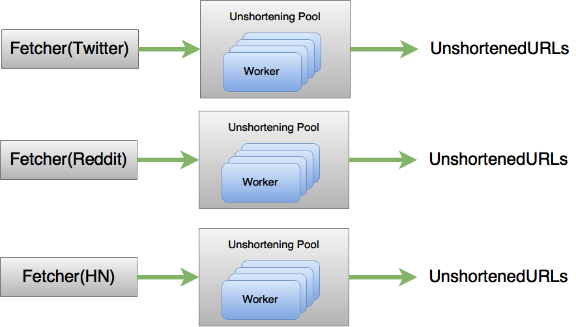
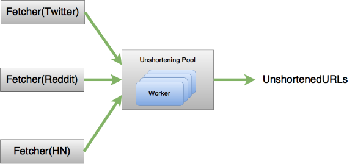

# Designing with OTP Applications in Elixir

Last week I wrote about [Using Elixir `Stream`s to map work through a process pool](http://learningelixir.joekain.com/streaming-through-a-pool-in-elixir/). This was part of building my [Domain Scraper application](https://github.com/joekain/ds_prototype). This week, I’ll continue the work by building up the OTP application structure for Domain Scraper. And I’ll continue using `Stream`s to compose computation.

## Getting Started

I’ve been looking forward to this part of the project for some time. I’ve written posts on [OTP application design](http://learningelixir.joekain.com/elixir-application-design-posts/) but haven’t yet put together a real application of my own. I found it hard to get started with this iteration and have been thinking about it for some time. I tried approaching the problem from a few different directions.

First I asked myself: “What is the restart strategy that I want for the various processes involved?” I was thinking that if any processes die I should restart the whole thing. But then I realized that I occasionally get errors like this:

```
16:24:02.317 [error] GenServer #PID<0.233.0> terminating
** (ArgumentError) argument error
  (kernel) gen_tcp.erl:148: :gen_tcp.connect/4
  (ibrowse) src/ibrowse_http_client.erl:706: :ibrowse_http_client.send_req_1/8
  (stdlib) gen_server.erl:629: :gen_server.try_handle_call/4
  (stdlib) gen_server.erl:661: :gen_server.handle_msg/5
  (stdlib) proc_lib.erl:240: :proc_lib.init_p_do_apply/3
Last message: {:send_req, { {:url, 'http:///?p=9403', [], 80, :undefined, :undefined, '/?p=9403', :http, :hostname}, [], :head, "", [], 5000}}
State: {:state, [], 80, :undefined, #Reference<0.0.3.341>, false, :undefined, [], false, :undefined, false, [], {[], []}, :undefined, :idle, :undefined, "", 0, 0, [], :undefined, :undefined, :undefined, :undefined, false, :undefined, :undefined, "", :undefined, false, 348232, 0, :undefined}
```

when fetching Tweets. These errors are recoverable now and should remain that way.

I took a step back from this problem and worked on a few other things. Also, I attended ElixirConf in Austin, TX. On the plane ride over I finally read [Elixir in Action](http://www.amazon.com/gp/product/161729201X/ref=as_li_tl?ie=UTF8&camp=1789&creative=9325&creativeASIN=161729201X&linkCode=as2&tag=learnelixi-20&linkId=ET5PFLCV6GSDJYYR) by Saša Jurić. I really wish I had read this book earlier, it has been recommended to me many times. Part II of *Elixir in Action* gives an amazing description of creating OTP applications and assembling them together to build up larger programs. I can’t recommend this book enough!

When I returned home from ElixirConf I put what I’d learned to work and enumerated all the Domain Scraper processes I have control over:

- Top level P1
  - poolboy
    - Workers
- Fetcher -> Decoupler
  - BlockingQueue (decoupler)
  - Anonymous process (decoupler)
- Processor
  - Decoupler
    - BlockingQueue
    - Anonymous process
    - Agent worker processes
      - Inserting an Agent into supervision tree requires start\_link but start\_link doen’t return until function returns.
- PoolUtil - map\_through\_pool
  - BlockingQueue (pool)
  - Anonymous process (stream\_through\_pool

I thought about what would happen if any of these processes fail. What happes if …

- Top Level P1 dies? - restart entire thing
- poolboy dies? - restart entire thing
  - Top Level P1 is checking results back into poolboy does it need to restart?
  - Top Level P1 is popping items out of BlockingQueue (pool) does it need to restart?
- Worker dies?
  - Work is lost, poolboy restarts them
  - These are really outside my control
- BlockingQueue (decoupler) dies? - restart entire thing
  - Agents passing through the decoupler need to be terminated
- Anonymous process (decoupler) dies? - restart entire thing
- BlockingQueue (pool) - restart entire thing
- ExTwitter process dies? - whole pipeline needs to be restarted
  - This is really outside my control and started with `spawn`, not `spawn_link`!

This again led me to: Restart the entire tree if anything dies.

But, do I really want such coarse grained control over processes?

Finally, I looked at the problem from the point of view of the major components. How are these components organized? The components are:

1. Fetcher -> Decoupler
2. Unshortening Pool

After thinking about it for some time I realized that these components should be separate OTP applications. They are logically separate pieces of functionality and can stand on their own. As applications I can still use them together and flow the data through like this:



I realized, that I’m missing aggregation in the diagram above. And as I thought about how to add it I started to realize that it would make more sense for Unshortening Pool to be able to accept multiple input streams. That way we would have something more like this:



Then I realized that I can almost make this work right now. Fetchers route data to the pool using the `PoolUtill.map_through_pool` interface that we developed last week. `map_through_pool` doesn’t imply exclusive access to the pool. Any number of clients can map data through the pool and the pool could provide a single output stream of completed work. The pool just needs to be large enough to accommodate all the work.

In terms of restart strategy this means that the individual Fetchers can all fail and restart independently, `UnshorteningPool` can fail and restart independently, and `Aggregator` can fail and restart independently.

## Writing Some Code

After thinking through the design I was ready to start writing up a new prototype iteration to reduce the ideas to practice.

I needed to walk away from [`P1`](https://github.com/joekain/ds_prototype), the project I already had, and start a new umbrella application to host the several applications I’ve identified in the design. I created it like this:

```
mix new --umbrella p9
```

I’m on the ninth iteration, hence the name p9. And you can follow along with the source in the github repo [ds\_p9](https://github.com/joekain/ds_p9).

### Fetcher(Twitter)

I started off by recreating the Twitter fetcher within p9. First, I had to create it as a supervised, child application:

```
apps/
mix new --sup twitter
```

I copied over the relevant files and did a little renaming. The `Twitter.Fetcher`, `Twitter.Parser` and `Decoupler` are basically the same. But there are a few more files to turn this all into an application. First, there is twitter/lib/twitter.ex:

```
defmodule Twitter 
   Application

  # See http://elixir-lang.org/docs/stable/elixir/Application.html
  # for more information on OTP Applications
   start_type _args 
    import Supervisor warn: false

    children  
      # Define workers and child supervisors to be supervised
      workerTwitterServer 
    

    # See http://elixir-lang.org/docs/stable/elixir/Supervisor.html
    # for other strategies and supported options
      strategy: :one_for_one name: TwitterSupervisor
    Supervisorstart_linkchildren 
  

   test_runner 
    TwitterServer
    |> Stream  -> inspect  
    |> 
    |> to_list
```

This is the main module for the application and uses `Application`. The `start/2` function is required and is used to start up Twitter as an OTP application. This function creates the supervision tree. Most of the work specific to Domain Scraper is in the `children` specification. We start up one worker process which is defined by the `Twitter.Server` module which we will investigate next. Finally, `start/2` has some boilerplate code (generated by mix) that starts the supervisor using the `children` specification.

`test_runner` is a function I wrote for testing. I’m not doing a good job using ExUnit to test these OTP applications. That’s something I will need to learn to do soon.

The next new file is twitter/lib/twitter/server.ex:

```
defmodule TwitterServer 
   ExActorGenServer export: :global :calculator

  defstart start_link 
    configure_extwitter

    stream  TwitterFetcherfetch
    |> Streamflat_map tweet -> TwitterParsertweet 

    initial_statestream
  

  defcall  state: stream  replystream

   configure_extwitter 
    ExTwitterconfigure 
       consumer_key: Systemget_envTWITTER_CONSUMER_KEY"
       consumer_secret: Systemget_envTWITTER_CONSUMER_SECRET"
       access_token: Systemget_envTWITTER_ACCESS_TOKEN"
       access_token_secret: Systemget_envTWITTER_ACCESS_SECRET"
```

This is a GenServer which I’ve implemented using [ExActor](https://github.com/sasa1977/exactor). `Twitter.Server.start_link/2` will start up the server and will start the Fetcher and Parser. The `get/0` function will return the resulting stream. `configure_extwitter/0` is copied over from some other part of the old iteration and is just used to configure `ExTwitter`. There’s not really much here. This is just a process to create and execute the Fetcher / Parser stream.

Note, at this point we haven’t connected the Fetcher / Parser stream to anything. We’ve completed one part of our design but need to write the Unshortening Pool before we can connect anything together.

### Unshortening Pool

So, the next piece to build is the Unshortening Pool. The process here was very similar. I copied over the code. Note, that in the prototype p8 I already had setup a supervised application for the pool.

### Try it out

With the Twitter and Unshortening Pool applications ready I should be able to run things end-to-end. I ran this in iex:

```
TwitterServer |> UnshorteningPool |> Stream  -> inspect   
  |> to_list
```

And this worked pretty well for streaming out an endless supply of links from Twitter. I did find that I need to increase the size of the pool. I had only 10 items in previous iterations and this could fill up if we encountered too many slow resolving URLs.

## What did we learn?

The first thing I learned was how to build a real umbrella application and how to connect the applications together. I also learned more about creating OTP supervised applications.

We learned how to look at the different pieces of the program and to identify parts that make sense as independent OTP applications. We came up with a design based on this.

We validated the design, at least to some degree. In the “Next Steps” below we’ll see that there is a little more to do.

## Next Steps

There are a few things to do next:

I can put everything together and run end-to-end in iex. But really the OTP application structure should assemble everything automatically.

Second, I wanted this design:


but so far I’ve only build this much:


and honestly, I had this much last week.

I like the new architecture, or at least it looks good on paper but to really validate our design we need at least one more fetcher.

Next week I plan to develop the Reddit fetcher and in the following week we will plumb everything together so that the OTP applications are setup to talk with one another.

---

**Designing with OTP Applications in Elixir** was published on October 27, 2015.
