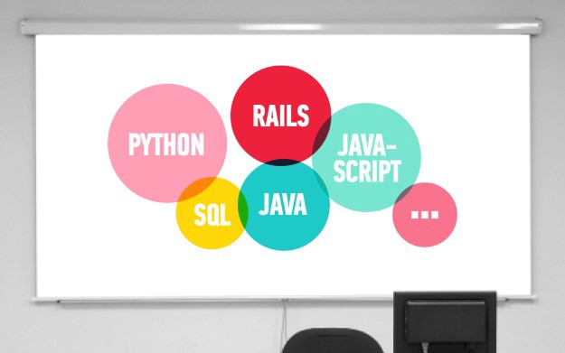

# Medium

[Open in app](medium://p/74867cadbd22)Install

[Homepage](https://medium.com/)

[### Published inEducation for the 21st Century](https://medium.com/education-for-the-21st-century?source=logo-lo_d75ea16673f5-17460edc18bd)

[Sign up](https://medium.com/m/signin?redirect=https://medium.com:443/education-for-the-21st-century/the-8-most-in-demand-programming-languages-of-2016-74867cadbd22)

54

1

[General Assembly](https://medium.com/@ga)BlockedUnblockFollowFollowing

[General Assembly](https://medium.com/@ga)Mar 257 min read

---

### The 8 Most In-Demand Programming Languages of 2016

By [Hannah Atkin](https://medium.com/@hannahatkin)

In 2012, Venture capitalist Marc Andreessen famously declared, “[Software is eating the world](http://genius.com/Marc-andreessen-why-software-is-eating-the-world-annotated).”

By 2020, there will be 1.4 million computer specialist job openings, according to the U.S. Department of Labor. But a study by [Gartner](http://www.infoworld.com/article/2969298/agile-development/how-to-fix-the-tech-talent-shortage.html) projects that universities are not likely to produce enough qualified graduates to fill even about 30% of these jobs.

This means that the door is wide open for individuals who do not have a traditional background in computer science to learn how to code. But with so many programming languages out there, where do you start?

Let’s take a look at some of the most in-demand languages of 2016 to figure out which tools will best complement your skill set and career goals.

### 1. SQL

#### What is it?

SQL stands for Structured Query Language. SQL is not a “procedural language,” meaning it doesn’t instruct the computer to perform actions and create data. Instead, it’s a “query language,” which, you probably guessed, means it focuses on retrieving data.

#### What can you do with it?

SQL is good at fetching data and is most typically used to retrieve information from databases and combine it together to create reports.

#### What’s the learning curve like?

The great thing about this language is the syntax is very simple and it takes only [a few minutes to learn](https://www.codecademy.com/learn/learn-sql) how to run a very basic report. If you’re already an Excel wiz, you’re in luck because there is much similarity between the two.

#### Why is it in-demand?

Think of just about any organization from big banks, to hospitals, to app startups — all companies rely on data and need to organize and understand the information in a relevant way. They are always going to need a database professional.

#### Who Uses SQL?

Back-end developers, data scientists, data-driven marketers in almost every industry — everyone who uses a relational database uses SQL.

### 2. JAVA

#### What is it?

Java is a general-purpose programming language that can run on virtually any type of computer and is independent of both device and platform. It is an object-oriented language which basically means that it’s made up of modules of code, kind of like lego bricks, which can be used in other programs, without having to rewrite it.

#### What can you do with it?

The short answer is, [just about anything](https://java.com/en/download/faq/whatis_java.xml). Java allows you to build applications, develop Android apps, deploy applications, integrate robust libraries, and create sophisticated GUIs, just to name a few.

#### What’s the learning curve like?

You have to remember that Java is a programming language so in order to learn to “speak” it, you must first learn to “talk” or computer program. The learning curve is steep but once it clicks, everything begins to fall into place. Remember, unlike other programming languages Java does not offer as much “instant gratification” upfront which can be frustrating in the beginning.

#### Why is it in-demand?

Java is a mature language and has been around a long time (for computer years). Due to it’s maturity and widespread use, most large applications use this language because of how effective it is to scale and maintain. Java is running pretty much everywhere you can think of and not going anywhere anytime soon.

#### Who uses Java?

Back-end web developers, especially in industries where you need high performance and security — like finance, healthcare, and even the gaming industry.

### 3. Python

#### What is it?

Python is an object-oriented [programming language](https://www.python.org/doc/essays/blurb/) that is known for it’s clear syntax and readability.

#### What can you do with it?

Python can be used to program web and desktop applications. It is also heavily used in the sciences to analyze data.

#### What’s the learning curve like?

It is fairly easy to learn compared to more verbose languages like Java or C++. Python is a very readable language, which makes it easier to learn because you won’t waste time learning arcane syntax. This makes Python a great language for[beginners](https://www.python.org/about/gettingstarted/) and allows you to focus on programming concepts and paradigms early.

#### Why is it in-demand?

It is a very consistent language and works extremely well right out of the box. Python can complete the same tasks in fewer lines of code and it feels more intuitive and natural. This convenience and ease of use have made Python a popular language all around.

#### Who uses Python?

Data engineers, data scientists, and developers. Python is not industry specific, but task specific — great for data processing, business intelligence, and some application development.

### 4. JavaScript

#### What is it?

Javascript is an object-oriented [programming language](https://developer.mozilla.org/en-US/docs/Web/JavaScript) used to make interactive web effects, build rich user interfaces by pulling API data, and interact with a multitude of different systems. It interacts and builds HTML markup on the page by manipulating the HTML document in the window.

#### What can you do with it?

Javascript is is not only used to spice up your website, it can also help with things like validation or even to program games. Think of it as the web’s response to particular user actions.

#### What’s the learning curve like?

Javascript can pose a bit of a hurdle for those who have never done any programming and only ever used markup languages like HTML and CSS. While there may be a slight bump in the road, the rule states that it’s [easy to learn](https://www.udacity.com/course/javascript-basics--ud804) and difficult to master.

#### Why is it in-demand?

This is the native language for all web browser. It has a library for pretty much everything and it makes communicating with APIs for data services simpler — just to name a few examples.

#### Who uses JavaScript?

Back-end and front-end web developers. JavaScript is increasing in popularity across a variety of industries.

### 5. C#

#### What is it?

C# (pronounced cee-sharp) is a [multiple paradigm programming language](https://msdn.microsoft.com/en-us/library/z1zx9t92.aspx) developed by Microsoft to compete with Java. A hybrid of C and C++, it is designed to help improve productivity of web and development.

#### What can you do with it?

Using C# you can do things like make software, write Windows applications, program games, write native mobile apps — all with native API calls and native platform controls.

#### What’s the learning curve like?

C# is generally known as [friendlier for beginners](https://mva.microsoft.com/en-US/training-courses/c-fundamentals-for-absolute-beginners-8295?l=bifAqFYy_204984382) than Java. While the syntax is similar to Java, there tend to be more easily accessible resources and Microsoft’s collection of developer tools, [Visual Studio](https://www.visualstudio.com/en-us/visual-studio-homepage-vs.aspx), makes creating apps easier.

#### Why is it in-demand?

C# is convenient because it’s part of the “common language infrastructure”, meaning it can be used across multiple computer platforms and doesn’t need to be rewritten. The language’s diversity and flexibility make it a go-to for many programmers focused on Windows-based environments.

#### Who uses C#?

Web and mobile developers, especially developing business applications targeting a Windows environment.

### 6. C++

#### What is it?

C++ (pronounced cee plus plus) is a general purpose programming language used to define a series of operations that a computer can perform to accomplish a task.

#### What can you do with it?

C++ can be used to manipulate numbers and text. It’s great at pulling and inputting data into databases, displaying graphics, analyzing data, and controlling PC connected devices.

#### What’s the learning curve like?

This is an older language, which means there are many rules, guidelines, libraries, and bugs that come with those things. While it’s not the easiest language to learn, some may even say the hardest, it’s definitely still worth the effort.

#### Why is it in-demand?

C++ has been around since 1979 and it’s a go-to for reliability and performance. It’s typically found in your “hardcore” applications, or those requiring performance, like Adobe, Microsoft, portions of Mac OS/X, and even gaming site Twitch.

#### Who uses C++?

C++ is truly cross-platform from Windows to Linux to Unix and mobile devices. The entire AAA games industry depends on C++. The world of open source uses C++ extensively. While languages such as Python don’t match it for performance, they are good enough and arguably easier to learn.

### 7. PHP

#### What is it?

PHP is a recursive acronym for Hypertext Preprocessor. It’s a one-source, server-side [scripting language](http://php.net/manual/en/intro-whatis.php) commonly bundled with databases written in SQL.

#### What can you do with it?

PHP can be used in many ways, including generating dynamic page content, interacting with server files in a multitude of ways, collecting form data, sending and receiving cookies, and modifying database data — just to name a few.

#### What’s the learning curve like?

Like other scripting languages, PHP is [relatively easy to learn](https://www.codecademy.com/learn/php). That being said everything will be more difficult if this is your first stab at programming in general.

#### Why is it in-demand?

PHP is incredibly useful because it runs on many platforms, it’s compatible with nearly any server used today, it supports a range of databases, and it’s free and open source. PHP is even used for big websites like Facebook and WordPress.

#### Who uses PHP?

PHP is popular among Back-end web developers because it’s easy to use, with lots of documentation, and community support.

### 8. RUBY ON RAILS (“RAILS”)

#### **What is it?**

Ruby on Rails is a full-featured web framework built in Ruby (a programming language) that allows for robust web development.

#### What can you do with it?

Ruby is a dynamic, reflective, object-oriented, general-purpose programming language that will help you quickly get a website up and running.

#### What’s the learning curve like?

Ruby is a great language for beginners because of how flexible and forgiving it can be, and Ruby on Rails is a great framework for those beginners by getting them building things on the web quickly, easily, and maintainably. It is also a great way to learn many aspects of development because you will end up learning some HTML, CSS, and Javascript as you go.

#### Why is it in-demand?

Ruby on Rails is extremely popular and many of the biggest (and trendiest) websites are built in it. Think Airbnb, Basecamp, Groupon, Kickstarter, and General Assembly!

#### Who uses Rails?

Back-end web developers at startups and big corporations alike.

### Get started with programming at General Assembly.

[**Learn more about coding.**](https://generalassemb.ly/education?topic=6)

*Originally posted on* [*General Assembly’s blog.*](https://generalassemb.ly/blog/the-8-most-in-demand-programming-languages-of-2016/)

[Programming](https://medium.com/tag/programming?source=post)[Web Development](https://medium.com/tag/web-development?source=post)[Coding](https://medium.com/tag/coding?source=post)

54

1

---

- BlockedUnblockFollowFollowing

  

  ### [General Assembly](https://medium.com/@ga "Go to the profile of General Assembly")

  GA transforms thinkers into creators through education and opportunities in tech, business, and design.

- FollowFollowing

  

  ### [Education for the 21st Century](https://medium.com/education-for-the-21st-century?source=footer_card)

  There’s an undeniable momentum building around new models for education. At General Assembly we focus on accelerated, just-in-time tech, business and design education that’s built on community, innovation and hands-on approaches. Share your EdTech stories here.

Most popular Medium stories tagged Programming

- 1

  #### [I’m a boring programmer (and proud of it)](https://m.signalvnoise.com/i-m-a-boring-programmer-and-proud-of-it-d4ac3dd2defe?source=bundle------programming)

  [Dan Kim](https://medium.com/@lateplate)1.6K
  93
- 2

  #### [5,000 developers talk about their salaries](https://medium.freecodecamp.com/5-000-developers-talk-about-their-salaries-d13ddbb17fb8?source=bundle------programming)

  [Quincy Larson](https://medium.com/@quincylarson)780
  24
- 3

  #### [Learn to Code: 13 Tips that Could Save You Years of Effort](https://medium.com/javascript-scene/learn-to-code-13-tips-that-could-save-you-years-of-effort-92ce799a3e1f?source=bundle------programming)

  [Eric Elliott](https://medium.com/@_ericelliott)697
  29

Want more stories like these delivered to you? [Sign up for Medium](https://medium.com/m/signin?redirect=https://medium.com/education-for-the-21st-century/the-8-most-in-demand-programming-languages-of-2016-74867cadbd22#.8krnerg66)

Responses

Show all responses

## The story isn’t over until you say it is.

### Get the app to recommend, highlight, or respond with your own opinion.

Get the appNo, thanks

×

Don’t miss General Assembly’s next story

BlockedUnblockFollowFollowing

General Assembly
