# 25 livros pra atolar (ainda mais) sua lista de leituras

Tem Paulo Coelho, Nietzche, Bukowski e Dostoiévski pra encher a sua biblioteca particular

Desde moleque uma das coisas que mais gosto, junto com a cerveja e os filmes, é ler. Mas mesmo gostando tanto de ler, é sempre difícil escrever sobre os livros. Minha relação com eles é mais sensorial que racional, e é complicado transmitir isso em palavras.

Nesses vinte e poucos anos eu pude amadurecer minhas leituras, passando da fase da leitura apenas por prazer para a leitura por conhecimento e alternando entre livros mais leves e livros mais densos. Também tem aqueles prazeres culpados, que você tem vergonha de dizer que leu ou que gosta.

Essa mistura boa foi que me inspirou a fazer a lista. Tem de tudo aí. Aproveite.

### **7 Livros para ler e pensar**

### **1. O Estrangeiro - Albert Camus**

Se você recebesse uma mensagem falando que a sua mãe morreu, qual seria a sua reação?

Provavelmente seria bem diferente da reação de Mersault, que se conserva indiferente e não derrama uma lágrima no enterro. Pode parecer algo ao acaso, mas esse comportamento é o principal responsável por levá-lo para trás das grades ao ser julgado por um assassinato.

O personagem principal, que não saberia dizer se é um herói ou anti-herói, mostra-se indiferente a todos os valores morais dos quais é acusado de não possuir e leva isso as últimas consequências sem demonstrar o menor arrependimento. O livro foi inspiração para a música [A revolta dos dândis](https://www.youtube.com/watch?v=NvuKloRz30A) dos Engenheiros do Hawaii.

### **2. O Retrato de Dorian Gray – Oscar Wilde**

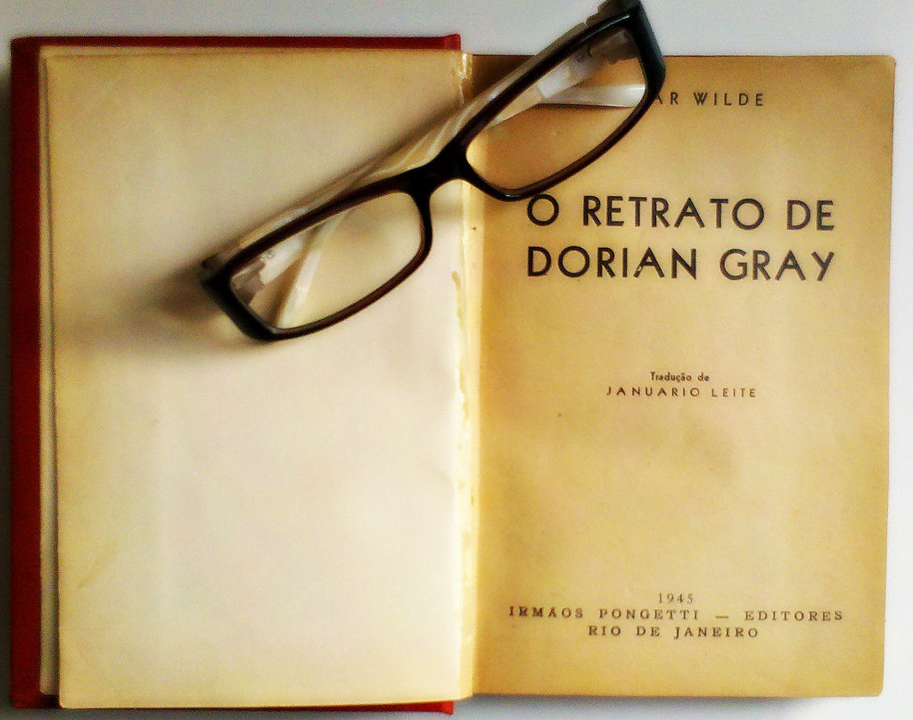

Sabe quando você ouve um jovem (ou até um adulto) entoar aquele trecho do Lulu: *"Vamos viver tudo que há para viver?"*

Dorian Gray é personificação desse espírito que quer viver tudo e corre em direção ao prazer. Um hedonista em todos os sentidos. Mas isso o leva a ficar cada vez mais longe da moral e se tornar um monstro atormentado pela culpa. O mais interessante você já sabe: ele não envelhece.

### **3. Os Irmãos Karamazov – Fiódor Dostoiévski**

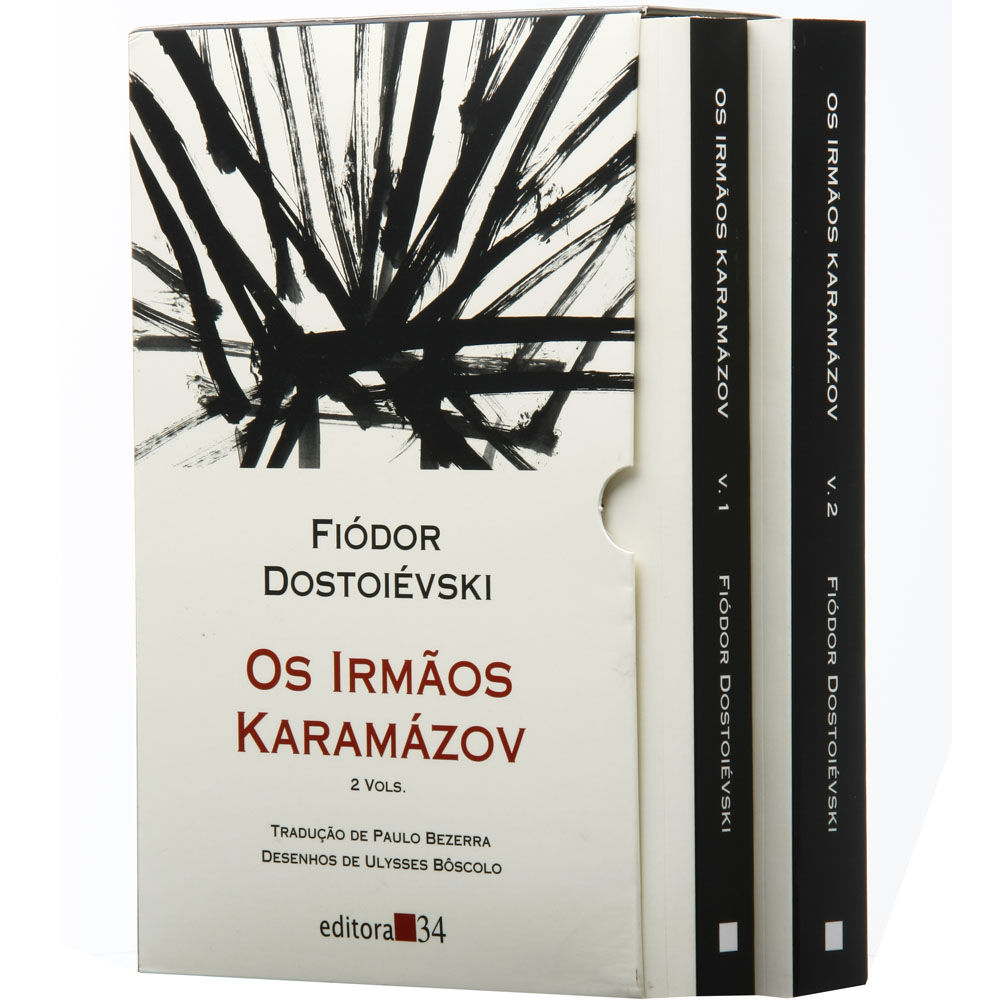

Ok, este é um livro um pouco grande e vai lhe tomar um tempo.

A história é dos irmãos abandonados pelo pai e com personalidades singulares. Todos os três irmãos, assim como o pai, são minuciosamente detalhados em seus conflitos psicológicos e embates pessoais.

### **4. O Pequeno Príncipe - Antoine de Saint-Exupéry**

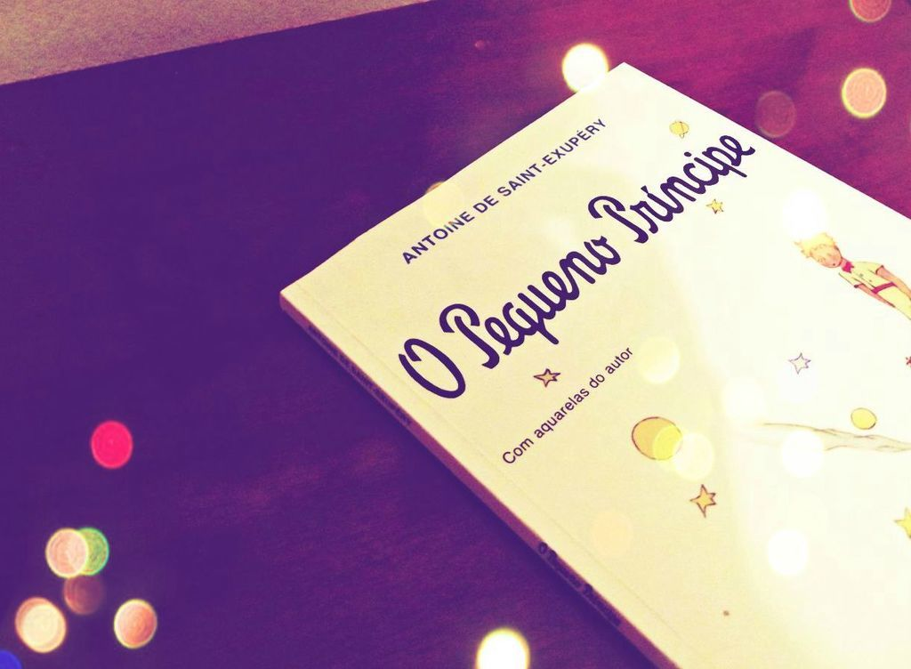

O livro infantil mais adulto que existe – e que já virou [filme](https://www.youtube.com/watch?v=Zl0S927VD3Q).

Foda-se se o fenômeno do twitter, padre Fábio de Melo, já se declarou contra o livro. Você deveria ler esse livro uma vez por ano (ou mais) para entrar em contato com sua inocência e nunca se esquecer da beleza e importância de coisas bem singelas.

### **5. Admirável Mundo Novo – Aldous Huxley**

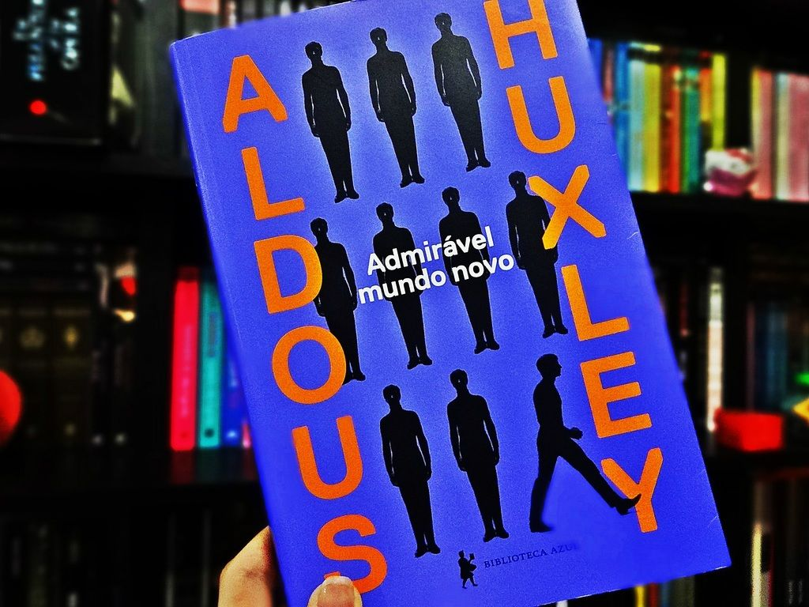

Esqueça as distopias que você conheceu com Jogas Vorazes e Divergente. Uma distopia com um mundo visivelmente arruinado e injusto é bem fácil. O distópico se disfarça numa sociedade perfeita, em que ninguém sofre mais. Onde todos fazem aquilo que amam e foram criados para fazer.

Aqui todas as pessoas são lindas. Apenas a verdadeira rebeldia, aquela que surge do questionamento e não da raiva, pode se sobressair.

### **6. Guia do Mochileiro das Galáxias – Douglas Adams**

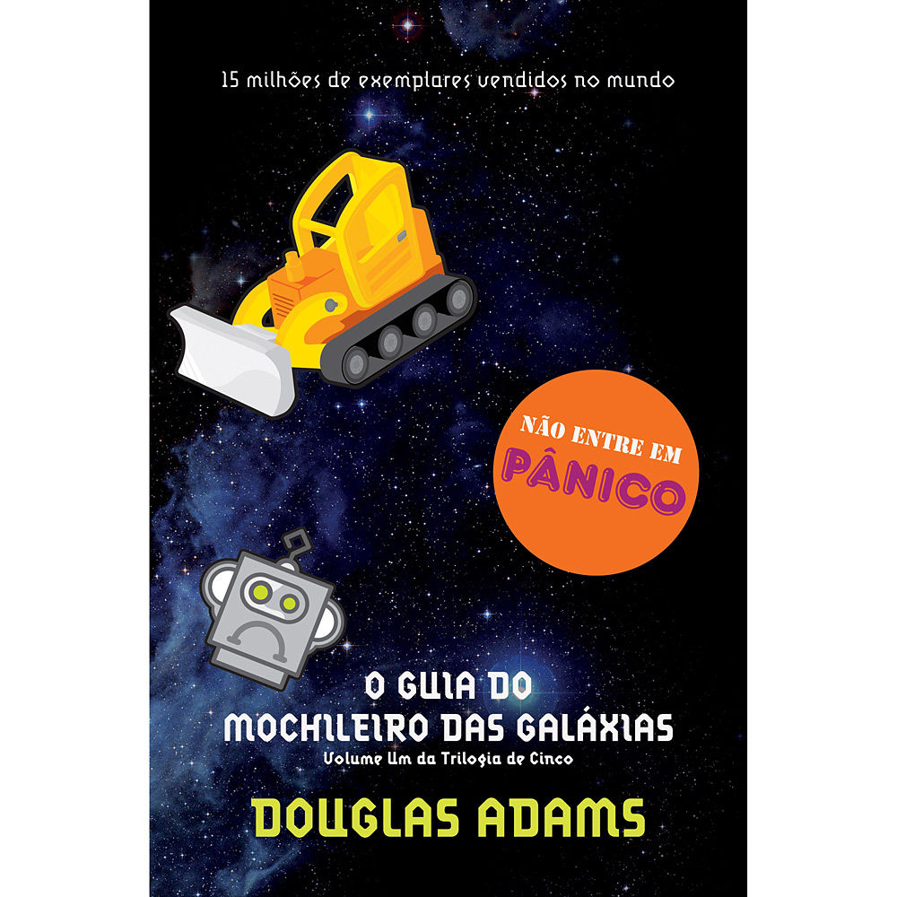

Sim. Um livro para não levar a sério, e ao mesmo tempo levar a sério. Na trilogia de cinco de Douglas Adams ele faz diversas observações e críticas, por vezes ácidas, sobre a sociedade, política, religião e tudo o mais.

### **7. Clube da Luta – Chuck Palanhiuk**

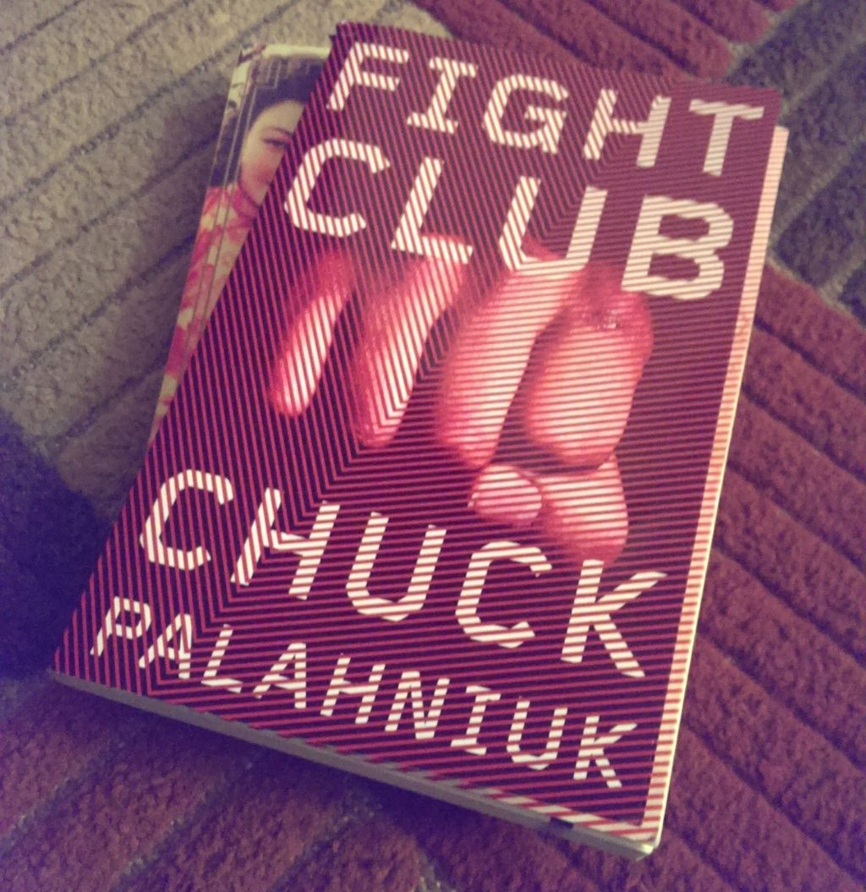

Desculpe, mas não posso falar dele.

### 5 Livros para ler pelo prazer da leitura

### **8. Coleção A Torre Negra – Stephen King**

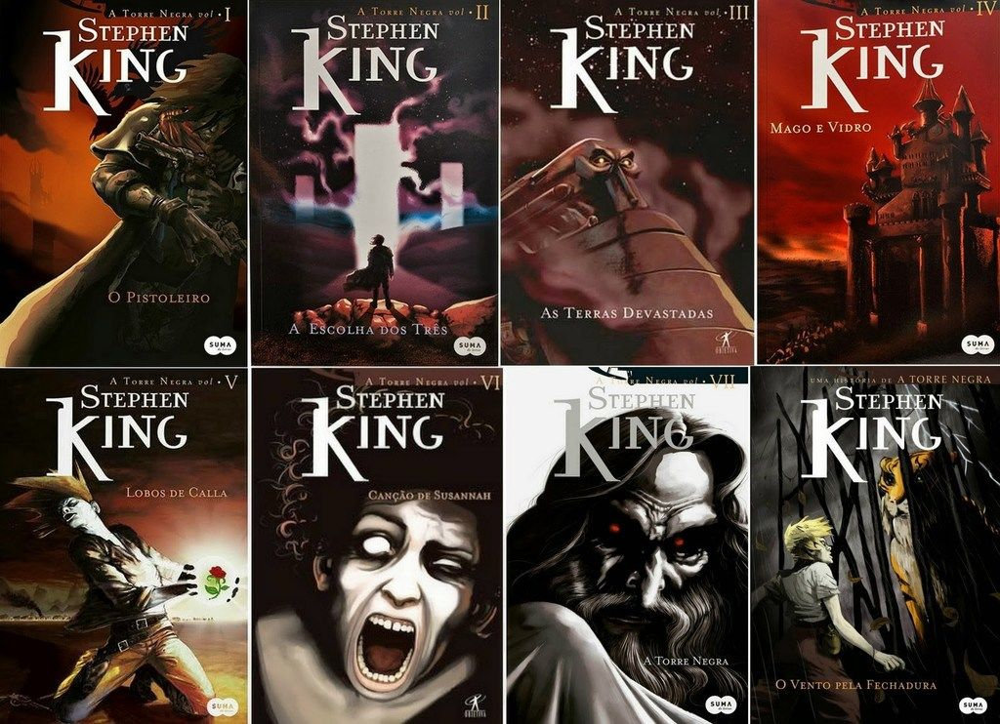

Tudo bem, são sete livros aqui e não um.

Trapaça? Talvez. Mas a Torre Negra não é um livro para se ler isolado, e se quer aproveitar completamente as aventuras de Roland e seu *ka-tet* é bom ler toda a obra.

Se eu tivesse que recomendar só um deles, diria para ler Mago e Vidro (livro 4) que é de longe o melhor dos sete e onde conhecemos as motivações e o passado de Roland Deschain.

### **9. As vantagens de ser invisível - Stephen Chbosky**

Um livro *teen*, para você ler e lembrar de todos os problemas da adolescência. Sim, aqueles problemas que somem quando você arruma um emprego. E lembrar também das suas experiências com os amigos.

### **10. Na Estrada – Jack Kerouack**

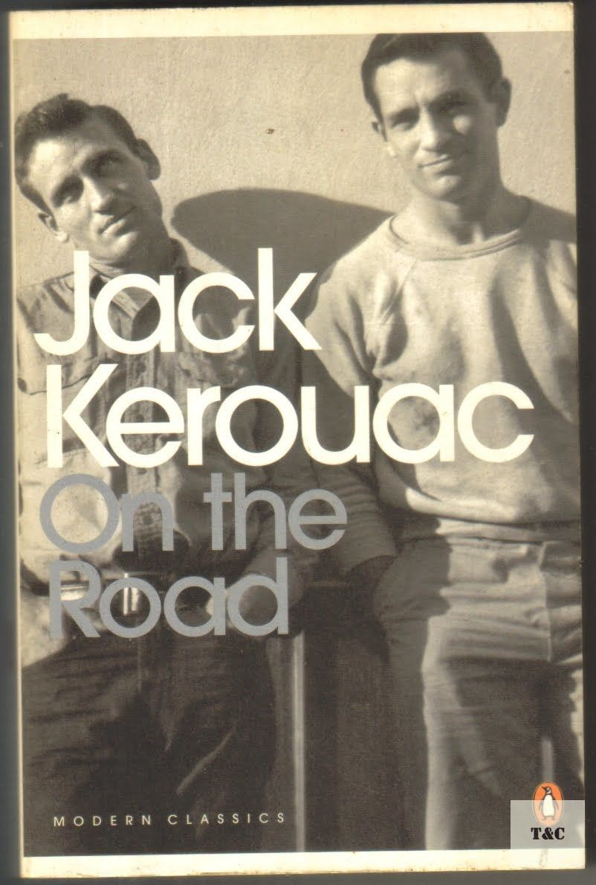

Dois amigos e uma gatinha cruzando o país, com jazz e drogas. Em meio a idas e vindas, Sal Paradise (alter ego de Jack) se conhece enquanto conhece os Estados Unidos e até o México com o malandro Dean Moriarty. Um livro sobre a estrada e sobre o amadurecimento. Livro que inspirou grandes nomes da música e do cinema.

### **11. Feliz Ano Velho – Marcelo Rubens Paiva**

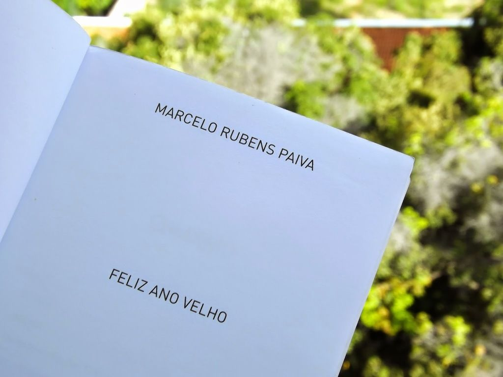

A autobiografia de Marcelo Rubens Paiva começa no momento em que ele mergulha e fratura a coluna. A partir disso acompanhamos sua trajetória nos hospitais e suas lembranças de infância, do pai desaparecido e de seus amores.

### **12. Mulheres – Charles Bukowski**

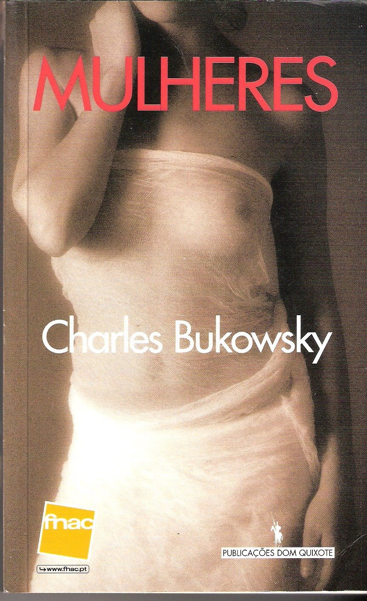

Escrito de forma rude, sem poupar palavrões ou tentar esconder o vício de Henry Chinaski (alter ego de Bukowski) em álcool e alguns tipos de drogas. Muitas vezes tratando as mulheres como objetos. Outras se mostrando sensível atrás da casca de velho ranzinza.

É um bom livro para passar o tempo.

### **6 Livros de/sobre filosofia**

### **13. O anticristo –** **Friedrich Nietzsche**

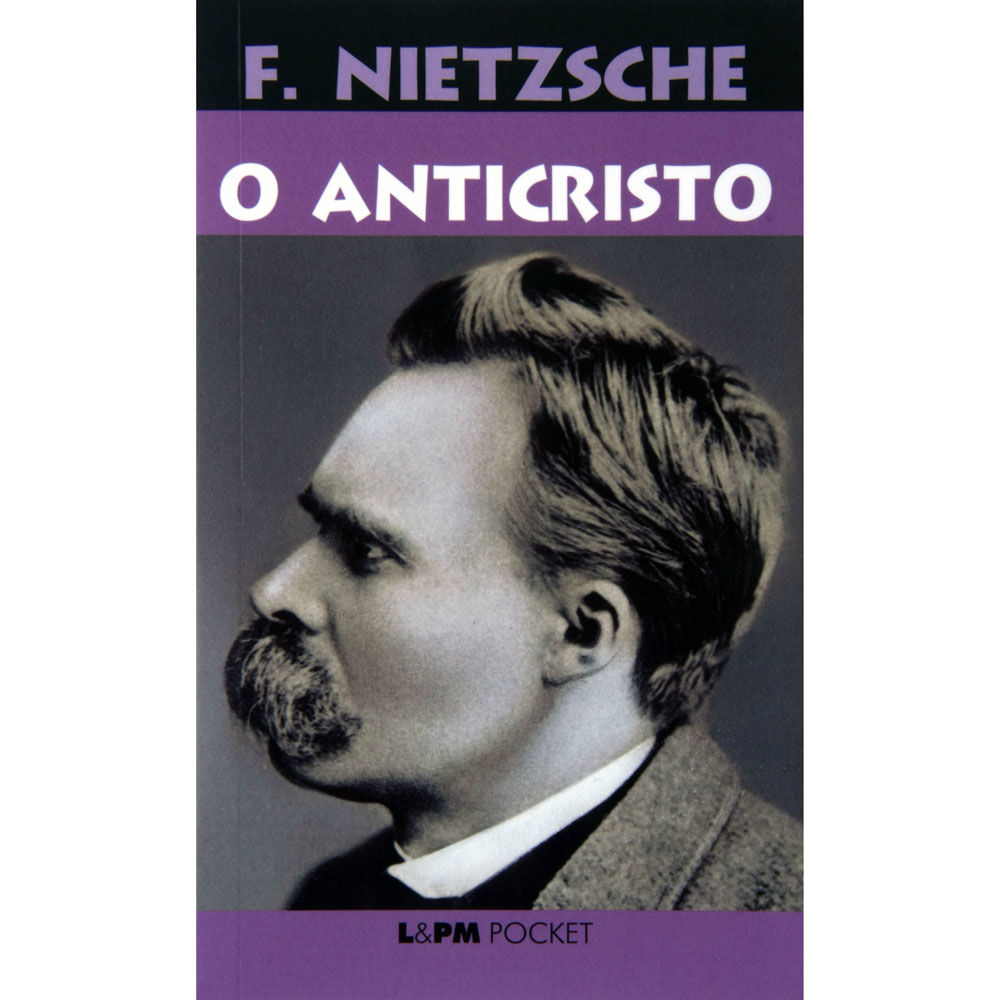

Desde o início do livro, o filosofo bigodudo se mostra contrário aos valores cristãos. Para ele a religião rebaixava o homem e o tornava fraco, nivelando-o por baixo com uma ideia equivocada de humildade.

Ao longo do livro as explicações se tornam mais profundas.

### **14. Discurso sobre o método – René Descartes**

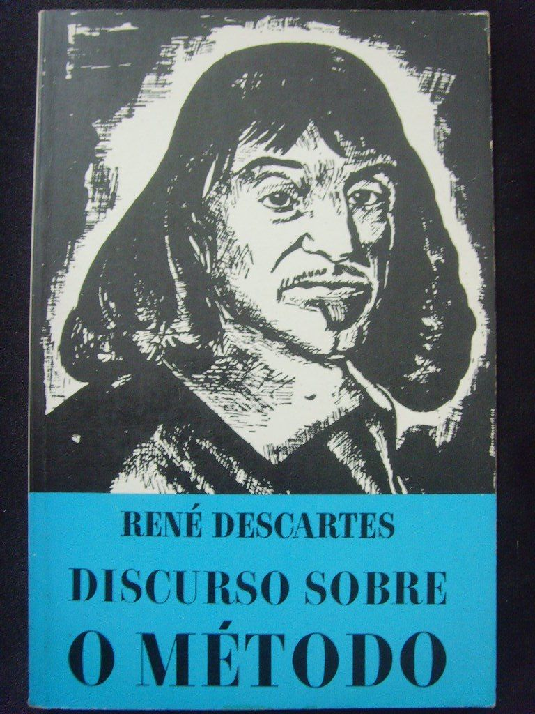

Traz um conceito bem simples, que é o de autoridade da razão e como alcançar a verdade a partir de um raciocínio lógico dividido em quatro preceitos.

Durante o livro René utiliza o método e aplica-o em si mesmo. Ótimo para aprender mais sobre o pensar.

### **15. Contra um mundo melhor – Luiz Felipe Pondé**

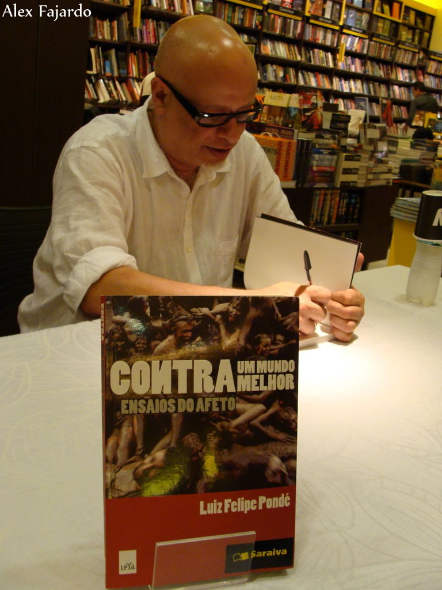

Um livro de ensaios, argumentando fortemente contra um mundo melhor. Sim, contra um mundo melhor. Você não precisa concordar com Pondé, mas lê-lo com certeza vai atiçar sua inteligência e te fazer querer argumentar, mesmo que contra.

### **16. O Príncipe – Nicolau Maquiavel**

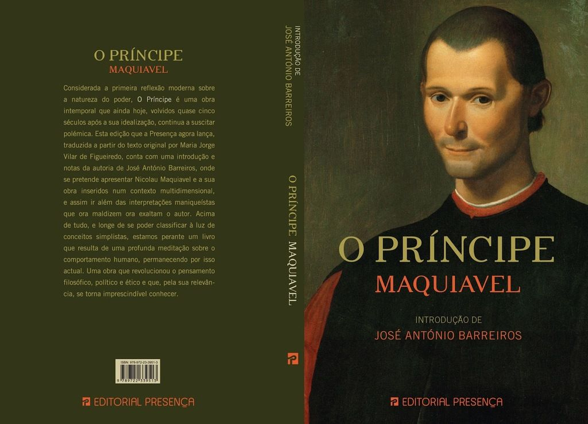

Um livro sobre o governo e sobre como governar. A ideia que tirada ao se ler de forma rasa é de um governo absolutista onde os “fins justificam os meios”.

Para entender completamente o livro lembre-se que ele foi escrito para um governante da Itália Renascentista, em outro contexto. Leia e absorva o que lhe for conveniente.

### **17. O ser e o nada – Jean-Paul Sartre**

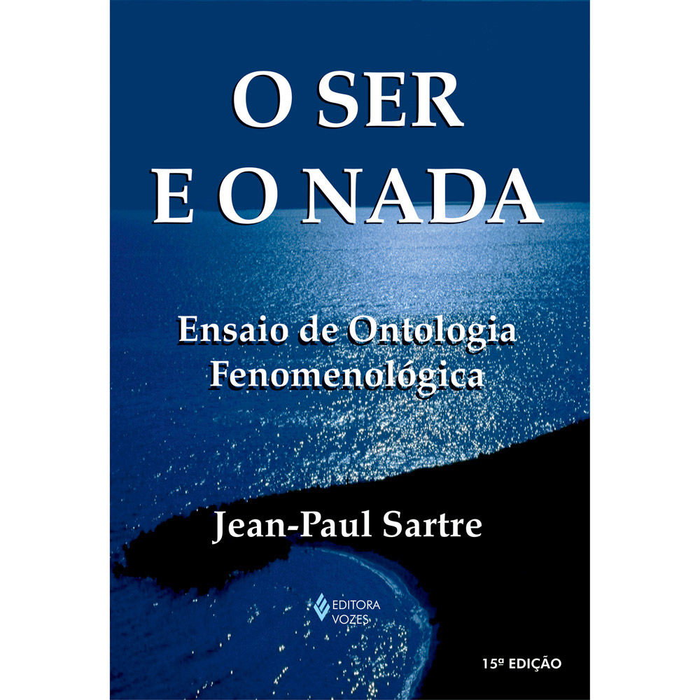

Responda rápido: o homem é o ser ou o nada?

Se você disse “o nada”, você acertou. Ao menos de acordo com Sartre. Não somos nada e por isso podemos ser tudo, e veja bem: essa possibilidade é assustadora.

### **18. A arte da guerra - Sun Tzu**

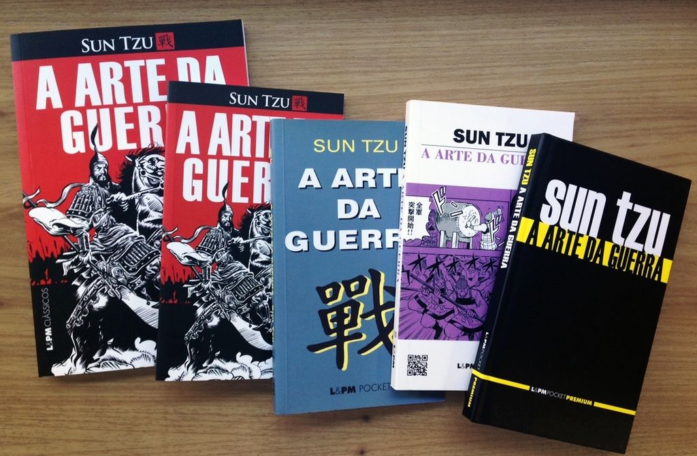

Verdade seja dita: com o tempo esse livro foi banalizado e muitas pessoas o veem como um livro de autoajuda, mas é um dos maiores estudos sobre estratégia militar já feito. Estratégias que ainda são adotadas, inclusive no mundo dos negócios.

### **3 Livros sobre ciência**

### **19. Uma breve história do tempo – Stephen Hawking**

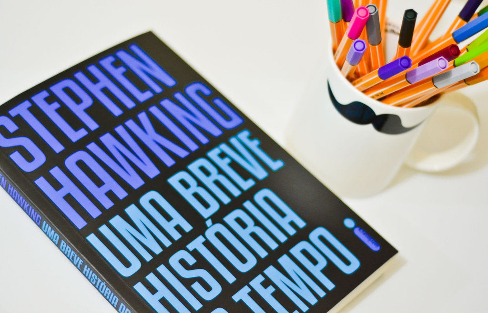

De Aristóteles até a física moderna muita coisa mudou. Hawking nos conduz por essas mudanças, mostra a incompatibilidade da relatividade e da mecânica quântica, fala dos buracos de minhoca, e da quarta dimensão: o tempo.

Tudo isso em uma linguagem bem acessível, ótimo para aprender mais sobre “a vida, o universo e tudo mais”.

### **20. O universo elegante – Brian Greene**

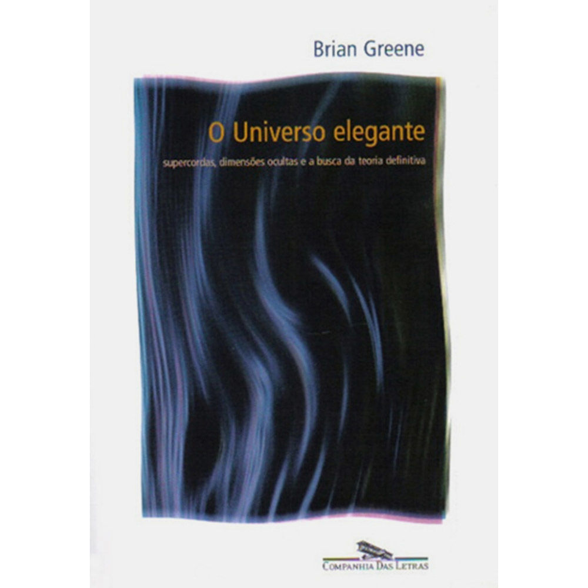

O livro também nos mostra incompatibilidade da física mecânica com a relatividade, mas nos apresenta também uma possível solução: a teoria das cordas.

A obra nos explica de forma simplificada a teoria das cordas e sua influência em toda a física moderna.

### **21. O mundo assombrado pelos demônios – Carl Sagan**

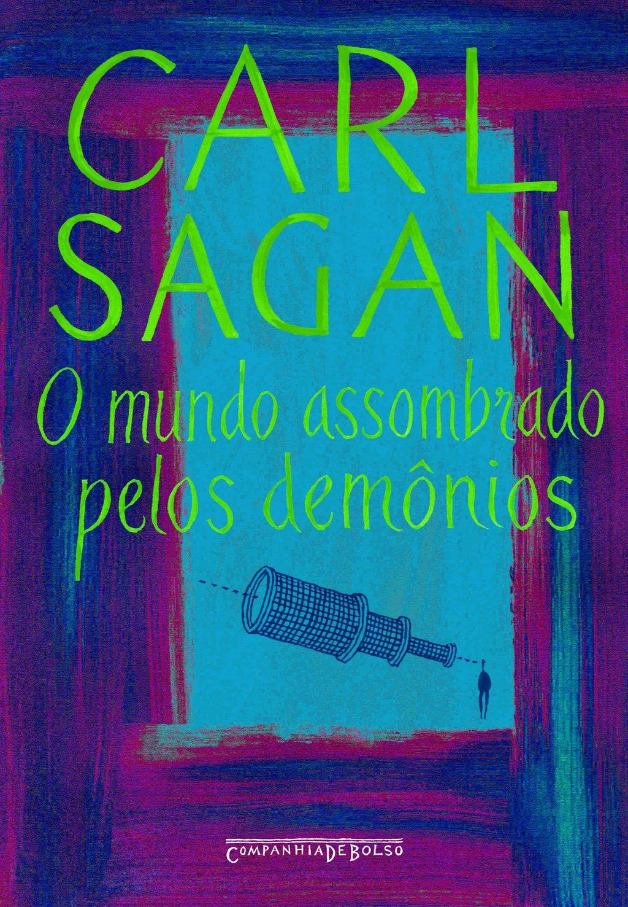

Exercite seu ceticismo e criticismo. Questione as coisas, especialmente as que parecem mais certas e lembre-se que nenhuma verdade é absoluta. E deixe as crianças fazerem perguntas.

### **4 Livros para ser alguém melhor**

### **22. Eu sou o Mensageiro – Markus Zusak**

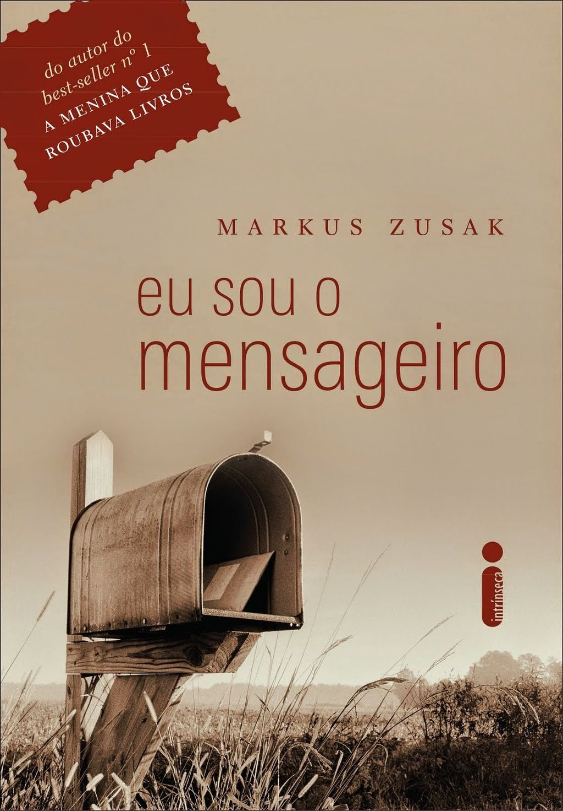

Do mesmo autor de A Menina que Roubava Livros, este livro é uma pérola de empatia. O que um jovem, de dezenove anos, se sentindo um fracassado, pode fazer de bom?Talvez ajudar uma velha solitária ou impedir um estupro.

E se, no fim, a resposta para a vida for a empatia ao invés da indiferença do Estrangeiro? Ed Kennedy é o mensageiro que, em meio a socos, choros e ases de baralho traz uma mensagem: amor.

### **23. O lado bom da vida - Matthew Quick**

Pat Peoples acabou de sair do hospital psiquiátrico disposto a se tornar uma versão melhor de si mesmo para reconquistar sua ex-mulher. Afinal, se você acreditar e pensar positivo você consegue, não é? A crença dele é tão forte e simples, que é impossível não se deixar levar por ele nessa empreitada.

### **24. O Demônio e a Srta. Prim – Paulo Coelho**

Você pode torcer o nariz por eu colocar um livro do Paulo Coelho aqui. Eu também torceria. Mas em O Demônio e Srta. Prim, somos colocados num debate moral juntos com uma vila inteira: sacrificar uma pessoa velha e fraca para que todos no vilarejo ganhem muito dinheiro, ou perder o dinheiro e deixa-la viver?

Essa é a proposta que um forasteiro propõe a Srta. Prim e toda sua vila.

### **25. Harry Potter –  J.K Rowling**

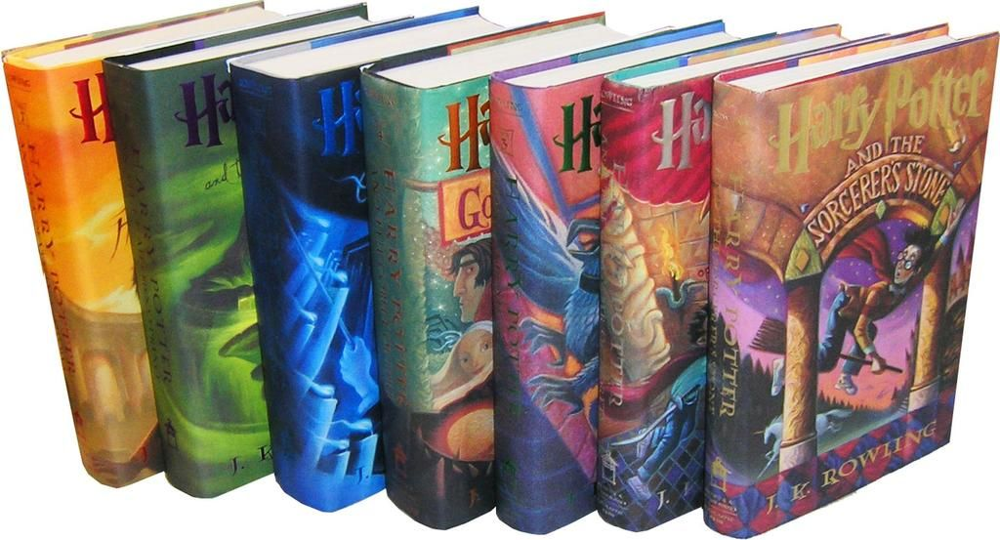

Outra coleção, sim. Infanto juvenil, sim. Por quê?

Já foi dito que jovens que leem Harry Potter são menos preconceituosos. E pra quem conhece a série isso faz bastante sentido. Só por isso.

E você, gosta de ler? O que já leu e recomenda? Vamos levar essa conversa aos comentários.

---

*publicado em 06 de Fevereiro de 2016, 00:05*
