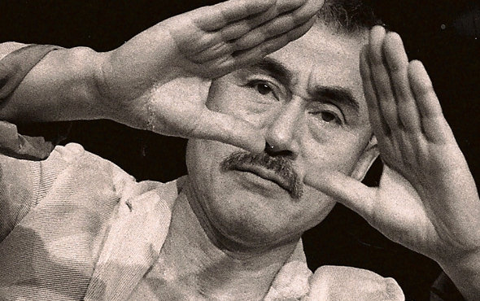
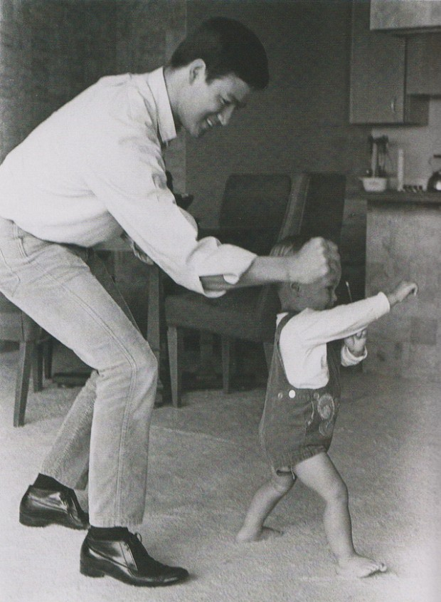

# Como encontrar um bom professor de artes marciais

Eu tive muitos professores de artes marciais nesses anos como praticante. Na juventude, meu critério era tão simples quanto perguntar se meus amigos conheciam alguém bom. Recebendo alguma confirmação, saia em busca das indicações, treinava bastante por um tempo e questionava técnicas e comportamentos. Eventualmente, percebia alguma falta de coerência e saia em busca de outro.

Em 2001, eu desisti das artes marciais, achando que era um caminho ruim, pois o final dos praticantes de referência com quem tive contato não era muito feliz. Recebi notícias de mortes por tiro ou facadas em brigas, excessos com drogas e até um campeão que tornou-se alcoólatra.

Alguns, com um pouco mais de sorte, não tiveram um destino tão trágico, mas eram falastrões, aumentavam suas histórias, viviam criticando negativamente os outros etc.

Minha principal dificuldade era não encontrar uma coerência, um equilíbrio, entre habilidade, técnica e comportamento.

Mas tentei novamente (pela última vez, eu me dizia). Um primo me ajudou a pesquisar na internet e me esforcei para ser um pouco mais criterioso dessa vez.

Compartilho aqui alguns desses critérios que acabei adotando.

### 1. Acompanhar atentamente e com calma

> "No Japão há um ditado que diz que é melhor gastar três anos procurando por um bom professor do que ocupar o mesmo período de tempo fazendo exercícios com alguém inferior." –Yoshi Oida

É preciso tempo para poder avaliar as qualidades de um bom professor. Você dificilmente vai conseguir entender os métodos, técnicas e abordagens sendo apressado.

Às vezes, uma boa instrução pode demorar para ser digerida e até mesmo fazer soar um alarme, deixar você desconfiado de maneira equivocada, podendo levá-lo a desistir cedo de algo valioso. Ao mesmo tempo, você pode apostar prematuramente as suas fichas e se dedicar a um ambiente nocivo por não ter avaliado calmamente o mestre. O tempo pode ajudar a dissolver esses enganos.

Se formos com pressa nas nossas avaliações, podemos tanto perder tempo com um professor ruim, como podemos abandonar cedo demais um professor bom.

### 2. Entender e conhecer a linhagem

As artes marciais foram tradicionalmente passadas de forma oral, de mestre pra aluno, por incontáveis gerações. A linhagem é uma forma de verificar a qualidade daquele método pelo qual o professor ensina. De onde ele saiu, quem o ensinou, quem o autorizou, por sua vez, a ensinar?

Conhecer a linhagem ajuda você a compreender qual o contexto daquele método, sua história e até mesmo conhecer outros professores vivos que também detenham aqueles conhecimentos.

Isso não significa que todos os professores dentro de uma mesma linhagem ensinem rigorosamente do mesmo jeito, nem que ser rígido com as tradições seja em si uma característica positiva. Cada professor tem liberdade de ensinar por métodos com suas próprias particularidades. Porém, saber quem veio antes pode ser útil para compreender e até mesmo confiar.

### 3. Observar os alunos e quem está ao seu redor

Se a linhagem é uma forma de saber de onde veio o professor, observar os alunos é um meio de saber a qualidade dos ensinamentos dele por meio dos frutos que gera.

Em geral, quando observamos nos alunos uma competitividade nociva, arrogância, raiva, falta de empatia e bom senso, isso de certa forma costuma estar associado à uma postura de incentivo ou omissão do professor.

Se olharmos atentamente os alunos mais velhos, veremos que ali está um espelho das qualidades do mestre.

### 4. Atentar à relação que ele estabelece com outros professores e linhagens

Um aspecto que me chama bastante atenção nos mestres é uma grande abertura e curiosidade em relação aos outros artistas marciais. Admiro quando um professor mantém um brilho natural e consegue se relacionar sem medos e reconhecer que não sabe de tudo, indo além das rivalidades entre escolas que são historicamente conhecidas no meio.

Um amigo me mostrou esse vídeo dos mestres [Tuhon Pat O'Malley](http://www.rapidarnis.com/Tuhon_Pat_OMalley.html), [Guru Maul Mornie](http://www.silatsuffian.com/2009/01/about-maul-mornie.html) e [Gurdev Nihang Nidar Singh](http://nidarsingh.com/) conversando entre si, trocando conhecimentos sobre as suas artes. Fico emocionado de assisti-los. Essa relação está muito além da paranoia de técnica, de quem é melhor ou pior, de fanatismo ou sectarismo.

*[Link Youtube](http://youtu.be/Ve_P8oOcNco) | Três mestres de diferentes conversando e praticando juntos (o relato a partir dos 7:50 é bem legal)*

### 5. Contemplar o espírito de aprendiz no professor

Assim como grandes professores são abertos com outros estilos, eles costumam manter a mesma curiosidade dentro da própria prática.

É comum que eles treinem com seus alunos ou visitantes, não para fazer um show de habilidades de forma egocêntrica, mas sim por que gostam muito de estar ali e, por isso, se posicionam como aprendizes, testando, praticando, avançando junto com todos.

Às vezes o fazem, mesmo quando já não têm tanto vigor físico, em função da idade. Isso ocorre porque carregam uma jovialidade em suas mentes, são conscientes de suas limitações físicas e possuem essa energia, essa presença. Eu acho isso fantástico, admirável.

Mesmo não sabendo praticamente nada de Kendo, admiro mestres de qualquer estilo com essa postura em idade avançada. É o caso do Sensei Taniguchi, com 82 anos na época, no vídeo abaixo. O corpo pode perder o vigor, envelhecer, mas parece que existe um espírito marcial que está além do físico e essa energia surge de algum lugar e não envelhece com o corpo. Chego a ficar com lágrimas nos olhos de assistir este e outros mestres assim.

[Link Youtube](http://youtu.be/rcBf9XUrsJw)

### 6. Procurar pelo coração do professor

Infelizmente, há vários ambientes de treino no qual as artes marciais ou o benefício do aluno não são prioridade. Não que isso seja em si algo equivocado, mas talvez essa não seja a melhor forma de assimilar os aspectos mais profundos das artes marciais.

Uma boa forma de enxergar se o ambiente é positivo ou não é procurar direto pelo coração do professor, tentar ver qual a motivação por trás da ação.

Todos os professores mais importantes da minha vida tinham uma característica em comum: eu tinha a nítida impressão de que eles ensinavam com o coração. Sentia que desejavam de verdade meu desenvolvimento, não me olhavam de forma utilitária, *“ah, mais uma mensalidade entrando*, mas sim como um ser humano, com sentimentos e emoções como todos os outros.

Esses mestres me acolheram como um irmão ou filho. Com eles eu senti que avancei muito tecnicamente, mas principalmente como ser humano.

Esse é um guia feito com base nas minhas experiências com as artes marciais. Foram anos errando e quebrando a cara até chegar a ter um mínimo critério nas minhas escolhas. Mas – importante frisar – de forma alguma considero esses parâmetros um manual infalível. Com certeza deve ter muito mais a ser adicionado e várias outras experiências diferentes da minha que poderiam contribuir com esse guia.

Então, já pergunto, quais as experiências de vocês com relação à escolha de professores de artes marciais? Adicionariam ou removeriam algo da lista?

O papo segue nos comentários.

### [Se inscreva no seminário de meu professor no Brasil](http://gileanes.com.br/seminario-com-sifu-cemil-uylukcu-maio-2014/)

Cemil Uylukçu é turco, professor de Escrima e Wing Chun, fundador da ProWes. Hoje ele viaja o mundo ensinando esses estilos. Daqui a uma semana, no dia 17 e 18 de maio, ele [estará em São Paulo e Joinville oferecendo seminários](http://gileanes.com.br/seminario-com-sifu-cemil-uylukcu-maio-2014/).

Gostaria de convidar a todos para conhecerem um pouco desse mestre em quem coloco confiança. É uma ótima oportunidade de experimentar, conhecer e até começar a praticar, tanto para principiantes e praticantes experientes de qualquer estilo ou linhagem.

Abaixo, um vídeo que filmamos com ele há um ano, no qual ele conta um pouco sobre sua vida e visão nas artes marciais.

*[Link Youtube](http://youtu.be/zQRJJ_1jXBI)*

**Local:** São Paulo, Dojo Harmonia (Rua dos Cariris, 13, Pinheiros). Joinville, Academia Storm (Rua Tuiuti nº 884, Bairro Aventureiro).

**Duração:** Manhã e tarde.

**Data:**São Paulo, 17/05. Joinville, 18/05.

**Valor:** R$200,00 (dia todo), R$150,00 (Wing Chun, tarde), R$100,00 (Escrima, manhã).

Ainda há vagas para São Paulo e Joinville. [Faça sua inscrição aqui.](http://gileanes.com.br/seminario-com-sifu-cemil-uylukcu-maio-2014/)

---

*publicado em 10 de Maio de 2014, 16:39*
