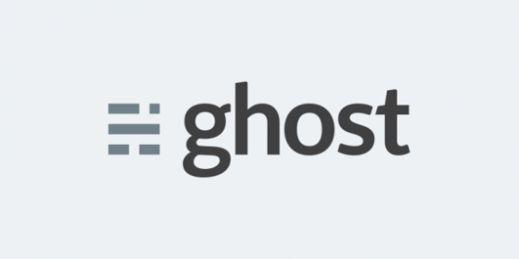
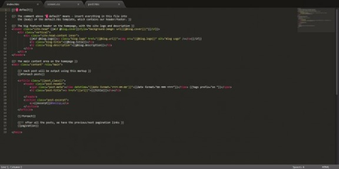
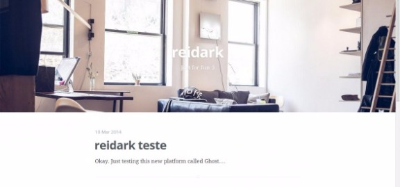
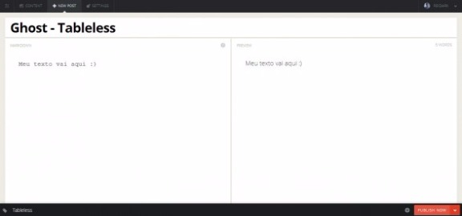
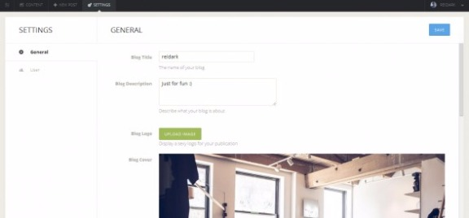

# Ghost – A simples e perfeita plataforma para publicações

[18 comentários](http://tableless.com.br/ghost-simples-e-perfeita-plataforma-para-publicacoes/#disqus_thread)
 por [Victor "reidark" Matias](http://tableless.com.br/author/victormatiasrei/ "Posts de Victor ")

Descobrir novas plataformas é um barato pra mim. Estar envolvido no que aparece de novo na internet é algo simplesmente prazeroso. Ideias de outras pessoas me impressionam, até quando parece ser algo tão simples, mas, por ser tão simples, é que é especial.

Caros amigos e amigas, venho lhes apresentar a nova (não tão nova assim) plataforma para blogging/publicações na web: **[Ghost](https://ghost.org/)**.

## Ghost, simplificando o que há de complicado.

[](http://tableless.com.br/wp-content/uploads/2014/03/ghost.png)

  
Eu não sei vocês, mas nunca fui fã de rezar terço do WordPress. Claro, não estou tirando mérito nenhum da plataforma, e a discussão nem é pra isso (longe de mim). Apenas quero enfatizar que, para pequenas aplicações e blogs, o WordPress, algumas vezes (principalmente pra quem não tem muita expêriencia) acaba sendo um tiro no escuro.

E, sem mais, nem menos, foi pra isso que surgiu a plataforma Ghost: “*just a blogging platform*“.

Assim como outras plataformas, ela é open-source e você pode fazer exatamente o que quiser com ela (eu, particularmente, odeio alterar o “core” das plataformas, mas sinta-se em casa).  
Foi um projeto tão bacana que teve iniciativa na Kickstarter, apenas para criarem o projeto. O resultado a gente já sabe, conseguiram os fundos necessários e trouxeram a plataforma viva.

O projeto do Kickstater pode ser visto [aqui](https://www.kickstarter.com/projects/johnonolan/ghost-just-a-blogging-platform) (*This project was successfully funded on May 28, 2013*).

## Como ele funciona

Ghost é uma plataforma que não utiliza banco de dados, se assim posso dizer, eles trabalham com o node.js, que, utilizando as próprias palavras da equipe do Node.js, é o seguinte:

“*Node.js usa um modelo de I/O direcionada a evento não bloqueante que o torna leve e eficiente, ideal para aplicações em tempo real com troca intensa de dados através de dispositivos distribuídos.*”

Lembrando que, para surpresa de alguns (ah, nem tanto), node.js roda Javascript no server-side e não no client-side.

Ghost, assim como o WordPress e outras plataformas, está disponível para criar online (com amostra grátis de 30 dias) apenas para você ver como o serviço funciona, e, a que vamos usar, para você fazer o download dos arquivos e editar no seu próprio computador (localhost) e subir online aonde você desejar.

Caso você queira se aventurar agora mesmo e já ir fuçando, deixarei o link para o download e doc aqui: [Ghost – Downloads and Docs](http://docs.ghost.org/pt-BR/installation/)

*Mas eu nunca rodei node.js no meu computador, como faço?*

Calma amigo, o próprio Ghost já adiantou 500 pedras e disponibilizou um tutorial show de bola online para você rodar o node.js na sua máquina, seja ela Windows, Mac ou Linux. Para ver esse tutorial [entra aqui](http://docs.ghost.org/pt-BR/installation/).

## Desenvolvendo no paraíso…

Ok, ok, não ataquem pedras, sei que exagerei um pouquinho, rs. Mas, brincadeiras à parte, desenvolver no Ghost é extramente gostoso. Eles tem [uma simples documentação para desenvolvedores](http://docs.ghost.org/usage/settings/) para você conferir o que pode usar ou não no seu tema. E é aqui que entra a parte simples do Ghost, que o torna prático e eficaz, o “código-fonte” dele é o básico do básico (extremamente fácil de editar e fazer um tema próprio).

[](http://tableless.com.br/wp-content/uploads/2014/03/Ghost-Fonte.jpg)

E para criar seu próprio tema é mais ainda, basta *reescrever* o tema que vem default nele, chamado de “casper” (lembrando que isso é indicação do próprio criador do Ghost para quem deseja criar seu próprio tema).

Apenas tenha em mente que os arquivos de tema seguem uma hierarquia (e eu aconselho você a não se aventurar em mudar isso) que é:

```
1. ├── /assets
2. |   └── /css
3. |       ├── screen.css
4. |   ├── /fonts
5. |   ├── /images
6. |   ├── /js
7. ├── default.hbs
8. ├── index.hbs [required]
9. └── post.hbs [required]
```

E caso você queira surfar um pouco mais na criação de temas para Ghost, recomendo com alto nível de prioridade você ler esse doc: [How To Make Ghost Themes](http://docs.ghost.org/themes/).

## Publicações e visão geral

Olha, eu simplesmente adorei o design do layout default do Ghost. Pra alguém que deseja apenas um blog, só pra postar algumas coisinhas, é um tema perfeito, você não vai precisar sair comprando ou pedindo para alguém criar algum tema para você, o casper (tema padrão) dá conta muito bem do recado.

[](http://tableless.com.br/wp-content/uploads/2014/03/Ghost-Index.jpg)

A forma de publicar é simples, você escreve seu post, seguindo as normas de HTML para marcações, como utilizar `hgroup (H1 / H2 / H3 ...)`, `(img)`, `(a)`, e assim por diante…

[](http://tableless.com.br/wp-content/uploads/2014/03/Ghost-Post.jpg)

Contando também que ele oferece o sistema de url amigável e também criar posts como páginas estáticas, e que, todo post vem com 3 redes sociais para o usuário poder compartilhar: Facebook, Twitter e Google+.

A página para editar as configurações é bem intuitiva e você pode fazer várias alterações bacanas, como trocar facilmente a imagem de fundo do header do seu site.

[](http://tableless.com.br/wp-content/uploads/2014/03/Ghost-Settings.jpg)

Você também pode adicionar informação ao seu usuário, como foto, email, website, biografia, e assim, essas informações aparecerão no final de todo post de sua autoria. Bacana né?

## Pequeno impasse…

Não é um problema, na realidade, longe disso, mas colocar seu tema online não é tão fácil assim. Mas não se assuste, estou apenas falando que não é tão fácil quanto fazer upload dos arquivos por FTP e o site/blog já está rodando zero bala.

Como Ghost usa do node.js para poder funcionar, precisamos rodar nosso blog em um local onde node.js esteja instalado e possa ser rodado, que é o caso da Nuvem, Dedicados ou até mesmo do seu computador com DNS para internet.

Pra ficar mais fácil eles disponibilizaram um tutorial para explicar como funciona, que você pode ver [aqui](http://docs.ghost.org/installation/deploy/).

### Fazendo do jeito mais fácil

Eu, como não sou nada experiente em dedicados e cloud, uso o serviço que a própria Ghost oferece.  
Você paga por mês 5 doláres para ter acesso há 1 blog com máximo de 10000 visitas por mês. Então, eu simplesmente faço o tema do meu blog no meu computador local, depois eu faço o upload do meu tema pra “hospedagem” hosteada pela Ghost, simples e fácil, em dois palitos eu tenho meu tema online sem nenhuma dificuldade (sem ter que ficar configurado node.js pra lá e pra cá, rsrs).

Caso queira fazer como eu, verifique na sua conta [os seus planos](https://ghost.org/settings/billing/), ai você assinar qual ser mais viável pro seu bolso e utilidades.

## Comentários Gerais

Aguarde, o futuro do Ghost é apenas crescer mais e mais, isso é certeza. Não se sabe o que se pode fazer com a plataforma, porque mesmo sendo para blogging, já vi alguns temas exóticos de pessoas usando para publicar trabalhos de portfólio e tudo mais. Por isso, dê uma chance ao Ghost, quem sabe não rola algum sentimento, não é?

Com todo perdão ao meu exagero, mas estou apaixonado por essa plataforma. Tive que vir fazer esse post de “apresentação” , apenas para vocês ficarem sabendo e criarem o interesse de ir buscar novas informações e regalias dessa nova plataforma.

Irei deixar alguns links úteis, caso queiram visitar:

Ghost, Site Official – [Entrar](https://ghost.org/)  
Ghost, Instalação e Docs – [Entrar](http://docs.ghost.org/installation/)  
Ghost, Guia para criação de temas – [Entrar](http://docs.ghost.org/usage/)  
Ghost, Forum – [Entrar](https://ghost.org/forum/)  
Ghost on Github – [Fork](https://github.com/tryghost/Ghost) [anexo ausente]

É certeza que voltarei com mais tutoriais sobre a plataforma, sem sombra de dúvidas, foi por isso que primeiro trouxe uma rápida introdução para vocês ficarem à parte do que se trata o Ghost.

Publicado no dia  20 de março de 2014
