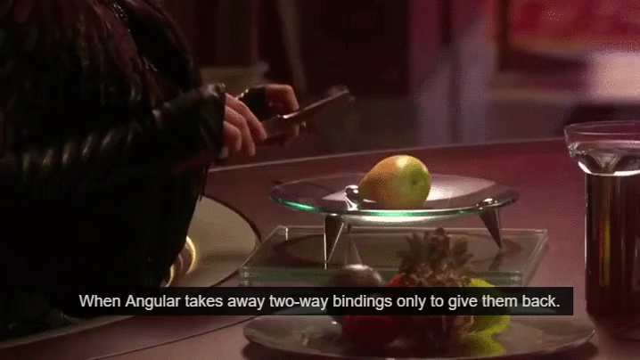

# Angular 2 You're Breaking My Heart

Angular 2's failures, frustrations, and potential fixes.

Published on at 8:12 pm

***Preface:*** *I give a fair amount of background here. Feel free to skip to my analysis further down for my actual thoughts on Angular 2.*

## Background


You’ll have to excuse me jumping on the Star Wars click-bait marketing bandwagon. In my defense, I chose one of the worst quotes in the franchise. It’s partly a joke, but in some ways the line, in all it’s cringe-inducing high-pitched Natalie Portmaning, accurately expresses my feelings about Angular.

After taking a brief coding break a couple weeks back (it was *Christmas* after all) I returned from my hiatus to find that Angular 2 had entered beta! I had been anticipating this release for a long time - I had long since declared Angular 1 to be the victor of the front-end framework war.

Admittedly the war was largely a religious one. Angular, Ember, Backbone all stomped their feet and declared their superiority, but ultimately they were just different sides of the same coin. Then React came along in all of its Zuckerbergian glory and disrupted everything. This was *Facebook-endorsed*. And, what’s that? *Server-side rendering!?!?!?*

That’s not to say that I’m not glad it’s out there - people are doing amazing things with React. Rather, my point is that all of the major front-end framework players can be used productively and with great success. Although they edge ahead of each other in certain respects, we as JS developers are blessed with several capable choices to pick from, and cross-framework criticism is overall pretty nit picky and opinion-based.

Angular did possess quite a few quirks and strange design choices, however. An experienced Angular developer would know these inside and out and dodge them with ease (careful with those watchers!), but at some point the Angular team took a step back and realized they simply weren’t satisfied with the state of Angular. So what was Angular 2 going to do? Start from scratch.

Many developers were outraged - they’d invested heavily in Angular and its way of thinking. Angular’s team soothingly assured that Angular 1.x would be maintained and that there would be a simple path for migration, all the while developing a new JS transpiler (Lord knows we don’t already have enough of those). Thankfully over the course of a year many kinks were smoothed out, AtScript was dropped in favor of TypeScript, and it looked like a thoughtful, comprehensive framework was coming to life.

## The Issues

When I first began a project with Angular 2 I was excited to see what the team had come up with. Angular 1 had sold me on its way of thinking long before and I was curious to see what had changed. It became pretty obvious pretty quickly that Angular 2 was something new entirely and bared almost no resemblance to its predecessor. The only obvious quality it retained was the binding of controllers to views via custom DOM elements and attributes. Even this similarity felt like a vain attempt by the developers to say, *See! It’s still Angular!*

*I’m going to break down my initial experiences with Angular 2 and the problems I faced. I’m mindful, however, that it’s still in beta, so take the issues with a grain of salt. I also propose some solutions further down, which I hope will be considered as relatively simple fixes to the challenges presented below.*

### Getting Started

[The Angular 2 documentation website](https://angular.io/docs/) has a 5 Minute Quickstart guide for new users. I chose to view the TypeScript version as it was the default guide and the most complete. It’s simple enough, but that’s because it encourages you to go through the motions of project setup with little understanding.

I’m told to copy and paste this starter package.json.

|  |  |
| --- | --- |
|  | ```   "name": "angular2-quickstart",   "version": "1.0.0",   "scripts": {     "start": "npm run lite",     "lite": "lite-server"  "license": "ISC",   "dependencies": {     "angular2": "2.0.0-beta.0",     "systemjs": "0.19.6",     "es6-promise": "^3.0.2",     "es6-shim": "^0.33.3",     "reflect-metadata": "0.1.2",     "rxjs": "5.0.0-beta.0",     "zone.js": "0.5.10"  "devDependencies": {     "lite-server": "^1.3.1" ``` |

But there’s no explanation in the main body or appendix of the significance of these dependiences. Are they core? Are they replacable? Are they just for TypeScript? I searched on Google for a while trying to find those answers.

The intro code and structure is comprehensive and helpful (though the guide’s author is a bit clever/borderline-sassy about the whole thing) and I’m mostly content with the 30 or so minutes I spent reading the whole thing. 5 minutes is a strech, but you know, marketing.

### TypeScript

With the almost complete ubiquity of transpilers like Babel and CoffeeScript, I figured I would fit easily into the TypeScript frame of mind. TypeScript, however, comes with far more baggage than I initially realized. For one, it requires its own JSON config file to compile. This is another mandatory copy-paste from the Angular quick start guide and while some of the field names are self-explanatory, others are less clear. What is the difference between `"module"` and `"moduleResolution"`? Again - some short Googling will rectify the knowledge gap, but this speaks to a larger issue.

Angular 2’s guide already expects you to know TypeScript. It doesn’t take the time to break down type annotation, or typings files, or even what distinguishes it from other ES6 transpilers like Babel. Some developers might be OK with this, having prior knowledge of TypeScript or the willingness to learn it on its own. I found it very disconcerting. While TypeScript’s examples aren’t exactly lacking, there are some very serious gaps.

For instance decorators, an ES7 proposal that makes up an integral part of Angular’s TypeScript syntax, are nowhere to be found on TypeScript’s website. If one jumps over to the TypeScript Specification on GitHub, scrolls through a couple of pages worth of table of contents, and finds the “Decorators” link, they will be taken to the bottom of the page and given only the following for their trouble:

> TODO: Document decorators.

The only other piece of information is a [link to a GitHub issue](https://github.com/Microsoft/TypeScript/issues/2249). Sure, I can do some more Googling to get the full scoop. It’s only expected at this point.

In another mind-bogglingly frustrating issue, I learned that TypeScript supports different types of module syntaxes, including ES6 `import` and CommonJS’s `var foo = require('foo');`. I spent hours trying to figure out why TypeScript was returning a `Could not find` error when I attempted to include one of my NPM-installed modules through the Angular-endorsed import syntax:

|  |  |
| --- | --- |
|  | ``` import foo from 'foo'; ``` |

None of these variations worked either.

|  |  |
| --- | --- |
|  | ``` import foo = require('foo'); import 'foo' as foo; import 'foo'; ``` |

Finally I learned that if a JS NPM module doesn’t have typings available, you *can’t use the ES6 import syntax* and have to use CommonJS instead. How on earth am I supposed to know that? Mind you, it took me *hours* of looking to discover this really strange behavior.

### Stratified Code

Some might argue that I’m being overly dramatic about TypeScript. If I dislike it that much, why not just use JavaScript? Let’s compare AppComponent, the wrapper class for apps specified in Angular 2’s guide, using TypeScript and JavaScript.

Here’s `app.component.ts`

|  |  |
| --- | --- |
|  | ``` import {Component} from 'angular2/core'; @Component({     selector: 'my-app',     template: '<h1>My First Angular 2 App</h1>'  export class AppComponent { } ``` |

And here’s `app.component.js`

|  |  |
| --- | --- |
|  | ``` (function() {   app.AppComponent = ng.core     .Component({       selector: 'my-app',       template: '<h1>My First Angular 2 App</h1>'  .Class({       constructor: function() {}  })(window.app || (window.app = {})); ``` |

The former is a little shorter, but not by much. TypeScript removes some unweildy syntax, but that’s about it. Let’s look at something a bit more complicated.

This code snippet is from the “Displaying Data” section of the JS Angular guide. The documentation displays TypeScript code snippets as the default tab (???) in the JS section - you have to click over to ES5 if you want to see the version you’re actually looking for.

Here’s TypeScript

|  |  |
| --- | --- |
|  | ``` import {Component, View, bootstrap, NgFor, NgIf} from 'angular2/angular2';  @View({   template:      <p>My name: {{ myName }}</p>     <p>Friends:</p>     <ul>       <li *ng-for="#name of names">         {{ name }}       </li>     </ul>     <p *ng-if="names.length > 3">You have many friends!</p> ,   directives: [NgFor, NgIf]  class DisplayComponent {   class FriendsService {   names: Array<string>;   constructor() {     .names = ["Aarav", "Martín", "Shannon"]; ``` |

And the same in JavaScript.

|  |  |
| --- | --- |
|  | ``` function DisplayComponent(friends) {   .myName = "Alice";   .names = friends.names;  DisplayComponent.annotations = [  angular.ViewAnnotation({     template: '<p>My name: {{ myName }}</p>' +       '<p>Friends:</p>' +       '<ul>' +       '<li *ng-for="#name of names">' +       '{{ name }}' +       '</li>' +       '</ul>' +       '<p *ng-if="names.length > 3">You have many friends!</p>',     directives: [angular.NgFor, angular.NgIf]   function FriendsService () {   .names = ["Aarav", "Martín", "Shannon"]; ``` |

There are minor differences in implementation between the two, but as you can see despite some unwieldy names, Angular in JavaScript actually shapes up pretty nicely. The concatenated strings are a bit annoying, but it’s nothing that the new ES6 String syntax `` `foo` ``  and Babel can’t handle. But therein lies my problem. The Angular team has created and endorsed two very capable syntaxes for their framework. Options are good though, right? Not really.

As I mentioned before, one of the biggest things Angular 1 had going for it was widespread community adoption. StackOverflow was full of people asking and answering all the right questions - it was almost guaranteed that any of the problems you experienced as a novice would already be thoroughly solved. Angular 2 is taking the dangerous path of stratifying its codebase. While it seems clear that TypeScript is the preferred way to interact with Angular 2 (the JavaScript documentation is missing about 10 pages as of the time of this post), for many users that are new to JavaScript the choice comes down to transpiler vs. no transpiler. I think it’s clear what most will opt for.

This schism might be tolerable if the two syntaxes were 1 to 1 comparable. But the aforementioned undocumented decorators hide a lot of syntactic sugar. Here’s dependency injection with TypeScript.

|  |  |
| --- | --- |
|  | ``` @Component({  appInjector: [FriendsService] ``` |

And here’s the same in JavaScript.

|  |  |
| --- | --- |
|  | ``` DisplayComponent.annotations = [    angular.ComponentAnnotation({     selector: "display",     appInjector: [FriendsService]  DisplayComponent.parameters = [[FriendsService]]; ``` |

Now the Angular team has said that they’re working on JS sugar for this code, but there’s a larger issue. They don’t look anything alike! That magic little `@` symbol makes the difference between the two styles as big as that between JS and CoffeeScript. And given how frustrated the prevalence of CS made JS users, I can only imagine that this will amount to the same thing.

Notice I haven’t even brought Dart into the equation. Right now, Dart hovers on the outskirts of the web. But it’s possible Google could finally give it the push it needs (implementation in Chrome?) to break into the mainstream. Given the state of Angular right now, that would suck.

### No more two-way binding… except?



One of the big stated reasons for the creation of Angular 2 was removing the messiness and performance hurt of two-way data binding. Now observables and events are the way of the future. Except, no. Angular 2 retains the two-way bound ngModel. So the following is the endorsed way of watching form input.

|  |  |
| --- | --- |
|  | ``` @Component({     template: `<div>         <input type="text" [(ngModel)]="bar">         <span>{{bar}} I appear!</span>     </div>`,  export class  { ``` |

I mean c’mon Angular. If you’re going to create a new framework for the sole purpose of fixing messy patterns like this, why on earth are you half-butting it? Look, I get it. It’s not going to hurt performance like before, it’s just removing a lot of boilerplate code and unnecessary hardship for the developer. But it’s not entirely clear whether ngModel is unique in it’s two-way-ness, or if developers will be able to create their own two-way-bound directives. Rather than creating an exception, why not come up with a better way within the one-way binding constraints that were initially set?

### No Easy Path for Migration

One of first thing Angular assured developers of was that the introduction of 2 would not mean the death of 1. We were assured that there would be a relatively simple way to upgrade and incorporate elements of your Angular 1.x applications into new ones.

[Here’s the guide.](https://angular.io/docs/ts/latest/guide/upgrade.html)

Now I appreciate that they’re thorough, but this is not something I’d personally attempt to tackle. Even when executed perfectly,

> …what we’re really doing is running both versions of Angular at the same time. All Angular 2 code is running in the Angular 2 framework, and Angular 1 code in the Angular 1 framework. Both of these are the actual, fully featured versions of the frameworks. There is no emulation going on, so we can expect to have all the features and natural behavior of both frameworks.

This could actually be a great migration solution. I can’t claim to be an expert. But my initial impression, based on the length of the guide and the technical details I have read, is that migrating in this manner will be difficult. These issues are compounded by the TypeScript vs. JavaScript discrepency that many who are attempting to upgrade applications will face. Neat? Sure. But not something I’d ever want to put in production.

### My Complaints Stop Here

Angular 2 is not a disaster by any means. It suffers primarily from what a lot of the JS community is afflicted with - excessive customization patterns. Modularity is a great thing, but once you’ve set up WebPack, and Gulp, and unit testing, and TypeScript, and a style framework, and your ESLint… You realize half the battle in making a “quality” application these days is simply setup.

## The Solutions

I don’t think any of the problems I’ve mentioned are insurmountable. Luckily Angular 2 is still in beta so there’s plenty of time to remedy the issues at present. Here’s my 3 step proposal to getting Angular 2 on track.

### 1. Rename it.

I know this isn’t going to happen, but I’m going to say it anyway. Naming Angular 2 after its predecessor is going to hurt the community. Think about it - Python 3 still hasn’t achieved widespread adoption - *eight years later*. Python 3 didn’t even make many breaking changes - and it had a tool that would spit out legible Python 3 from Python 2. It couldn’t have been simpler to upgrade, and yet the community still hasn’t made it there yet. Angular’s changes are far more drastic, and I’m already having issues of getting Angular 1 results every time I Google an Angular 2 issue. I recognize the value of brand recognition to a project, but even a play off the previous name would help people understand the separation of 1 and 2. Oblique? Acute? Bent.js? I’m sure they could come up with something. Angular 2 is a spiritual successor and little else, so help people out with a new name.

### 2. Ignore other Languages

If you want TypeScript to be *the* way to program in Angular, that’s totally fine. But don’t try to throw a bone to people who are reluctant to follow that path. I understand the rationale for this choice. After all, React permits both .jsx and vanilla .js. Then again, I’m not aware of a single React user that bothers with the .js style. Angular attempts to pack a lot more functionality than React under its heading. Supporting Dart and JS as viable alternatives will just hold it back and divide the Angular community even further.

### 3. Make an “Angular 2 for Angular 1” Developers Guide

At some level, Angular 2 was inspired by Angular 1. It’s not immediately obvious to someone jumping in, but after spending some time looking around you’ll see that Angular 2 and Angular 1 have a similar spirit. We need a guide that is for the huge number of fluent Angular 1 users. It would introduce 2’s similarities and differences and the rationale for various design decisions, while exposing the flaws of Angular 1 and why and how they were fixed. Without a clearly marked path like this, don’t expect Angular’s users to loyally follow the framework just because the name hasn’t changed.

## Conclusion


Angular 2 gets a lot of things right, but it still has a lot of tidying up to do in beta. I’m still not sure if Angular 2 can arrive at a place that is friendly to new and old developers, but with its talented team they might just pull it off. In the mean time, I’ll slowly, miserably, and with a broken heart unlearn all of my old quirky Angular 1 habits and brave the uncharted waters Angular 2 resides in.
