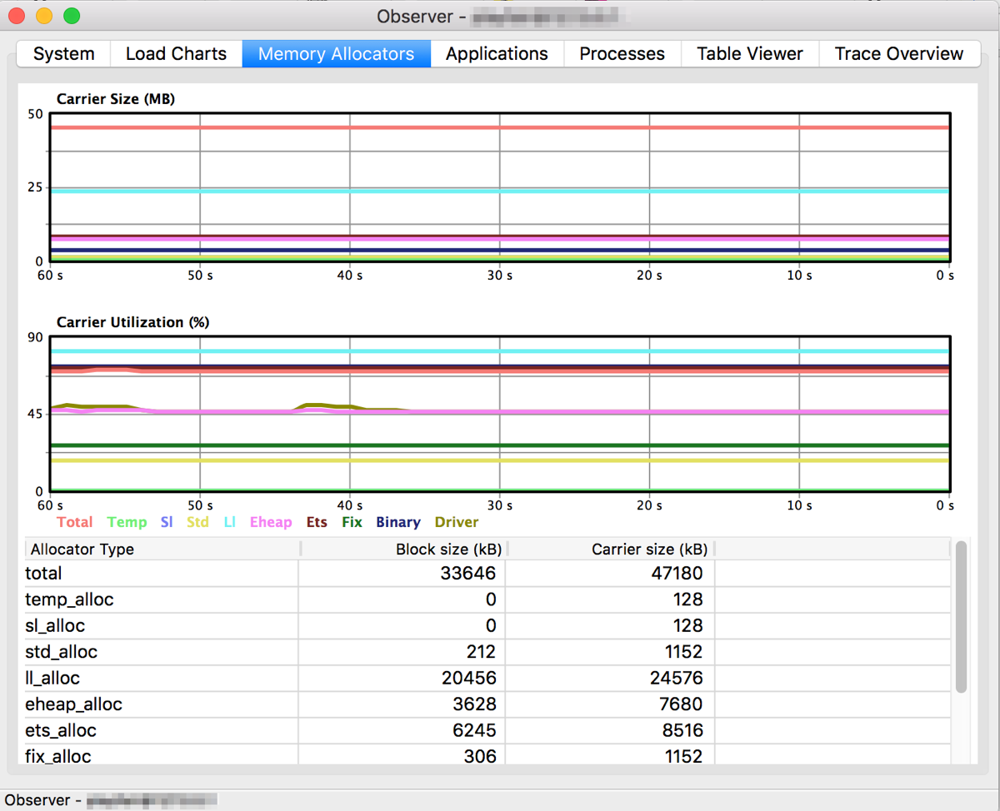

Today we will continue exploring techniques for debugging and tracing Elixir code that are so important for running and understanding production systems.

In the past, we have discussed:

1. [how to debug your application](http://blog.plataformatec.com.br/2016/04/debugging-techniques-in-elixir-lang/)
2. [how to trace systems with Erlyberly](http://blog.plataformatec.com.br/2016/04/how-to-trace-elixir-nodes-with-erlyberly/)
3. [how to use the observer to introspect applications](http://blog.plataformatec.com.br/2015/06/elixir-in-times-of-microservices/).

The examples above always connected to systems running locally. Given Elixir’s and the Erlang VM focus on distributed systems, you may have wondered: can we use the VM capabilities to trace and observe remote nodes?

Certainly!

Your application runs as part of the Erlang Runtime System, which is often called a node, as it may connect to other machines. Before we establish such connections, let’s get to know some concepts and then configure our applications.

## EPMD

**Erlang Port Mapper Daemon**, EPMD, acts as a name server on all hosts involved in distributed Erlang communications. When an Erlang node starts, the node has a name and it obtains an address from the host OS kernel. The default port the daemon runs on is 4369 but you can change it with the [`ERL_EPMD_PORT` environment variable](http://erlang.org/doc/man/epmd.html#environment_variables) .

You can run `epmd -names` to check the port and the nodes connected:

```
user@localhost:~$ epmd -names
epmd: up and running on port 4369 with data:
name myapp at port 43316
```

## SSH Port Forwarding

Depending on your firewall configuration, the port 4369 from EPMD is blocked by default. We will use port forwarding to redirect our local EPMD port to the remote EPMD with `ssh`: `ssh user@myapp.com -L4369:localhost:4369`.

Therefore, when we start a node locally, it will attempt to register itself to the EPMD running on port 4369, which is effectively forwarded to the remote EPMD. Once our local node registers itself to the remote EPMD, it will be able to find all remote nodes running on the remote EPMD.

## Configuring the Phoenix application

Imagine we want to trace or observe a Phoenix project. In our case, our project was released using [exrm](https://github.com/bitwalker/exrm) and our release path in production has a directory called `running-config`. In this directory we can find the files `sys.config` and `vm.args`.

The file `vm.args` is responsible for configuring our application when it starts. Let’s change it as follows:

```
## Name of the node
-name myapp@127.0.0.1
-kernel inet_dist_listen_min 9001 inet_dist_listen_max 9001

## Cookie for distributed erlang (you want a really long cookie)
-setcookie my_cookie
```

We added a name to your application, set a port range where remote nodes may connect to and chose a cookie secret. If your server was already running, you will need to restart it after changing `vm.args`.

After restarting our application, we should see it registered in the remote EPMD:

```
user@localhost:~$ epmd -names
epmd: up and running on port 4369 with data:
name myapp at port 9001
```

## Tracing application

After our application is started, we need to change our `ssh` command to forward to EPMD and our application ports: `ssh user@myapp.com -L4369:localhost:4369 -L9001:localhost:9001`.

Now let’s start the tracing tool locally with the proper cookie options. The tracing tool will register itself to the remote EPMD, via port forwarding, and find our remote application. Once the Erlyberly is started, you should see the following in the remote EPMD:

```
user@localhost:~$ epmd -names
epmd: up and running on port 4369 with data:
name myapp at port 9001
name erlyberly-1460466831146 at port 54420
```

## Observing application

We can also observe a remote system using ssh port forwarding. One option is to establish a remote shell, as explained in the [IEx documentation](http://elixir-lang.org/docs/stable/iex/IEx.html):

```
$ iex --name mylocalmachine@127.0.0.1 --cookie my_cookie --remsh myapp@127.0.0.1
```

Now you are connected directly to a remote node and you can introspect it as well as start tools like Observer.

Alternatively, you can start a new local shell with the same cookie as the remote node:

```
$ iex --name mylocalmachine@127.0.0.1 --cookie my_cookie
Erlang/OTP 18 [erts-7.3] [source] [64-bit] [smp:4:4] [async-threads:10] [hipe] [kernel-poll:false] [dtrace]

Interactive Elixir (1.2.4) - press Ctrl+C to exit (type h() ENTER for help)
iex(mylocalmachine@127.0.0.1)1> :observer.start()
:ok
```

The local shell should be registered in the remote EPMD alongside the remote system:

```
user@localhost:~$ epmd -names
epmd: up and running on port 4369 with data:
name mylocalmachine at port 50055
name myapp at port 9001
```

With Observer open, we can now change the inspected node using the menu ‘Nodes > Connect node’. In the prompt we can fill in the node name. In our example the node is `myapp@127.0.0.1`.



### Troubleshooting

You may receive an error similar to the one below when you try to connect through Observer:

```
16:38:44.278 [error] [node: :"mylocalmachine@127.0.0.1", call: {:observer_backend, :sys_info, []}, reason: {:badrpc, {:EXIT, {:undef, [{:observer_backend, :sys_info, [], []}, {:rpc, :"-handle_call_call/6-fun-0-", 5, [file: 'rpc.erl', line: 206]}]}}}]
```

This occurs because the `:observer_backend` is disabled. You can enable it by adding the `:runtime_tools` to your application `mix.exs` file. You can get more details in the [Runtime tools documentation](http://erlang.org/doc/man/runtime_tools_app.html).

Do you use other techniques to connect to remote nodes? Share your tips with a comment below.

---

[](http://pages.plataformatec.com.br/ebook-whats-new-in-ecto-2-0?utm_source=our-blog&utm_medium=referral&utm_campaign=ebook-ecto-2-0&utm_content=cta-blog-post-bottom)

[[anexo ausente]](http://www.facebook.com/sharer.php?u=http://blog.plataformatec.com.br/2016/05/tracing-and-observing-your-remote-node/)[[anexo ausente]](https://plus.google.com/share?url=http://blog.plataformatec.com.br/2016/05/tracing-and-observing-your-remote-node/)[[anexo ausente]](http://twitter.com/share?url=http://blog.plataformatec.com.br/2016/05/tracing-and-observing-your-remote-node/&text=Tracing+and+observing+your+remote+node+)[[anexo ausente]](http://www.linkedin.com/shareArticle?mini=true&url=http://blog.plataformatec.com.br/2016/05/tracing-and-observing-your-remote-node/)[[anexo ausente]](http://blog.plataformatec.com.br/2016/05/tracing-and-observing-your-remote-node/mailto:?subject=Tracing%20and%20observing%20your%20remote%20node&body=%20http://blog.plataformatec.com.br/2016/05/tracing-and-observing-your-remote-node/)
