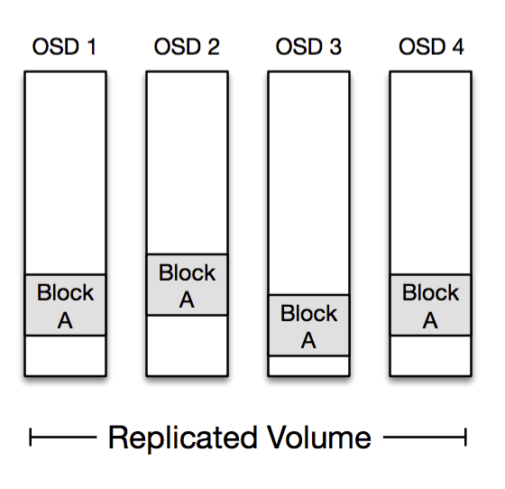

# Inside the Magic Pocket

James Cowling| Yesterday

|[1 comment](https://blogs.dropbox.com/tech/2016/05/inside-the-magic-pocket/#disqus_thread)

[**](https://blogs.dropbox.com/tech/2016/05/inside-the-magic-pocket/# "Tweet") [**](https://blogs.dropbox.com/tech/2016/05/inside-the-magic-pocket/# "Facebook") [**](https://blogs.dropbox.com/tech/2016/05/inside-the-magic-pocket/# "LinkedIn") [**](https://blogs.dropbox.com/tech/2016/05/inside-the-magic-pocket/# "Google+")

[](https://dropboxtechblog.files.wordpress.com/2016/05/overall.png)

We’ve received a lot of positive feedback since [announcing Magic Pocket](https://blogs.dropbox.com/tech/2016/03/magic-pocket-infrastructure/), our in-house multi-exabyte storage system. We’re going to follow that announcement with a series of technical blog posts that offer a look behind the scenes at interesting aspects of the system, including our protection mechanisms, operational tooling, and innovations on the boundary between hardware and software. But first, we’ll need some context: in this post, we’ll give a high level architectural overview of Magic Pocket and the criteria it was designed to meet.

As we explained in our [introductory post](https://blogs.dropbox.com/tech/2016/03/magic-pocket-infrastructure/), Dropbox stores two kinds of data: file content and metadata about files and users. Magic Pocket is the system we use to store the file content. These files are split up into blocks, replicated for durability, and distributed across our infrastructure in multiple geographic regions.

Magic Pocket is based on a rather simple set of core protocols, but it’s also a big, complicated system, so we’ll necessarily need to gloss over some details. Feel free to add feedback in the comments below; we’ll do our best to delve further in future posts.

*Note: Internally we just call the system “MP” so that we don’t have to feel silly saying the word “Magic” all the time. We’ll do that in this post as well.*

# Requirements

## Immutable block storage

Magic Pocket is an *immutable block storage system*. It stores encrypted chunks of files up to 4 megabytes in size, and once a block is written to the system it never changes. Immutability makes our lives *a lot* easier.

When a user makes changes to a file on Dropbox we record all of the alterations in a separate system called *FileJournal*. This enables us to have the simplicity of storing immutable blocks while moving the logic that supports mutability higher up in the stack. There are plenty of large-scale storage systems that provide native support for mutable blocks, but they’re typically based on immutable storage primitives once you get down to the lower layers. 

## Workload

Dropbox has a *lot* of data and a high degree of temporal locality. Much of that data is accessed very frequently within an hour of being uploaded and increasingly less frequently afterwards. This pattern makes sense: our users collaborate heavily within Dropbox, so a file is likely to be synced to other devices soon after upload. But we still need reliably fast access: you probably don’t look at your tax records from 1997 too often, but when you do, you want them immediately. We have a fairly “cold” storage system but with the requirement of low-latency reads for all blocks. 

To tackle this workload, we’ve built a system based on spinning media (a fancy way of saying “hard drives”), which has the advantage of being durable, cheap, storage-dense and fairly low latency—we save the solid-state drives (SSDs) for our databases and caches. We use a high degree of initial replication and caching for recent uploads, alongside a more efficient storage encoding for the rest of our data.

## Durability

Durability is non-negotiable in Magic Pocket. Our theoretical durability has to be effectively infinite, to the point where loss due to an apocalyptic asteroid impact is more likely than random disk failures—at that stage, we’ll probably have bigger problems to worry about. This data is erasure-coded for efficiency and stored across multiple geographic regions with a wide degree of replication to ensure protection against calamities and natural disasters.

## Scale

As an engineer, this is the fun part. Magic Pocket had to grow from our initial double-digit-petabyte prototypes to a multi-exabyte behemoth within the span of around 6 months—a fairly unprecedented transition. This required us to spend a lot of time thinking, designing, and prototyping to eliminate the bottlenecks we could foresee. This process also helped us to ensure that the architecture was sufficiently extensible, so we could change it as unforeseen requirements arose.

There were plenty of examples of unforeseen requirements along the way. In one case, traffic grew suddenly and we started saturating the routers between our network clusters. This required us to change our data placement algorithms and our request routing to better reflect cluster affinity (along with available storage capacity, cluster growth schedules, etc) and eventually to change our inter-cluster network architecture altogether.

## Simplicity

As engineers we know that complexity is usually antithetical to reliability. Many of us have spent enough time writing complex consensus protocols to know that spending all day reimplementing [Paxos](https://en.wikipedia.org/wiki/Paxos_(computer_science)) is usually a bad idea. MP eschews quorum-style consensus or distributed coordination as much as possible, and heavily leverages points of centralized coordination when performed in a fault-tolerant and scalable manner.  There were times when we could have opted for a distributed hash table or trie for our Block Index and instead just opted for a giant sharded MySQL cluster; this turned out to be a really great decision in terms of simplifying development and minimizing unknowns.

# Data Model

Before we get to the architecture itself, first let’s work out what we’re storing.

MP stores **blocks**, which are opaque chunks of files, up to 4MB in size:

[](https://dropboxtechblog.files.wordpress.com/2016/05/blocks.png)

These blocks are compressed and encrypted and then passed to MP for storage. Each block needs a key or name, which for most of our use-cases is a SHA-256 **hash** of the block.

4MB is a pretty small amount of data in a multi-exabyte storage system however and too small a unit of granularity to move around whenever we need to replace a disk or erasure code some data. To make this problem tractable, we aggregate these blocks into 1GB logical storage containers called **buckets**. The blocks within a given bucket don’t necessarily have anything in common; they’re just blocks that happened to be uploaded around the same time.

Buckets need to be replicated across multiple physical machines for reliability. Recently uploaded blocks get replicated directly onto multiple machines, and then eventually the buckets containingthe blocks are aggregated together and erasure coded for storage efficiency. We use the term **volume** to refer to one or more buckets replicated onto a set of physical storage nodes.

[](https://dropboxtechblog.files.wordpress.com/2016/05/buckets.png)

To summarize: A **block**, identified by its **hash**, gets written to a **bucket**. Each bucket is stored in a **volume** across multiple machines, in either replicated or erasure coded form.

# Architecture

So now that we know our requirements and data model, what does Magic Pocket actually look like? Well, something like this:[](https://dropboxtechblog.files.wordpress.com/2016/05/pocket.png)

That might not look like much, but it’s important. MP is a *multi-zone* architecture, with server clusters in western, central and eastern United States. Each block in MP is stored independently in at least two separate zones and then replicated reliably *within* these zones. This redundancy is great for avoiding natural disasters and large-scale outages but also allows us to establish very clear administrative domains and abstraction boundaries to avoid a misconfiguration or congestion collapse from cascading across zones.

*[We have some extensions in the works for for less-frequently accessed (“colder”) data that adopts a different multi-zone architecture than this.]*

Most of the magic happens inside a zone however, so let’s dive in:

[](https://dropboxtechblog.files.wordpress.com/2016/05/zone.png)We’ll go through these components one by one.

### **Frontends**

These nodes accept storage requests from outside the system, and are the gateway to Magic Pocket. They determine where a block should be stored and issue commands inside MP to read or write the block.

### **Block Index**

This is the service that maps each block to the bucket where it’s stored. You can think of this as a giant database with the following schema:

```
hash → cell, bucket, checksum
```

(Our real schema is a little more complicated than this to support things like deletes, cross-zone replication, etc.)

The Block Index is a giant sharded MySQL cluster, fronted by an RPC service layer, plus a lot of tooling for database operations and reliability. We’d originally planned on building a dedicated key-value store for this purpose but MySQL turned out to be more than capable. We already had thousands of database nodes in service across the Dropbox stack, so this allowed us to leverage the operational competency we’ve built up around managing MySQL at scale.

We might build a more sophisticated system eventually, but we’re happy with this for now. Key-value stores are fashionable and offer high performance, but databases are highly reliable and provide an expressive data model which has allowed us to easily expand our schema and functionality over time.

### **Cross-zone replication**

The cross-zone replication daemon is responsible for asynchronously replicating all block puts from one zone to the other. We write each block to a remote zone within one second of it being uploaded locally. We factor this replication delay into our durability models and ensure that the data is replicated sufficiently widely in the local zone.

### **Cells**

Cells are self-contained logical storage clusters that store around 50PB of raw data. Whenever we want to add more space to MP we typically bring up a new cell. While the cells are completely logically independent, we stripe each cell across our racks to ensure maximal physical diversity within a cell.

Let’s dive inside a cell to see how it works:[](https://dropboxtechblog.files.wordpress.com/2016/05/cell.png)

### **Object Storage Devices (OSDs)**

The most important characters in a cell are the OSDs, storage boxes full of disks that can store over a petabyte of data in a single machine, or over 8 PB per rack. There’s some very complex logic on these devices for managing caching, disk scheduling, and data validation, but from the perspective of the rest of the system these are “dumb” nodes: they store blocks but don’t understand the cell topology or participate in distributed protocols.

### **Replication Table**

The Replication Table is the index into the cell which maps each logical bucket of data to the volume and OSDs that bucket is stored on. Like the Block Index, the Replication Table is stored as a MySQL database but is much smaller and updated far less frequently. The working set for the Replication Table fits entirely in memory on these databases which gives us very high read throughput on a small number of physical machines.

The schema on the Replication Table looks something like this:

```
bucket → volume
volume → OSDs, open, type, generation
```

One important concept here is the open flag, which dictates whether the volume is “open” or “closed”. An open volume is open for writing new data but nothing else. A closed volume is immutable and may be safely moved around the cell. Only a small number of volumes are open at any point in time.

The type  specifies the type of volume: a replicated volume or encoded with one of our erasure coding schemes. The generation number is used to ensure consistency when moving volumes around to recover from a disk failure or to optimize storage layout.

### **Master**

The Master is best thought of as the janitor or coordinator for the cell. It contains most of the complex protocol logic in the system, and its main job is to watch the OSDs and trigger data repair operations whenever one fails. It also coordinates background operations like creating new storage buckets when they get full, triggering garbage collection when data is deleted, or merging buckets together when they become too small after garbage collection.

The Replication Table stores the authoritative volume state so that the Master itself is entirely soft-state. Note that the Master is not on the data plane: no live traffic flows through it, and the cell can continue to serve reads if the Master is down. The cell can even receive writes without the Master, although it will eventually run out of available storage buckets without the Master creating new ones as they fill up. There are always plenty of other cells to write to if the Master isn’t around to create these new buckets.

We run a single Master per cell, which provides us a centralized point of coordination for complex data-placement decisions without the significant complexity of a distributed protocol. This centralized model does impose a limit on the size of each cell: we can support around a hundred petabytes before the memory and CPU overhead becomes a bottleneck. Fortunately, having multiple cells also happens to be very convenient from a deployment perspective and provides greater isolation to avoid cascading failures.

### **Volume Managers**

The Volume Managers are the heavy lifters of the cell. They respond to requests from the Master to move volumes around, or to erasure code volumes. This typically means reading from a bunch of OSDs, writing to other OSDs, and then handing control back to the Master to complete the operation.

The Volume Manager processes run on the same physical hardware as the OSDs since this allows us to amortize their heavy network-capacity demands across idle storage hardware in the cell.

# Protocol

Phew! You’ve made it this far, and hopefully have a reasonable understanding of the high-level Magic Pocket architecture. We’ll wrap up with a very cursory overview of some core MP protocols, which we can expound upon in future posts. Fortunately these protocols are already quite simple.

## Put

The Frontends are armed with a few pieces of information in advance of receiving a Put request: they periodically contact each cell to determine how much available space it has, along with a list of *open volumes* that can receive new writes.

When a Put request arrives, the Frontend first checks if the block already exists (via the Block Index) and then chooses a target volume to store the block. The volume is chosen from the cells in such a way as to evenly distribute cell load and minimize network traffic between storage clusters. The Frontend then consults the Replication Table to determine the OSDs that are currently storing the volume.

The Frontend issues store commands to these OSDs, which all fsync the blocks to disk (or on-board SSD) before responding. If this was successful then the Frontend adds a new entry to the Block Index and can return successfully to the client. If any OSDs fail along the way then the Frontend just retries with another volume, potentially in another cell. If the Block Index fails then the Frontend forwards the request to the other zone. The Master periodically runs background tasks to clean up from any partial writes for failed operations.[](https://dropboxtechblog.files.wordpress.com/2016/05/put-protocol.png)

There are some subtle details behind the scenes, but it ultimately it’s rather simple. If we adopted a quorum-based protocol where the Frontend was only required to write to a subset of the OSDs in a volume then we would avoid some of these retries and potentially achieve lower tail latency but at the expense of greater complexity. Judicious management of timeouts in a retry-based scheme already results in low tail latencies and gives us performance that we’re very happy with.

## Get

Once we know the Put protocol, the process for serving a Get should be self-explanatory. The Frontend looks up the cell and bucket from the Block Index, then looks up the volume and OSDs from the Replication Table, and then fetches the block from one of the OSDs, retrying if one is unavailable.

As mentioned, we store both replicated data and erasure coded data in MP. Reading from a replicated volume is easy because each OSD in the volume stores all the blocks.[](https://dropboxtechblog.files.wordpress.com/2016/05/replicated.png)

Reading from an erasure coded volume can be a little more tricky. We encode in such a way that each block can be read in entirety from a single given OSD, so most reads only hit a single disk spindle; this is important in reducing load on our hardware. If that OSD is unavailable then the Frontend needs to reconstruct the block by reading encoded data from the other OSDs. It performs this reconstruction with the aid of the Volume Manager.[](https://dropboxtechblog.files.wordpress.com/2016/05/encoding.png)

In the encoding scheme above, the Frontend can read Block A from OSD 1, highlighted in green. If that read fails it can reconstruct Block A by reading from a sufficient number of blocks on the other OSDs, highlighted in red. Our actual encoding is a little more complicated than this and is optimized to allow reconstruction from a smaller subset of OSDs under most failure scenarios.

## Repair

The Master runs a number of different protocols to manage the volumes in a cell and to clean up after failed operations. But the most important operation the Master performs is Repair.

Repair is the operation used to re-replicate volumes whenever a disk fails. The Master continually monitors OSD health via our service discovery system and triggers a repair operation once an OSD has been offline for 15 minutes — long enough to restart a node without triggering unnecessary repairs, but short enough to provide rapid recovery and minimize any window of vulnerability.

Volumes are spread somewhat-randomly throughout a cell, and each OSD holds several thousand volumes. This means that if we lose a single OSD we can reconstruct the full set of volumes from hundreds of other OSDs simultaneously:[](https://dropboxtechblog.files.wordpress.com/2016/05/placement.png)

In the diagram above we’ve lost OSD 3, but can recover volumes A, B and C from OSDs 1, 2, 4 and 5. In practice there are thousands of volumes per OSD, and hundreds of other OSDs they share this data with. This allows us to amortize the reconstruction traffic across hundreds of network cards and thousands of disk spindles to minimize recovery time.

The first thing the Master does when an OSD fails is to close all the volumes that were on that OSD and instruct the other OSDs to reflect this change locally. Now that the volumes are closed, we know that they won’t accept any future writes and are thus safe to move around.

The Master then builds a *reconstruction plan*, where it chooses a set of OSDs to copy from and a set of OSDs to replicate to, in such a way as to evenly spread load across as many OSDs as possible. This step allows us to avoid traffic spikes on particular disks or machines. The reconstruction plan allows us to provision far fewer hardware resources per OSD, and would be difficult to produce without having the Master as a central point of coordination.

We’ll gloss over the data transfer process, but it involves the volume managers copying data from the sources to the destinations, erasure coding where necessary, and then handing control back to the Master.

The final step is fairly simple, but critical: At this point the volume exists on both the source and destination OSDs, but the move hasn’t been committed yet. If the Master fails at this point, the volume will just stay in the old location and get repaired again by the new Master. To commit the repair operation, the Master first increments the *generation number* on the volumes on the new OSDs, and then updates the Replication Table to store the new volume-to-OSD mapping with the new generation (the commit point). Now that we’ve incremented the generation number we know that there’ll be no confusion about which OSDs hold the volume, even if the failed OSD comes back to life.

This protocol ensures that any node can fail at any time without leaving the system in an inconsistent state. We’ve seen all sorts of crazy stuff in production. In one instance, a database frontend froze for a full hour before springing back to life and forwarding a request to the Replication Table, during which time the Master had also failed and restarted, issuing an entirely different set of repair operations. Our consistency protocols need to be completely solid in the face of arbitrary failures like these. The Master also runs a number of other background processes such as Reconcile, which validates OSD state and rolls back failed repairs or incomplete operations.

The open/closed volume model is key for ensuring that live traffic doesn’t interfere with background operations, and allows us to use far simpler consistency protocols than if we didn’t enforce this dichotomy.

# Wrap-up

Thanks for making it this far! Hopefully this post gives some context for how Magic Pocket works and for some of our motivations.

The primary design principle here is **keep it simple!** Designing a distributed storage system is a big challenge, but it’s *much* harder to build one that operates reliably at scale, and supports all of the monitoring and verifications systems and tooling that will ensure it’s running correctly. It’s also incredibly important to make technical decisions that are the right solution to the right problem, not just because they’re cool and novel. Most of MP was built by a team of less than half a dozen people, which required us to focus on the things that mattered, and played a big part in the success of the project.

There are obviously a lot of details that we’ve left out. (Just in case you’re about to respond, *“Wait! this doesn’t work when X, Y and Z happens!”—*we’ve thought about that, I promise.) Stay tuned for future blog posts where we’ll go into more detail on specific aspects about building and operating a system at this scale.

Filed under: [Infrastructure](https://blogs.dropbox.com/tech/category/infrastructure/)|Tags: [Magic Pocket](https://blogs.dropbox.com/tech/tag/magic-pocket/)

[** Twitter](https://blogs.dropbox.com/tech/2016/05/inside-the-magic-pocket/# "Tweet") [** Facebook](https://blogs.dropbox.com/tech/2016/05/inside-the-magic-pocket/# "Facebook") [** LinkedIn](https://blogs.dropbox.com/tech/2016/05/inside-the-magic-pocket/# "LinkedIn") [**](https://blogs.dropbox.com/tech/2016/05/inside-the-magic-pocket/# "Google+")[1 comment](https://blogs.dropbox.com/tech/2016/05/inside-the-magic-pocket/#disqus_thread)
